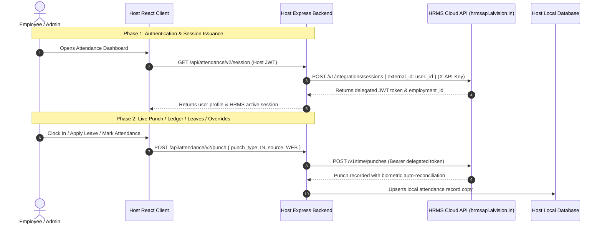

# Attendance V2 & HRMS Complete Integration Master Specification
> **The All-In-One, Single-File Integration Blueprint & Complete Source Bundle**  
> Everything required to port, embed, and run the complete Attendance V2 feature suite (Backend, Frontend, CSS, API Client, and Schemas) into ANY web, mobile, or enterprise application.

---

## Table of Contents
1. [Architecture & System Topology](#1-architecture--system-topology)
2. [Prerequisites & Environment Configuration](#2-prerequisites--environment-configuration)
3. [Quick-Start Deployment Checklist](#3-quick-start-deployment-checklist)
4. [Complete REST API Contract (All 18 Endpoints)](#4-complete-rest-api-contract)
5. [Database Schemas (MongoDB & SQL)](#5-database-schemas)
6. [Complete Backend Source Code (Express.js Standalone Router)](#6-complete-backend-source-code)
7. [Complete Frontend API Client Source Code](#7-complete-frontend-api-client)
8. [Complete Modern Executive Design System (CSS)](#8-complete-modern-executive-design-system)
9. [Complete Frontend Component Source Code](#9-complete-frontend-component-source-code)
   - 9.1 [Package Export (index.js)](#91-package-export-indexjs)
   - 9.2 [AttendanceV2Dashboard.jsx](#92-attendancev2dashboardjsx)
   - 9.3 [AttendanceV2Clock.jsx](#93-attendancev2clockjsx)
   - 9.4 [AttendanceV2Ledger.jsx](#94-attendancev2ledgerjsx)
   - 9.5 [AttendanceV2Leaves.jsx](#95-attendancev2leavesjsx)
   - 9.6 [AttendanceV2Corrections.jsx](#96-attendancev2correctionsjsx)
   - 9.7 [AttendanceV2Approvals.jsx](#97-attendancev2approvalsjsx)
   - 9.8 [AttendanceV2Employees.jsx](#98-attendancev2employeesjsx)
   - 9.9 [AttendanceV2IntegrationAdmin.jsx](#99-attendancev2integrationadminjsx)
10. [Verification & Production Testing Commands](#10-verification--production-testing-commands)

---

## 1. Architecture & System Topology

The Attendance V2 suite integrates seamlessly into any host application via a **Delegated Token Architecture**.



### 1.1 Auto-Sync & Employee Onboarding Architecture

When new employees are hired or existing staff are updated in your application, Attendance V2 provides **triple-layer automatic synchronization** with the HRMS platform:

1. **Active Push Onboarding (`POST /api/attendance/v2/onboard`)**:
   - When an HR manager completes an onboarding form (such as in your Employee Onboarding module or user registration), your server invokes `upsertEmployee` (or calls `POST /api/attendance/v2/onboard`).
   - HRMS immediately provisions an employment profile, generates their official employee code, binds their `external_id`, and assigns default leave quotas.
   
2. **Lazy Zero-Config Auto-Link (Self-Healing)**:
   - If an employee was added directly into your database without triggering an active push, Attendance V2 automatically detects and links them the moment they access the dashboard or clock in.
   - The built-in `linkUserToHrms()` engine reconciles local users against HRMS by:
     - Matching `employee_code` (e.g. `EMP-042`)
     - Matching `username` against HRMS code
     - Matching primary corporate or personal `email`
     - Matching sanitized `full_name`
   - Once matched, the user's local `external_id` is linked to HRMS and their session is minted with zero admin intervention.

3. **1-Click Admin Roster Synchronization**:
   - In the **Employees** workspace tab, administrators can see real-time linkage status for every staff member:
     - <span style="color:#059669;font-weight:600;">● HRMS Synced</span> (Green badge) — Fully linked with live biometric/leave tracking.
     - <span style="color:#d97706;font-weight:600;">● Unsynced</span> (Amber badge) — Displays a **"Sync to HRMS"** button that executes a 1-click binding request (`POST /api/attendance/v2/sync-user/:userId`).

---

## 2. Prerequisites & Environment Configuration

### Dependencies
In your host application root:
```bash
# Backend (Node.js / Express)
npm install express dotenv

# Frontend (React)
npm install react react-dom react-router-dom react-icons react-hot-toast axios
```

### Environment Variables (.env)
Add these variables to your host backend `.env` file:
```env
# HRMS Cloud Integration Credentials
HRMS_BASE_URL=http://hrmsapi.alvision.in
HRMS_API_KEY=hrms_test_i50hhHYx_KuXYvGMeJOk76AzvIapcmWKg5wvNIyKxDFaax1fQ
```

---

## 3. Quick-Start Deployment Checklist

### Step 1: Copy Backend Router
Save the code from [Section 6](#6-complete-backend-source-code) as `server/integrations/attendanceV2Integration.mjs` and mount it in your `server.js` / `app.js`:
```javascript
import express from 'express';
import { createAttendanceV2Router } from './integrations/attendanceV2Integration.mjs';
import { authenticateUser } from './middleware/auth.js'; // Your host app JWT auth middleware

const app = express();
app.use(express.json());

app.use('/api/attendance/v2', createAttendanceV2Router({
  hrmsBaseUrl: process.env.HRMS_BASE_URL,
  hrmsApiKey: process.env.HRMS_API_KEY,
  authMiddleware: authenticateUser,
  isAdmin: (user) => user.role === 'Admin' || user.role === 'HR' || user.isHod === true,
}));
```

### Step 2: Copy Frontend Files
1. Copy [Section 7](#7-complete-frontend-api-client) into `client/src/api/attendance/attendanceV2.api.js`.
2. Copy [Section 8](#8-complete-modern-executive-design-system) into `client/src/components/attendance-v2/AttendanceV2.css`.
3. Copy the React components in [Section 9](#9-complete-frontend-component-source-code) into `client/src/components/attendance-v2/`.

### Step 3: Mount in React Router
```jsx
import React from 'react';
import { Routes, Route, useNavigate } from 'react-router-dom';
import AttendanceV2Dashboard from './components/attendance-v2';

function App() {
  const navigate = useNavigate();
  const currentUser = { id: '123', username: 'john_doe', role: 'Admin' };

  return (
    <Routes>
      <Route
        path="/attendance/*"
        element={<AttendanceV2Dashboard currentUser={currentUser} onBack={() => navigate('/')} />}
      />
    </Routes>
  );
}
```

---

## 4. Complete REST API Contract

All endpoints below are relative to `/api/attendance/v2`:

| Method | Endpoint | Description | Request Body / Query | Success Response |
| :--- | :--- | :--- | :--- | :--- |
| `GET` | `/session` | Profile & HRMS delegation status | None | `{ user: {...}, hrms: { employment_id, roles } }` |
| `GET` | `/today` | Live punch status & chronograph elapsed work time | `?work_date=YYYY-MM-DD` | `{ is_punched_in, effective_minutes, punches: [...] }` |
| `POST` | `/punch` | Clock In / Out / Break Start / Break End | `{ punch_type: "IN", source: "WEB", latitude, longitude }` | `{ success: true, punch: {...} }` |
| `GET` | `/days` | Monthly attendance ledger records | `?from_date=YYYY-MM-01&to_date=YYYY-MM-31` | `[ { work_date, status, first_punch_in, last_punch_out, effective_minutes, late_by_minutes, ot_minutes } ]` |
| `GET` | `/leave/types` | List configured annual leave policies | None | `[ { id, name, code, is_paid } ]` |
| `GET` | `/leave/balances` | Real-time available leave buckets | `?year=YYYY` | `[ { id, name, available_days, balance, accrued } ]` |
| `GET` | `/leave/applications` | Past leave applications | `?status=PENDING` | `[ { id, from_date, to_date, status, reason } ]` |
| `POST` | `/leave/apply` | Submit new leave application | `{ leave_type_id, from_date, to_date, half_day_option, reason }` | `{ id, status: "PENDING_APPROVAL" }` |
| `DELETE` | `/leave/applications/:id` | Cancel active or pending leave | `{ cancel_reason: "..." }` | `{ success: true, message: "Cancelled" }` |
| `GET` | `/corrections` | Attendance regularization requests | `?status=PENDING` | `[ { id, work_date, correction_type, status, reason } ]` |
| `POST` | `/corrections/request` | Submit attendance regularization | `{ work_date, correction_type, requested_punch_in, requested_punch_out, reason }` | `{ id, status: "PENDING" }` |
| `DELETE` | `/corrections/:id` | Cancel correction request | None | `{ success: true }` |
| `GET` | `/approvals/inbox` | Manager / HR approval inbox | None | `{ items: [ { instance_id, request_type, requester_name, details } ], count }` |
| `POST` | `/approvals/action` | Make decision on approval item | `{ instance_id, action: "APPROVE" \| "REJECT", comments }` | `{ success: true, decision: "APPROVE" }` |
| `GET` | `/employees` | Workforce roster (merged with HRMS) | `?refresh=true` | `{ employees: [ { userId, employmentId, isHrmsLinked, name, employeeCode, department, designation } ] }` |
| `POST` | `/admin/mark-attendance` | Direct 1-Click Present/Absent/Half-Day override | `{ user_id, work_date, status: "PRESENT", punch_in, punch_out, reason }` | `{ success: true, message: "Marked PRESENT" }` |
| `POST` | `/sync-user/:userId` | Force 1-Click re-link with HRMS | None | `{ success: true, employment: {...} }` |
| `POST` | `/onboard` | Auto-Sync Onboard employee to HRMS | `{ user: { first_name, last_name, email, employee_code, ... } }` | `{ success: true, externalId, hrmsResult }` |
| `GET` | `/health` | Live connectivity test | None | `{ status: "UP", totalEmployees: 48 }` |

---

## 5. Database Schemas

### MongoDB Mongoose Schema (`AttendanceRecord.js`)
```javascript
import mongoose from 'mongoose';

const AttendanceRecordSchema = new mongoose.Schema({
  user_id: { type: mongoose.Schema.Types.ObjectId, ref: 'User', required: true, index: true },
  work_date: { type: String, required: true, index: true }, // Format: YYYY-MM-DD
  status: {
    type: String,
    enum: ['PRESENT', 'ABSENT', 'HALF_DAY', 'ON_LEAVE', 'MISSED_PUNCH', 'WEEKEND', 'HOLIDAY'],
    default: 'ABSENT',
  },
  first_punch_in: { type: String, default: null },
  last_punch_out: { type: String, default: null },
  effective_minutes: { type: Number, default: 0 },
  late_by_minutes: { type: Number, default: 0 },
  ot_minutes: { type: Number, default: 0 },
  source: { type: String, default: 'WEB' },
  marked_by: { type: String, default: null },
  punches: [{
    punch_type: { type: String, enum: ['IN', 'OUT', 'BREAK_START', 'BREAK_END'] },
    punched_at: { type: Date, default: Date.now },
    latitude: Number,
    longitude: Number,
  }],
}, { timestamps: true });

AttendanceRecordSchema.index({ user_id: 1, work_date: 1 }, { unique: true });
export default mongoose.model('AttendanceRecord', AttendanceRecordSchema);
```

### PostgreSQL / MySQL DDL
```sql
CREATE TABLE attendance_records (
    id SERIAL PRIMARY KEY,
    user_id VARCHAR(64) NOT NULL,
    work_date DATE NOT NULL,
    status VARCHAR(32) NOT NULL DEFAULT 'ABSENT',
    first_punch_in VARCHAR(16),
    last_punch_out VARCHAR(16),
    effective_minutes INT DEFAULT 0,
    late_by_minutes INT DEFAULT 0,
    ot_minutes INT DEFAULT 0,
    marked_by VARCHAR(64),
    source VARCHAR(32) DEFAULT 'WEB',
    created_at TIMESTAMP WITH TIME ZONE DEFAULT CURRENT_TIMESTAMP,
    updated_at TIMESTAMP WITH TIME ZONE DEFAULT CURRENT_TIMESTAMP,
    CONSTRAINT uq_user_work_date UNIQUE (user_id, work_date)
);

CREATE INDEX idx_att_user_date ON attendance_records (user_id, work_date);
```

---

## 6. Complete Backend Source Code

Save as **`server/integrations/attendanceV2Integration.mjs`**:

```javascript
/**
 * ==============================================================================
 * ATTENDANCE V2 & HRMS STANDALONE INTEGRATION MODULE
 * ==============================================================================
 * 
 * A self-contained, enterprise-grade drop-in integration file for Express.js
 * that provides full Attendance, Biometric & Web Punch, Leave Management,
 * Regularization, Approvals, Staff Directory, and Admin Overrides powered by HRMS.
 * 
 * Features Included:
 * 1. Built-in HRMS Client with automatic session issuance & cache
 * 2. Self-healing auto-linking for employees by code, username, or email
 * 3. Live Web Punch terminal with GPS geolocation support
 * 4. Monthly Attendance Ledger with calendar & overtime breakdown
 * 5. Leave Quota Balances & Leave Application workflows
 * 6. Attendance Correction & Regularization requests
 * 7. Manager & HR Approvals Inbox (decision workflow)
 * 8. Workforce Directory merging local application users with HRMS profiles
 * 9. Direct 1-Click Admin Attendance overrides (Present, Absent, Half Day)
 * 10. Offline resilience handling with standard HTTP 503 codes
 * 
 * QUICK START:
 * ```javascript
 * import express from 'express';
 * import { createAttendanceV2Router } from './attendanceV2Integration.mjs';
 * 
 * const app = express();
 * app.use(express.json());
 * 
 * // Mount the entire Attendance V2 feature suite with 1 line:
 * app.use('/api/attendance/v2', createAttendanceV2Router({
 *   hrmsBaseUrl: process.env.HRMS_BASE_URL || 'http://hrmsapi.alvision.in',
 *   hrmsApiKey: process.env.HRMS_API_KEY || 'your_hrms_integration_key',
 * }));
 * ```
 */

import express from 'express';

// ─── 1. STANDALONE HRMS INTEGRATION CLIENT ────────────────────────────────────

export class StandaloneHrmsClient {
  constructor(config = {}) {
    this.baseUrl = (config.hrmsBaseUrl || process.env.HRMS_BASE_URL || 'http://hrmsapi.alvision.in').replace(/\/$/, '');
    this.apiKey = config.hrmsApiKey || process.env.HRMS_API_KEY || 'hrms_test_i50hhHYx_KuXYvGMeJOk76AzvIapcmWKg5wvNIyKxDFaax1fQ';
    
    // In-memory cache for issued employee session tokens
    this.sessionCache = new Map();

    // Cache of integration employees list
    this.employeesCache = null;
    this.employeesCachedAt = 0;
    this.CACHE_TTL = 10 * 60 * 1000; // 10 minutes
  }

  /**
   * Helper for integration endpoints using X-API-Key header.
   */
  async integrationRequest(path, options = {}) {
    const headers = {
      'Accept': 'application/json',
      'X-API-Key': this.apiKey,
      ...(options.headers || {}),
    };

    if (options.body && typeof options.body === 'object' && !(options.body instanceof FormData)) {
      headers['Content-Type'] = 'application/json';
      options.body = JSON.stringify(options.body);
    }

    const url = `${this.baseUrl}${path}`;
    const timeoutMs = options.timeoutMs || 15000;
    const signal = options.signal || AbortSignal.timeout(timeoutMs);

    let res;
    try {
      res = await fetch(url, { ...options, headers, signal });
    } catch (fetchErr) {
      const err = new Error(fetchErr.name === 'TimeoutError' || fetchErr.name === 'AbortError'
        ? `HRMS request timed out after ${timeoutMs / 1000}s`
        : `HRMS connection failed: ${fetchErr.message}`);
      err.code = fetchErr.code || (fetchErr.name === 'TimeoutError' ? 'ETIMEDOUT' : 'HRMS_NETWORK_ERROR');
      err.status = 503;
      throw err;
    }

    if (!res.ok) {
      const errorJson = await res.json().catch(() => null);
      const detail = errorJson?.detail || errorJson?.error?.message || errorJson?.message || `HRMS integration error ${res.status}`;
      const err = new Error(detail);
      err.status = res.status;
      err.code = errorJson?.code;
      err.details = errorJson?.error?.details || [];
      throw err;
    }

    if (res.status === 204) return null;
    return await res.json();
  }

  /**
   * Helper for standard HRMS endpoints using Bearer token.
   */
  async bearerRequest(path, token, options = {}) {
    const headers = {
      'Accept': 'application/json',
      'Authorization': `Bearer ${token}`,
      ...(options.headers || {}),
    };

    if (options.body && typeof options.body === 'object' && !(options.body instanceof FormData)) {
      headers['Content-Type'] = 'application/json';
      options.body = JSON.stringify(options.body);
    }

    const url = `${this.baseUrl}${path}`;
    const timeoutMs = options.timeoutMs || 15000;
    const signal = options.signal || AbortSignal.timeout(timeoutMs);

    let res;
    try {
      res = await fetch(url, { ...options, headers, signal });
    } catch (fetchErr) {
      const err = new Error(fetchErr.name === 'TimeoutError' || fetchErr.name === 'AbortError'
        ? `HRMS request timed out after ${timeoutMs / 1000}s`
        : `HRMS connection failed: ${fetchErr.message}`);
      err.code = fetchErr.code || (fetchErr.name === 'TimeoutError' ? 'ETIMEDOUT' : 'HRMS_NETWORK_ERROR');
      err.status = 503;
      throw err;
    }

    if (!res.ok) {
      if (res.status === 401 && options.userId) {
        this.sessionCache.delete(String(options.userId));
      }
      const errorJson = await res.json().catch(() => null);
      const detail = errorJson?.detail || errorJson?.error?.message || errorJson?.message || `HRMS error ${res.status}`;
      const err = new Error(detail);
      err.status = res.status;
      err.code = errorJson?.code;
      err.details = errorJson?.error?.details || [];
      throw err;
    }

    if (res.status === 204) return null;
    return await res.json();
  }

  /**
   * Fetch all employees from the integration feed with pagination.
   */
  async getIntegrationEmployees(forceRefresh = false) {
    const now = Date.now();
    if (!forceRefresh && this.employeesCache && this.employeesCachedAt > now - this.CACHE_TTL) {
      return this.employeesCache;
    }

    let allEmployees = [];
    let offset = 0;
    const limit = 200;
    let pageCount = 0;
    const MAX_PAGES = 50;

    while (true) {
      const res = await this.integrationRequest(`/v1/integrations/employees?limit=${limit}&offset=${offset}`);
      const emps = res?.employees || [];
      allEmployees.push(...emps);
      pageCount++;
      if (emps.length < limit || !res?.has_more || pageCount >= MAX_PAGES) break;
      offset += limit;
    }

    this.employeesCache = allEmployees;
    this.employeesCachedAt = now;
    return allEmployees;
  }

  /**
   * Helper: Formats a local application user object into the standard HRMS integration payload.
   */
  formatUserForHrms(user = {}) {
    const rawHireDate = user.date_of_joining || user.joining_date || user.hire_date;
    let hireDateStr = '2024-01-01';
    if (rawHireDate) {
      const d = new Date(rawHireDate);
      if (!isNaN(d.getTime())) hireDateStr = d.toISOString().split('T')[0];
    }
    const isManager = ['ADMIN', 'MANAGER', 'HOD', 'HEAD_OF_DEPARTMENT'].includes(String(user.role || '').toUpperCase());

    return {
      employee_code: (user.employee_code || user.employeeCode || user.username || '').trim(),
      first_name: (user.first_name || user.firstName || user.name || 'Employee').trim(),
      last_name: (user.last_name || user.lastName || '').trim() || '.',
      email: (user.email || '').trim() || null,
      mobile: (user.mobile || user.phone || '').trim() || null,
      company: user.company || 'Suraj Forwarders Private Limited',
      department: user.department || 'Operations',
      designation: user.designation || 'Executive',
      location: user.branch || user.location || 'Head Office',
      role: isManager ? 'MANAGER' : 'EMPLOYEE',
      hire_date: hireDateStr,
      source_updated_at: new Date().toISOString(),
    };
  }

  /**
   * Auto-Sync Onboarding: Upserts a new or existing employee directly into HRMS.
   */
  async upsertEmployee(externalId, employeeData, options = {}) {
    const query = options.dryRun ? '?dry_run=true' : '';
    const headers = {};
    if (options.idempotencyKey) {
      headers['Idempotency-Key'] = options.idempotencyKey;
    }
    const res = await this.integrationRequest(`/v1/integrations/employees/${encodeURIComponent(externalId)}${query}`, {
      method: 'PUT',
      headers,
      body: employeeData,
    });
    // Invalidate employee feed cache so new hire appears immediately
    this.employeesCache = null;
    this.employeesCachedAt = 0;
    this.sessionCache.delete(String(externalId));
    return res;
  }

  /**
   * Self-healing: Links a local application user to an HRMS employment record.
   */
  async linkUserToHrms(user) {
    const externalId = String(user._id || user.id);
    const emps = await this.getIntegrationEmployees(true);

    const norm = (val) => String(val || '').trim().toLowerCase();
    const cleanAlphaNum = (val) => String(val || '').toLowerCase().replace(/[^a-z0-9]/g, '');

    const targetUsername = norm(user.username);
    const targetCleanUsername = cleanAlphaNum(user.username);
    const targetCode = norm(user.employee_code || user.employeeCode);
    const targetCleanCode = cleanAlphaNum(user.employee_code || user.employeeCode);
    const targetEmail = norm(user.email);
    const targetFullName = norm(`${user.first_name || ''} ${user.last_name || ''}`).trim();

    const match = emps.find((e) => {
      const code = norm(e.employee_code);
      const cleanCode = cleanAlphaNum(e.employee_code);
      const email = norm(e.email);
      const empFullName = norm(`${e.first_name || e.legal_first_name || ''} ${e.last_name || e.legal_last_name || ''}`).trim();

      if (targetCode && (code === targetCode || cleanCode === targetCleanCode)) return true;
      if (targetUsername && (code === targetUsername || cleanCode === targetCleanUsername)) return true;
      if (targetEmail && email === targetEmail) return true;
      if (targetFullName && empFullName && targetFullName === empFullName && targetFullName.length > 5) return true;

      return false;
    });

    if (match && match.employment_id) {
      try {
        await this.integrationRequest(`/v1/integrations/employees/${encodeURIComponent(externalId)}`, {
          method: 'PUT',
          body: { employment_id: match.employment_id },
        });
      } catch (e) {
        console.warn(`[HRMS Integration] Linking external_id PUT notice:`, e.message);
      }

      this.sessionCache.delete(externalId);
      return match;
    }

    return null;
  }

  /**
   * Obtains a delegated session token for an employee.
   */
  async getEmployeeSession(user) {
    if (!user || (!user._id && !user.id)) {
      throw new Error('User context is required to issue HRMS session');
    }

    const externalId = String(user._id || user.id);
    const now = Date.now();
    const cached = this.sessionCache.get(externalId);

    if (cached && cached.expiresAt > now + 60 * 1000) {
      return cached;
    }

    try {
      const data = await this.integrationRequest('/v1/integrations/sessions', {
        method: 'POST',
        body: { external_id: externalId },
      });

      const sessionObj = {
        access_token: data.access_token,
        employment_id: data.employment_id,
        roles: data.roles || ['EMPLOYEE'],
        expiresAt: now + (data.expires_in || 3600) * 1000,
      };

      this.sessionCache.set(externalId, sessionObj);
      return sessionObj;
    } catch (err) {
      if (err.status === 403 || err.code === 'SESSION_REFUSED') {
        const linked = await this.linkUserToHrms(user);
        if (linked) {
          const data = await this.integrationRequest('/v1/integrations/sessions', {
            method: 'POST',
            body: { external_id: externalId },
          });

          const sessionObj = {
            access_token: data.access_token,
            employment_id: data.employment_id,
            roles: data.roles || ['EMPLOYEE'],
            expiresAt: now + (data.expires_in || 3600) * 1000,
          };

          this.sessionCache.set(externalId, sessionObj);
          return sessionObj;
        }
      }

      throw err;
    }
  }

  // ─── Self-Service Endpoints ───────────────────────────────────────────────

  async getTodayStatus(user, workDate = null) {
    const session = await this.getEmployeeSession(user);
    const query = workDate ? `?work_date=${encodeURIComponent(workDate)}` : '';
    return await this.bearerRequest(`/v1/time/today${query}`, session.access_token, { userId: user._id || user.id });
  }

  async recordPunch({ user, punchType, source = 'WEB', latitude = null, longitude = null, confirmLongDay = false }) {
    const session = await this.getEmployeeSession(user);
    const body = {
      punch_type: punchType,
      source: source || 'WEB',
      latitude: latitude ? Number(latitude) : null,
      longitude: longitude ? Number(longitude) : null,
      confirm_long_day: Boolean(confirmLongDay),
    };
    return await this.bearerRequest('/v1/time/punches', session.access_token, {
      method: 'POST',
      body,
      userId: user._id || user.id,
    });
  }

  async getAttendanceDays({ user, fromDate, toDate }) {
    const session = await this.getEmployeeSession(user);
    const params = new URLSearchParams({ from_date: fromDate, to_date: toDate });
    return await this.bearerRequest(`/v1/time/attendance-days?${params.toString()}`, session.access_token, { userId: user._id || user.id });
  }

  async getLeaveBalances(user, year = null) {
    const session = await this.getEmployeeSession(user);
    const query = year ? `?year=${encodeURIComponent(year)}` : '';
    return await this.bearerRequest(`/v1/leave/balances${query}`, session.access_token, { userId: user._id || user.id });
  }

  async getLeaveTypes(user) {
    const session = await this.getEmployeeSession(user);
    return await this.bearerRequest('/v1/leave/types', session.access_token, { userId: user._id || user.id });
  }

  async getLeaveApplications(user, status = null) {
    const session = await this.getEmployeeSession(user);
    const query = status ? `?status=${encodeURIComponent(status)}` : '';
    return await this.bearerRequest(`/v1/leave/applications${query}`, session.access_token, { userId: user._id || user.id });
  }

  async applyLeave({ user, leaveTypeId, fromDate, toDate, halfDayOption = 'NONE', reason = '' }) {
    const session = await this.getEmployeeSession(user);
    const draft = await this.bearerRequest('/v1/leave/applications', session.access_token, {
      method: 'POST',
      body: {
        leave_type_id: leaveTypeId,
        from_date: fromDate,
        to_date: toDate,
        half_day_option: halfDayOption || 'NONE',
        reason: reason || null,
      },
      userId: user._id || user.id,
    });

    if (draft && draft.id) {
      return await this.bearerRequest(`/v1/leave/applications/${encodeURIComponent(draft.id)}/submit`, session.access_token, {
        method: 'POST',
        userId: user._id || user.id,
      });
    }

    return draft;
  }

  async cancelLeave({ user, applicationId, cancelReason = 'Cancelled by employee' }) {
    const session = await this.getEmployeeSession(user);
    return await this.bearerRequest(`/v1/leave/applications/${encodeURIComponent(applicationId)}/cancel`, session.access_token, {
      method: 'POST',
      body: { cancel_reason: cancelReason || null },
      userId: user._id || user.id,
    });
  }

  async getCorrections(user, status = null) {
    const session = await this.getEmployeeSession(user);
    const query = status ? `?status=${encodeURIComponent(status)}` : '';
    return await this.bearerRequest(`/v1/corrections${query}`, session.access_token, { userId: user._id || user.id });
  }

  async requestCorrection({ user, workDate, correctionType, requestedPunchIn = null, requestedPunchOut = null, reason }) {
    const session = await this.getEmployeeSession(user);
    return await this.bearerRequest('/v1/corrections', session.access_token, {
      method: 'POST',
      body: {
        work_date: workDate,
        correction_type: correctionType,
        requested_punch_in: requestedPunchIn || null,
        requested_punch_out: requestedPunchOut || null,
        reason: reason || 'Attendance correction',
      },
      userId: user._id || user.id,
    });
  }

  async cancelCorrection({ user, correctionId }) {
    const session = await this.getEmployeeSession(user);
    return await this.bearerRequest(`/v1/corrections/${encodeURIComponent(correctionId)}/cancel`, session.access_token, {
      method: 'POST',
      userId: user._id || user.id,
    });
  }

  async approveCorrection({ user, correctionId, comments = 'Approved by administrator' }) {
    const session = await this.getEmployeeSession(user);
    return await this.bearerRequest(`/v1/corrections/${encodeURIComponent(correctionId)}/approve`, session.access_token, {
      method: 'POST',
      body: { action: 'APPROVE', comments: comments || null },
      userId: user._id || user.id,
    });
  }

  async getApprovalsInbox(user) {
    const session = await this.getEmployeeSession(user);
    return await this.bearerRequest('/v1/approvals/inbox', session.access_token, { userId: user._id || user.id });
  }

  async makeApprovalDecision({ user, instanceId, action, comments = '' }) {
    const session = await this.getEmployeeSession(user);
    return await this.bearerRequest(`/v1/approvals/requests/${encodeURIComponent(instanceId)}/decision`, session.access_token, {
      method: 'POST',
      body: {
        action: action === 'REJECT' ? 'REJECT' : 'APPROVE',
        comments: comments || null,
      },
      userId: user._id || user.id,
    });
  }
}

// ─── 2. EXPRESS ROUTER FACTORY ───────────────────────────────────────────────

/**
 * Creates and returns an Express Router with all Attendance V2 endpoints.
 * 
 * @param {Object} options Configuration options
 * @param {string} [options.hrmsBaseUrl] HRMS Base API URL
 * @param {string} [options.hrmsApiKey] HRMS Integration API Key
 * @param {Function} [options.authMiddleware] Middleware setting req.user
 * @param {Function} [options.findUserById] Async function (userId) => user object
 * @param {Function} [options.findUsers] Async function () => array of local user objects
 * @param {Function} [options.onAttendanceUpsert] Async hook (record) => void
 * @param {Function} [options.isAdmin] Function (user) => boolean
 */
export function createAttendanceV2Router(options = {}) {
  const router = express.Router();
  const hrmsClient = new StandaloneHrmsClient(options);

  // Authentication Guard Middleware
  if (typeof options.authMiddleware === 'function') {
    router.use(options.authMiddleware);
  } else {
    // Default fallback auth guard
    router.use((req, res, next) => {
      if (!req.user) {
        return res.status(401).json({ message: 'Authentication required for Attendance V2' });
      }
      next();
    });
  }

  const isAdminUser = (user) => {
    if (typeof options.isAdmin === 'function') return options.isAdmin(user);
    return user?.role === 'Admin' || user?.role === 'HR' || user?.isHod === true;
  };

  const handleHrmsError = (res, err, defaultMsg = 'HRMS Operation Failed') => {
    const isOffline =
      err.status === 530 ||
      err.status === 502 ||
      err.status === 503 ||
      err.status === 504 ||
      err.name === 'AbortError' ||
      err.name === 'TimeoutError' ||
      err.code === 'ECONNREFUSED' ||
      err.code === 'ENOTFOUND' ||
      err.code === 'ETIMEDOUT' ||
      err.code === 'HRMS_NETWORK_ERROR' ||
      (err.message && (
        String(err.message).includes('1033') ||
        String(err.message).includes('530') ||
        String(err.message).includes('fetch failed') ||
        String(err.message).includes('timed out')
      ));

    const statusCode = isOffline ? 503 : (err.status || 500);
    const message = isOffline
      ? 'HRMS Platform API is currently offline or unreachable. Please try again in a moment.'
      : (err.message || defaultMsg);

    return res.status(statusCode).json({
      message,
      code: isOffline ? 'HRMS_SERVICE_OFFLINE' : (err.code || 'HRMS_ERROR'),
      details: err.details || [],
    });
  };

  // Helper to resolve target user (for admin on-behalf operations)
  const resolveTargetUser = async (req) => {
    const targetUserId = req.query.user_id || req.body?.user_id;
    if (targetUserId && isAdminUser(req.user)) {
      if (typeof options.findUserById === 'function') {
        const u = await options.findUserById(targetUserId);
        if (u) return u;
      }
      return { _id: targetUserId, id: targetUserId, username: 'target_employee' };
    }
    return req.user;
  };

  // ─── CORE ATTENDANCE ROUTES ───────────────────────────────────────────────

  /**
   * GET /session
   * Profile status, employment mapping, and HRMS session tokens
   */
  router.get('/session', async (req, res) => {
    try {
      const session = await hrmsClient.getEmployeeSession(req.user);
      return res.json({
        user: {
          id: req.user._id || req.user.id,
          username: req.user.username,
          name: `${req.user.first_name || ''} ${req.user.last_name || ''}`.trim() || req.user.username,
          role: req.user.role || 'User',
          company: req.user.company,
          department: req.user.department,
        },
        hrms: {
          employment_id: session.employment_id,
          roles: session.roles,
        },
      });
    } catch (err) {
      if (err.status === 403 || err.code === 'SESSION_REFUSED') {
        return res.json({
          unlinked: true,
          message: 'User is not yet linked to an active HRMS employment record',
          user: req.user,
        });
      }
      return handleHrmsError(res, err, 'Failed to establish HRMS session');
    }
  });

  /**
   * GET /today
   * Live punch status, chronograph elapsed time, active state
   */
  router.get('/today', async (req, res) => {
    try {
      const user = await resolveTargetUser(req);
      const data = await hrmsClient.getTodayStatus(user, req.query.work_date);
      return res.json(data);
    } catch (err) {
      return handleHrmsError(res, err, 'Failed to fetch today attendance status');
    }
  });

  /**
   * POST /punch
   * Record punch in/out/break
   */
  router.post('/punch', async (req, res) => {
    try {
      const { punch_type, source, latitude, longitude, confirm_long_day } = req.body;
      if (!punch_type) {
        return res.status(400).json({ message: 'punch_type is required (IN, OUT, BREAK_START, BREAK_END)' });
      }

      const result = await hrmsClient.recordPunch({
        user: req.user,
        punchType: punch_type,
        source: source || 'WEB',
        latitude,
        longitude,
        confirmLongDay: confirm_long_day,
      });

      return res.json(result);
    } catch (err) {
      return handleHrmsError(res, err, 'Failed to record punch');
    }
  });

  /**
   * GET /days
   * Monthly attendance ledger records
   */
  router.get('/days', async (req, res) => {
    try {
      const { from_date, to_date } = req.query;
      if (!from_date || !to_date) {
        return res.status(400).json({ message: 'from_date and to_date query parameters are required' });
      }

      const user = await resolveTargetUser(req);
      const data = await hrmsClient.getAttendanceDays({
        user,
        fromDate: from_date,
        toDate: to_date,
      });

      return res.json(data);
    } catch (err) {
      return handleHrmsError(res, err, 'Failed to fetch attendance ledger');
    }
  });

  // ─── LEAVE MANAGEMENT ROUTES ──────────────────────────────────────────────

  router.get('/leave/types', async (req, res) => {
    try {
      const user = await resolveTargetUser(req);
      const data = await hrmsClient.getLeaveTypes(user);
      return res.json(data);
    } catch (err) {
      return handleHrmsError(res, err, 'Failed to fetch leave types');
    }
  });

  router.get('/leave/balances', async (req, res) => {
    try {
      const user = await resolveTargetUser(req);
      const data = await hrmsClient.getLeaveBalances(user, req.query.year);
      return res.json(data);
    } catch (err) {
      return handleHrmsError(res, err, 'Failed to fetch leave balances');
    }
  });

  router.get('/leave/applications', async (req, res) => {
    try {
      const user = await resolveTargetUser(req);
      const data = await hrmsClient.getLeaveApplications(user, req.query.status);
      return res.json(data);
    } catch (err) {
      return handleHrmsError(res, err, 'Failed to fetch leave applications');
    }
  });

  router.post('/leave/apply', async (req, res) => {
    try {
      const { leave_type_id, from_date, to_date, half_day_option, reason } = req.body;
      if (!leave_type_id || !from_date || !to_date) {
        return res.status(400).json({ message: 'leave_type_id, from_date, and to_date are required' });
      }

      const user = await resolveTargetUser(req);
      const result = await hrmsClient.applyLeave({
        user,
        leaveTypeId: leave_type_id,
        fromDate: from_date,
        toDate: to_date,
        halfDayOption: half_day_option || 'NONE',
        reason: reason || '',
      });

      return res.json(result);
    } catch (err) {
      return handleHrmsError(res, err, 'Failed to submit leave application');
    }
  });

  router.delete('/leave/applications/:id', async (req, res) => {
    try {
      const user = await resolveTargetUser(req);
      const result = await hrmsClient.cancelLeave({
        user,
        applicationId: req.params.id,
        cancelReason: req.body?.cancel_reason || 'Cancelled by user',
      });
      return res.json(result);
    } catch (err) {
      return handleHrmsError(res, err, 'Failed to cancel leave application');
    }
  });

  // ─── ATTENDANCE CORRECTIONS (REGULARIZATION) ──────────────────────────────

  router.get('/corrections', async (req, res) => {
    try {
      const user = await resolveTargetUser(req);
      const data = await hrmsClient.getCorrections(user, req.query.status);
      return res.json(data);
    } catch (err) {
      return handleHrmsError(res, err, 'Failed to fetch correction requests');
    }
  });

  router.post('/corrections/request', async (req, res) => {
    try {
      const { work_date, correction_type, requested_punch_in, requested_punch_out, reason } = req.body;
      if (!work_date || !correction_type || !reason) {
        return res.status(400).json({ message: 'work_date, correction_type, and reason are required' });
      }

      const user = await resolveTargetUser(req);
      const result = await hrmsClient.requestCorrection({
        user,
        workDate: work_date,
        correctionType: correction_type,
        requestedPunchIn: requested_punch_in,
        requestedPunchOut: requested_punch_out,
        reason,
      });

      return res.json(result);
    } catch (err) {
      return handleHrmsError(res, err, 'Failed to submit correction request');
    }
  });

  router.delete('/corrections/:id', async (req, res) => {
    try {
      const user = await resolveTargetUser(req);
      const result = await hrmsClient.cancelCorrection({
        user,
        correctionId: req.params.id,
      });
      return res.json(result);
    } catch (err) {
      return handleHrmsError(res, err, 'Failed to cancel correction request');
    }
  });

  // ─── APPROVALS INBOX (MANAGERS & ADMINS) ──────────────────────────────────

  router.get('/approvals/inbox', async (req, res) => {
    try {
      const data = await hrmsClient.getApprovalsInbox(req.user);
      return res.json(data);
    } catch (err) {
      return handleHrmsError(res, err, 'Failed to fetch approvals inbox');
    }
  });

  router.post('/approvals/action', async (req, res) => {
    try {
      const { instance_id, action, comments } = req.body;
      if (!instance_id || !action) {
        return res.status(400).json({ message: 'instance_id and action (APPROVE or REJECT) are required' });
      }

      const result = await hrmsClient.makeApprovalDecision({
        user: req.user,
        instanceId: instance_id,
        action,
        comments,
      });

      return res.json(result);
    } catch (err) {
      return handleHrmsError(res, err, 'Failed to process approval decision');
    }
  });

  // ─── WORKFORCE DIRECTORY & ADMIN OVERRIDES ────────────────────────────────

  /**
   * GET /employees
   * Merges active local users with HRMS employment profiles
   */
  router.get('/employees', async (req, res) => {
    try {
      if (!isAdminUser(req.user)) {
        return res.status(403).json({ message: 'Permission denied: Requires Admin or HOD role' });
      }

      const forceRefresh = req.query.refresh === 'true';
      let localUsers = [];
      if (typeof options.findUsers === 'function') {
        localUsers = await options.findUsers();
      }

      const hrmsEmps = await hrmsClient.getIntegrationEmployees(forceRefresh);
      const hrmsMapByCode = new Map();
      const hrmsMapByExtId = new Map();
      const hrmsMapByEmail = new Map();

      for (const e of hrmsEmps) {
        if (e.employee_code) hrmsMapByCode.set(String(e.employee_code).toLowerCase().trim(), e);
        if (e.external_id) hrmsMapByExtId.set(String(e.external_id).trim(), e);
        if (e.email) hrmsMapByEmail.set(String(e.email).toLowerCase().trim(), e);
      }

      const employeesList = (localUsers || []).map((u) => {
        const uId = String(u._id || u.id);
        const code = String(u.employee_code || u.employeeCode || u.username || '').toLowerCase().trim();
        const email = String(u.email || '').toLowerCase().trim();

        const hrmsProfile =
          hrmsMapByExtId.get(uId) ||
          (code && hrmsMapByCode.get(code)) ||
          (email && hrmsMapByEmail.get(email)) ||
          null;

        return {
          userId: uId,
          employmentId: hrmsProfile?.employment_id || null,
          isHrmsLinked: Boolean(hrmsProfile?.employment_id),
          username: u.username,
          employeeCode: u.employee_code || u.employeeCode || hrmsProfile?.employee_code || u.username,
          name: `${u.first_name || ''} ${u.last_name || ''}`.trim() || hrmsProfile?.display_name || u.username,
          email: u.email || hrmsProfile?.email || '',
          role: u.role || 'User',
          department: u.department || hrmsProfile?.department || 'General',
          designation: u.designation || hrmsProfile?.designation || 'Staff',
          company: u.company || hrmsProfile?.company || 'Corporate',
        };
      });

      return res.json({ employees: employeesList, count: employeesList.length });
    } catch (err) {
      return handleHrmsError(res, err, 'Failed to fetch workforce directory');
    }
  });

  /**
   * POST /admin/mark-attendance
   * Direct 1-Click attendance override (Present, Absent, Half Day)
   */
  router.post('/admin/mark-attendance', async (req, res) => {
    try {
      if (!isAdminUser(req.user)) {
        return res.status(403).json({ message: 'Permission denied: Requires Admin or HOD role' });
      }

      const { user_id, work_date, status, punch_in, punch_out, reason } = req.body;
      if (!user_id || !work_date || !status) {
        return res.status(400).json({ message: 'user_id, work_date, and status are required' });
      }

      let targetUser = null;
      if (typeof options.findUserById === 'function') {
        targetUser = await options.findUserById(user_id);
      }
      if (!targetUser) {
        targetUser = { _id: user_id, id: user_id, username: 'employee' };
      }

      const normalizedStatus = status.toUpperCase();
      let correctionType = 'STATUS_OVERRIDE';
      let reqIn = punch_in || null;
      let reqOut = punch_out || null;

      if (normalizedStatus === 'PRESENT') {
        correctionType = 'MISSED_BOTH';
        if (!reqIn) reqIn = '09:30';
        if (!reqOut) reqOut = '18:30';
      } else if (normalizedStatus === 'HALF_DAY') {
        correctionType = 'MISSED_BOTH';
        if (!reqIn) reqIn = '09:30';
        if (!reqOut) reqOut = '13:30';
      }

      const requestReason = reason || `Marked ${normalizedStatus} by Admin (${req.user?.username || 'Admin'})`;

      try {
        const corrRes = await hrmsClient.requestCorrection({
          user: targetUser,
          workDate: work_date,
          correctionType,
          requestedPunchIn: reqIn,
          requestedPunchOut: reqOut,
          reason: requestReason,
        });

        if (corrRes && corrRes.id) {
          await hrmsClient.approveCorrection({
            user: req.user,
            correctionId: corrRes.id,
            comments: `Direct override to ${normalizedStatus} approved by Admin (${req.user.username})`,
          });
        }
      } catch (hrmsErr) {
        console.warn(`[Admin Mark Attendance] HRMS correction notice:`, hrmsErr.message);
      }

      if (typeof options.onAttendanceUpsert === 'function') {
        await options.onAttendanceUpsert({
          userId: user_id,
          workDate: work_date,
          status: normalizedStatus,
          punchIn: reqIn,
          punchOut: reqOut,
          markedBy: req.user?.username,
        });
      }

      return res.json({
        success: true,
        message: `Successfully marked ${normalizedStatus} for date ${work_date}!`,
        status: normalizedStatus,
      });
    } catch (err) {
      return handleHrmsError(res, err, 'Failed to mark attendance');
    }
  });

  /**
   * POST /sync-user/:userId
   * Force 1-click re-synchronization with HRMS
   */
  router.post('/sync-user/:userId', async (req, res) => {
    try {
      let targetUser = null;
      if (typeof options.findUserById === 'function') {
        targetUser = await options.findUserById(req.params.userId);
      }
      if (!targetUser) {
        targetUser = { _id: req.params.userId, id: req.params.userId };
      }

      const linked = await hrmsClient.linkUserToHrms(targetUser);
      return res.json({
        success: true,
        message: linked ? 'User linked successfully to HRMS employment' : 'Sync completed',
        employment: linked,
      });
    } catch (err) {
      return handleHrmsError(res, err, 'Failed to synchronize user');
    }
  });

  /**
   * POST /onboard
   * Auto-Sync Onboarding: Push new or existing employee to HRMS with full employment creation.
   */
  router.post('/onboard', async (req, res) => {
    try {
      const targetUser = req.body.user || req.body;
      const externalId = String(targetUser._id || targetUser.id || targetUser.userId || targetUser.external_id || '');
      if (!externalId) {
        return res.status(400).json({ error: 'User ID or external_id is required for onboarding sync' });
      }

      const formatted = hrmsClient.formatUserForHrms(targetUser);
      const result = await hrmsClient.upsertEmployee(externalId, formatted, {
        dryRun: Boolean(req.body.dryRun),
      });

      return res.status(200).json({
        success: true,
        message: 'Employee onboarded and auto-synced to HRMS successfully',
        externalId,
        hrmsResult: result,
      });
    } catch (err) {
      return handleHrmsError(res, err, 'Failed to onboard and sync employee with HRMS');
    }
  });

  /**
   * GET /health
   * Connectivity check
   */
  router.get('/health', async (req, res) => {
    try {
      const emps = await hrmsClient.getIntegrationEmployees();
      return res.json({
        status: 'UP',
        integration: 'CONNECTED',
        totalEmployees: emps.length,
        timestamp: new Date().toISOString(),
      });
    } catch (err) {
      return res.status(503).json({
        status: 'DOWN',
        integration: 'OFFLINE',
        error: err.message,
      });
    }
  });

  return router;
}

export default createAttendanceV2Router;

```

---

## 7. Complete Frontend API Client

Save as **`client/src/api/attendance/attendanceV2.api.js`**:

```javascript
import apiClient from '../attendanceApiClient';

/**
 * Attendance V2 API Service
 * Interacts with EXIM backend /api/attendance/v2 routes powered by HRMS Integration API
 */
const attendanceV2API = {
  /**
   * Get current user's profile and mapped HRMS session details
   */
  getMe: async () => {
    const res = await apiClient.get('/attendance/v2/me');
    return res.data;
  },

  /**
   * Auto-link current EXIM user to their HRMS employee profile
   */
  autoLink: async () => {
    const res = await apiClient.post('/attendance/v2/auto-link');
    return res.data;
  },

  /**
   * Get today's attendance status & punch log
   */
  getTodayStatus: async (params = {}) => {
    const res = await apiClient.get('/attendance/v2/today', { params });
    return res.data;
  },

  /**
   * Record a live punch (IN, OUT, BREAK_START, BREAK_END)
   */
  punch: async (payload) => {
    const res = await apiClient.post('/attendance/v2/punch', payload);
    return res.data;
  },

  /**
   * Get attendance days ledger for a date range or month
   */
  getDays: async (params = {}) => {
    const res = await apiClient.get('/attendance/v2/days', { params });
    return res.data;
  },

  /**
   * Get leave balances
   */
  getLeaveBalances: async (params = {}) => {
    const res = await apiClient.get('/attendance/v2/leave/balances', { params });
    return res.data;
  },

  /**
   * Get configured leave types
   */
  getLeaveTypes: async () => {
    const res = await apiClient.get('/attendance/v2/leave/types');
    return res.data;
  },

  /**
   * Get leave applications
   */
  getLeaveApplications: async (params = {}) => {
    const res = await apiClient.get('/attendance/v2/leave/applications', { params });
    return res.data;
  },

  /**
   * Apply for leave
   */
  applyLeave: async (payload) => {
    const res = await apiClient.post('/attendance/v2/leave/apply', payload);
    return res.data;
  },

  /**
   * Cancel a leave application
   */
  cancelLeave: async (id, payload = {}) => {
    const res = await apiClient.post(`/attendance/v2/leave/cancel/${id}`, payload);
    return res.data;
  },

  /**
   * Get regularization / correction requests
   */
  getCorrections: async (params = {}) => {
    const res = await apiClient.get('/attendance/v2/corrections', { params });
    return res.data;
  },

  /**
   * Request attendance correction
   */
  requestCorrection: async (payload) => {
    const res = await apiClient.post('/attendance/v2/corrections', payload);
    return res.data;
  },

  /**
   * Cancel correction request
   */
  cancelCorrection: async (id) => {
    const res = await apiClient.post(`/attendance/v2/corrections/cancel/${id}`);
    return res.data;
  },

  /**
   * Get approvals inbox (for Managers, HODs, Admins)
   */
  getApprovalsInbox: async () => {
    const res = await apiClient.get('/attendance/v2/approvals/inbox');
    return res.data;
  },

  /**
   * Decide on an approval item
   */
  decideApproval: async (id, action, comments = '') => {
    const res = await apiClient.post(`/attendance/v2/approvals/decision/${id}`, { action, comments });
    return res.data;
  },

  /**
   * Get daily attendance summary (for Admins / HODs)
   */
  getDailySummary: async (date) => {
    const res = await apiClient.get('/attendance/v2/daily-summary', { params: { date } });
    return res.data;
  },

  /**
   * Get holidays list
   */
  getHolidays: async (year) => {
    const res = await apiClient.get('/attendance/v2/holidays', { params: { year } });
    return res.data;
  },

  /**
   * Get reference data
   */
  getReferenceData: async () => {
    const res = await apiClient.get('/attendance/v2/reference-data');
    return res.data;
  },

  /**
   * Get integrated employees list
   */
  getEmployees: async (refresh = false) => {
    const res = await apiClient.get('/attendance/v2/employees', { params: { refresh } });
    return res.data;
  },

  // ─── HRMS Live Integration & Sync Management ───────────────────────────────

  /**
   * Get sync status, health, cursor, and recent reconcile metrics
   */
  getIntegrationStatus: async () => {
    const res = await apiClient.get('/attendance/v2/integration/status');
    return res.data;
  },

  /**
   * Manually trigger pull of events feed
   */
  pollEvents: async () => {
    const res = await apiClient.post('/attendance/v2/integration/poll');
    return res.data;
  },

  /**
   * Run full reconciliation comparing active EXIM users with HRMS
   */
  runReconciliation: async () => {
    const res = await apiClient.post('/attendance/v2/integration/reconcile');
    return res.data;
  },

  /**
   * Push single user to HRMS
   */
  syncUser: async (userId, dryRun = false) => {
    const res = await apiClient.post(`/attendance/v2/integration/sync-user/${userId}`, null, {
      params: { dry_run: dryRun }
    });
    return res.data;
  },

  /**
   * Auto-Sync Onboard employee to HRMS
   */
  onboardEmployee: async (userData, dryRun = false) => {
    const res = await apiClient.post('/attendance/v2/onboard', {
      user: userData,
      dryRun,
    });
    return res.data;
  },

  /**
   * Bulk push all active users to HRMS
   */
  syncAllUsers: async (dryRun = false) => {
    const res = await apiClient.post('/attendance/v2/integration/sync-all', { dry_run: dryRun });
    return res.data;
  },

  /**
   * Run employee code linking
   */
  linkEmployees: async (dryRun = true) => {
    const res = await apiClient.post('/attendance/v2/integration/link', null, {
      params: { dry_run: dryRun }
    });
    return res.data;
  },

  /**
   * Fetch recent event log
   */
  getEventsLog: async () => {
    const res = await apiClient.get('/attendance/v2/integration/events-log');
    return res.data;
  },

  /**
   * Mark attendance (PRESENT/ABSENT/HALF_DAY) on behalf of an employee (Admin/HOD)
   */
  markAttendanceAdmin: async (payload) => {
    const res = await apiClient.post('/attendance/v2/admin/mark-attendance', payload);
    return res.data;
  },

  /**
   * Update employee details (department, designation, etc.)
   */
  updateEmployee: async (userId, data) => {
    const res = await apiClient.put(`/attendance/v2/employees/${userId}`, data);
    return res.data;
  },
};

export default attendanceV2API;

```

---

## 8. Complete Modern Executive Design System

Save as **`client/src/components/attendance-v2/AttendanceV2.css`**:

```css
:root {
  /* Color Palette - Modern Executive SaaS Indigo & Slate */
  --att-primary: #4f46e5;
  --att-primary-hover: #4338ca;
  --att-primary-glow: rgba(79, 70, 229, 0.22);
  --att-primary-subtle: #eef2ff;
  --att-primary-border: #c7d2fe;
  --att-primary-text: #3730a3;
  
  --att-accent: #6366f1;
  --att-accent-gradient: linear-gradient(135deg, #4f46e5 0%, #6366f1 100%);
  --att-hero-gradient: linear-gradient(135deg, #0f172a 0%, #1e293b 60%, #1e1b4b 100%);

  /* Universal Status Colors - Cohesive & High-Contrast */
  --att-success: #10b981;
  --att-success-hover: #059669;
  --att-success-glow: rgba(16, 185, 129, 0.25);
  --att-success-subtle: #ecfdf5;
  --att-success-border: #a7f3d0;
  --att-success-text: #065f46;

  --att-warning: #f59e0b;
  --att-warning-hover: #d97706;
  --att-warning-glow: rgba(245, 158, 11, 0.25);
  --att-warning-subtle: #fffbeb;
  --att-warning-border: #fde68a;
  --att-warning-text: #92400e;

  --att-danger: #f43f5e;
  --att-danger-hover: #e11d48;
  --att-danger-glow: rgba(244, 63, 94, 0.25);
  --att-danger-subtle: #fff1f2;
  --att-danger-border: #fecdd3;
  --att-danger-text: #9f1239;

  --att-info: #0284c7;
  --att-info-subtle: #f0f9ff;
  --att-info-border: #bae6fd;
  --att-info-text: #0369a1;

  --att-purple: #8b5cf6;
  --att-purple-subtle: #faf5ff;
  --att-purple-border: #ddd6fe;
  --att-purple-text: #6b21a8;

  --att-orange: #ea580c;
  --att-orange-subtle: #fff7ed;
  --att-orange-border: #fed7aa;
  --att-orange-text: #9a3412;

  /* Surfaces & Backgrounds */
  --att-bg: #f8fafc;
  --att-surface: #ffffff;
  --att-surface-muted: #f1f5f9;
  --att-surface-glass: rgba(255, 255, 255, 0.9);

  /* Typography Colors */
  --att-text: #0f172a;
  --att-text-secondary: #475569;
  --att-text-muted: #64748b;
  --att-text-disabled: #94a3b8;

  /* Borders & Shadows */
  --att-border: #e2e8f0;
  --att-border-subtle: #f1f5f9;
  --att-border-focus: #818cf8;
  
  --att-radius-sm: 8px;
  --att-radius-md: 12px;
  --att-radius-lg: 16px;
  --att-radius-xl: 20px;
  --att-radius-pill: 9999px;

  --att-shadow-xs: 0 1px 2px 0 rgba(15, 23, 42, 0.05);
  --att-shadow-sm: 0 1px 3px 0 rgba(15, 23, 42, 0.06), 0 1px 2px -1px rgba(15, 23, 42, 0.06);
  --att-shadow-md: 0 4px 6px -1px rgba(15, 23, 42, 0.07), 0 2px 4px -2px rgba(15, 23, 42, 0.05);
  --att-shadow-lg: 0 10px 25px -5px rgba(15, 23, 42, 0.06), 0 8px 10px -6px rgba(15, 23, 42, 0.03);
  --att-shadow-xl: 0 20px 35px -10px rgba(15, 23, 42, 0.1), 0 10px 15px -5px rgba(15, 23, 42, 0.04);
  --att-shadow-glow: 0 0 20px -3px var(--att-primary-glow);
}

/* ==========================================================================
   CONTAINER & CORE LAYOUT
   ========================================================================== */

.attendance-v2-container {
  min-height: calc(100vh - 68px);
  background: var(--att-bg);
  padding: 24px 28px 48px;
  font-family: -apple-system, BlinkMacSystemFont, "Inter", "Segoe UI", Roboto, sans-serif;
  color: var(--att-text);
  box-sizing: border-box;
  -webkit-font-smoothing: antialiased;
}

@media (max-width: 768px) {
  .attendance-v2-container {
    padding: 16px;
  }
}

/* ==========================================================================
   EXECUTIVE HERO COCKPIT BANNER
   ========================================================================== */

.att-v2-header {
  background: var(--att-hero-gradient);
  border-radius: var(--att-radius-lg);
  padding: 24px 32px;
  color: #ffffff;
  display: flex;
  justify-content: space-between;
  align-items: center;
  margin-bottom: 22px;
  box-shadow: 0 10px 25px -5px rgba(15, 23, 42, 0.18), 0 0 0 1px rgba(255, 255, 255, 0.08) inset;
  position: relative;
  overflow: hidden;
}

.att-v2-title-area {
  position: relative;
  z-index: 1;
}

.att-v2-hero-badge {
  display: inline-flex;
  align-items: center;
  gap: 7px;
  background: rgba(255, 255, 255, 0.1);
  border: 1px solid rgba(255, 255, 255, 0.16);
  color: #c7d2fe;
  font-size: 11px;
  font-weight: 700;
  padding: 4px 12px;
  border-radius: var(--att-radius-pill);
  text-transform: uppercase;
  letter-spacing: 0.8px;
  margin-bottom: 10px;
  backdrop-filter: blur(6px);
}

.att-v2-hero-badge-dot {
  width: 7px;
  height: 7px;
  border-radius: 50%;
  background: #34d399;
  box-shadow: 0 0 10px #34d399;
}

.att-v2-title-area h1 {
  font-size: 24px;
  font-weight: 800;
  margin: 0 0 8px 0;
  letter-spacing: -0.6px;
  display: flex;
  align-items: center;
  gap: 12px;
  color: #ffffff;
}

.att-v2-subtitle {
  font-size: 14px;
  color: #cbd5e1;
  margin: 0;
  display: flex;
  align-items: center;
  flex-wrap: wrap;
  gap: 10px;
}

.att-v2-chip {
  background: rgba(255, 255, 255, 0.12);
  border: 1px solid rgba(255, 255, 255, 0.14);
  padding: 2px 10px;
  border-radius: var(--att-radius-pill);
  font-size: 12px;
  color: #e2e8f0;
  font-weight: 500;
  display: inline-flex;
  align-items: center;
  gap: 5px;
}

.att-v2-header-meta {
  display: flex;
  align-items: center;
  gap: 16px;
  position: relative;
  z-index: 1;
}

.att-v2-time-display {
  text-align: right;
  background: rgba(15, 23, 42, 0.45);
  padding: 12px 22px;
  border-radius: var(--att-radius-md);
  backdrop-filter: blur(12px);
  border: 1px solid rgba(255, 255, 255, 0.12);
  box-shadow: 0 6px 16px rgba(0, 0, 0, 0.15);
}

.att-v2-live-clock {
  font-size: 24px;
  font-weight: 800;
  letter-spacing: 1.2px;
  font-variant-numeric: tabular-nums;
  color: #ffffff;
  text-shadow: 0 2px 8px rgba(0, 0, 0, 0.3);
}

.att-v2-live-date {
  font-size: 12px;
  color: #94a3b8;
  margin-top: 2px;
  font-weight: 500;
  display: flex;
  align-items: center;
  justify-content: flex-end;
  gap: 6px;
}

.att-v2-btn-sync {
  background: rgba(255, 255, 255, 0.12);
  color: #ffffff;
  border: 1px solid rgba(255, 255, 255, 0.2);
  backdrop-filter: blur(8px);
  display: inline-flex;
  align-items: center;
  gap: 8px;
  padding: 10px 18px;
  border-radius: var(--att-radius-md);
  font-size: 13.5px;
  font-weight: 600;
  cursor: pointer;
  transition: all 0.2s cubic-bezier(0.4, 0, 0.2, 1);
}

.att-v2-btn-sync:hover {
  background: rgba(255, 255, 255, 0.22);
  border-color: rgba(255, 255, 255, 0.35);
  transform: translateY(-1px);
  box-shadow: 0 4px 12px rgba(0, 0, 0, 0.2);
}

.att-v2-btn-sync:active {
  transform: translateY(0);
}

@media (max-width: 900px) {
  .att-v2-header {
    flex-direction: column;
    align-items: flex-start;
    gap: 20px;
    padding: 24px;
  }
  .att-v2-header-meta {
    width: 100%;
    justify-content: space-between;
  }
}

/* ==========================================================================
   NAVIGATION SEGMENTED CONTROL TABS
   ========================================================================== */

.att-v2-nav-tabs {
  display: flex;
  gap: 6px;
  background: var(--att-surface);
  padding: 6px;
  border-radius: var(--att-radius-lg);
  border: 1px solid var(--att-border);
  box-shadow: var(--att-shadow-sm);
  margin-bottom: 24px;
  overflow-x: auto;
  scrollbar-width: none;
}

.att-v2-nav-tabs::-webkit-scrollbar {
  display: none;
}

.att-v2-tab-btn {
  display: flex;
  align-items: center;
  gap: 8px;
  padding: 11px 20px;
  font-size: 13.5px;
  font-weight: 600;
  color: var(--att-text-secondary);
  background: transparent;
  border: none;
  border-radius: var(--att-radius-md);
  cursor: pointer;
  transition: all 0.2s ease;
  white-space: nowrap;
  position: relative;
}

.att-v2-tab-btn:hover {
  color: var(--att-primary);
  background: var(--att-surface-muted);
}

.att-v2-nav-tabs {
  background: #ffffff;
}

.att-v2-tab-btn:hover {
  color: var(--att-text);
  background: var(--att-surface-muted);
}

.att-v2-tab-btn.active {
  color: #ffffff;
  background: var(--att-primary);
  font-weight: 700;
  box-shadow: 0 2px 8px -1px var(--att-primary-glow);
}

.att-v2-tab-btn.active svg {
  color: #ffffff;
}

.att-v2-tab-count {
  background: var(--att-danger);
  color: #ffffff;
  font-size: 11px;
  padding: 2px 7px;
  border-radius: var(--att-radius-pill);
  font-weight: 800;
  box-shadow: 0 2px 6px rgba(244, 63, 94, 0.4);
}

/* ==========================================================================
   EXECUTIVE KPI METRICS GRID
   ========================================================================== */

.att-v2-kpi-grid {
  display: grid;
  grid-template-columns: repeat(auto-fit, minmax(240px, 1fr));
  gap: 18px;
  margin-bottom: 24px;
}

.att-v2-kpi-card {
  background: var(--att-surface);
  border-radius: var(--att-radius-lg);
  border: 1px solid var(--att-border);
  box-shadow: var(--att-shadow-sm);
  padding: 22px;
  display: flex;
  align-items: center;
  gap: 18px;
  transition: all 0.25s cubic-bezier(0.4, 0, 0.2, 1);
  position: relative;
  overflow: hidden;
}

.att-v2-kpi-card::after {
  content: "";
  position: absolute;
  top: 0;
  left: 0;
  width: 4px;
  height: 100%;
  background: transparent;
  transition: background 0.2s ease;
}

.att-v2-kpi-card:hover {
  transform: translateY(-3px);
  box-shadow: var(--att-shadow-lg);
  border-color: var(--att-border-focus);
}

.att-v2-kpi-card.status-active::after { background: var(--att-success); }
.att-v2-kpi-card.status-break::after { background: var(--att-warning); }
.att-v2-kpi-card.status-hours::after { background: var(--att-accent); }
.att-v2-kpi-card.status-leaves::after { background: var(--att-info); }

.att-v2-kpi-icon {
  width: 52px;
  height: 52px;
  border-radius: var(--att-radius-md);
  display: flex;
  align-items: center;
  justify-content: center;
  font-size: 24px;
  flex-shrink: 0;
  transition: transform 0.2s ease;
}

.att-v2-kpi-card:hover .att-v2-kpi-icon {
  transform: scale(1.08);
}

.att-v2-kpi-icon.blue {
  background: linear-gradient(135deg, #eff6ff 0%, #dbeafe 100%);
  color: #2563eb;
  border: 1px solid #bfdbfe;
}

.att-v2-kpi-icon.green {
  background: linear-gradient(135deg, #ecfdf5 0%, #d1fae5 100%);
  color: #059669;
  border: 1px solid #a7f3d0;
}

.att-v2-kpi-icon.purple {
  background: linear-gradient(135deg, #faf5ff 0%, #f3e8ff 100%);
  color: #7c3aed;
  border: 1px solid #ddd6fe;
}

.att-v2-kpi-icon.amber {
  background: linear-gradient(135deg, #fffbeb 0%, #fef3c7 100%);
  color: #d97706;
  border: 1px solid #fde68a;
}

.att-v2-kpi-info {
  flex: 1;
  min-width: 0;
}

.att-v2-kpi-info h4 {
  font-size: 11.5px;
  color: var(--att-text-muted);
  text-transform: uppercase;
  margin: 0 0 6px 0;
  font-weight: 700;
  letter-spacing: 0.6px;
}

.att-v2-kpi-info p {
  font-size: 22px;
  font-weight: 800;
  margin: 0;
  color: var(--att-text);
  line-height: 1.2;
}

.att-v2-kpi-sub {
  font-size: 12px;
  color: var(--att-text-secondary);
  margin-top: 4px;
  display: flex;
  align-items: center;
  gap: 6px;
}

.att-v2-progress-track {
  width: 100%;
  height: 7px;
  background: #e2e8f0;
  border-radius: var(--att-radius-pill);
  overflow: hidden;
  margin-top: 10px;
}

.att-v2-progress-fill {
  height: 100%;
  background: var(--att-primary);
  border-radius: var(--att-radius-pill);
  transition: width 0.6s cubic-bezier(0.4, 0, 0.2, 1);
}

/* ==========================================================================
   DASHBOARD MAIN GRID (CLOCK & MONTHLY LEDGER)
   ========================================================================== */

.att-v2-grid-dashboard {
  display: grid;
  grid-template-columns: 380px minmax(0, 1fr);
  gap: 24px;
  margin-bottom: 24px;
  align-items: start;
}

@media (max-width: 1200px) {
  .att-v2-grid-dashboard {
    grid-template-columns: 1fr;
  }
}

/* ==========================================================================
   PUNCH CLOCK TERMINAL CARD
   ========================================================================== */

.att-v2-punch-card {
  background: var(--att-surface);
  border-radius: var(--att-radius-xl);
  border: 1px solid var(--att-border);
  box-shadow: var(--att-shadow-md);
  padding: 28px;
  display: flex;
  flex-direction: column;
  align-items: center;
  position: relative;
  overflow: hidden;
  transition: box-shadow 0.25s ease;
}

.att-v2-punch-card:hover {
  box-shadow: var(--att-shadow-lg);
}

.att-v2-punch-card-header {
  width: 100%;
  display: flex;
  justify-content: space-between;
  align-items: center;
  margin-bottom: 20px;
}

.att-v2-punch-title {
  font-size: 16px;
  font-weight: 800;
  color: var(--att-text);
  display: flex;
  align-items: center;
  gap: 10px;
  letter-spacing: -0.2px;
}

.att-v2-punch-state-badge {
  display: inline-flex;
  align-items: center;
  gap: 7px;
  padding: 5px 14px;
  border-radius: var(--att-radius-pill);
  font-size: 11.5px;
  font-weight: 800;
  text-transform: uppercase;
  letter-spacing: 0.5px;
}

.att-v2-punch-state-badge.in {
  background: var(--att-success-subtle);
  color: var(--att-success-text);
  border: 1px solid var(--att-success-border);
}

.att-v2-punch-state-badge.break {
  background: var(--att-warning-subtle);
  color: var(--att-warning-text);
  border: 1px solid var(--att-warning-border);
}

.att-v2-punch-state-badge.out {
  background: var(--att-surface-muted);
  color: var(--att-text-muted);
  border: 1px solid var(--att-border);
}

.att-v2-pulse-dot {
  width: 8px;
  height: 8px;
  border-radius: 50%;
  background: var(--att-success);
  display: inline-block;
  animation: att-pulse 2s infinite;
}

.att-v2-pulse-dot.break {
  background: var(--att-warning);
  animation: att-pulse-break 2s infinite;
}

@keyframes att-pulse {
  0% { transform: scale(0.95); box-shadow: 0 0 0 0 rgba(16, 185, 129, 0.7); }
  70% { transform: scale(1); box-shadow: 0 0 0 9px rgba(16, 185, 129, 0); }
  100% { transform: scale(0.95); box-shadow: 0 0 0 0 rgba(16, 185, 129, 0); }
}

@keyframes att-pulse-break {
  0% { transform: scale(0.95); box-shadow: 0 0 0 0 rgba(245, 158, 11, 0.7); }
  70% { transform: scale(1); box-shadow: 0 0 0 9px rgba(245, 158, 11, 0); }
  100% { transform: scale(0.95); box-shadow: 0 0 0 0 rgba(245, 158, 11, 0); }
}

/* CHRONOGRAPH DIAL */
.att-v2-dial-container {
  position: relative;
  width: 210px;
  height: 210px;
  margin: 10px 0 24px;
  display: flex;
  justify-content: center;
  align-items: center;
}

.att-v2-dial-svg {
  position: absolute;
  top: 0;
  left: 0;
  width: 100%;
  height: 100%;
  transform: rotate(-90deg);
}

.att-v2-dial-bg-circle {
  fill: none;
  stroke: #f1f5f9;
  stroke-width: 10;
}

.att-v2-dial-progress {
  fill: none;
  stroke-width: 10;
  stroke-linecap: round;
  transition: stroke-dashoffset 0.8s ease, stroke 0.4s ease;
}

.att-v2-dial-progress.working {
  stroke: url(#att-grad-work);
  filter: drop-shadow(0 0 8px var(--att-success-glow));
}

.att-v2-dial-progress.break {
  stroke: url(#att-grad-break);
  filter: drop-shadow(0 0 8px var(--att-warning-glow));
}

.att-v2-dial-progress.idle {
  stroke: #cbd5e1;
}

.att-v2-dial-content {
  position: relative;
  z-index: 2;
  text-align: center;
  display: flex;
  flex-direction: column;
  align-items: center;
}

.att-v2-elapsed-label {
  font-size: 11px;
  color: var(--att-text-muted);
  text-transform: uppercase;
  font-weight: 700;
  letter-spacing: 0.8px;
}

.att-v2-elapsed-time {
  font-size: 30px;
  font-weight: 800;
  color: var(--att-text);
  font-variant-numeric: tabular-nums;
  margin: 4px 0;
  letter-spacing: -0.5px;
}

.att-v2-status-sub {
  font-size: 12px;
  color: var(--att-text-muted);
  font-weight: 500;
  max-width: 150px;
  overflow: hidden;
  text-overflow: ellipsis;
  white-space: nowrap;
}

/* PUNCH ACTION BUTTONS */
.att-v2-punch-actions {
  width: 100%;
  display: flex;
  flex-direction: column;
  gap: 12px;
}

.att-v2-btn-punch {
  width: 100%;
  padding: 15px 20px;
  font-size: 15px;
  font-weight: 700;
  color: #ffffff;
  border: none;
  border-radius: var(--att-radius-md);
  cursor: pointer;
  display: flex;
  justify-content: center;
  align-items: center;
  gap: 10px;
  transition: all 0.25s cubic-bezier(0.4, 0, 0.2, 1);
  box-shadow: 0 4px 14px rgba(0, 0, 0, 0.1);
}

.att-v2-btn-punch:hover {
  transform: translateY(-2px);
}

.att-v2-btn-punch:active {
  transform: translateY(0);
}

.att-v2-btn-punch.in {
  background: linear-gradient(135deg, #059669 0%, #10b981 100%);
  box-shadow: 0 6px 20px var(--att-success-glow);
}

.att-v2-btn-punch.in:hover {
  box-shadow: 0 8px 26px rgba(16, 185, 129, 0.55);
}

.att-v2-btn-punch.out {
  background: linear-gradient(135deg, #e11d48 0%, #f43f5e 100%);
  box-shadow: 0 6px 20px var(--att-danger-glow);
}

.att-v2-btn-punch.out:hover {
  box-shadow: 0 8px 26px rgba(244, 63, 94, 0.55);
}

.att-v2-btn-punch.resume {
  background: var(--att-primary);
  box-shadow: 0 6px 20px var(--att-primary-glow);
}

.att-v2-btn-punch.resume:hover {
  box-shadow: 0 8px 26px rgba(99, 102, 241, 0.55);
}

.att-v2-btn-break {
  width: 100%;
  padding: 11px 16px;
  font-size: 13.5px;
  font-weight: 600;
  color: var(--att-warning-text);
  background: var(--att-warning-subtle);
  border: 1px solid var(--att-warning-border);
  border-radius: var(--att-radius-md);
  cursor: pointer;
  display: flex;
  justify-content: center;
  align-items: center;
  gap: 8px;
  transition: all 0.2s ease;
}

.att-v2-btn-break:hover {
  background: #fde68a;
  border-color: #f59e0b;
  transform: translateY(-1px);
}

/* STATS SUMMARY BOXES */
.att-v2-punch-stats {
  width: 100%;
  margin-top: 22px;
  padding-top: 20px;
  border-top: 1px solid var(--att-border);
  display: grid;
  grid-template-columns: 1fr 1fr;
  gap: 12px;
}

.att-v2-stat-box {
  background: var(--att-surface-muted);
  padding: 12px 14px;
  border-radius: var(--att-radius-md);
  border: 1px solid var(--att-border);
  transition: all 0.2s ease;
}

.att-v2-stat-box:hover {
  background: #ffffff;
  border-color: var(--att-border-focus);
}

.att-v2-stat-label {
  font-size: 11px;
  color: var(--att-text-muted);
  font-weight: 700;
  text-transform: uppercase;
  letter-spacing: 0.4px;
}

.att-v2-stat-val {
  font-size: 15px;
  font-weight: 800;
  color: var(--att-text);
  margin-top: 3px;
  font-variant-numeric: tabular-nums;
}

/* TIMELINE ACTIVITY STEPPER */
.att-v2-timeline-section {
  width: 100%;
  margin-top: 20px;
}

.att-v2-timeline-title {
  font-size: 12px;
  font-weight: 700;
  color: var(--att-text-muted);
  text-transform: uppercase;
  letter-spacing: 0.5px;
  margin-bottom: 12px;
  display: flex;
  justify-content: space-between;
  align-items: center;
}

.att-v2-timeline {
  display: flex;
  flex-direction: column;
  gap: 10px;
  position: relative;
}

.att-v2-timeline-item {
  display: flex;
  align-items: center;
  gap: 12px;
  font-size: 13px;
  padding: 10px 14px;
  background: var(--att-surface-muted);
  border-radius: var(--att-radius-md);
  border: 1px solid var(--att-border-subtle);
  transition: all 0.2s ease;
}

.att-v2-timeline-item:hover {
  background: #ffffff;
  border-color: var(--att-border);
  transform: translateX(2px);
}

.att-v2-timeline-badge {
  padding: 3px 9px;
  border-radius: var(--att-radius-sm);
  font-weight: 800;
  font-size: 10.5px;
  text-transform: uppercase;
  letter-spacing: 0.5px;
}

.att-v2-timeline-badge.IN { background: var(--att-success-subtle); color: var(--att-success-text); border: 1px solid var(--att-success-border); }
.att-v2-timeline-badge.OUT { background: var(--att-danger-subtle); color: var(--att-danger-text); border: 1px solid var(--att-danger-border); }
.att-v2-timeline-badge.BREAK_START { background: var(--att-warning-subtle); color: var(--att-warning-text); border: 1px solid var(--att-warning-border); }
.att-v2-timeline-badge.BREAK_END { background: var(--att-info-subtle); color: var(--att-info-text); border: 1px solid var(--att-info-border); }

/* ==========================================================================
   MONTHLY LEDGER & CALENDAR
   ========================================================================== */

.att-v2-card {
  background: var(--att-surface);
  border-radius: var(--att-radius-xl);
  border: 1px solid var(--att-border);
  box-shadow: var(--att-shadow-md);
  padding: 28px;
  margin-bottom: 24px;
  transition: box-shadow 0.25s ease;
}

.att-v2-card:hover {
  box-shadow: var(--att-shadow-lg);
}

.att-v2-card-header {
  display: flex;
  justify-content: space-between;
  align-items: center;
  flex-wrap: wrap;
  gap: 16px;
  margin-bottom: 22px;
  padding-bottom: 16px;
  border-bottom: 1px solid var(--att-border);
}

.att-v2-card-header h3 {
  font-size: 18px;
  font-weight: 800;
  margin: 0;
  display: flex;
  align-items: center;
  gap: 10px;
  color: var(--att-text);
  letter-spacing: -0.3px;
}

/* Month Navigation Pill */
.att-v2-month-nav {
  display: flex;
  align-items: center;
  gap: 8px;
  background: var(--att-surface-muted);
  padding: 4px;
  border-radius: var(--att-radius-md);
  border: 1px solid var(--att-border);
}

.att-v2-month-nav-btn {
  background: transparent;
  border: none;
  width: 32px;
  height: 32px;
  border-radius: var(--att-radius-sm);
  display: flex;
  align-items: center;
  justify-content: center;
  color: var(--att-text-secondary);
  cursor: pointer;
  transition: all 0.2s ease;
}

.att-v2-month-nav-btn:hover {
  background: #ffffff;
  color: var(--att-primary);
  box-shadow: var(--att-shadow-xs);
}

.att-v2-month-title {
  font-size: 14px;
  font-weight: 700;
  color: var(--att-text);
  padding: 0 10px;
  min-width: 130px;
  text-align: center;
}

/* View Toggle (Calendar / Table) */
.att-v2-view-toggle {
  display: inline-flex;
  background: var(--att-surface-muted);
  padding: 3px;
  border-radius: var(--att-radius-md);
  border: 1px solid var(--att-border);
}

.att-v2-toggle-btn {
  display: flex;
  align-items: center;
  gap: 6px;
  padding: 7px 14px;
  font-size: 13px;
  font-weight: 600;
  color: var(--att-text-muted);
  background: transparent;
  border: none;
  border-radius: var(--att-radius-sm);
  cursor: pointer;
  transition: all 0.2s ease;
}

.att-v2-toggle-btn:hover {
  color: var(--att-text);
}

.att-v2-toggle-btn.active {
  background: #ffffff;
  color: var(--att-primary);
  font-weight: 700;
  box-shadow: var(--att-shadow-sm);
}

/* Monthly Summary Statistics Strip */
.att-v2-summary-strip {
  display: flex;
  flex-wrap: wrap;
  align-items: center;
  gap: 10px;
  margin-bottom: 20px;
  padding: 12px 18px;
  background: linear-gradient(135deg, #f8fafc 0%, #f1f5f9 100%);
  border-radius: var(--att-radius-md);
  border: 1px solid var(--att-border);
}

.att-v2-summary-chip {
  display: inline-flex;
  align-items: center;
  gap: 6px;
  padding: 4px 12px;
  border-radius: var(--att-radius-pill);
  font-size: 12px;
  font-weight: 700;
  background: #ffffff;
  border: 1px solid var(--att-border);
  box-shadow: var(--att-shadow-xs);
}

.att-v2-summary-chip.present { color: var(--att-success-text); border-color: var(--att-success-border); }
.att-v2-summary-chip.absent { color: var(--att-danger-text); border-color: var(--att-danger-border); }
.att-v2-summary-chip.late { color: var(--att-warning-text); border-color: var(--att-warning-border); }
.att-v2-summary-chip.leave { color: var(--att-purple-text); border-color: var(--att-purple-border); }
.att-v2-summary-chip.holiday { color: var(--att-info-text); border-color: var(--att-info-border); }
.att-v2-summary-chip.off { color: var(--att-text-muted); }

/* CALENDAR GRID */
.att-v2-calendar-container {
  width: 100%;
}

.att-v2-cal-header-row {
  display: grid;
  grid-template-columns: repeat(7, 1fr);
  gap: 10px;
  margin-bottom: 12px;
}

.att-v2-cal-header-cell {
  text-align: center;
  font-size: 12px;
  font-weight: 800;
  color: var(--att-text-muted);
  text-transform: uppercase;
  letter-spacing: 0.6px;
  padding: 6px 0;
}

.att-v2-cal-grid {
  display: grid;
  grid-template-columns: repeat(7, 1fr);
  gap: 10px;
}

@media (max-width: 900px) {
  .att-v2-cal-grid {
    gap: 6px;
  }
}

.att-v2-cal-cell {
  background: #ffffff;
  border: 1px solid var(--att-border);
  border-radius: var(--att-radius-md);
  padding: 12px 10px;
  min-height: 98px;
  display: flex;
  flex-direction: column;
  justify-content: space-between;
  cursor: pointer;
  transition: all 0.2s cubic-bezier(0.4, 0, 0.2, 1);
  position: relative;
}

.att-v2-cal-cell:hover {
  transform: translateY(-2px);
  box-shadow: var(--att-shadow-md);
  border-color: var(--att-border-focus);
}

.att-v2-cal-cell.is-today {
  border: 2px solid var(--att-primary);
  background: #faf5ff;
}

.att-v2-cal-cell.empty {
  background: transparent;
  border-color: transparent;
  cursor: default;
}

.att-v2-cal-cell-top {
  display: flex;
  justify-content: space-between;
  align-items: center;
}

.att-v2-day-number {
  font-size: 13px;
  font-weight: 800;
  color: var(--att-text);
  width: 24px;
  height: 24px;
  display: flex;
  align-items: center;
  justify-content: center;
  border-radius: 50%;
}

.att-v2-cal-cell.is-today .att-v2-day-number {
  background: var(--att-primary);
  color: #ffffff;
}

.att-v2-cell-status-dot {
  width: 7px;
  height: 7px;
  border-radius: 50%;
}

.att-v2-cell-status-dot.present { background: var(--att-success); }
.att-v2-cell-status-dot.absent { background: var(--att-danger); }
.att-v2-cell-status-dot.half-day { background: var(--att-warning); }
.att-v2-cell-status-dot.leave { background: var(--att-purple); }
.att-v2-cell-status-dot.weekend { background: #94a3b8; }
.att-v2-cell-status-dot.holiday { background: var(--att-info); }

.att-v2-cell-content {
  margin: 6px 0;
  display: flex;
  flex-direction: column;
  gap: 3px;
}

.att-v2-cell-hours {
  font-size: 13px;
  font-weight: 800;
  color: var(--att-text);
}

.att-v2-cell-times {
  font-size: 10.5px;
  color: var(--att-text-muted);
  white-space: nowrap;
  overflow: hidden;
  text-overflow: ellipsis;
}

.att-v2-cell-badge {
  font-size: 10px;
  font-weight: 800;
  padding: 2px 6px;
  border-radius: var(--att-radius-sm);
  text-transform: uppercase;
  letter-spacing: 0.4px;
  display: inline-block;
  align-self: flex-start;
}

/* ==========================================================================
   DATA TABLE (LEDGER, HISTORY, LEAVES, APPROVALS)
   ========================================================================== */

.att-v2-table-wrapper {
  overflow-x: auto;
  border-radius: var(--att-radius-md);
  border: 1px solid var(--att-border);
  box-shadow: var(--att-shadow-xs);
}

.att-v2-table {
  width: 100%;
  border-collapse: collapse;
  font-size: 13.5px;
  text-align: left;
}

.att-v2-table th {
  background: #f8fafc;
  color: var(--att-text-secondary);
  font-weight: 800;
  font-size: 11.5px;
  text-transform: uppercase;
  letter-spacing: 0.6px;
  padding: 14px 18px;
  border-bottom: 1px solid var(--att-border);
  white-space: nowrap;
}

.att-v2-table td {
  padding: 14px 18px;
  border-bottom: 1px solid #f1f5f9;
  color: var(--att-text);
  vertical-align: middle;
}

.att-v2-table tr:hover td {
  background: #f8fafc;
}

/* STATUS PILLS */
.att-v2-status-pill {
  display: inline-flex;
  align-items: center;
  gap: 6px;
  padding: 4px 11px;
  border-radius: var(--att-radius-pill);
  font-size: 11.5px;
  font-weight: 800;
  text-transform: uppercase;
  letter-spacing: 0.4px;
}

.att-v2-status-pill.PRESENT, .att-v2-status-pill.present { background: var(--att-success-subtle); color: var(--att-success-text); border: 1px solid var(--att-success-border); }
.att-v2-status-pill.ABSENT, .att-v2-status-pill.absent { background: var(--att-danger-subtle); color: var(--att-danger-text); border: 1px solid var(--att-danger-border); }
.att-v2-status-pill.HALF_DAY, .att-v2-status-pill.half_day, .att-v2-status-pill.HALFDAY { background: var(--att-warning-subtle); color: var(--att-warning-text); border: 1px solid var(--att-warning-border); }
.att-v2-status-pill.LATE, .att-v2-status-pill.late { background: #ffedd5; color: #c2410c; border: 1px solid #fed7aa; }
.att-v2-status-pill.ON_LEAVE, .att-v2-status-pill.on_leave, .att-v2-status-pill.LEAVE, .att-v2-status-pill.leave { background: var(--att-purple-subtle); color: var(--att-purple-text); border: 1px solid var(--att-purple-border); }
.att-v2-status-pill.HOLIDAY, .att-v2-status-pill.holiday { background: var(--att-info-subtle); color: var(--att-info-text); border: 1px solid var(--att-info-border); }
.att-v2-status-pill.WEEKEND, .att-v2-status-pill.weekend, .att-v2-status-pill.WEEKLY_OFF, .att-v2-status-pill.weekly_off { background: #f1f5f9; color: var(--att-text-muted); border: 1px solid #e2e8f0; }
.att-v2-status-pill.MISSED_PUNCH, .att-v2-status-pill.missed_punch, .att-v2-status-pill.INCOMPLETE, .att-v2-status-pill.incomplete { background: #ffe4e6; color: #be123c; border: 1px solid #fecdd3; }
.att-v2-status-pill.PENDING, .att-v2-status-pill.pending { background: var(--att-warning-subtle); color: var(--att-warning-text); border: 1px solid var(--att-warning-border); }
.att-v2-status-pill.APPROVED, .att-v2-status-pill.approved { background: var(--att-success-subtle); color: var(--att-success-text); border: 1px solid var(--att-success-border); }
.att-v2-status-pill.REJECTED, .att-v2-status-pill.rejected { background: var(--att-danger-subtle); color: var(--att-danger-text); border: 1px solid var(--att-danger-border); }
.att-v2-status-pill.CANCELLED, .att-v2-status-pill.cancelled { background: #f1f5f9; color: var(--att-text-muted); border: 1px solid #e2e8f0; }

/* ==========================================================================
   LEAVE BALANCE CARDS
   ========================================================================== */

.att-v2-balances-grid {
  display: grid;
  grid-template-columns: repeat(auto-fill, minmax(260px, 1fr));
  gap: 20px;
  margin-bottom: 28px;
}

.att-v2-balance-card {
  background: var(--att-surface);
  border: 1px solid var(--att-border);
  border-radius: var(--att-radius-lg);
  padding: 22px;
  box-shadow: var(--att-shadow-sm);
  position: relative;
  overflow: hidden;
  transition: all 0.2s cubic-bezier(0.4, 0, 0.2, 1);
}

.att-v2-balance-card:hover {
  transform: translateY(-3px);
  box-shadow: var(--att-shadow-lg);
  border-color: var(--att-border-focus);
}

.att-v2-balance-card-top {
  display: flex;
  justify-content: space-between;
  align-items: center;
  margin-bottom: 16px;
}

.att-v2-balance-name {
  font-size: 15px;
  font-weight: 800;
  color: var(--att-text);
}

.att-v2-balance-code {
  font-size: 11px;
  font-weight: 800;
  background: var(--att-surface-muted);
  color: var(--att-text-secondary);
  padding: 3px 9px;
  border-radius: var(--att-radius-pill);
  border: 1px solid var(--att-border);
}

.att-v2-balance-main {
  display: flex;
  align-items: baseline;
  gap: 6px;
  margin-bottom: 12px;
}

.att-v2-balance-avail {
  font-size: 34px;
  font-weight: 900;
  color: var(--att-primary);
  font-variant-numeric: tabular-nums;
  line-height: 1;
}

.att-v2-balance-total {
  font-size: 13px;
  color: var(--att-text-muted);
  font-weight: 500;
}

.att-v2-progress-bar {
  width: 100%;
  height: 7px;
  background: #f1f5f9;
  border-radius: var(--att-radius-pill);
  overflow: hidden;
  margin-bottom: 14px;
}

.att-v2-progress-fill.leave {
  height: 100%;
  background: var(--att-primary);
  border-radius: var(--att-radius-pill);
}

.att-v2-balance-footer {
  display: flex;
  justify-content: space-between;
  font-size: 12px;
  color: var(--att-text-muted);
  font-weight: 500;
}

/* ==========================================================================
   BUTTONS & MODALS
   ========================================================================== */

.att-v2-btn-primary {
  padding: 9px 20px;
  background: var(--att-primary);
  color: #ffffff;
  border: none;
  border-radius: var(--att-radius-md);
  font-size: 13.5px;
  font-weight: 700;
  cursor: pointer;
  display: inline-flex;
  align-items: center;
  gap: 8px;
  transition: all 0.15s cubic-bezier(0.4, 0, 0.2, 1);
  box-shadow: 0 2px 6px -1px var(--att-primary-glow);
}

.att-v2-btn-primary:hover {
  background: var(--att-primary-hover);
  transform: translateY(-1px);
  box-shadow: 0 4px 14px var(--att-primary-glow);
}

.att-v2-btn-primary:active {
  transform: translateY(0);
}

.att-v2-btn-secondary {
  padding: 9px 18px;
  background: #ffffff;
  color: var(--att-text-secondary);
  border: 1px solid var(--att-border);
  border-radius: var(--att-radius-md);
  font-size: 13.5px;
  font-weight: 600;
  cursor: pointer;
  display: inline-flex;
  align-items: center;
  gap: 8px;
  transition: all 0.15s ease;
}

.att-v2-btn-secondary:hover {
  background: var(--att-surface-muted);
  color: var(--att-text);
  border-color: #cbd5e1;
}

/* MODAL OVERLAY */
.att-v2-modal-overlay {
  position: fixed;
  inset: 0;
  background: rgba(15, 23, 42, 0.65);
  backdrop-filter: blur(8px);
  display: flex;
  justify-content: center;
  align-items: center;
  z-index: 99999;
  padding: 20px;
  animation: att-fade-in 0.2s ease;
}

@keyframes att-fade-in {
  from { opacity: 0; }
  to { opacity: 1; }
}

.att-v2-modal {
  background: #ffffff;
  border-radius: var(--att-radius-xl);
  width: 100%;
  max-width: 540px;
  box-shadow: 0 25px 50px -12px rgba(15, 23, 42, 0.25);
  padding: 30px;
  position: relative;
  max-height: 90vh;
  overflow-y: auto;
  border: 1px solid var(--att-border);
}

.att-v2-modal-header {
  display: flex;
  justify-content: space-between;
  align-items: center;
  margin-bottom: 22px;
  padding-bottom: 14px;
  border-bottom: 1px solid var(--att-border);
}

.att-v2-modal-header h3 {
  font-size: 19px;
  font-weight: 800;
  margin: 0;
  color: var(--att-text);
  display: flex;
  align-items: center;
  gap: 10px;
}

.att-v2-modal-close {
  background: var(--att-surface-muted);
  border: none;
  width: 32px;
  height: 32px;
  border-radius: 50%;
  display: flex;
  align-items: center;
  justify-content: center;
  cursor: pointer;
  color: var(--att-text-muted);
  transition: all 0.2s ease;
}

.att-v2-modal-close:hover {
  background: #fee2e2;
  color: #ef4444;
}

.att-v2-form-group {
  margin-bottom: 18px;
}

.att-v2-form-group label {
  display: block;
  font-size: 13px;
  font-weight: 700;
  color: var(--att-text-secondary);
  margin-bottom: 6px;
}

.att-v2-input,
.att-v2-select,
.att-v2-textarea {
  width: 100%;
  padding: 11px 16px;
  border: 1px solid var(--att-border);
  border-radius: var(--att-radius-md);
  font-size: 14px;
  box-sizing: border-box;
  outline: none;
  transition: all 0.2s ease;
  background: #ffffff;
  color: var(--att-text);
  font-family: inherit;
}

.att-v2-input:focus,
.att-v2-select:focus,
.att-v2-textarea:focus {
  border-color: var(--att-primary);
  box-shadow: 0 0 0 3px var(--att-primary-glow);
}

.att-v2-modal-actions {
  display: flex;
  justify-content: flex-end;
  gap: 12px;
  margin-top: 28px;
}

/* LINK & OFFLINE BANNERS */
.att-v2-link-banner {
  margin: 0 0 24px 0;
  padding: 20px 26px;
  background: linear-gradient(135deg, #eef2ff 0%, #faf5ff 100%);
  border: 1px solid var(--att-primary-border);
  border-radius: var(--att-radius-lg);
  display: flex;
  align-items: center;
  justify-content: space-between;
  gap: 20px;
  flex-wrap: wrap;
  box-shadow: var(--att-shadow-sm);
}

.att-v2-link-banner-left {
  display: flex;
  align-items: center;
  gap: 16px;
  max-width: 750px;
}

.att-v2-link-banner-icon {
  width: 48px;
  height: 48px;
  border-radius: var(--att-radius-md);
  background: var(--att-primary);
  color: #ffffff;
  display: flex;
  align-items: center;
  justify-content: center;
  flex-shrink: 0;
  box-shadow: 0 4px 14px var(--att-primary-glow);
}

.att-v2-offline-banner {
  margin: 0 0 24px 0;
  padding: 20px 26px;
  background: linear-gradient(135deg, #fff1f2 0%, #fff5f5 100%);
  border: 1px solid var(--att-danger-border);
  border-radius: var(--att-radius-lg);
  display: flex;
  align-items: center;
  justify-content: space-between;
  gap: 20px;
  flex-wrap: wrap;
  box-shadow: var(--att-shadow-sm);
}

.att-v2-offline-icon {
  width: 48px;
  height: 48px;
  border-radius: var(--att-radius-md);
  background: #ffe4e6;
  color: var(--att-danger);
  display: flex;
  align-items: center;
  justify-content: center;
  flex-shrink: 0;
}

/* SPINNER */
.spinning {
  animation: att-spin 1s linear infinite;
}

@keyframes att-spin {
  from { transform: rotate(0deg); }
  to { transform: rotate(360deg); }
}


/* ==========================================================================
   ENHANCED CALENDAR STYLES & INTERACTIVE CELLS
   ========================================================================== */

.att-v2-calendar-legend {
  display: flex;
  flex-wrap: wrap;
  align-items: center;
  gap: 16px;
  margin-bottom: 20px;
  padding: 12px 18px;
  background: var(--att-surface-muted);
  border-radius: var(--att-radius-md);
  border: 1px solid var(--att-border);
}

.att-v2-legend-item {
  display: flex;
  align-items: center;
  gap: 6px;
  font-size: 12px;
  font-weight: 600;
  color: var(--att-text-secondary);
}

.att-v2-legend-dot {
  width: 9px;
  height: 9px;
  border-radius: 50%;
  display: inline-block;
}

.att-v2-legend-dot.present { background: var(--att-success); box-shadow: 0 0 6px var(--att-success-glow); }
.att-v2-legend-dot.absent { background: var(--att-danger); }
.att-v2-legend-dot.half-day { background: var(--att-warning); }
.att-v2-legend-dot.leave { background: var(--att-purple); }
.att-v2-legend-dot.missed { background: #f43f5e; }
.att-v2-legend-dot.off { background: #94a3b8; }

.att-v2-cal-header-cell.weekend {
  color: #94a3b8;
}

.att-v2-cal-cell {
  background: #ffffff;
  border: 1px solid var(--att-border);
  border-radius: var(--att-radius-md);
  padding: 10px;
  min-height: 110px;
  display: flex;
  flex-direction: column;
  justify-content: space-between;
  cursor: pointer;
  transition: all 0.22s cubic-bezier(0.4, 0, 0.2, 1);
  position: relative;
  overflow: hidden;
}

.att-v2-cal-cell:hover {
  transform: translateY(-2px);
  box-shadow: 0 8px 18px -4px rgba(15, 23, 42, 0.08);
  border-color: var(--att-border-focus);
  z-index: 2;
}

.att-v2-cal-cell.other-month {
  background: #f8fafc;
  opacity: 0.45;
  cursor: not-allowed;
  border-color: #f1f5f9;
}

.att-v2-cal-cell.today {
  border: 2px solid var(--att-primary);
  background: linear-gradient(180deg, #faf5ff 0%, #ffffff 100%);
  box-shadow: 0 0 0 1px var(--att-primary-glow);
}

.att-v2-cal-cell.status-present {
  border-left: 3.5px solid var(--att-success);
}

.att-v2-cal-cell.status-absent {
  border-left: 3.5px solid var(--att-danger);
  background: #fffafa;
}

.att-v2-cal-cell.status-half-day {
  border-left: 3.5px solid var(--att-warning);
}

.att-v2-cal-cell.status-leave {
  border-left: 3.5px solid var(--att-purple);
  background: #faf8ff;
}

.att-v2-cal-cell.status-missed {
  border-left: 3.5px solid #be123c;
  background: #fff5f5;
}

.att-v2-cal-cell.status-weekend {
  background: #f8fafc;
  border-color: #f1f5f9;
}

.att-v2-cal-top {
  display: flex;
  justify-content: space-between;
  align-items: center;
  margin-bottom: 6px;
}

.att-v2-cal-day-num {
  font-size: 13px;
  font-weight: 800;
  color: var(--att-text);
  width: 24px;
  height: 24px;
  display: flex;
  align-items: center;
  justify-content: center;
  border-radius: 50%;
}

.att-v2-cal-cell.today .att-v2-cal-day-num {
  background: var(--att-primary);
  color: #ffffff;
}

.att-v2-cal-today-pill {
  font-size: 10px;
  font-weight: 800;
  text-transform: uppercase;
  background: var(--att-primary);
  color: #ffffff;
  padding: 1px 6px;
  border-radius: var(--att-radius-pill);
  letter-spacing: 0.4px;
}

.att-v2-cal-badge {
  font-size: 10px;
  font-weight: 800;
  padding: 2px 6px;
  border-radius: var(--att-radius-sm);
  text-transform: uppercase;
  letter-spacing: 0.3px;
  white-space: nowrap;
}

.att-v2-cal-badge.present { background: var(--att-success-subtle); color: var(--att-success-text); border: 1px solid var(--att-success-border); }
.att-v2-cal-badge.absent { background: var(--att-danger-subtle); color: var(--att-danger-text); border: 1px solid var(--att-danger-border); }
.att-v2-cal-badge.half-day { background: var(--att-warning-subtle); color: var(--att-warning-text); border: 1px solid var(--att-warning-border); }
.att-v2-cal-badge.leave { background: var(--att-purple-subtle); color: var(--att-purple-text); border: 1px solid var(--att-purple-border); }
.att-v2-cal-badge.missed { background: #ffe4e6; color: #be123c; border: 1px solid #fecdd3; }
.att-v2-cal-badge.weekend { background: #f1f5f9; color: #475569; border: 1px solid #e2e8f0; }
.att-v2-cal-badge.holiday { background: var(--att-info-subtle); color: var(--att-info-text); border: 1px solid var(--att-info-border); }

.att-v2-cal-body {
  display: flex;
  flex-direction: column;
  gap: 3px;
  margin: 4px 0;
}

.att-v2-cal-time-row {
  display: flex;
  flex-direction: column;
  font-size: 10px;
  color: var(--att-text-muted);
  line-height: 1.3;
}

.att-v2-cal-time-row strong {
  color: var(--att-text-secondary);
}

.att-v2-cal-hours {
  font-size: 13px;
  font-weight: 800;
  color: var(--att-text);
  margin-top: 2px;
}

.att-v2-cal-tags {
  display: flex;
  flex-wrap: wrap;
  gap: 4px;
  margin-top: 3px;
}

.att-v2-cal-tag {
  font-size: 9.5px;
  font-weight: 700;
  padding: 1px 5px;
  border-radius: 4px;
  letter-spacing: 0.2px;
}

.att-v2-cal-tag.late { background: #ffedd5; color: #c2410c; }
.att-v2-cal-tag.ot { background: #ecfdf5; color: #047857; }

.att-v2-cal-footer {
  margin-top: 4px;
  display: flex;
  justify-content: flex-end;
}

.att-v2-cal-btn-regularize {
  background: #ffffff;
  border: 1px solid #fecdd3;
  color: #e11d48;
  font-size: 10.5px;
  font-weight: 700;
  padding: 2px 7px;
  border-radius: 4px;
  cursor: pointer;
  transition: all 0.15s ease;
}

.att-v2-cal-btn-regularize:hover {
  background: #ffe4e6;
  border-color: #fda4af;
}

/* ==========================================================================
   APPROVALS INBOX ENHANCEMENTS
   ========================================================================== */

.att-v2-approval-card {
  background: #ffffff;
  border: 1px solid var(--att-border);
  border-radius: var(--att-radius-lg);
  padding: 20px 24px;
  box-shadow: var(--att-shadow-sm);
  display: flex;
  justify-content: space-between;
  align-items: center;
  flex-wrap: wrap;
  gap: 16px;
  transition: all 0.2s cubic-bezier(0.4, 0, 0.2, 1);
}

.att-v2-approval-card:hover {
  transform: translateY(-2px);
  box-shadow: var(--att-shadow-md);
  border-color: var(--att-border-focus);
}

.att-v2-avatar {
  width: 44px;
  height: 44px;
  border-radius: 50%;
  background: var(--att-primary);
  color: #ffffff;
  font-weight: 800;
  font-size: 15px;
  display: flex;
  align-items: center;
  justify-content: center;
  box-shadow: 0 4px 10px var(--att-primary-glow);
  flex-shrink: 0;
}

/* ==========================================================================
   INTEGRATION ADMIN TOGGLE SWITCH & CARDS
   ========================================================================== */

.att-v2-switch-container {
  display: inline-flex;
  align-items: center;
  gap: 10px;
  cursor: pointer;
  font-size: 13px;
  font-weight: 600;
  color: var(--att-text-secondary);
}

.att-v2-switch {
  position: relative;
  display: inline-block;
  width: 40px;
  height: 22px;
}

.att-v2-switch input {
  opacity: 0;
  width: 0;
  height: 0;
}

.att-v2-switch-slider {
  position: absolute;
  cursor: pointer;
  top: 0;
  left: 0;
  right: 0;
  bottom: 0;
  background-color: #cbd5e1;
  transition: .3s;
  border-radius: 34px;
}

.att-v2-switch-slider:before {
  position: absolute;
  content: "";
  height: 16px;
  width: 16px;
  left: 3px;
  bottom: 3px;
  background-color: white;
  transition: .3s;
  border-radius: 50%;
}

.att-v2-switch input:checked + .att-v2-switch-slider {
  background-color: var(--att-primary);
}

.att-v2-switch input:checked + .att-v2-switch-slider:before {
  transform: translateX(18px);
}


/* ==========================================================================
   NAVIGATION BACK BUTTON & BREADCRUMBS
   ========================================================================== */

.att-v2-top-nav {
  display: flex;
  align-items: center;
  justify-content: space-between;
  gap: 16px;
  margin-bottom: 18px;
  flex-wrap: wrap;
}

.att-v2-btn-back {
  display: inline-flex;
  align-items: center;
  gap: 8px;
  padding: 8px 16px;
  background: var(--att-surface);
  color: var(--att-text);
  border: 1px solid var(--att-border);
  border-radius: var(--att-radius-md);
  font-size: 13.5px;
  font-weight: 700;
  cursor: pointer;
  box-shadow: var(--att-shadow-xs);
  transition: all 0.2s cubic-bezier(0.4, 0, 0.2, 1);
}

.att-v2-btn-back:hover {
  background: var(--att-surface-muted);
  color: var(--att-primary);
  border-color: var(--att-border-focus);
  transform: translateX(-3px);
  box-shadow: var(--att-shadow-sm);
}

.att-v2-btn-back:active {
  transform: translateX(0);
}

.att-v2-btn-back-overview {
  display: inline-flex;
  align-items: center;
  gap: 6px;
  padding: 8px 14px;
  background: var(--att-primary-subtle);
  color: var(--att-primary);
  border: 1px solid var(--att-primary-border);
  border-radius: var(--att-radius-md);
  font-size: 13px;
  font-weight: 700;
  cursor: pointer;
  transition: all 0.2s ease;
}

.att-v2-btn-back-overview:hover {
  background: #e0e7ff;
  border-color: #a5b4fc;
  transform: translateX(-2px);
}

.att-v2-hero-back-btn {
  display: inline-flex;
  align-items: center;
  gap: 6px;
  padding: 5px 12px;
  background: rgba(255, 255, 255, 0.12);
  color: #ffffff;
  border: 1px solid rgba(255, 255, 255, 0.22);
  border-radius: var(--att-radius-pill);
  font-size: 12px;
  font-weight: 700;
  cursor: pointer;
  backdrop-filter: blur(8px);
  transition: all 0.2s ease;
}

.att-v2-hero-back-btn:hover {
  background: rgba(255, 255, 255, 0.26);
  border-color: rgba(255, 255, 255, 0.4);
  transform: translateX(-2px);
}

.att-v2-breadcrumbs {
  display: inline-flex;
  align-items: center;
  gap: 8px;
  font-size: 13px;
  color: var(--att-text-muted);
}

.att-v2-breadcrumb-item {
  display: inline-flex;
  align-items: center;
  gap: 6px;
  font-weight: 500;
}

.att-v2-breadcrumb-item.clickable {
  cursor: pointer;
  color: var(--att-text-secondary);
  transition: color 0.15s ease;
}

.att-v2-breadcrumb-item.clickable:hover {
  color: var(--att-primary);
  text-decoration: underline;
}

.att-v2-breadcrumb-item.active {
  font-weight: 800;
  color: var(--att-text);
}

.att-v2-breadcrumb-sep {
  color: var(--att-text-disabled);
  font-size: 11px;
}

.att-v2-btn-exit {
  display: inline-flex;
  align-items: center;
  gap: 6px;
  padding: 8px 14px;
  background: var(--att-surface-muted);
  color: var(--att-text-secondary);
  border: 1px solid var(--att-border);
  border-radius: var(--att-radius-md);
  font-size: 13px;
  font-weight: 600;
  cursor: pointer;
  transition: all 0.2s ease;
}

.att-v2-btn-exit:hover {
  background: #fee2e2;
  color: #ef4444;
  border-color: #fecdd3;
  transform: translateY(-1px);
}

/* ==========================================================================
   SKELETON SHIMMER LOADERS
   ========================================================================== */

.att-v2-skeleton-card {
  background: var(--att-surface);
  border: 1px solid var(--att-border);
  border-radius: var(--att-radius-lg);
  padding: 22px;
  min-height: 140px;
  display: flex;
  flex-direction: column;
  justify-content: space-between;
}

.att-v2-skeleton-line {
  background: linear-gradient(90deg, #f1f5f9 25%, #e2e8f0 50%, #f1f5f9 75%);
  background-size: 200% 100%;
  animation: att-skeleton-shimmer 1.5s infinite linear;
  border-radius: 4px;
}

@keyframes att-skeleton-shimmer {
  0% { background-position: 200% 0; }
  100% { background-position: -200% 0; }
}

/* ==========================================================================
   ATTENDANCE V2 - EMPLOYEE DIRECTORY & MANAGEMENT SUITE
   ========================================================================== */

/* Toolbar & Filters */
.att-v2-emp-toolbar {
  background: var(--att-surface);
  border: 1px solid var(--att-border);
  border-radius: var(--att-radius-lg);
  padding: 16px 20px;
  margin-bottom: 20px;
  box-shadow: var(--att-shadow-xs);
  display: flex;
  flex-direction: column;
  gap: 14px;
}

.att-v2-emp-search-row {
  display: flex;
  align-items: center;
  gap: 12px;
  flex-wrap: wrap;
}

.att-v2-emp-search-box {
  flex: 1 1 300px;
  position: relative;
  display: flex;
  align-items: center;
}

.att-v2-emp-search-box svg.search-icon {
  position: absolute;
  left: 14px;
  color: var(--att-text-muted);
  pointer-events: none;
}

.att-v2-emp-search-input {
  width: 100%;
  padding: 10px 38px 10px 40px;
  background: var(--att-bg);
  border: 1px solid var(--att-border);
  border-radius: var(--att-radius-md);
  font-size: 14px;
  color: var(--att-text);
  outline: none;
  transition: all 0.2s ease;
}

.att-v2-emp-search-input:focus {
  background: #ffffff;
  border-color: var(--att-primary);
  box-shadow: 0 0 0 3px var(--att-primary-glow);
}

.att-v2-emp-clear-btn {
  position: absolute;
  right: 12px;
  background: none;
  border: none;
  color: var(--att-text-muted);
  cursor: pointer;
  padding: 4px;
  border-radius: 50%;
  display: flex;
  align-items: center;
  justify-content: center;
}

.att-v2-emp-clear-btn:hover {
  background: #f1f5f9;
  color: var(--att-text);
}

/* Quick Filter Pills Row */
.att-v2-emp-pills-row {
  display: flex;
  align-items: center;
  gap: 8px;
  flex-wrap: wrap;
  padding-top: 4px;
  border-top: 1px dashed var(--att-border);
}

.att-v2-filter-label {
  font-size: 11px;
  font-weight: 800;
  text-transform: uppercase;
  letter-spacing: 0.5px;
  color: var(--att-text-muted);
  margin-right: 4px;
}

.att-v2-pill-btn {
  padding: 5px 12px;
  border-radius: var(--att-radius-pill);
  font-size: 12px;
  font-weight: 600;
  border: 1px solid var(--att-border);
  background: var(--att-surface);
  color: var(--att-text-secondary);
  cursor: pointer;
  transition: all 0.15s ease;
  display: inline-flex;
  align-items: center;
  gap: 6px;
}

.att-v2-pill-btn:hover {
  background: var(--att-surface-muted);
  color: var(--att-text);
  border-color: #cbd5e1;
}

.att-v2-pill-btn.active {
  background: var(--att-primary);
  color: #ffffff;
  border-color: var(--att-primary);
  box-shadow: 0 2px 6px -1px var(--att-primary-glow);
}

.att-v2-pill-btn .count {
  font-size: 11px;
  padding: 1px 6px;
  border-radius: var(--att-radius-pill);
  background: rgba(0, 0, 0, 0.08);
}

.att-v2-pill-btn.active .count {
  background: rgba(255, 255, 255, 0.25);
  color: #ffffff;
}

/* View Mode Switcher */
.att-v2-view-switcher {
  display: inline-flex;
  background: var(--att-surface-muted);
  border: 1px solid var(--att-border);
  border-radius: var(--att-radius-md);
  padding: 3px;
  gap: 3px;
}

.att-v2-view-btn {
  border: none;
  background: transparent;
  padding: 6px 10px;
  border-radius: var(--att-radius-sm);
  color: var(--att-text-muted);
  cursor: pointer;
  font-size: 13px;
  display: flex;
  align-items: center;
  gap: 6px;
  font-weight: 600;
  transition: all 0.15s ease;
}

.att-v2-view-btn.active {
  background: #ffffff;
  color: var(--att-primary);
  box-shadow: 0 1px 3px rgba(15, 23, 42, 0.08);
}

/* Employee Cards Grid */
.att-v2-emp-grid {
  display: grid;
  grid-template-columns: repeat(auto-fill, minmax(320px, 1fr));
  gap: 18px;
  margin-bottom: 24px;
}

.att-v2-emp-card {
  background: var(--att-surface);
  border: 1px solid var(--att-border);
  border-radius: var(--att-radius-lg);
  padding: 20px;
  box-shadow: var(--att-shadow-xs);
  transition: all 0.2s cubic-bezier(0.16, 1, 0.3, 1);
  display: flex;
  flex-direction: column;
  position: relative;
}

.att-v2-emp-card:hover {
  transform: translateY(-2px);
  border-color: var(--att-primary-border);
  box-shadow: var(--att-shadow-md);
}

.att-v2-emp-header-row {
  display: flex;
  align-items: flex-start;
  gap: 14px;
  margin-bottom: 14px;
}

.att-v2-emp-avatar-wrapper {
  position: relative;
  flex-shrink: 0;
}

.att-v2-emp-avatar {
  width: 46px;
  height: 46px;
  border-radius: 50%;
  display: flex;
  align-items: center;
  justify-content: center;
  font-weight: 700;
  font-size: 15px;
  background: var(--att-primary-subtle);
  color: var(--att-primary);
  border: 1px solid var(--att-primary-border);
  object-fit: cover;
  transition: all 0.2s ease;
}

.att-v2-emp-sync-dot {
  position: absolute;
  bottom: 0;
  right: 0;
  width: 13px;
  height: 13px;
  border-radius: 50%;
  border: 2px solid #ffffff;
}

.att-v2-emp-sync-dot.linked {
  background: #10b981;
}

.att-v2-emp-sync-dot.unlinked {
  background: #f59e0b;
}

.att-v2-emp-name-block {
  flex: 1;
  min-width: 0;
}

.att-v2-emp-name {
  font-size: 15px;
  font-weight: 800;
  color: var(--att-text);
  margin: 0 0 2px 0;
  white-space: nowrap;
  overflow: hidden;
  text-overflow: ellipsis;
}

.att-v2-emp-code-row {
  display: flex;
  align-items: center;
  gap: 6px;
  font-size: 12px;
  color: var(--att-text-muted);
}

.att-v2-emp-code-badge {
  background: var(--att-surface-muted);
  color: var(--att-text-secondary);
  padding: 1px 6px;
  border-radius: 4px;
  font-family: monospace;
  font-size: 11px;
  font-weight: 700;
}

.att-v2-emp-placement-row {
  display: flex;
  align-items: center;
  gap: 8px;
  flex-wrap: wrap;
  margin-bottom: 16px;
  font-size: 12px;
}

.att-v2-emp-tag {
  display: inline-flex;
  align-items: center;
  gap: 4px;
  padding: 3px 8px;
  border-radius: var(--att-radius-sm);
  background: var(--att-surface-muted);
  color: var(--att-text-secondary);
  font-weight: 600;
}

.att-v2-emp-tag.company {
  background: #eef2ff;
  color: #3730a3;
  font-weight: 700;
}

.att-v2-emp-tag.designation {
  background: #f8fafc;
  border: 1px solid var(--att-border);
  color: var(--att-text);
}

.att-v2-emp-actions-row {
  display: flex;
  align-items: center;
  gap: 8px;
  margin-top: auto;
  padding-top: 14px;
  border-top: 1px solid var(--att-border-subtle);
}

.att-v2-action-btn-sm {
  flex: 1;
  display: inline-flex;
  align-items: center;
  justify-content: center;
  gap: 6px;
  padding: 7px 10px;
  border-radius: var(--att-radius-md);
  font-size: 12px;
  font-weight: 700;
  border: 1px solid var(--att-border);
  background: #ffffff;
  color: var(--att-text-secondary);
  cursor: pointer;
  transition: all 0.15s ease;
}

.att-v2-action-btn-sm:hover {
  border-color: #cbd5e1;
  background: var(--att-surface-muted);
  color: var(--att-text);
}

.att-v2-action-btn-sm.mark-btn:hover {
  border-color: var(--att-success-border);
  background: var(--att-success-subtle);
  color: var(--att-success-text);
}

.att-v2-action-btn-sm.leave-btn:hover {
  border-color: var(--att-primary-border);
  background: var(--att-primary-subtle);
  color: var(--att-primary);
}

.att-v2-action-btn-sm.ledger-btn,
.att-v2-action-btn-sm.manage-btn {
  color: var(--att-primary);
  background: var(--att-primary-subtle);
  border-color: var(--att-primary-border);
  font-weight: 700;
}

.att-v2-action-btn-sm.ledger-btn:hover,
.att-v2-action-btn-sm.manage-btn:hover {
  background: #e0e7ff;
  color: #3730a3;
  border-color: #a5b4fc;
}

/* Slide-Over Drawer */
.att-v2-drawer-backdrop {
  position: fixed;
  inset: 0;
  background: rgba(15, 23, 42, 0.5);
  backdrop-filter: blur(4px);
  z-index: 99990;
  display: flex;
  justify-content: flex-end;
  animation: att-fade-in 0.2s ease;
}

.att-v2-drawer {
  background: #ffffff;
  width: 92vw;
  max-width: 1240px;
  height: 100vh;
  box-shadow: -15px 0 50px rgba(15, 23, 42, 0.25);
  display: flex;
  flex-direction: column;
  animation: att-slide-left 0.25s cubic-bezier(0.16, 1, 0.3, 1);
  overflow-y: auto;
}

@media (max-width: 768px) {
  .att-v2-drawer {
    width: 100vw;
    max-width: 100vw;
  }
}

@keyframes att-slide-left {
  from { transform: translateX(100%); }
  to { transform: translateX(0); }
}

.att-v2-drawer-header {
  padding: 20px 32px;
  background: #ffffff;
  border-bottom: 1px solid var(--att-border);
  display: flex;
  justify-content: space-between;
  align-items: center;
  position: sticky;
  top: 0;
  z-index: 10;
  color: var(--att-text);
  box-shadow: 0 1px 3px 0 rgba(15, 23, 42, 0.05);
}

.att-v2-drawer-close-btn {
  width: 36px;
  height: 36px;
  border-radius: var(--att-radius-md);
  background: var(--att-surface-muted);
  border: 1px solid var(--att-border);
  color: var(--att-text-secondary);
  display: flex;
  align-items: center;
  justify-content: center;
  cursor: pointer;
  transition: all 0.15s ease;
}

.att-v2-drawer-close-btn:hover {
  background: #e2e8f0;
  color: var(--att-text);
}

/* Modern Status Pills for Directory */
.att-v2-status-pill {
  display: inline-flex;
  align-items: center;
  gap: 5px;
  font-size: 11px;
  font-weight: 700;
  padding: 2px 8px;
  border-radius: var(--att-radius-pill);
  line-height: 1.3;
}

.att-v2-status-pill.synced {
  background: var(--att-success-subtle);
  color: var(--att-success-text);
  border: 1px solid var(--att-success-border);
}

.att-v2-status-pill.pending {
  background: var(--att-warning-subtle);
  color: var(--att-warning-text);
  border: 1px solid var(--att-warning-border);
}

.att-v2-status-pill .dot {
  width: 6px;
  height: 6px;
  border-radius: 50%;
}

.att-v2-status-pill.synced .dot {
  background: var(--att-success);
}

.att-v2-status-pill.pending .dot {
  background: var(--att-warning);
}

.att-v2-drawer-body {
  padding: 28px 34px;
  flex: 1;
  background: #f8fafc;
}

/* Interactive Status Selector Cards in Mark Attendance */
.att-v2-status-cards-row {
  display: grid;
  grid-template-columns: repeat(3, 1fr);
  gap: 12px;
  margin-bottom: 18px;
}

.att-v2-status-choice {
  border: 2px solid var(--att-border);
  border-radius: var(--att-radius-lg);
  padding: 14px 10px;
  text-align: center;
  cursor: pointer;
  background: #ffffff;
  transition: all 0.2s ease;
  display: flex;
  flex-direction: column;
  align-items: center;
  gap: 6px;
}

.att-v2-status-choice:hover {
  transform: translateY(-1px);
  border-color: #cbd5e1;
}

.att-v2-status-choice.selected.present {
  border-color: #10b981;
  background: #ecfdf5;
  box-shadow: 0 0 0 3px rgba(16, 185, 129, 0.2);
}

.att-v2-status-choice.selected.halfday {
  border-color: #f59e0b;
  background: #fffbeb;
  box-shadow: 0 0 0 3px rgba(245, 158, 11, 0.2);
}

.att-v2-status-choice.selected.absent {
  border-color: #f43f5e;
  background: #fff1f2;
  box-shadow: 0 0 0 3px rgba(244, 63, 94, 0.2);
}

.att-v2-status-choice h5 {
  margin: 0;
  font-size: 13px;
  font-weight: 800;
}

.att-v2-status-choice p {
  margin: 0;
  font-size: 11px;
  color: var(--att-text-muted);
}

```

---

## 9. Complete Frontend Component Source Code

### 9.1 Package Export (`index.js`)
Save as **`client/src/components/attendance-v2/index.js`**:
```javascript
import AttendanceV2Dashboard from ./AttendanceV2Dashboard;
import AttendanceV2Clock from ./AttendanceV2Clock;
import AttendanceV2Ledger from ./AttendanceV2Ledger;
import AttendanceV2Leaves from ./AttendanceV2Leaves;
import AttendanceV2Corrections from ./AttendanceV2Corrections;
import AttendanceV2Approvals from ./AttendanceV2Approvals;
import AttendanceV2Employees from ./AttendanceV2Employees;
import AttendanceV2IntegrationAdmin from ./AttendanceV2IntegrationAdmin;
import ./AttendanceV2.css;

export {
  AttendanceV2Dashboard,
  AttendanceV2Clock,
  AttendanceV2Ledger,
  AttendanceV2Leaves,
  AttendanceV2Corrections,
  AttendanceV2Approvals,
  AttendanceV2Employees,
  AttendanceV2IntegrationAdmin,
};

export default AttendanceV2Dashboard;
```

### 9.2 `AttendanceV2Dashboard.jsx`
Save as **`client/src/components/attendance-v2/AttendanceV2Dashboard.jsx`**:
```jsx
import React, { useState, useEffect, useContext } from "react";
import { useNavigate } from "react-router-dom";
import {
  FiClock, FiCalendar, FiFileText, FiAlertTriangle, FiCheckCircle, FiUsers,
  FiRefreshCw, FiAward, FiActivity, FiUserCheck, FiDatabase,
  FiBriefcase, FiLayers, FiShield, FiPlus, FiArrowLeft, FiChevronLeft, FiHome
} from "react-icons/fi";
import toast from "react-hot-toast";
import { UserContext } from "../../contexts/UserContext";
import attendanceV2API from "../../api/attendance/attendanceV2.api";
import AttendanceV2Clock from "./AttendanceV2Clock";
import AttendanceV2Ledger from "./AttendanceV2Ledger";
import AttendanceV2Leaves from "./AttendanceV2Leaves";
import AttendanceV2Corrections from "./AttendanceV2Corrections";
import AttendanceV2Approvals from "./AttendanceV2Approvals";
import AttendanceV2IntegrationAdmin from "./AttendanceV2IntegrationAdmin";
import AttendanceV2Employees from "./AttendanceV2Employees";
import "./AttendanceV2.css";

const AttendanceV2Dashboard = () => {
  const navigate = useNavigate();
  const [tabHistory, setTabHistory] = useState(["overview"]);

  const switchTab = (newTab) => {
    if (newTab === activeTab) return;
    setTabHistory((prev) => [...prev, newTab]);
    setActiveTab(newTab);
  };

  const handleBack = () => {
    if (tabHistory.length > 1) {
      const nextHistory = [...tabHistory];
      nextHistory.pop();
      const prevTab = nextHistory[nextHistory.length - 1];
      setTabHistory(nextHistory);
      setActiveTab(prevTab);
      return;
    }
    if (activeTab !== "overview") {
      setActiveTab("overview");
      setTabHistory(["overview"]);
      return;
    }
    if (window.history && window.history.state && window.history.state.idx > 0) {
      navigate(-1);
    } else {
      navigate("/");
    }
  };

  const handleExitToErp = () => {
    if (window.history && window.history.state && window.history.state.idx > 0) {
      navigate(-1);
    } else {
      navigate("/");
    }
  };
  const { user } = useContext(UserContext);

  const [activeTab, setActiveTab] = useState("overview");
  const [sessionData, setSessionData] = useState(null);
  const [todayData, setTodayData] = useState(null);
  const [leaveBalances, setLeaveBalances] = useState([]);
  const [inboxCount, setInboxCount] = useState(0);
  const [loading, setLoading] = useState(true);
  const [regularizeDate, setRegularizeDate] = useState(null);
  const [leaveDate, setLeaveDate] = useState(null);
  const [hrmsOffline, setHrmsOffline] = useState(false);
  const [linking, setLinking] = useState(false);

  const [currentTime, setCurrentTime] = useState(new Date());

  // Live second clock for the header
  useEffect(() => {
    const timer = setInterval(() => setCurrentTime(new Date()), 1000);
    return () => clearInterval(timer);
  }, []);

  const loadDashboardData = async () => {
    setLoading(true);
    setHrmsOffline(false);
    try {
      const [meRes, todayRes, balRes] = await Promise.all([
        attendanceV2API.getMe().catch((err) => {
          const status = err?.response?.status;
          const code = err?.response?.data?.code;
          if (status === 530 || status === 503 || status === 502 || code === "HRMS_SERVICE_OFFLINE") {
            setHrmsOffline(true);
          }
          return null;
        }),
        attendanceV2API.getTodayStatus().catch((err) => {
          const status = err?.response?.status;
          const code = err?.response?.data?.code;
          if (status === 530 || status === 503 || status === 502 || code === "HRMS_SERVICE_OFFLINE") {
            setHrmsOffline(true);
          }
          return null;
        }),
        attendanceV2API.getLeaveBalances().catch(() => []),
      ]);

      setSessionData(meRes);
      setTodayData(todayRes);
      setLeaveBalances(Array.isArray(balRes) ? balRes : []);

      // Check approvals inbox count if manager or admin
      const isMgr = meRes?.hrms?.roles?.includes("MANAGER") || user?.role === "Admin" || user?.isHod;
      if (isMgr) {
        attendanceV2API
          .getApprovalsInbox()
          .then((inbox) => {
            if (Array.isArray(inbox)) setInboxCount(inbox.length);
          })
          .catch(() => {});
      }
    } catch (err) {
      console.error("Failed to load Attendance V2 dashboard:", err);
    } finally {
      setLoading(false);
    }
  };

  useEffect(() => {
    loadDashboardData();
  }, []);

  const handleAutoLink = async () => {
    setLinking(true);
    try {
      const res = await attendanceV2API.autoLink();
      if (res?.success) {
        toast.success(res.message || "Profile linked successfully!");
        loadDashboardData();
      } else {
        toast.error(res?.message || "Unable to auto-link profile.");
      }
    } catch (err) {
      toast.error(err?.response?.data?.message || err?.message || "Auto-link failed");
    } finally {
      setLinking(false);
    }
  };

  const isManagerOrAdmin =
    sessionData?.hrms?.roles?.includes("MANAGER") ||
    sessionData?.hrms?.roles?.includes("ADMIN") ||
    user?.role === "Admin" ||
    user?.isHod;

  const isAdmin = user?.role === "Admin" || sessionData?.hrms?.roles?.includes("ADMIN");

  const totalLeaveAvail = leaveBalances.reduce((sum, b) => sum + (b.available_days || 0), 0);

  const handleRequestCorrectionFromLedger = (workDate) => {
    setRegularizeDate(workDate);
    switchTab("corrections");
  };

  const handleApplyLeaveFromLedger = (workDate) => {
    setLeaveDate(workDate);
    switchTab("leaves");
  };

  return (
    <div className="attendance-v2-container">
      {/* TOP NAVIGATION / BREADCRUMB BAR */}
      <div className="att-v2-top-nav">
        <div style={{ display: "flex", alignItems: "center", gap: "10px", flexWrap: "wrap" }}>
          {activeTab !== "overview" ? (
            <>
              <button
                type="button"
                className="att-v2-btn-back"
                onClick={handleBack}
                id="att-v2-back-button"
                title="Back to Overview Tab"
              >
                <FiArrowLeft size={16} />
                <span>Back to Overview</span>
              </button>
              <button
                type="button"
                className="att-v2-btn-exit"
                onClick={handleExitToErp}
                title="Exit"
              >
                <FiHome size={14} />
                <span>Exit</span>
              </button>
            </>
          ) : (
            <button
              type="button"
              className="att-v2-btn-back"
              onClick={handleExitToErp}
              id="att-v2-back-button"
              title="Exit Attendance V2"
            >
              <FiArrowLeft size={16} />
              <span>Exit</span>
            </button>
          )}
        </div>

        <div className="att-v2-breadcrumbs">
          <span className="att-v2-breadcrumb-item clickable" onClick={() => navigate("/")} title="Go to ERP Home">
            <FiHome size={14} />
            <span>ERP Home</span>
          </span>
          <span className="att-v2-breadcrumb-sep">/</span>
          <span
            className={`att-v2-breadcrumb-item ${activeTab === "overview" ? "active" : "clickable"}`}
            onClick={() => switchTab("overview")}
          >
            Attendance V2
          </span>
          {activeTab !== "overview" && (
            <>
              <span className="att-v2-breadcrumb-sep">/</span>
              <span className="att-v2-breadcrumb-item active">
                {activeTab === "clock" && "Punch Terminal"}
                {activeTab === "ledger" && "Attendance Ledger"}
                {activeTab === "leaves" && "Leaves Center"}
                {activeTab === "corrections" && "Regularization"}
                {activeTab === "approvals" && "Approvals Inbox"}
                {activeTab === "admin" && "Integration Control"}
                {activeTab === "employees" && "Employee Management"}
              </span>
            </>
          )}
        </div>
      </div>
      {/* EXECUTIVE COCKPIT HEADER */}
      <div className="att-v2-header">
        <div className="att-v2-title-area">
          <div style={{ display: "flex", alignItems: "center", gap: "10px", marginBottom: "10px", flexWrap: "wrap" }}>
            <button
              type="button"
              className="att-v2-hero-back-btn"
              onClick={handleBack}
              title={activeTab !== "overview" ? "Back to Overview" : "Exit"}
            >
              <FiArrowLeft size={13} />
              <span>{activeTab !== "overview" ? "Back to Overview" : "Exit"}</span>
            </button>
            <div className="att-v2-hero-badge" style={{ marginBottom: 0 }}>
              <span className="att-v2-hero-badge-dot" />
              <span>Attendance V2 • Live Connected</span>
            </div>
          </div>
          <h1>
            <span>Enterprise Attendance & Time</span>
          </h1>
          <div className="att-v2-subtitle">
            <span>Welcome, <strong>{user?.first_name || user?.username || "Employee"}</strong></span>
            <span>•</span>
            <span className="att-v2-chip">
              <FiBriefcase size={12} />
              <span>{sessionData?.employment?.legal_entity_name || user?.company || "Suraj Group"}</span>
            </span>
            <span className="att-v2-chip">
              <FiLayers size={12} />
              <span>{sessionData?.employment?.department || user?.department || "Operations"}</span>
            </span>
          </div>
        </div>

        <div className="att-v2-header-meta">
          <button
            className="att-v2-btn-sync"
            onClick={loadDashboardData}
            disabled={loading}
            title="Sync live status with HRMS"
          >
            <FiRefreshCw className={loading ? "spinning" : ""} size={15} />
            <span>{loading ? "Syncing..." : "Sync Live"}</span>
          </button>

          <div className="att-v2-time-display">
            <div className="att-v2-live-clock">
              {currentTime.toLocaleTimeString([], { hour: "2-digit", minute: "2-digit", second: "2-digit" })}
            </div>
            <div className="att-v2-live-date">
              <FiCalendar size={13} />
              <span>{currentTime.toLocaleDateString([], { weekday: "short", month: "short", day: "numeric", year: "numeric" })}</span>
            </div>
          </div>
        </div>
      </div>

      {/* UNLINKED PROFILE ALERT BANNER */}
      {sessionData?.unlinked && (
        <div className="att-v2-link-banner">
          <div className="att-v2-link-banner-left">
            <div className="att-v2-link-banner-icon">
              <FiUserCheck size={26} />
            </div>
            <div>
              <h4 style={{ margin: "0 0 4px 0", color: "#1e1b4b", fontSize: "16px", fontWeight: 800 }}>
                Employee Profile Linking Required
              </h4>
              <p style={{ margin: 0, color: "#4338ca", fontSize: "13.5px" }}>
                Your account (<strong>{user?.username}</strong>) is not yet mapped to an active HRMS employment record.
                Click <strong>Auto-Link</strong> to immediately connect and enable live biometric sync.
              </p>
            </div>
          </div>
          <div>
            <button
              className="att-v2-btn-primary"
              onClick={handleAutoLink}
              disabled={linking}
            >
              <FiRefreshCw className={linking ? "spinning" : ""} size={15} />
              <span>{linking ? "Linking Profile..." : "Auto-Link Profile Now"}</span>
            </button>
          </div>
        </div>
      )}

      {/* OFFLINE WARNING BANNER */}
      {hrmsOffline && (
        <div className="att-v2-offline-banner">
          <div style={{ display: "flex", alignItems: "center", gap: "16px" }}>
            <div className="att-v2-offline-icon">
              <FiAlertTriangle size={24} />
            </div>
            <div>
              <div style={{ fontWeight: 800, color: "#9f1239", fontSize: "15px" }}>
                Live Attendance Connection Paused
              </div>
              <div style={{ color: "#881337", fontSize: "13px", marginTop: "3px" }}>
                The background sync channel is temporarily offline. Local records remain safe and will reconcile automatically when the connection restores.
              </div>
            </div>
          </div>
          <div>
            <button
              className="att-v2-btn-secondary"
              onClick={loadDashboardData}
              style={{ background: "#ffffff", color: "#e11d48", borderColor: "#fecdd3" }}
            >
              Retry Reconnect
            </button>
          </div>
        </div>
      )}

      {/* SEGMENTED NAVIGATION TABS */}
      <div className="att-v2-nav-tabs">
        <button
          className={`att-v2-tab-btn ${activeTab === "overview" ? "active" : ""}`}
          onClick={() => switchTab("overview")}
        >
          <FiClock size={16} />
          <span>Clock & Overview</span>
        </button>

        <button
          className={`att-v2-tab-btn ${activeTab === "ledger" ? "active" : ""}`}
          onClick={() => switchTab("ledger")}
        >
          <FiCalendar size={16} />
          <span>Monthly Ledger</span>
        </button>

        <button
          className={`att-v2-tab-btn ${activeTab === "leaves" ? "active" : ""}`}
          onClick={() => switchTab("leaves")}
        >
          <FiFileText size={16} />
          <span>Leaves & Quota</span>
        </button>

        <button
          className={`att-v2-tab-btn ${activeTab === "corrections" ? "active" : ""}`}
          onClick={() => switchTab("corrections")}
        >
          <FiAlertTriangle size={16} />
          <span>Regularization</span>
        </button>

        {isManagerOrAdmin && (
          <button
            className={`att-v2-tab-btn ${activeTab === "approvals" ? "active" : ""}`}
            onClick={() => switchTab("approvals")}
          >
            <FiCheckCircle size={16} />
            <span>Approvals</span>
            {inboxCount > 0 && <span className="att-v2-tab-count">{inboxCount}</span>}
          </button>
        )}

        {isManagerOrAdmin && (
          <button
            className={`att-v2-tab-btn ${activeTab === "employees" ? "active" : ""}`}
            onClick={() => switchTab("employees")}
          >
            <FiUsers size={16} />
            <span>Employees</span>
          </button>
        )}

        {isAdmin && (
          <button
            className={`att-v2-tab-btn ${activeTab === "integration" ? "active" : ""}`}
            onClick={() => switchTab("integration")}
          >
            <FiDatabase size={16} />
            <span>HRMS Integration</span>
          </button>
        )}
      </div>

      {/* TAB 1: OVERVIEW & PUNCH CLOCK */}
      {activeTab === "overview" && (
        <>
          {/* 4 EXECUTIVE KPI CARDS */}
          <div className="att-v2-kpi-grid">
            {(() => {
              const punches = todayData?.punches || [];
              const sorted = [...punches].sort((a, b) => new Date(a.punched_at) - new Date(b.punched_at));
              const lastPunch = sorted.length > 0 ? sorted[sorted.length - 1] : null;
              const isOnBreak = Boolean(
                todayData?.is_on_break ||
                todayData?.status === "ON_BREAK" ||
                (lastPunch && lastPunch.punch_type === "BREAK_START")
              );
              const isWorking = Boolean(
                !isOnBreak && (
                  todayData?.is_punched_in ||
                  (lastPunch && (lastPunch.punch_type === "IN" || lastPunch.punch_type === "BREAK_END"))
                )
              );

              return (
                <div className={`att-v2-kpi-card ${isWorking ? "status-active" : isOnBreak ? "status-break" : ""}`}>
                  <div className={`att-v2-kpi-icon ${isWorking ? "green" : isOnBreak ? "amber" : "blue"}`}>
                    <FiClock />
                  </div>
                  <div className="att-v2-kpi-info">
                    <h4>Today's State</h4>
                    <p style={{ color: isWorking ? "#059669" : isOnBreak ? "#d97706" : "var(--att-text)" }}>
                      {isWorking ? "Clocked In" : isOnBreak ? "On Break" : todayData?.status || "Not Checked In"}
                    </p>
                    <div className="att-v2-kpi-sub">
                      <span>{isWorking ? "In Office · Active" : isOnBreak ? "Break in progress" : "Shift: 09:30 AM – 06:30 PM"}</span>
                    </div>
                  </div>
                </div>
              );
            })()}

            <div className="att-v2-kpi-card status-hours">
              <div className="att-v2-kpi-icon purple">
                <FiActivity />
              </div>
              <div className="att-v2-kpi-info">
                <h4>Effective Work Time</h4>
                <p>
                  {Math.floor((todayData?.effective_minutes || 0) / 60)}h{" "}
                  {String((todayData?.effective_minutes || 0) % 60).padStart(2, "0")}m
                </p>
                <div className="att-v2-progress-track">
                  <div
                    className="att-v2-progress-fill"
                    style={{
                      width: `${Math.min(100, Math.round(((todayData?.effective_minutes || 0) / 480) * 100))}%`,
                    }}
                  />
                </div>
                <div className="att-v2-kpi-sub">
                  <span>
                    {Math.min(100, Math.round(((todayData?.effective_minutes || 0) / 480) * 100))}% of 8h standard shift
                  </span>
                </div>
              </div>
            </div>

            <div className="att-v2-kpi-card status-leaves" onClick={() => switchTab("leaves")} style={{ cursor: "pointer" }} title="View Leave Quotas & Balances">
              <div className="att-v2-kpi-icon blue">
                <FiFileText />
              </div>
              <div className="att-v2-kpi-info">
                <h4>Leave Balance</h4>
                <p>{totalLeaveAvail} Days</p>
                <div className="att-v2-kpi-sub">
                  <span>{leaveBalances.length} leave types available</span>
                </div>
              </div>
            </div>

            <div className="att-v2-kpi-card">
              <div className="att-v2-kpi-icon amber">
                <FiShield />
              </div>
              <div className="att-v2-kpi-info">
                <h4>Access Role</h4>
                <p style={{ fontSize: "20px" }}>
                  {sessionData?.hrms?.roles?.join(", ") || user?.role || "Employee"}
                </p>
                <div className="att-v2-kpi-sub">
                  <span>Biometric & Web Terminal Enabled</span>
                </div>
              </div>
            </div>
          </div>

          {/* MAIN TWO-COLUMN DASHBOARD */}
          <div className="att-v2-grid-dashboard">
            {/* Live Clock Chronograph */}
            <AttendanceV2Clock todayData={todayData} onRefresh={loadDashboardData} />

            {/* Attendance Monthly Calendar View */}
            <AttendanceV2Ledger
              defaultView="calendar"
              onRequestCorrection={handleRequestCorrectionFromLedger}
              onApplyLeave={handleApplyLeaveFromLedger}
            />
          </div>
        </>
      )}

      {/* TAB 2: MONTHLY LEDGER */}
      {activeTab === "ledger" && (
        <AttendanceV2Ledger
          defaultView="table"
          onRequestCorrection={handleRequestCorrectionFromLedger}
          onApplyLeave={handleApplyLeaveFromLedger}
          onBack={handleBack}
        />
      )}

      {/* TAB 3: LEAVES & BALANCES */}
      {activeTab === "leaves" && <AttendanceV2Leaves initialDate={leaveDate} initialBalances={leaveBalances} onBack={handleBack} />}

      {/* TAB 4: REGULARIZATION & CORRECTIONS */}
      {activeTab === "corrections" && (
        <AttendanceV2Corrections initialDate={regularizeDate} onBack={handleBack} />
      )}

      {/* TAB 5: APPROVALS */}
      {activeTab === "approvals" && isManagerOrAdmin && <AttendanceV2Approvals onBack={handleBack} />}

      {/* TAB: EMPLOYEES DIRECTORY & CONTROL */}
      {activeTab === "employees" && isManagerOrAdmin && (
        <AttendanceV2Employees onBack={handleBack} currentUser={user} />
      )}

      {/* TAB 6: ADMIN HRMS INTEGRATION */}
      {activeTab === "integration" && isAdmin && <AttendanceV2IntegrationAdmin onBack={handleBack} />}
    </div>
  );
};

export default AttendanceV2Dashboard;

```

### 9.3 `AttendanceV2Clock.jsx`
Save as **`client/src/components/attendance-v2/AttendanceV2Clock.jsx`**:
```jsx
import React, { useState, useEffect } from "react";
import { FiLogIn, FiLogOut, FiCoffee, FiClock, FiActivity, FiMapPin, FiCheckCircle } from "react-icons/fi";
import toast from "react-hot-toast";
import attendanceV2API from "../../api/attendance/attendanceV2.api";

const formatTime12h = (val) => {
  if (!val) return "--:--";
  if (typeof val === "string") {
    const s = val.trim();
    if (/^(0?[1-9]|1[0-2]):[0-5][0-9](:[0-5][0-9])?\s*(AM|PM)$/i.test(s)) {
      return s;
    }
    if (/^([01]?[0-9]|2[0-3]):[0-5][0-9](:[0-5][0-9])?$/.test(s)) {
      const parts = s.split(":");
      const h = Number(parts[0]);
      const m = Number(parts[1]);
      const ampm = h >= 12 ? "PM" : "AM";
      const h12 = h % 12 || 12;
      return `${h12}:${String(m).padStart(2, "0")} ${ampm}`;
    }
  }
  const d = new Date(val);
  if (isNaN(d.getTime())) return typeof val === "string" ? val : "--:--";
  return d.toLocaleTimeString([], { hour: "2-digit", minute: "2-digit", second: "2-digit" });
};

const formatDuration = (totalSeconds) => {
  const safe = Math.max(0, Math.floor(totalSeconds));
  const h = String(Math.floor(safe / 3600)).padStart(2, "0");
  const m = String(Math.floor((safe % 3600) / 60)).padStart(2, "0");
  const s = String(safe % 60).padStart(2, "0");
  return `${h}:${m}:${s}`;
};

const AttendanceV2Clock = ({ todayData, onRefresh }) => {
  const [loading, setLoading] = useState(false);
  const [elapsedSeconds, setElapsedSeconds] = useState(0);

  const punches = todayData?.punches || [];
  const sortedPunches = [...punches].sort((a, b) => new Date(a.punched_at) - new Date(b.punched_at));
  const lastPunch = sortedPunches.length > 0 ? sortedPunches[sortedPunches.length - 1] : null;

  // Determine current exact state
  const isOnBreak = Boolean(
    todayData?.is_on_break ||
    todayData?.status === "ON_BREAK" ||
    (lastPunch && lastPunch.punch_type === "BREAK_START")
  );

  const isWorking = Boolean(
    !isOnBreak && (
      todayData?.is_punched_in ||
      (lastPunch && (lastPunch.punch_type === "IN" || lastPunch.punch_type === "BREAK_END"))
    )
  );

  const firstIn = todayData?.first_punch_in || todayData?.first_in || todayData?.in_time;
  const lastOut = todayData?.last_punch_out || todayData?.last_out || todayData?.out_time;
  const effectiveMinutes =
    todayData?.effective_minutes ??
    (todayData?.net_work_hours
      ? Math.round(todayData.net_work_hours * 60)
      : todayData?.total_work_hours
      ? Math.round(todayData.total_work_hours * 60)
      : 0);

  // Calculate live elapsed seconds when actively working
  useEffect(() => {
    let interval = null;

    if (isWorking && firstIn) {
      const inTs = new Date(firstIn).getTime();
      const calculateSeconds = () => {
        const now = Date.now();
        const diff = Math.max(0, Math.floor((now - inTs) / 1000));
        setElapsedSeconds(diff);
      };

      calculateSeconds();
      interval = setInterval(calculateSeconds, 1000);
    } else {
      setElapsedSeconds(effectiveMinutes * 60);
    }

    return () => {
      if (interval) clearInterval(interval);
    };
  }, [isWorking, firstIn, effectiveMinutes]);

  // Standard 8-hour shift in seconds = 28800s
  const targetSeconds = 8 * 3600;
  const progressRatio = Math.min(1, elapsedSeconds / targetSeconds);
  const radius = 88;
  const circumference = 2 * Math.PI * radius;
  const strokeDashoffset = circumference - progressRatio * circumference;

  const handlePunch = async (punchType) => {
    setLoading(true);
    let coords = { latitude: null, longitude: null };

    // Attempt to capture browser location if granted
    if (navigator.geolocation) {
      try {
        const pos = await new Promise((resolve, reject) => {
          navigator.geolocation.getCurrentPosition(resolve, reject, { timeout: 4000 });
        }).catch(() => null);

        if (pos?.coords) {
          coords.latitude = pos.coords.latitude;
          coords.longitude = pos.coords.longitude;
        }
      } catch (e) {
        // Fallback without coordinates
      }
    }

    try {
      const res = await attendanceV2API.punch({
        punch_type: punchType,
        source: "WEB",
        ...coords,
      });

      let label = "Punch recorded successfully";
      if (punchType === "IN") {
        label = res?.resolved_from_break ? "Checked in after break — Welcome back!" : "Clocked In successfully — Have a productive day!";
      } else if (punchType === "OUT") {
        label = "Clocked Out successfully — Great work today!";
      } else if (punchType === "BREAK_START") {
        label = "Break started — Enjoy your break!";
      } else if (punchType === "BREAK_END") {
        label = "Break ended — Welcome back!";
      }

      toast.success(label);
      if (onRefresh) onRefresh();
    } catch (err) {
      const serverMsg = err?.response?.data?.message || err?.message;
      if (err?.response?.status === 409) {
        if (punchType === "IN") {
          toast.error(serverMsg || "You are currently on break. Please click Check In After Break to resume work.");
        } else {
          toast.error(serverMsg || "Punch state conflict. Please refresh and try again.");
        }
      } else {
        toast.error(serverMsg || "Failed to record punch");
      }
    } finally {
      setLoading(false);
    }
  };

  return (
    <div className="att-v2-punch-card">
      <div className="att-v2-punch-card-header">
        <div className="att-v2-punch-title">
          <FiClock style={{ color: "var(--att-primary)" }} size={18} />
          <span>Punch Terminal</span>
        </div>
        <div className={`att-v2-punch-state-badge ${isWorking ? "in" : isOnBreak ? "break" : "out"}`}>
          {isWorking && <span className="att-v2-pulse-dot" />}
          {isOnBreak && <span className="att-v2-pulse-dot break" />}
          <span>{isWorking ? "Clocked In" : isOnBreak ? "On Break" : "Clocked Out"}</span>
        </div>
      </div>

      {/* SVG CHRONOGRAPH DIAL */}
      <div className="att-v2-dial-container">
        <svg className="att-v2-dial-svg" viewBox="0 0 210 210">
          <defs>
            <linearGradient id="att-grad-work" x1="0%" y1="0%" x2="100%" y2="100%">
              <stop offset="0%" stopColor="#10b981" />
              <stop offset="100%" stopColor="#06b6d4" />
            </linearGradient>
            <linearGradient id="att-grad-break" x1="0%" y1="0%" x2="100%" y2="100%">
              <stop offset="0%" stopColor="#f59e0b" />
              <stop offset="100%" stopColor="#ea580c" />
            </linearGradient>
          </defs>

          {/* Background Track */}
          <circle
            className="att-v2-dial-bg-circle"
            cx="105"
            cy="105"
            r={radius}
          />

          {/* Dynamic Progress Ring */}
          <circle
            className={`att-v2-dial-progress ${isWorking ? "working" : isOnBreak ? "break" : "idle"}`}
            cx="105"
            cy="105"
            r={radius}
            strokeDasharray={circumference}
            strokeDashoffset={strokeDashoffset}
          />
        </svg>

        {/* Center Clock Readout */}
        <div className="att-v2-dial-content">
          <span className="att-v2-elapsed-label">
            {isOnBreak ? "Break Elapsed" : isWorking ? "Live Session" : "Today's Work"}
          </span>
          <div className="att-v2-elapsed-time">
            {formatDuration(elapsedSeconds)}
          </div>
          <span className="att-v2-status-sub">
            {isWorking
              ? `${Math.round(progressRatio * 100)}% of 8h shift`
              : isOnBreak
              ? "Paused for break"
              : todayData?.status || "Ready to clock in"}
          </span>
        </div>
      </div>

      {/* ACTION PUNCH BUTTONS */}
      <div className="att-v2-punch-actions">
        {isOnBreak ? (
          <>
            <button
              className="att-v2-btn-punch resume"
              onClick={() => handlePunch("BREAK_END")}
              disabled={loading}
            >
              <FiLogIn size={18} />
              <span>{loading ? "Recording..." : "Check In After Break (Resume)"}</span>
            </button>
            <button
              className="att-v2-btn-punch out"
              onClick={() => handlePunch("OUT")}
              disabled={loading}
              style={{ padding: "11px", fontSize: "13px" }}
            >
              <FiLogOut size={16} />
              <span>Clock Out for Day</span>
            </button>
          </>
        ) : isWorking ? (
          <>
            <button
              className="att-v2-btn-punch out"
              onClick={() => handlePunch("OUT")}
              disabled={loading}
            >
              <FiLogOut size={18} />
              <span>{loading ? "Recording..." : "Clock Out"}</span>
            </button>
            <button
              className="att-v2-btn-break"
              onClick={() => handlePunch("BREAK_START")}
              disabled={loading}
            >
              <FiCoffee size={16} />
              <span>Take Break</span>
            </button>
          </>
        ) : (
          <button
            className="att-v2-btn-punch in"
            onClick={() => handlePunch("IN")}
            disabled={loading}
          >
            <FiLogIn size={18} />
            <span>{loading ? "Recording..." : "Clock In (Web Terminal)"}</span>
          </button>
        )}
      </div>

      {/* QUICK STATS */}
      <div className="att-v2-punch-stats">
        <div className="att-v2-stat-box">
          <div className="att-v2-stat-label">First Punch In</div>
          <div className="att-v2-stat-val">{formatTime12h(firstIn)}</div>
        </div>
        <div className="att-v2-stat-box">
          <div className="att-v2-stat-label">Last Punch Out</div>
          <div className="att-v2-stat-val">{formatTime12h(lastOut)}</div>
        </div>
      </div>

      {/* TODAY'S ACTIVITY TIMELINE */}
      {punches.length > 0 && (
        <div className="att-v2-timeline-section">
          <div className="att-v2-timeline-title">
            <span>Today's Timeline</span>
            <span style={{ color: "var(--att-primary)", fontWeight: 800 }}>{punches.length} punches</span>
          </div>
          <div className="att-v2-timeline">
            {punches.map((p, idx) => (
              <div key={p.id || idx} className="att-v2-timeline-item">
                <span className={`att-v2-timeline-badge ${p.punch_type}`}>
                  {p.punch_type.replace("_", " ")}
                </span>
                <span style={{ fontWeight: 700, fontVariantNumeric: "tabular-nums" }}>
                  {formatTime12h(p.punched_at)}
                </span>
                <span style={{ color: "var(--att-text-muted)", fontSize: "11px", marginLeft: "auto", display: "flex", alignItems: "center", gap: "4px" }}>
                  <FiMapPin size={11} />
                  <span>{p.source || "WEB"}</span>
                </span>
              </div>
            ))}
          </div>
        </div>
      )}
    </div>
  );
};

export default AttendanceV2Clock;

```

### 9.4 `AttendanceV2Ledger.jsx`
Save as **`client/src/components/attendance-v2/AttendanceV2Ledger.jsx`**:
```jsx
import React, { useState, useEffect, useMemo } from 'react';
import {
  FiArrowLeft, FiChevronLeft, FiChevronRight, FiCalendar, FiClock, FiAlertCircle,
  FiList, FiX, FiFileText, FiEdit3, FiTrendingUp
} from 'react-icons/fi';
import attendanceV2API from '../../api/attendance/attendanceV2.api';

const normalizeDateKey = (val) => {
  if (!val) return '';
  if (typeof val === 'string') {
    const trimmed = val.trim();
    if (trimmed.includes('T')) return trimmed.split('T')[0];
    if (/^\d{4}-\d{2}-\d{2}$/.test(trimmed)) return trimmed;
  }
  const d = new Date(val);
  if (!isNaN(d.getTime())) {
    const y = d.getFullYear();
    const m = String(d.getMonth() + 1).padStart(2, '0');
    const day = String(d.getDate()).padStart(2, '0');
    return `${y}-${m}-${day}`;
  }
  return '';
};

const formatTimeOnly = (val) => {
  if (!val) return '-';
  if (typeof val === 'string') {
    const s = val.trim();
    if (/^(0?[1-9]|1[0-2]):[0-5][0-9](:[0-5][0-9])?\s*(AM|PM)$/i.test(s)) {
      return s.replace(/:00\s*(AM|PM)/i, ' $1');
    }
    if (/^([01]?[0-9]|2[0-3]):[0-5][0-9](:[0-5][0-9])?$/.test(s)) {
      const parts = s.split(':');
      const h = Number(parts[0]);
      const m = Number(parts[1]);
      const ampm = h >= 12 ? 'PM' : 'AM';
      const h12 = h % 12 || 12;
      return `${h12}:${String(m).padStart(2, '0')} ${ampm}`;
    }
  }
  const d = new Date(val);
  if (isNaN(d.getTime())) return typeof val === 'string' ? val : '-';
  return d.toLocaleTimeString([], { hour: '2-digit', minute: '2-digit' });
};

const formatMins = (mins) => {
  const safeMins = Math.max(0, Math.round(Number(mins) || 0));
  const h = Math.floor(safeMins / 60);
  const m = safeMins % 60;
  return `${h}h ${String(m).padStart(2, '0')}m`;
};

const getStatusCategory = (status) => {
  const s = String(status || '').toUpperCase().trim();
  if (s === 'PRESENT') return 'present';
  if (s === 'ABSENT') return 'absent';
  if (s === 'HALF_DAY' || s === 'HALFDAY') return 'half-day';
  if (s === 'ON_LEAVE' || s === 'LEAVE') return 'leave';
  if (s === 'MISSED_PUNCH' || s === 'MISSED' || s === 'INCOMPLETE') return 'missed';
  if (s === 'WEEKLY_OFF' || s === 'WEEKEND' || s === 'WEEKLY OFF') return 'weekend';
  if (s === 'HOLIDAY') return 'holiday';
  return 'default';
};

const AttendanceV2Ledger = ({ onRequestCorrection, onApplyLeave, defaultView = 'table', title, onBack, targetUserId = null, employeeName = null }) => {
  const [currentDate, setCurrentDate] = useState(new Date());
  const [days, setDays] = useState([]);
  const [loading, setLoading] = useState(false);
  const [error, setError] = useState(null);
  const [viewMode, setViewMode] = useState(defaultView); // 'table' | 'calendar'
  const [selectedDay, setSelectedDay] = useState(null);

  useEffect(() => {
    if (defaultView) {
      setViewMode(defaultView);
    }
  }, [defaultView]);

  const year = currentDate.getFullYear();
  const month = currentDate.getMonth() + 1;

  const fetchDays = async () => {
    setLoading(true);
    setError(null);
    try {
      const fromDate = `${year}-${String(month).padStart(2, '0')}-01`;
      const lastDay = new Date(year, month, 0).getDate();
      const toDate = `${year}-${String(month).padStart(2, '0')}-${String(lastDay).padStart(2, '0')}`;

      const params = { from_date: fromDate, to_date: toDate };
      if (targetUserId) {
        params.user_id = targetUserId;
      }
      const res = await attendanceV2API.getDays(params);
      const rawList = Array.isArray(res)
        ? res
        : Array.isArray(res?.days)
        ? res.days
        : Array.isArray(res?.attendance_days)
        ? res.attendance_days
        : Array.isArray(res?.data)
        ? res.data
        : Array.isArray(res?.items)
        ? res.items
        : Array.isArray(res?.records)
        ? res.records
        : [];

      const normalized = rawList.map((d) => {
        const rawDate = d.work_date || d.attendance_date_str || d.attendance_date || d.date;
        const workDate = normalizeDateKey(rawDate);
        return {
          ...d,
          work_date: workDate,
          status: String(d.status || 'ABSENT').toUpperCase(),
          first_punch_in: d.first_punch_in || d.first_in || d.in_time || d.punch_in_time || null,
          last_punch_out: d.last_punch_out || d.last_out || d.out_time || d.punch_out_time || null,
          effective_minutes: d.effective_minutes ?? (d.net_work_hours ? Math.round(d.net_work_hours * 60) : d.total_work_hours ? Math.round(d.total_work_hours * 60) : (d.work_minutes || 0)),
          late_by_minutes: d.late_by_minutes ?? (d.is_late ? (d.late_minutes || 0) : 0),
          ot_minutes: d.ot_minutes ?? (d.overtime_minutes || (d.overtime_hours ? Math.round(d.overtime_hours * 60) : 0)),
        };
      });

      setDays(normalized);
    } catch (err) {
      console.error('Failed to fetch attendance days:', err);
      setError(err?.response?.data?.message || err?.message || 'Failed to load attendance days');
    } finally {
      setLoading(false);
    }
  };

  useEffect(() => {
    fetchDays();
  }, [year, month]);

  const handlePrevMonth = () => {
    setCurrentDate(new Date(year, month - 2, 1));
  };

  const handleNextMonth = () => {
    setCurrentDate(new Date(year, month, 1));
  };

  const handleCurrentMonth = () => {
    setCurrentDate(new Date());
  };

  // Compute month summary statistics
  const summary = useMemo(() => {
    return days.reduce(
      (acc, day) => {
        acc.total++;
        const s = String(day.status || '').toUpperCase();
        if (s === 'PRESENT') acc.present++;
        else if (s === 'ABSENT') acc.absent++;
        else if (s === 'HALF_DAY' || s === 'HALFDAY') acc.halfDay++;
        else if (s === 'ON_LEAVE' || s === 'LEAVE') acc.leave++;

        const lateMins = day.late_by_minutes || 0;
        if (lateMins > 0) acc.late++;
        acc.totalMinutes += day.effective_minutes || 0;
        acc.totalOtMinutes += day.ot_minutes || 0;
        return acc;
      },
      { total: 0, present: 0, absent: 0, halfDay: 0, leave: 0, late: 0, totalMinutes: 0, totalOtMinutes: 0 }
    );
  }, [days]);

  const monthLabel = currentDate.toLocaleString('default', { month: 'long', year: 'numeric' });
  const isCurrentMonth = new Date().getFullYear() === year && new Date().getMonth() + 1 === month;

  // Calendar calculations
  const firstDayOfMonth = new Date(year, month - 1, 1).getDay(); // 0 (Sun) to 6 (Sat)
  const daysInCurrentMonth = new Date(year, month, 0).getDate();
  const daysInPrevMonth = new Date(year, month - 1, 0).getDate();

  const dayRecordMap = useMemo(() => {
    const map = new Map();
    for (const d of days) {
      const rawDate = d.work_date || d.attendance_date_str || d.attendance_date || d.date;
      const key = normalizeDateKey(rawDate);
      if (key) {
        map.set(key, d);
      }
    }
    return map;
  }, [days]);

  const today = new Date();
  const todayStr = `${today.getFullYear()}-${String(today.getMonth() + 1).padStart(2, '0')}-${String(today.getDate()).padStart(2, '0')}`;

  const calendarCells = useMemo(() => {
    const cells = [];

    // Trailing days from previous month
    for (let i = firstDayOfMonth - 1; i >= 0; i--) {
      const prevDayNum = daysInPrevMonth - i;
      const prevDate = new Date(year, month - 2, prevDayNum);
      const dStr = `${prevDate.getFullYear()}-${String(prevDate.getMonth() + 1).padStart(2, '0')}-${String(prevDayNum).padStart(2, '0')}`;
      cells.push({
        dateStr: dStr,
        dayNum: prevDayNum,
        isCurrentMonth: false,
        record: dayRecordMap.get(dStr) || null,
        dayOfWeek: prevDate.getDay(),
      });
    }

    // Days in current month
    for (let dayNum = 1; dayNum <= daysInCurrentMonth; dayNum++) {
      const dStr = `${year}-${String(month).padStart(2, '0')}-${String(dayNum).padStart(2, '0')}`;
      const dObj = new Date(year, month - 1, dayNum);
      cells.push({
        dateStr: dStr,
        dayNum,
        isCurrentMonth: true,
        isToday: dStr === todayStr,
        record: dayRecordMap.get(dStr) || null,
        dayOfWeek: dObj.getDay(),
      });
    }

    // Leading days of next month to complete the last week row
    const remaining = (7 - (cells.length % 7)) % 7;
    for (let dayNum = 1; dayNum <= remaining; dayNum++) {
      const nextDate = new Date(year, month, dayNum);
      const dStr = `${nextDate.getFullYear()}-${String(nextDate.getMonth() + 1).padStart(2, '0')}-${String(dayNum).padStart(2, '0')}`;
      cells.push({
        dateStr: dStr,
        dayNum,
        isCurrentMonth: false,
        record: dayRecordMap.get(dStr) || null,
        dayOfWeek: nextDate.getDay(),
      });
    }

    return cells;
  }, [year, month, firstDayOfMonth, daysInCurrentMonth, daysInPrevMonth, dayRecordMap, todayStr]);

  const weekDayNames = ['Sun', 'Mon', 'Tue', 'Wed', 'Thu', 'Fri', 'Sat'];

  return (
    <div className="att-v2-card">
      <div className="att-v2-card-header">
        <div style={{ display: 'flex', alignItems: 'center', gap: '12px' }}>
          {onBack && (
            <button
              type="button"
              className="att-v2-btn-back-overview"
              onClick={onBack}
              title="Back to Overview"
            >
              <FiArrowLeft size={14} />
              <span>Back to Overview</span>
            </button>
          )}
          <h3 style={{ margin: 0 }}>
            {viewMode === 'calendar' ? <FiCalendar className="text-primary" /> : <FiList className="text-primary" />}
            <span>{title || (viewMode === 'calendar' ? 'Monthly Attendance Calendar' : 'Monthly Attendance Ledger')}</span>
          </h3>
        </div>

        <div style={{ display: 'flex', alignItems: 'center', gap: '12px', flexWrap: 'wrap' }}>
          {/* Segmented View Switcher */}
          <div className="att-v2-view-toggle">
            <button
              type="button"
              className={`att-v2-toggle-btn ${viewMode === 'table' ? 'active' : ''}`}
              onClick={() => setViewMode('table')}
            >
              <FiList size={14} />
              <span>Table</span>
            </button>
            <button
              type="button"
              className={`att-v2-toggle-btn ${viewMode === 'calendar' ? 'active' : ''}`}
              onClick={() => setViewMode('calendar')}
            >
              <FiCalendar size={14} />
              <span>Calendar</span>
            </button>
          </div>

          {/* Sleek Month Navigator */}
          <div className="att-v2-month-nav">
            <button className="att-v2-month-nav-btn" onClick={handlePrevMonth} title="Previous Month">
              <FiChevronLeft size={16} />
            </button>
            <span className="att-v2-month-title">{monthLabel}</span>
            <button className="att-v2-month-nav-btn" onClick={handleNextMonth} title="Next Month">
              <FiChevronRight size={16} />
            </button>
            {!isCurrentMonth && (
              <button
                type="button"
                onClick={handleCurrentMonth}
                style={{
                  background: 'var(--att-primary-subtle)',
                  color: 'var(--att-primary)',
                  border: '1px solid var(--att-primary-border)',
                  borderRadius: '6px',
                  padding: '3px 8px',
                  fontSize: '11px',
                  fontWeight: 700,
                  cursor: 'pointer',
                  marginLeft: '4px',
                }}
              >
                Today
              </button>
            )}
          </div>
        </div>
      </div>

      {/* Monthly Summary Statistics Strip */}
      <div className="att-v2-summary-strip">
        <div className="att-v2-summary-chip present">
          <span className="att-v2-legend-dot present" />
          <span>Present: <strong>{summary.present}</strong></span>
        </div>
        <div className="att-v2-summary-chip late">
          <span className="att-v2-legend-dot half-day" />
          <span>Half Day: <strong>{summary.halfDay}</strong></span>
        </div>
        <div className="att-v2-summary-chip late">
          <span style={{ color: '#ea580c', fontWeight: 800 }}>!</span>
          <span>Late: <strong>{summary.late}</strong></span>
        </div>
        <div className="att-v2-summary-chip leave">
          <span className="att-v2-legend-dot leave" />
          <span>Leave: <strong>{summary.leave}</strong></span>
        </div>
        <div className="att-v2-summary-chip absent">
          <span className="att-v2-legend-dot absent" />
          <span>Absent: <strong>{summary.absent}</strong></span>
        </div>
        <div style={{ marginLeft: 'auto', display: 'flex', gap: '12px', flexWrap: 'wrap' }}>
          <div className="att-v2-summary-chip" style={{ borderColor: 'var(--att-primary-border)', color: 'var(--att-primary)' }}>
            <FiClock size={13} />
            <span>Total Hours: <strong>{formatMins(summary.totalMinutes)}</strong></span>
          </div>
          {summary.totalOtMinutes > 0 && (
            <div className="att-v2-summary-chip" style={{ borderColor: 'var(--att-success-border)', color: 'var(--att-success-text)' }}>
              <FiTrendingUp size={13} />
              <span>Overtime: <strong>{formatMins(summary.totalOtMinutes)}</strong></span>
            </div>
          )}
        </div>
      </div>

      {/* Error Banner */}
      {error && (
        <div style={{ padding: '14px 18px', background: '#fef2f2', border: '1px solid #fecdd3', borderRadius: '10px', color: '#991b1b', marginBottom: '18px', display: 'flex', justifyContent: 'space-between', alignItems: 'center' }}>
          <div style={{ display: 'flex', alignItems: 'center', gap: '8px' }}>
            <FiAlertCircle size={18} />
            <span>{error}</span>
          </div>
          <button className="att-v2-btn-secondary" onClick={fetchDays} style={{ background: '#ffffff', color: '#b91c1c', padding: '6px 12px', fontSize: '12px' }}>
            Retry
          </button>
        </div>
      )}

      {/* VIEW 1: CALENDAR VIEW */}
      {viewMode === 'calendar' && (
        <div className="att-v2-calendar-container">
          {/* Calendar Status Legend */}
          <div className="att-v2-calendar-legend">
            <div className="att-v2-legend-item">
              <span className="att-v2-legend-dot present" />
              <span>Present</span>
            </div>
            <div className="att-v2-legend-item">
              <span className="att-v2-legend-dot absent" />
              <span>Absent</span>
            </div>
            <div className="att-v2-legend-item">
              <span className="att-v2-legend-dot half-day" />
              <span>Half Day</span>
            </div>
            <div className="att-v2-legend-item">
              <span className="att-v2-legend-dot leave" />
              <span>On Leave</span>
            </div>
            <div className="att-v2-legend-item">
              <span className="att-v2-legend-dot missed" />
              <span>Missed Punch</span>
            </div>
            <div className="att-v2-legend-item">
              <span className="att-v2-legend-dot off" />
              <span>Weekend / Holiday</span>
            </div>
          </div>

          {/* Weekday Column Headers */}
          <div className="att-v2-cal-header-row">
            {weekDayNames.map((d, idx) => (
              <div key={d} className={`att-v2-cal-header-cell ${idx === 0 || idx === 6 ? 'weekend' : ''}`}>
                {d}
              </div>
            ))}
          </div>

          {/* Month Day Grid */}
          {loading ? (
            <div style={{ padding: '60px', textAlign: 'center', color: '#64748b' }}>
              <FiClock size={28} className="spinning" style={{ color: 'var(--att-primary)', marginBottom: '8px' }} />
              <div>Loading calendar view...</div>
            </div>
          ) : (
            <div className="att-v2-cal-grid">
              {calendarCells.map((cell, idx) => {
                const rec = cell.record;
                const statusCat = rec ? getStatusCategory(rec.status) : (cell.dayOfWeek === 0 || cell.dayOfWeek === 6 ? 'weekend' : 'default');
                const isWeekend = cell.dayOfWeek === 0 || cell.dayOfWeek === 6;

                return (
                  <div
                    key={`${cell.dateStr}-${idx}`}
                    className={`att-v2-cal-cell ${!cell.isCurrentMonth ? 'other-month' : ''} ${cell.isToday ? 'today' : ''} status-${statusCat}`}
                    onClick={() => cell.isCurrentMonth && setSelectedDay(cell)}
                  >
                    {/* Top Row: Date & Status Badge */}
                    <div className="att-v2-cal-top">
                      <span className="att-v2-cal-day-num">{cell.dayNum}</span>
                      {cell.isToday && <span className="att-v2-cal-today-pill">Today</span>}
                      {rec && rec.status && (
                        <span className={`att-v2-cal-badge ${statusCat}`}>
                          {rec.status.replace('_', ' ')}
                        </span>
                      )}
                      {!rec && cell.isCurrentMonth && isWeekend && (
                        <span className="att-v2-cal-badge weekend">Off</span>
                      )}
                    </div>

                    {/* Middle: Punches & Working Hours */}
                    {cell.isCurrentMonth && rec && (
                      <div className="att-v2-cal-body">
                        {(rec.first_punch_in || rec.last_punch_out) && (
                          <div className="att-v2-cal-time-row">
                            <span>In: <strong>{formatTimeOnly(rec.first_punch_in)}</strong></span>
                            <span>Out: <strong>{formatTimeOnly(rec.last_punch_out)}</strong></span>
                          </div>
                        )}
                        {rec.effective_minutes > 0 && (
                          <div className="att-v2-cal-hours">
                            {formatMins(rec.effective_minutes)}
                          </div>
                        )}
                        <div className="att-v2-cal-tags">
                          {rec.late_by_minutes > 0 && (
                            <span className="att-v2-cal-tag late">+{rec.late_by_minutes}m Late</span>
                          )}
                          {rec.ot_minutes > 0 && (
                            <span className="att-v2-cal-tag ot">+{formatMins(rec.ot_minutes)} OT</span>
                          )}
                        </div>
                      </div>
                    )}

                    {/* Bottom Action for Regularization */}
                    {cell.isCurrentMonth && rec && (rec.status === 'ABSENT' || rec.status === 'MISSED_PUNCH' || rec.late_by_minutes > 0) && (
                      <div className="att-v2-cal-footer">
                        <button
                          type="button"
                          className="att-v2-cal-btn-regularize"
                          onClick={(e) => {
                            e.stopPropagation();
                            onRequestCorrection && onRequestCorrection(cell.dateStr);
                          }}
                        >
                          Regularize
                        </button>
                      </div>
                    )}
                  </div>
                );
              })}
            </div>
          )}
        </div>
      )}

      {/* VIEW 2: TABLE VIEW */}
      {viewMode === 'table' && (
        <div className="att-v2-table-wrapper">
          <table className="att-v2-table">
            <thead>
              <tr>
                <th>Date</th>
                <th>Status</th>
                <th>First In</th>
                <th>Last Out</th>
                <th>Work Hours</th>
                <th>Late Arrival</th>
                <th>Overtime</th>
                <th style={{ textAlign: 'right' }}>Action</th>
              </tr>
            </thead>
            <tbody>
              {loading ? (
                <tr>
                  <td colSpan="8" style={{ textAlign: 'center', padding: '40px', color: '#64748b' }}>
                    <FiClock size={24} className="spinning" style={{ color: 'var(--att-primary)', marginBottom: '8px' }} />
                    <div>Loading attendance ledger...</div>
                  </td>
                </tr>
              ) : error ? (
                <tr>
                  <td colSpan="8" style={{ textAlign: 'center', padding: '36px', color: '#ef4444' }}>
                    <div>{error}</div>
                    <button
                      className="att-v2-btn-secondary"
                      onClick={fetchDays}
                      style={{ marginTop: '10px' }}
                    >
                      Retry Loading Ledger
                    </button>
                  </td>
                </tr>
              ) : days.length === 0 ? (
                <tr>
                  <td colSpan="8" style={{ textAlign: 'center', padding: '40px', color: '#64748b' }}>
                    No attendance records found for {monthLabel}.
                  </td>
                </tr>
              ) : (
                days.map((row) => {
                  const [y, m, d] = (row.work_date || '').split('-').map(Number);
                  const dateObj = y && m && d ? new Date(y, m - 1, d) : new Date(row.work_date);
                  const dayName = isNaN(dateObj.getTime()) ? '' : dateObj.toLocaleDateString('en-US', { weekday: 'short' });

                  return (
                    <tr
                      key={row.id || row.work_date}
                      onClick={() => setSelectedDay({ dateStr: row.work_date, record: row, dayOfWeek: isNaN(dateObj.getTime()) ? 0 : dateObj.getDay() })}
                      style={{ cursor: 'pointer' }}
                    >
                      <td style={{ fontWeight: 600 }}>
                        {row.work_date}{' '}
                        <span style={{ fontSize: '11px', color: '#94a3b8', fontWeight: 500 }}>({dayName})</span>
                      </td>
                      <td>
                        <span className={`att-v2-status-pill ${row.status}`}>
                          {row.status?.replace('_', ' ')}
                        </span>
                      </td>
                      <td>{formatTimeOnly(row.first_punch_in)}</td>
                      <td>{formatTimeOnly(row.last_punch_out)}</td>
                      <td style={{ fontWeight: 700, color: 'var(--att-text)' }}>{formatMins(row.effective_minutes)}</td>
                      <td style={{ color: row.late_by_minutes > 0 ? '#ea580c' : '#64748b', fontWeight: row.late_by_minutes > 0 ? 700 : 500 }}>
                        {row.late_by_minutes > 0 ? `+${row.late_by_minutes}m` : '-'}
                      </td>
                      <td style={{ color: row.ot_minutes > 0 ? '#16a34a' : '#64748b', fontWeight: row.ot_minutes > 0 ? 700 : 500 }}>
                        {row.ot_minutes > 0 ? formatMins(row.ot_minutes) : '-'}
                      </td>
                      <td style={{ textAlign: 'right' }}>
                        {(row.status === 'ABSENT' || row.status === 'MISSED_PUNCH' || row.late_by_minutes > 0) && (
                          <button
                            type="button"
                            className="att-v2-btn-secondary"
                            style={{ padding: '4px 10px', fontSize: '12px' }}
                            onClick={(e) => {
                              e.stopPropagation();
                              onRequestCorrection && onRequestCorrection(row.work_date);
                            }}
                          >
                            Regularize
                          </button>
                        )}
                      </td>
                    </tr>
                  );
                })
              )}
            </tbody>
          </table>
        </div>
      )}

      {/* Selected Day Quick Inspection Modal */}
      {selectedDay && (
        <div className="att-v2-modal-overlay" onClick={() => setSelectedDay(null)}>
          <div className="att-v2-modal" style={{ maxWidth: '440px' }} onClick={(e) => e.stopPropagation()}>
            <div className="att-v2-modal-header">
              <div style={{ display: 'flex', alignItems: 'center', gap: '8px' }}>
                <FiCalendar className="text-primary" size={18} />
                <h3 style={{ margin: 0, fontSize: '17px' }}>
                  {new Date(selectedDay.dateStr).toLocaleDateString('en-US', {
                    weekday: 'short', month: 'short', day: 'numeric', year: 'numeric'
                  })}
                </h3>
              </div>
              <button className="att-v2-modal-close" onClick={() => setSelectedDay(null)}>
                <FiX size={18} />
              </button>
            </div>

            <div style={{ padding: '16px 0', display: 'flex', flexDirection: 'column', gap: '14px' }}>
              <div style={{ display: 'flex', justifyContent: 'space-between', alignItems: 'center' }}>
                <span style={{ color: 'var(--att-text-muted)', fontSize: '13px' }}>Status</span>
                <span className={`att-v2-status-pill ${selectedDay.record?.status || 'WEEKEND'}`}>
                  {selectedDay.record?.status?.replace('_', ' ') || (selectedDay.dayOfWeek === 0 || selectedDay.dayOfWeek === 6 ? 'Weekly Off' : 'No Record')}
                </span>
              </div>

              <div style={{ display: 'grid', gridTemplateColumns: '1fr 1fr', gap: '10px' }}>
                <div className="att-v2-stat-box">
                  <div className="att-v2-stat-label">Punch In</div>
                  <div className="att-v2-stat-val" style={{ fontSize: '16px' }}>
                    {formatTimeOnly(selectedDay.record?.first_punch_in)}
                  </div>
                </div>
                <div className="att-v2-stat-box">
                  <div className="att-v2-stat-label">Punch Out</div>
                  <div className="att-v2-stat-val" style={{ fontSize: '16px' }}>
                    {formatTimeOnly(selectedDay.record?.last_punch_out)}
                  </div>
                </div>
              </div>

              <div style={{ display: 'flex', justifyContent: 'space-between', padding: '10px 14px', background: '#f8fafc', borderRadius: '8px', fontSize: '13px' }}>
                <span>Effective Work Time</span>
                <strong style={{ color: '#0f172a' }}>{formatMins(selectedDay.record?.effective_minutes)}</strong>
              </div>

              <div style={{ display: 'flex', justifyContent: 'space-between', padding: '10px 14px', background: '#f8fafc', borderRadius: '8px', fontSize: '13px' }}>
                <span>Late Arrival</span>
                <strong style={{ color: selectedDay.record?.late_by_minutes > 0 ? '#ea580c' : '#64748b' }}>
                  {selectedDay.record?.late_by_minutes > 0 ? `+${selectedDay.record.late_by_minutes} mins` : 'On Time'}
                </strong>
              </div>

              <div style={{ display: 'flex', justifyContent: 'space-between', padding: '10px 14px', background: '#f8fafc', borderRadius: '8px', fontSize: '13px' }}>
                <span>Overtime</span>
                <strong style={{ color: selectedDay.record?.ot_minutes > 0 ? '#16a34a' : '#64748b' }}>
                  {selectedDay.record?.ot_minutes > 0 ? formatMins(selectedDay.record.ot_minutes) : 'None'}
                </strong>
              </div>
            </div>

            <div className="att-v2-modal-actions" style={{ display: 'flex', gap: '8px', flexWrap: 'wrap', justifyContent: 'flex-end', alignItems: 'center' }}>
              <button
                type="button"
                className="att-v2-btn-secondary"
                onClick={() => setSelectedDay(null)}
              >
                Close
              </button>

              <button
                type="button"
                className="att-v2-btn-secondary"
                style={{
                  display: 'inline-flex',
                  alignItems: 'center',
                  gap: '6px',
                  background: '#f5f3ff',
                  color: '#6d28d9',
                  borderColor: '#ddd6fe',
                  fontWeight: 600,
                  fontSize: '13px',
                  padding: '8px 14px',
                }}
                onClick={() => {
                  const dStr = selectedDay.dateStr;
                  setSelectedDay(null);
                  onApplyLeave && onApplyLeave(dStr);
                }}
                title="Apply leave for this date"
              >
                <FiFileText size={15} />
                <span>Apply Leave</span>
              </button>

              <button
                type="button"
                className="att-v2-btn-primary"
                style={{
                  display: 'inline-flex',
                  alignItems: 'center',
                  gap: '6px',
                  fontSize: '13px',
                  padding: '8px 14px',
                }}
                onClick={() => {
                  const dStr = selectedDay.dateStr;
                  setSelectedDay(null);
                  onRequestCorrection && onRequestCorrection(dStr);
                }}
                title="Apply attendance correction / regularization for this date"
              >
                <FiEdit3 size={15} />
                <span>Apply Correction</span>
              </button>
            </div>
          </div>
        </div>
      )}
    </div>
  );
};

export default AttendanceV2Ledger;

```

### 9.5 `AttendanceV2Leaves.jsx`
Save as **`client/src/components/attendance-v2/AttendanceV2Leaves.jsx`**:
```jsx
import React, { useState, useEffect, useMemo } from 'react';
import {
  FiArrowLeft, FiPlus, FiFileText, FiClock, FiCalendar, FiCheckCircle,
  FiXCircle, FiAlertCircle, FiX, FiLayers
} from 'react-icons/fi';
import toast from 'react-hot-toast';
import attendanceV2API from '../../api/attendance/attendanceV2.api';

const AttendanceV2Leaves = ({ initialDate = null, onBack, initialBalances = [] }) => {
  const [balances, setBalances] = useState(Array.isArray(initialBalances) ? initialBalances : []);
  const [leaveTypes, setLeaveTypes] = useState([]);
  const [applications, setApplications] = useState([]);
  const [loading, setLoading] = useState(!Array.isArray(initialBalances) || initialBalances.length === 0);
  const [showModal, setShowModal] = useState(Boolean(initialDate));
  const [submitting, setSubmitting] = useState(false);

  // Form state
  const [leaveTypeId, setLeaveTypeId] = useState('');
  const [fromDate, setFromDate] = useState(initialDate || '');
  const [toDate, setToDate] = useState(initialDate || '');
  const [halfDayOption, setHalfDayOption] = useState('NONE');
  const [reason, setReason] = useState('');

  // Keep balances in sync if initialBalances changes
  useEffect(() => {
    if (Array.isArray(initialBalances) && initialBalances.length > 0 && balances.length === 0) {
      setBalances(initialBalances);
      setLoading(false);
    }
  }, [initialBalances]);

  const loadData = async () => {
    if (balances.length === 0) setLoading(true);
    try {
      const [balRes, typesRes, appsRes] = await Promise.all([
        attendanceV2API.getLeaveBalances().catch(() => []),
        attendanceV2API.getLeaveTypes().catch(() => []),
        attendanceV2API.getLeaveApplications().catch(() => []),
      ]);

      setBalances(Array.isArray(balRes) ? balRes : []);
      setLeaveTypes(Array.isArray(typesRes) ? typesRes : []);
      setApplications(Array.isArray(appsRes) ? appsRes : []);

      if (Array.isArray(typesRes) && typesRes.length > 0) {
        setLeaveTypeId((prev) => prev || typesRes[0].id);
      }
    } catch (err) {
      console.error('Failed to load leave data:', err);
    } finally {
      setLoading(false);
    }
  };

  useEffect(() => {
    loadData();
  }, []);

  useEffect(() => {
    if (initialDate) {
      setFromDate(initialDate);
      setToDate(initialDate);
      setShowModal(true);
    }
  }, [initialDate]);

  // Calculate estimated days count
  const estimatedDays = useMemo(() => {
    if (!fromDate || !toDate) return 0;
    const d1 = new Date(fromDate);
    const d2 = new Date(toDate);
    if (isNaN(d1) || isNaN(d2) || d2 < d1) return 0;
    const diffTime = Math.abs(d2 - d1);
    const diffDays = Math.ceil(diffTime / (1000 * 60 * 60 * 24)) + 1;
    if (halfDayOption !== 'NONE') {
      return diffDays === 1 ? 0.5 : diffDays - 0.5;
    }
    return diffDays;
  }, [fromDate, toDate, halfDayOption]);

  const handleApply = async (e) => {
    e.preventDefault();
    if (!leaveTypeId || !fromDate || !toDate) {
      toast.error('Please select leave type and date range');
      return;
    }

    setSubmitting(true);
    try {
      await attendanceV2API.applyLeave({
        leave_type_id: leaveTypeId,
        from_date: fromDate,
        to_date: toDate,
        half_day_option: halfDayOption,
        reason,
      });

      toast.success('Leave application submitted for approval');
      setShowModal(false);
      setFromDate('');
      setToDate('');
      setReason('');
      loadData();
    } catch (err) {
      toast.error(err?.response?.data?.message || err?.message || 'Failed to apply for leave');
    } finally {
      setSubmitting(false);
    }
  };

  const handleCancel = async (appId) => {
    if (!window.confirm('Are you sure you want to cancel this leave application?')) return;

    try {
      await attendanceV2API.cancelLeave(appId);
      toast.success('Leave application cancelled');
      loadData();
    } catch (err) {
      toast.error(err?.response?.data?.message || err?.message || 'Failed to cancel leave');
    }
  };

  return (
    <div style={{ display: 'flex', flexDirection: 'column', gap: '24px' }}>
      {/* Leave Balances Header & Grid */}
      <div>
        <div className="att-v2-card-header" style={{ marginBottom: '20px', borderBottom: 'none', paddingBottom: 0 }}>
          <div style={{ display: 'flex', alignItems: 'center', gap: '12px' }}>
            {onBack && (
              <button
                type="button"
                className="att-v2-btn-back-overview"
                onClick={onBack}
                title="Back to Overview"
              >
                <FiArrowLeft size={14} />
                <span>Back to Overview</span>
              </button>
            )}
            <div>
              <h3 style={{ margin: 0, display: 'flex', alignItems: 'center', gap: '10px' }}>
                <FiLayers className="text-primary" />
                <span>Leave Allocation & Balances</span>
              </h3>
              <p style={{ margin: '4px 0 0', fontSize: '13px', color: 'var(--att-text-muted)' }}>
                Fiscal Year 2026-2027 active quotas and consumed leaves
              </p>
            </div>
          </div>
          <button className="att-v2-btn-primary" onClick={() => setShowModal(true)}>
            <FiPlus size={16} />
            <span>Apply Leave</span>
          </button>
        </div>

        {/* Dynamic Balances: Shimmer Skeletons while loading vs Empty state vs Real HRMS balances */}
        {loading && balances.length === 0 ? (
          <div className="att-v2-balances-grid">
            {[1, 2, 3, 4].map((n) => (
              <div key={n} className="att-v2-skeleton-card">
                <div className="att-v2-skeleton-line" style={{ width: '55%', height: '18px', marginBottom: '14px' }} />
                <div className="att-v2-skeleton-line" style={{ width: '40%', height: '38px', marginBottom: '14px' }} />
                <div className="att-v2-skeleton-line" style={{ width: '100%', height: '8px', marginBottom: '14px' }} />
                <div style={{ display: 'flex', justifyContent: 'space-between' }}>
                  <div className="att-v2-skeleton-line" style={{ width: '35%', height: '14px' }} />
                  <div className="att-v2-skeleton-line" style={{ width: '35%', height: '14px' }} />
                </div>
              </div>
            ))}
          </div>
        ) : balances.length === 0 ? (
          <div className="att-v2-card" style={{ padding: '36px', textAlign: 'center', marginBottom: '28px', color: '#64748b' }}>
            <FiFileText size={36} style={{ color: '#cbd5e1', marginBottom: '10px' }} />
            <h4 style={{ margin: '0 0 6px 0', color: '#1e293b', fontSize: '16px', fontWeight: 700 }}>No Active Leave Quotas</h4>
            <p style={{ margin: 0, fontSize: '13.5px', color: 'var(--att-text-muted)' }}>
              No active leave balances were found for Fiscal Year 2026-2027. Contact HR to configure your leave allocations.
            </p>
          </div>
        ) : (
          <div className="att-v2-balances-grid">
            {balances.map((b, idx) => {
              const avail = b.available_days ?? 0;
              const alloc = (b.allocated_days || 0) + (b.carry_forward_days || 0) || (avail + (b.used_days || 0)) || 1;
              const used = b.used_days || 0;
              const pending = b.pending_days || 0;
              const pct = Math.min(100, Math.max(0, Math.round((avail / alloc) * 100)));
              const barColor = b.color || (idx === 0 ? '#4f46e5' : idx === 1 ? '#059669' : idx === 2 ? '#d97706' : '#7c3aed');

              return (
                <div key={b.id || b.leave_type_id || idx} className="att-v2-balance-card">
                  <div className="att-v2-balance-card-top">
                    <span className="att-v2-balance-name">{b.leave_type_name}</span>
                    <span className="att-v2-balance-code">{b.leave_type_code}</span>
                  </div>
                  <div className="att-v2-balance-main">
                    <span className="att-v2-balance-avail" style={{ color: barColor }}>{avail}</span>
                    <span className="att-v2-balance-total">/ {alloc} days left</span>
                  </div>
                  <div className="att-v2-progress-bar">
                    <div
                      className="att-v2-progress-fill"
                      style={{ width: `${pct}%`, background: barColor }}
                    />
                  </div>
                  <div className="att-v2-balance-footer">
                    <span>Used: <strong>{used}d</strong></span>
                    <span>Pending: <strong>{pending}d</strong></span>
                  </div>
                </div>
              );
            })}
          </div>
        )}
      </div>

      {/* Leave Applications History */}
      <div className="att-v2-card">
        <div className="att-v2-card-header">
          <h3>
            <FiClock className="text-primary" />
            <span>Leave Applications History</span>
          </h3>
          <span style={{ fontSize: '12px', color: 'var(--att-text-muted)' }}>
            Showing {applications.length} submitted request{applications.length !== 1 ? 's' : ''}
          </span>
        </div>

        <div className="att-v2-table-wrapper">
          <table className="att-v2-table">
            <thead>
              <tr>
                <th>Leave Type</th>
                <th>From Date</th>
                <th>To Date</th>
                <th>Session</th>
                <th>Duration</th>
                <th>Status</th>
                <th>Reason</th>
                <th style={{ textAlign: 'right' }}>Action</th>
              </tr>
            </thead>
            <tbody>
              {loading && applications.length === 0 ? (
                <tr>
                  <td colSpan="8" style={{ textAlign: 'center', padding: '40px', color: '#64748b' }}>
                    <FiClock size={24} className="spinning" style={{ color: 'var(--att-primary)', marginBottom: '8px' }} />
                    <div>Loading applications history...</div>
                  </td>
                </tr>
              ) : applications.length === 0 ? (
                <tr>
                  <td colSpan="8" style={{ textAlign: 'center', padding: '48px', color: '#64748b' }}>
                    <FiFileText size={32} style={{ color: '#cbd5e1', marginBottom: '8px' }} />
                    <h4 style={{ margin: '0 0 4px 0', color: '#1e293b' }}>No Applications Yet</h4>
                    <p style={{ margin: 0, fontSize: '13px' }}>You haven't submitted any leave applications this period.</p>
                  </td>
                </tr>
              ) : (
                applications.map((app) => (
                  <tr key={app.id}>
                    <td style={{ fontWeight: 600 }}>{app.leave_type_name || app.leave_type_id}</td>
                    <td>{app.from_date}</td>
                    <td>{app.to_date}</td>
                    <td>
                      <span className="att-v2-chip" style={{ background: '#f1f5f9', color: '#475569', border: '1px solid #e2e8f0', fontSize: '11px' }}>
                        {app.half_day_option === 'NONE' ? 'Full Day' : app.half_day_option?.replace('_', ' ')}
                      </span>
                    </td>
                    <td style={{ fontWeight: 700 }}>
                      {app.days_requested ?? app.days_count ? `${app.days_requested ?? app.days_count}d` : '-'}
                    </td>
                    <td>
                      <span className={`att-v2-status-pill ${app.status?.startsWith('PENDING') ? 'PENDING' : app.status}`}>
                        {app.status?.replace('_', ' ')}
                      </span>
                    </td>
                    <td style={{ maxWidth: '240px', whiteSpace: 'nowrap', overflow: 'hidden', textOverflow: 'ellipsis', color: 'var(--att-text-secondary)' }}>
                      {app.reason || '-'}
                    </td>
                    <td style={{ textAlign: 'right' }}>
                      {app.status?.startsWith('PENDING') && (
                        <button
                          className="att-v2-btn-secondary"
                          style={{ padding: '4px 10px', fontSize: '12px', color: '#ef4444', borderColor: '#fee2e2' }}
                          onClick={() => handleCancel(app.id)}
                        >
                          Cancel
                        </button>
                      )}
                    </td>
                  </tr>
                ))
              )}
            </tbody>
          </table>
        </div>
      </div>

      {/* Apply Leave Modal */}
      {showModal && (
        <div className="att-v2-modal-overlay" onClick={() => setShowModal(false)}>
          <div className="att-v2-modal" onClick={(e) => e.stopPropagation()}>
            <div className="att-v2-modal-header">
              <div style={{ display: 'flex', alignItems: 'center', gap: '8px' }}>
                <FiFileText className="text-primary" size={20} />
                <h3 style={{ margin: 0 }}>Apply for Leave</h3>
              </div>
              <button className="att-v2-modal-close" onClick={() => setShowModal(false)}>
                <FiX size={18} />
              </button>
            </div>

            <form onSubmit={handleApply}>
              <div className="att-v2-form-group">
                <label>Leave Type *</label>
                <select
                  className="att-v2-select"
                  value={leaveTypeId}
                  onChange={(e) => setLeaveTypeId(e.target.value)}
                  required
                >
                  {leaveTypes.map((t) => (
                    <option key={t.id} value={t.id}>
                      {t.name} ({t.code})
                    </option>
                  ))}
                  {leaveTypes.length === 0 && (
                    <option value="" disabled>Loading leave types...</option>
                  )}
                </select>
              </div>

              <div style={{ display: 'grid', gridTemplateColumns: '1fr 1fr', gap: '14px' }}>
                <div className="att-v2-form-group">
                  <label>From Date *</label>
                  <input
                    type="date"
                    className="att-v2-input"
                    value={fromDate}
                    onChange={(e) => setFromDate(e.target.value)}
                    required
                  />
                </div>
                <div className="att-v2-form-group">
                  <label>To Date *</label>
                  <input
                    type="date"
                    className="att-v2-input"
                    value={toDate}
                    onChange={(e) => setToDate(e.target.value)}
                    min={fromDate}
                    required
                  />
                </div>
              </div>

              <div className="att-v2-form-group">
                <label>Session / Half-Day Option</label>
                <div style={{ display: 'grid', gridTemplateColumns: 'repeat(3, 1fr)', gap: '8px' }}>
                  {[
                    { key: 'NONE', label: 'Full Day' },
                    { key: 'FIRST_HALF', label: 'First Half' },
                    { key: 'SECOND_HALF', label: 'Second Half' },
                  ].map((opt) => (
                    <button
                      key={opt.key}
                      type="button"
                      onClick={() => setHalfDayOption(opt.key)}
                      style={{
                        padding: '9px 12px',
                        borderRadius: 'var(--att-radius-md)',
                        border: halfDayOption === opt.key ? '2px solid var(--att-primary)' : '1px solid var(--att-border)',
                        background: halfDayOption === opt.key ? 'var(--att-primary-subtle)' : '#ffffff',
                        color: halfDayOption === opt.key ? 'var(--att-primary)' : 'var(--att-text)',
                        fontWeight: halfDayOption === opt.key ? 700 : 500,
                        fontSize: '13px',
                        cursor: 'pointer',
                        transition: 'all 0.15s ease',
                      }}
                    >
                      {opt.label}
                    </button>
                  ))}
                </div>
              </div>

              {/* Estimated Days Calculation Pill */}
              {estimatedDays > 0 && (
                <div style={{ padding: '10px 14px', background: 'var(--att-surface-muted)', borderRadius: '8px', border: '1px solid var(--att-border)', display: 'flex', justifyContent: 'space-between', alignItems: 'center', marginBottom: '18px', fontSize: '13px' }}>
                  <span style={{ color: 'var(--att-text-muted)' }}>Estimated Duration:</span>
                  <span style={{ fontWeight: 800, color: 'var(--att-primary)', fontSize: '14px' }}>
                    {estimatedDays} working day{estimatedDays !== 1 ? 's' : ''}
                  </span>
                </div>
              )}

              <div className="att-v2-form-group">
                <label>Reason for Leave *</label>
                <textarea
                  className="att-v2-textarea"
                  rows="3"
                  placeholder="Provide brief explanation or medical reason..."
                  value={reason}
                  onChange={(e) => setReason(e.target.value)}
                  required
                />
              </div>

              <div className="att-v2-modal-actions">
                <button
                  type="button"
                  className="att-v2-btn-secondary"
                  onClick={() => setShowModal(false)}
                  disabled={submitting}
                >
                  Cancel
                </button>
                <button type="submit" className="att-v2-btn-primary" disabled={submitting}>
                  {submitting ? 'Submitting...' : 'Submit Application'}
                </button>
              </div>
            </form>
          </div>
        </div>
      )}
    </div>
  );
};

export default AttendanceV2Leaves;

```

### 9.6 `AttendanceV2Corrections.jsx`
Save as **`client/src/components/attendance-v2/AttendanceV2Corrections.jsx`**:
```jsx
import React, { useState, useEffect } from 'react';
import { FiArrowLeft, FiPlus, FiAlertTriangle, FiClock, FiCalendar, FiX, FiCheckCircle } from 'react-icons/fi';
import toast from 'react-hot-toast';
import attendanceV2API from '../../api/attendance/attendanceV2.api';

const formatDateTime = (iso) => {
  if (!iso) return '-';
  const d = new Date(iso);
  if (isNaN(d)) return '-';
  return d.toLocaleTimeString([], { hour: '2-digit', minute: '2-digit' });
};

const AttendanceV2Corrections = ({ initialDate = null, onBack }) => {
  const [corrections, setCorrections] = useState([]);
  const [loading, setLoading] = useState(false);
  const [showModal, setShowModal] = useState(false);
  const [submitting, setSubmitting] = useState(false);

  // Form state
  const [workDate, setWorkDate] = useState(initialDate || new Date().toISOString().split('T')[0]);
  const [correctionType, setCorrectionType] = useState('MISSED_PUNCH');
  const [requestedPunchIn, setRequestedPunchIn] = useState('');
  const [requestedPunchOut, setRequestedPunchOut] = useState('');
  const [reason, setReason] = useState('');

  const loadData = async () => {
    setLoading(true);
    try {
      const res = await attendanceV2API.getCorrections();
      setCorrections(Array.isArray(res) ? res : []);
    } catch (err) {
      console.error('Failed to load corrections:', err);
    } finally {
      setLoading(false);
    }
  };

  useEffect(() => {
    loadData();
  }, []);

  useEffect(() => {
    if (initialDate) {
      setWorkDate(initialDate);
      setShowModal(true);
    }
  }, [initialDate]);

  const handleSubmit = async (e) => {
    e.preventDefault();
    if (!workDate || !correctionType || !reason) {
      toast.error('Please fill in work date, correction type, and reason');
      return;
    }

    setSubmitting(true);
    try {
      // Build ISO timestamps in local timezone
      const punchInIso = requestedPunchIn ? new Date(`${workDate}T${requestedPunchIn}:00`).toISOString() : null;
      const punchOutIso = requestedPunchOut ? new Date(`${workDate}T${requestedPunchOut}:00`).toISOString() : null;

      await attendanceV2API.requestCorrection({
        work_date: workDate,
        correction_type: correctionType,
        requested_punch_in: punchInIso,
        requested_punch_out: punchOutIso,
        reason,
      });

      toast.success('Attendance regularization request submitted');
      setShowModal(false);
      setReason('');
      setRequestedPunchIn('');
      setRequestedPunchOut('');
      loadData();
    } catch (err) {
      toast.error(err?.response?.data?.message || err?.message || 'Failed to submit correction');
    } finally {
      setSubmitting(false);
    }
  };

  const handleCancel = async (id) => {
    if (!window.confirm('Cancel this regularization request?')) return;
    try {
      await attendanceV2API.cancelCorrection(id);
      toast.success('Regularization request cancelled');
      loadData();
    } catch (err) {
      toast.error(err?.response?.data?.message || err?.message || 'Failed to cancel correction');
    }
  };

  return (
    <div className="att-v2-card">
      <div className="att-v2-card-header">
        <div style={{ display: 'flex', alignItems: 'center', gap: '12px' }}>
          {onBack && (
            <button
              type="button"
              className="att-v2-btn-back-overview"
              onClick={onBack}
              title="Back to Overview"
            >
              <FiArrowLeft size={14} />
              <span>Back to Overview</span>
            </button>
          )}
          <div>
            <h3 style={{ margin: 0, display: 'flex', alignItems: 'center', gap: '10px' }}>
              <FiAlertTriangle className="text-primary" />
              <span>Attendance Regularization & Corrections</span>
            </h3>
            <p style={{ margin: '4px 0 0', fontSize: '13px', color: 'var(--att-text-muted)' }}>
              Request adjustments for missed punches, late arrivals, or biometric discrepancies
            </p>
          </div>
        </div>
        <button className="att-v2-btn-primary" onClick={() => setShowModal(true)}>
          <FiPlus size={16} />
          <span>New Regularization Request</span>
        </button>
      </div>

      <div className="att-v2-table-wrapper">
        <table className="att-v2-table">
          <thead>
            <tr>
              <th>Work Date</th>
              <th>Correction Type</th>
              <th>Requested In</th>
              <th>Requested Out</th>
              <th>Reason</th>
              <th>Status</th>
              <th style={{ textAlign: 'right' }}>Action</th>
            </tr>
          </thead>
          <tbody>
            {loading ? (
              <tr>
                <td colSpan="7" style={{ textAlign: 'center', padding: '40px', color: '#64748b' }}>
                  <FiClock size={24} className="spinning" style={{ color: 'var(--att-primary)', marginBottom: '8px' }} />
                  <div>Loading regularization requests...</div>
                </td>
              </tr>
            ) : corrections.length === 0 ? (
              <tr>
                <td colSpan="7" style={{ textAlign: 'center', padding: '48px', color: '#64748b' }}>
                  <FiCheckCircle size={32} style={{ color: '#10b981', marginBottom: '8px' }} />
                  <h4 style={{ margin: '0 0 4px 0', color: '#1e293b' }}>No Regularizations Pending</h4>
                  <p style={{ margin: 0, fontSize: '13px' }}>Your attendance records have no unresolved punch disputes or corrections.</p>
                </td>
              </tr>
            ) : (
              corrections.map((c) => (
                <tr key={c.id}>
                  <td style={{ fontWeight: 600 }}>{c.work_date}</td>
                  <td>
                    <span className="att-v2-chip" style={{ background: '#eef2ff', color: '#4338ca', border: '1px solid #c7d2fe', fontWeight: 700 }}>
                      {c.correction_type?.replace('_', ' ')}
                    </span>
                  </td>
                  <td style={{ fontWeight: 600 }}>{formatDateTime(c.requested_punch_in)}</td>
                  <td style={{ fontWeight: 600 }}>{formatDateTime(c.requested_punch_out)}</td>
                  <td style={{ maxWidth: '260px', whiteSpace: 'nowrap', overflow: 'hidden', textOverflow: 'ellipsis', color: 'var(--att-text-secondary)' }}>
                    {c.reason}
                  </td>
                  <td>
                    <span className={`att-v2-status-pill ${c.status}`}>
                      {c.status}
                    </span>
                  </td>
                  <td style={{ textAlign: 'right' }}>
                    {c.status === 'PENDING' && (
                      <button
                        className="att-v2-btn-secondary"
                        style={{ padding: '4px 10px', fontSize: '12px', color: '#ef4444', borderColor: '#fee2e2' }}
                        onClick={() => handleCancel(c.id)}
                      >
                        Cancel
                      </button>
                    )}
                  </td>
                </tr>
              ))
            )}
          </tbody>
        </table>
      </div>

      {/* Modal */}
      {showModal && (
        <div className="att-v2-modal-overlay" onClick={() => setShowModal(false)}>
          <div className="att-v2-modal" onClick={(e) => e.stopPropagation()}>
            <div className="att-v2-modal-header">
              <div style={{ display: 'flex', alignItems: 'center', gap: '8px' }}>
                <FiAlertTriangle className="text-primary" size={20} />
                <h3 style={{ margin: 0 }}>Request Attendance Regularization</h3>
              </div>
              <button className="att-v2-modal-close" onClick={() => setShowModal(false)}>
                <FiX size={18} />
              </button>
            </div>

            <form onSubmit={handleSubmit}>
              <div className="att-v2-form-group">
                <label>Work Date *</label>
                <input
                  type="date"
                  className="att-v2-input"
                  value={workDate}
                  onChange={(e) => setWorkDate(e.target.value)}
                  required
                />
              </div>

              <div className="att-v2-form-group">
                <label>Correction Category *</label>
                <select
                  className="att-v2-select"
                  value={correctionType}
                  onChange={(e) => setCorrectionType(e.target.value)}
                  required
                >
                  <option value="MISSED_PUNCH">Missed Punch (Both In & Out)</option>
                  <option value="PUNCH_IN">Forgot Punch In</option>
                  <option value="PUNCH_OUT">Forgot Punch Out</option>
                  <option value="REGULARIZE">General Regularization</option>
                  <option value="LATE_REASON">Late Arrival Justification</option>
                </select>
              </div>

              <div style={{ display: 'grid', gridTemplateColumns: '1fr 1fr', gap: '14px' }}>
                <div className="att-v2-form-group">
                  <label>Requested Punch In (Time)</label>
                  <input
                    type="time"
                    className="att-v2-input"
                    value={requestedPunchIn}
                    onChange={(e) => setRequestedPunchIn(e.target.value)}
                  />
                </div>
                <div className="att-v2-form-group">
                  <label>Requested Punch Out (Time)</label>
                  <input
                    type="time"
                    className="att-v2-input"
                    value={requestedPunchOut}
                    onChange={(e) => setRequestedPunchOut(e.target.value)}
                  />
                </div>
              </div>

              <div className="att-v2-form-group">
                <label>Justification Reason *</label>
                <textarea
                  className="att-v2-textarea"
                  rows="3"
                  placeholder="Explain why the punch was missed or requires regularization..."
                  value={reason}
                  onChange={(e) => setReason(e.target.value)}
                  required
                />
              </div>

              <div className="att-v2-modal-actions">
                <button
                  type="button"
                  className="att-v2-btn-secondary"
                  onClick={() => setShowModal(false)}
                  disabled={submitting}
                >
                  Cancel
                </button>
                <button type="submit" className="att-v2-btn-primary" disabled={submitting}>
                  {submitting ? 'Submitting...' : 'Submit Regularization'}
                </button>
              </div>
            </form>
          </div>
        </div>
      )}
    </div>
  );
};

export default AttendanceV2Corrections;

```

### 9.7 `AttendanceV2Approvals.jsx`
Save as **`client/src/components/attendance-v2/AttendanceV2Approvals.jsx`**:
```jsx
import React, { useState, useEffect } from 'react';
import {
  FiArrowLeft, FiCheckCircle, FiXCircle, FiCheck, FiX, FiClock,
  FiCalendar, FiUser, FiMessageSquare, FiRefreshCw
} from 'react-icons/fi';
import toast from 'react-hot-toast';
import attendanceV2API from '../../api/attendance/attendanceV2.api';

const getInitials = (name) => {
  if (!name) return 'EM';
  const parts = name.trim().split(/\s+/);
  if (parts.length === 1) return parts[0].substring(0, 2).toUpperCase();
  return (parts[0][0] + parts[parts.length - 1][0]).toUpperCase();
};

const AttendanceV2Approvals = ({ onBack }) => {
  const [items, setItems] = useState([]);
  const [loading, setLoading] = useState(false);
  const [actingId, setActingId] = useState(null);
  const [rejectDialogItem, setRejectDialogItem] = useState(null);
  const [remarks, setRemarks] = useState('');

  const loadInbox = async () => {
    setLoading(true);
    try {
      const res = await attendanceV2API.getApprovalsInbox();
      setItems(Array.isArray(res) ? res : []);
    } catch (err) {
      console.error('Failed to load approvals inbox:', err);
    } finally {
      setLoading(false);
    }
  };

  useEffect(() => {
    loadInbox();
  }, []);

  const handleDecision = async (id, action, comments = '') => {
    setActingId(id);
    try {
      await attendanceV2API.decideApproval(id, action, comments);
      toast.success(`Request ${action === 'APPROVE' ? 'Approved' : 'Rejected'} successfully`);
      setRejectDialogItem(null);
      setRemarks('');
      loadInbox();
    } catch (err) {
      toast.error(err?.response?.data?.message || err?.message || 'Failed to update approval decision');
    } finally {
      setActingId(null);
    }
  };

  return (
    <div className="att-v2-card">
      <div className="att-v2-card-header">
        <div style={{ display: 'flex', alignItems: 'center', gap: '12px' }}>
          {onBack && (
            <button
              type="button"
              className="att-v2-btn-back-overview"
              onClick={onBack}
              title="Back to Overview"
            >
              <FiArrowLeft size={14} />
              <span>Back to Overview</span>
            </button>
          )}
          <div>
            <h3 style={{ margin: 0, display: 'flex', alignItems: 'center', gap: '10px' }}>
              <FiCheckCircle className="text-primary" />
              <span>Manager Approvals Inbox ({items.length})</span>
            </h3>
            <p style={{ margin: '4px 0 0', fontSize: '13px', color: 'var(--att-text-muted)' }}>
              Review pending leave applications and missed-punch regularizations from your direct reports
            </p>
          </div>
        </div>
        <button className="att-v2-btn-secondary" onClick={loadInbox} disabled={loading}>
          <FiRefreshCw size={14} className={loading ? 'spinning' : ''} />
          <span>Refresh Inbox</span>
        </button>
      </div>

      {loading ? (
        <div style={{ padding: '60px', textAlign: 'center', color: '#64748b' }}>
          <FiClock size={28} className="spinning" style={{ color: 'var(--att-primary)', marginBottom: '8px' }} />
          <div>Loading pending approvals...</div>
        </div>
      ) : items.length === 0 ? (
        <div style={{ padding: '56px 20px', textAlign: 'center', color: '#64748b' }}>
          <div style={{
            width: '64px',
            height: '64px',
            borderRadius: '50%',
            background: '#ecfdf5',
            color: '#10b981',
            display: 'inline-flex',
            alignItems: 'center',
            justifyContent: 'center',
            marginBottom: '16px',
            boxShadow: '0 4px 12px rgba(16, 185, 129, 0.2)'
          }}>
            <FiCheckCircle size={32} />
          </div>
          <h4 style={{ margin: '0 0 6px 0', color: '#0f172a', fontSize: '18px', fontWeight: 800 }}>Inbox Zero!</h4>
          <p style={{ margin: 0, fontSize: '14px', color: 'var(--att-text-muted)' }}>
            There are no pending employee leave or punch correction requests awaiting your approval.
          </p>
        </div>
      ) : (
        <div style={{ display: 'flex', flexDirection: 'column', gap: '16px' }}>
          {items.map((item) => {
            const req = item.request || {};
            const isLeave = item.request_type === 'LEAVE';
            const isCorrection = item.request_type === 'CORRECTION';
            const initials = getInitials(item.employee_name);

            return (
              <div key={item.id} className="att-v2-approval-card">
                <div style={{ display: 'flex', alignItems: 'flex-start', gap: '16px', flex: 1, minWidth: '280px' }}>
                  <div className="att-v2-avatar">{initials}</div>

                  <div style={{ flex: 1 }}>
                    <div style={{ display: 'flex', alignItems: 'center', gap: '10px', flexWrap: 'wrap', marginBottom: '6px' }}>
                      <span
                        style={{
                          background: isLeave ? '#e0e7ff' : '#fef3c7',
                          color: isLeave ? '#3730a3' : '#92400e',
                          padding: '3px 9px',
                          borderRadius: 'var(--att-radius-pill)',
                          fontSize: '11px',
                          fontWeight: 800,
                          letterSpacing: '0.4px',
                          textTransform: 'uppercase',
                        }}
                      >
                        {item.request_type}
                      </span>
                      <strong style={{ fontSize: '16px', color: 'var(--att-text)' }}>
                        {item.employee_name || item.employee_number}
                      </strong>
                      <span className="att-v2-chip" style={{ fontSize: '11px' }}>
                        ID: {item.employee_number}
                      </span>
                    </div>

                    <div style={{ fontSize: '13px', color: 'var(--att-text-secondary)', display: 'flex', flexWrap: 'wrap', gap: '18px', margin: '8px 0' }}>
                      {isLeave && (
                        <>
                          <div>
                            <span style={{ color: 'var(--att-text-muted)' }}>Period: </span>
                            <strong>{req.from_date}</strong> to <strong>{req.to_date}</strong>
                          </div>
                          <div>
                            <span style={{ color: 'var(--att-text-muted)' }}>Type: </span>
                            <span className="att-v2-chip" style={{ background: '#f5f3ff', color: '#6d28d9', borderColor: '#ddd6fe' }}>
                              {req.leave_type_name || 'Leave'}
                            </span>
                          </div>
                          {req.half_day_option && req.half_day_option !== 'NONE' && (
                            <div>
                              <span style={{ color: 'var(--att-text-muted)' }}>Session: </span>
                              <strong>{req.half_day_option.replace('_', ' ')}</strong>
                            </div>
                          )}
                        </>
                      )}

                      {isCorrection && (
                        <>
                          <div>
                            <span style={{ color: 'var(--att-text-muted)' }}>Date: </span>
                            <strong>{req.work_date}</strong>
                          </div>
                          <div>
                            <span style={{ color: 'var(--att-text-muted)' }}>Category: </span>
                            <span className="att-v2-chip" style={{ background: '#fffbeb', color: '#b45309', borderColor: '#fde68a' }}>
                              {req.correction_type}
                            </span>
                          </div>
                          {req.requested_punch_in && (
                            <div>
                              <span style={{ color: 'var(--att-text-muted)' }}>Punch In: </span>
                              <strong>{new Date(req.requested_punch_in).toLocaleTimeString([], { hour: '2-digit', minute: '2-digit' })}</strong>
                            </div>
                          )}
                          {req.requested_punch_out && (
                            <div>
                              <span style={{ color: 'var(--att-text-muted)' }}>Punch Out: </span>
                              <strong>{new Date(req.requested_punch_out).toLocaleTimeString([], { hour: '2-digit', minute: '2-digit' })}</strong>
                            </div>
                          )}
                        </>
                      )}
                    </div>

                    {req.reason && (
                      <div style={{
                        fontSize: '13px',
                        color: 'var(--att-text-secondary)',
                        fontStyle: 'italic',
                        background: '#f8fafc',
                        padding: '8px 14px',
                        borderRadius: '8px',
                        borderLeft: '3px solid var(--att-primary)',
                        marginTop: '8px'
                      }}>
                        "{req.reason}"
                      </div>
                    )}
                  </div>
                </div>

                {/* Approve / Reject buttons */}
                <div style={{ display: 'flex', gap: '10px', alignItems: 'center' }}>
                  <button
                    className="att-v2-btn-secondary"
                    style={{ color: '#ef4444', borderColor: '#fee2e2', background: '#fff1f2' }}
                    onClick={() => setRejectDialogItem(item)}
                    disabled={actingId === item.id}
                  >
                    <FiX size={15} />
                    <span>Reject</span>
                  </button>

                  <button
                    className="att-v2-btn-primary"
                    style={{ background: 'linear-gradient(135deg, #059669 0%, #10b981 100%)', boxShadow: '0 4px 14px rgba(16, 185, 129, 0.35)' }}
                    onClick={() => handleDecision(item.id, 'APPROVE')}
                    disabled={actingId === item.id}
                  >
                    <FiCheck size={16} />
                    <span>{actingId === item.id ? 'Processing...' : 'Approve'}</span>
                  </button>
                </div>
              </div>
            );
          })}
        </div>
      )}

      {/* Reject Remarks Modal */}
      {rejectDialogItem && (
        <div className="att-v2-modal-overlay" onClick={() => setRejectDialogItem(null)}>
          <div className="att-v2-modal" onClick={(e) => e.stopPropagation()}>
            <div className="att-v2-modal-header">
              <div style={{ display: 'flex', alignItems: 'center', gap: '8px' }}>
                <FiXCircle style={{ color: '#ef4444' }} size={20} />
                <h3 style={{ margin: 0 }}>Reject Request</h3>
              </div>
              <button className="att-v2-modal-close" onClick={() => setRejectDialogItem(null)}>
                <FiX size={18} />
              </button>
            </div>
            <p style={{ fontSize: '14px', color: 'var(--att-text-secondary)', marginTop: 0 }}>
              Rejecting {rejectDialogItem.request_type.toLowerCase()} request for <strong>{rejectDialogItem.employee_name}</strong>.
            </p>
            <div className="att-v2-form-group">
              <label>Rejection Remarks (Optional)</label>
              <textarea
                className="att-v2-textarea"
                rows="3"
                placeholder="Explain the reason for denial (visible to employee)..."
                value={remarks}
                onChange={(e) => setRemarks(e.target.value)}
              />
            </div>
            <div className="att-v2-modal-actions">
              <button className="att-v2-btn-secondary" onClick={() => setRejectDialogItem(null)}>
                Cancel
              </button>
              <button
                className="att-v2-btn-primary"
                style={{ background: '#ef4444' }}
                onClick={() => handleDecision(rejectDialogItem.id, 'REJECT', remarks)}
                disabled={actingId === rejectDialogItem.id}
              >
                Confirm Rejection
              </button>
            </div>
          </div>
        </div>
      )}
    </div>
  );
};

export default AttendanceV2Approvals;

```

### 9.8 `AttendanceV2Employees.jsx`
Save as **`client/src/components/attendance-v2/AttendanceV2Employees.jsx`**:
```jsx
import React, { useState, useEffect, useMemo } from "react";
import {
  FiUsers, FiSearch, FiFilter, FiRefreshCw, FiCheckCircle, FiAlertCircle,
  FiArrowLeft, FiCalendar, FiClock, FiFileText, FiCheck, FiX, FiEdit3,
  FiShield, FiDatabase, FiLayers, FiActivity, FiUser, FiMail, FiBriefcase,
  FiChevronRight, FiPlus, FiExternalLink, FiGrid, FiList, FiTrendingUp,
  FiAward, FiMapPin, FiPhone, FiInfo
} from "react-icons/fi";
import toast from "react-hot-toast";
import attendanceV2API from "../../api/attendance/attendanceV2.api";
import AttendanceV2Ledger from "./AttendanceV2Ledger";

// Curated modern pastel avatar palettes matching Attendance V2 design system
const AVATAR_PALETTES = [
  { bg: "#eef2ff", color: "#4338ca", border: "#c7d2fe" }, // Indigo (Primary)
  { bg: "#f0fdf4", color: "#166534", border: "#bbf7d0" }, // Emerald (Subtle)
  { bg: "#f0f9ff", color: "#0369a1", border: "#bae6fd" }, // Sky
  { bg: "#faf5ff", color: "#6b21a8", border: "#e9d5ff" }, // Violet
  { bg: "#f8fafc", color: "#334155", border: "#cbd5e1" }, // Slate
  { bg: "#fff7ed", color: "#9a3412", border: "#fed7aa" }, // Warm Amber
];

const getAvatarStyle = (str) => {
  if (!str) {
    return {
      background: AVATAR_PALETTES[0].bg,
      color: AVATAR_PALETTES[0].color,
      border: `1px solid ${AVATAR_PALETTES[0].border}`,
    };
  }
  let hash = 0;
  for (let i = 0; i < str.length; i++) {
    hash = str.charCodeAt(i) + ((hash << 5) - hash);
  }
  const p = AVATAR_PALETTES[Math.abs(hash) % AVATAR_PALETTES.length];
  return {
    background: p.bg,
    color: p.color,
    border: `1px solid ${p.border}`,
  };
};

const getInitials = (name) => {
  if (!name) return "EM";
  const parts = name.trim().split(/\s+/);
  if (parts.length === 1) return parts[0].substring(0, 2).toUpperCase();
  return (parts[0][0] + parts[parts.length - 1][0]).toUpperCase();
};

const AttendanceV2Employees = ({ onBack, currentUser }) => {
  const [employees, setEmployees] = useState([]);
  const [loading, setLoading] = useState(true);
  const [refreshing, setRefreshing] = useState(false);
  const [viewMode, setViewMode] = useState("grid"); // 'grid' | 'table'

  // Filter States
  const [searchQuery, setSearchQuery] = useState("");
  const [selectedCompany, setSelectedCompany] = useState("ALL");
  const [selectedDept, setSelectedDept] = useState("ALL");
  const [selectedStatus, setSelectedStatus] = useState("ALL"); // ALL | LINKED | UNLINKED

  // Dedicated Modals State
  const [markModalEmp, setMarkModalEmp] = useState(null);
  const [leaveModalEmp, setLeaveModalEmp] = useState(null);
  const [drawerEmp, setDrawerEmp] = useState(null);

  // Quick Mark Attendance Form State
  const [attDate, setAttDate] = useState(new Date().toISOString().split("T")[0]);
  const [attStatus, setAttStatus] = useState("PRESENT"); // PRESENT | HALF_DAY | ABSENT
  const [attPunchIn, setAttPunchIn] = useState("09:30");
  const [attPunchOut, setAttPunchOut] = useState("18:30");
  const [attReason, setAttReason] = useState("");
  const [submittingAtt, setSubmittingAtt] = useState(false);

  // Quick Apply Leave Form State
  const [leaveTypeId, setLeaveTypeId] = useState("");
  const [leaveFromDate, setLeaveFromDate] = useState(new Date().toISOString().split("T")[0]);
  const [leaveToDate, setLeaveToDate] = useState(new Date().toISOString().split("T")[0]);
  const [leaveHalfDay, setLeaveHalfDay] = useState("NONE");
  const [leaveReason, setLeaveReason] = useState("");
  const [submittingLeave, setSubmittingLeave] = useState(false);

  // Drawer / Context State (Leave Balances & Edit Placement)
  const [drawerTab, setDrawerTab] = useState("ledger"); // ledger | profile | quotas
  const [drawerBalances, setDrawerBalances] = useState([]);
  const [drawerLeaveTypes, setDrawerLeaveTypes] = useState([]);
  const [loadingBalances, setLoadingBalances] = useState(false);

  const [editDept, setEditDept] = useState("");
  const [editDesig, setEditDesig] = useState("");
  const [savingPlacement, setSavingPlacement] = useState(false);
  const [syncingEmpId, setSyncingEmpId] = useState(null);

  // Load Employees List
  const fetchEmployeesList = async (forceRefresh = false) => {
    try {
      if (forceRefresh) setRefreshing(true);
      else setLoading(true);

      const res = await attendanceV2API.getEmployees(forceRefresh);
      const list = Array.isArray(res) ? res : Array.isArray(res?.employees) ? res.employees : [];
      setEmployees(list);
    } catch (err) {
      toast.error("Failed to load employees: " + (err.message || "Error"));
    } finally {
      setLoading(false);
      setRefreshing(false);
    }
  };

  useEffect(() => {
    fetchEmployeesList();
  }, []);

  // Compute Unique Companies and Departments with counts
  const companies = useMemo(() => {
    const counts = {};
    employees.forEach((e) => {
      const c = (typeof e.company === "string" ? e.company : e.company?.name || e.company?.code || "SFPL").trim();
      counts[c] = (counts[c] || 0) + 1;
    });
    return Object.entries(counts).sort((a, b) => b[1] - a[1]);
  }, [employees]);

  const departments = useMemo(() => {
    const counts = {};
    employees.forEach((e) => {
      const d = (typeof e.department === "string" ? e.department : e.department?.name || e.department?.code || "General").trim();
      counts[d] = (counts[d] || 0) + 1;
    });
    return Object.entries(counts).sort((a, b) => b[1] - a[1]);
  }, [employees]);

  // Filtered Roster
  const filteredEmployees = useMemo(() => {
    return employees.filter((emp) => {
      const q = searchQuery.toLowerCase().trim();
      const name = String(emp.name || "").toLowerCase();
      const code = String(emp.employeeCode || emp.username || "").toLowerCase();
      const email = String(emp.email || "").toLowerCase();
      const matchesSearch = !q || name.includes(q) || code.includes(q) || email.includes(q);

      const compName = (typeof emp.company === "string" ? emp.company : emp.company?.name || emp.company?.code || "SFPL").trim();
      const matchesComp = selectedCompany === "ALL" || compName === selectedCompany;

      const deptName = (typeof emp.department === "string" ? emp.department : emp.department?.name || emp.department?.code || "General").trim();
      const matchesDept = selectedDept === "ALL" || deptName === selectedDept;

      const matchesStatus =
        selectedStatus === "ALL" ||
        (selectedStatus === "LINKED" && emp.isHrmsLinked) ||
        (selectedStatus === "UNLINKED" && !emp.isHrmsLinked);

      return matchesSearch && matchesComp && matchesDept && matchesStatus;
    });
  }, [employees, searchQuery, selectedCompany, selectedDept, selectedStatus]);

  const linkedCount = useMemo(() => employees.filter((e) => e.isHrmsLinked).length, [employees]);
  const unlinkedCount = useMemo(() => employees.filter((e) => !e.isHrmsLinked).length, [employees]);

  // Load Leave Balances & Types when an employee is opened in Drawer or Leave Modal
  const loadEmployeeBalances = async (targetUser) => {
    if (!targetUser?.userId) return;
    try {
      setLoadingBalances(true);
      const [balRes, typesRes] = await Promise.all([
        attendanceV2API.getLeaveBalances({ user_id: targetUser.userId }).catch(() => []),
        attendanceV2API.getLeaveTypes().catch(() => []),
      ]);
      setDrawerBalances(Array.isArray(balRes) ? balRes : []);
      setDrawerLeaveTypes(Array.isArray(typesRes) ? typesRes : []);
      if (Array.isArray(typesRes) && typesRes.length > 0 && !leaveTypeId) {
        setLeaveTypeId(typesRes[0].id);
      }
    } catch (err) {
      console.warn("Failed to load leave context:", err);
    } finally {
      setLoadingBalances(false);
    }
  };

  // Open Quick Mark Attendance Modal
  const openMarkModal = (emp) => {
    setMarkModalEmp(emp);
    setAttDate(new Date().toISOString().split("T")[0]);
    setAttStatus("PRESENT");
    setAttPunchIn("09:30");
    setAttPunchOut("18:30");
    setAttReason("");
  };

  // Open Quick Apply Leave Modal
  const openLeaveModal = (emp) => {
    setLeaveModalEmp(emp);
    setLeaveFromDate(new Date().toISOString().split("T")[0]);
    setLeaveToDate(new Date().toISOString().split("T")[0]);
    setLeaveHalfDay("NONE");
    setLeaveReason("");
    loadEmployeeBalances(emp);
  };

  // Open Drawer Detail
  const openDrawer = (emp) => {
    setDrawerEmp(emp);
    setDrawerTab("ledger");
    setEditDept(emp.department || "");
    setEditDesig(emp.designation || "");
    loadEmployeeBalances(emp);
  };

  // Handle Mark Attendance Submit
  const handleMarkAttendance = async (e) => {
    e?.preventDefault();
    if (!markModalEmp?.userId) {
      toast.error("Employee does not have a valid User ID");
      return;
    }

    try {
      setSubmittingAtt(true);
      const res = await attendanceV2API.markAttendanceAdmin({
        user_id: markModalEmp.userId,
        work_date: attDate,
        status: attStatus,
        punch_in: attStatus === "ABSENT" ? null : attPunchIn,
        punch_out: attStatus === "ABSENT" ? null : attPunchOut,
        reason: attReason || `Marked ${attStatus} by Admin (${currentUser?.username || "Admin"})`,
      });

      toast.success(res.message || `Successfully marked ${attStatus} for ${markModalEmp.name}!`);
      setMarkModalEmp(null);
      setAttReason("");
    } catch (err) {
      toast.error(err.message || "Failed to mark attendance");
    } finally {
      setSubmittingAtt(false);
    }
  };

  // Handle Apply Leave Submit
  const handleApplyLeave = async (e) => {
    e?.preventDefault();
    if (!leaveModalEmp?.userId) {
      toast.error("Employee does not have a valid User ID");
      return;
    }
    if (!leaveTypeId || !leaveFromDate || !leaveToDate) {
      toast.error("Please fill all required leave fields");
      return;
    }

    try {
      setSubmittingLeave(true);
      await attendanceV2API.applyLeave({
        user_id: leaveModalEmp.userId,
        leave_type_id: leaveTypeId,
        from_date: leaveFromDate,
        to_date: leaveToDate,
        half_day_option: leaveHalfDay,
        reason: leaveReason || `Applied by HR on behalf of ${leaveModalEmp.name}`,
      });

      toast.success(`Leave applied successfully for ${leaveModalEmp.name}!`);
      setLeaveModalEmp(null);
      setLeaveReason("");
    } catch (err) {
      toast.error(err.message || "Failed to submit leave application");
    } finally {
      setSubmittingLeave(false);
    }
  };

  // Handle Placement Update
  const handleSavePlacement = async () => {
    if (!drawerEmp?.userId) return;
    try {
      setSavingPlacement(true);
      await attendanceV2API.updateEmployee(drawerEmp.userId, {
        department: editDept,
        designation: editDesig,
      });
      toast.success("Updated placement and synced with HRMS!");
      setDrawerEmp((prev) => ({
        ...prev,
        department: editDept,
        designation: editDesig,
      }));
      fetchEmployeesList(true);
    } catch (err) {
      toast.error("Failed to update: " + err.message);
    } finally {
      setSavingPlacement(false);
    }
  };

  // Handle 1-Click Force Sync
  const handleSyncUser = async (userId) => {
    try {
      setSyncingEmpId(userId);
      await attendanceV2API.syncUser(userId, false);
      toast.success("Successfully synchronized employee with HRMS!");
      fetchEmployeesList(true);
      if (drawerEmp && drawerEmp.userId === userId) {
        setDrawerEmp((prev) => ({ ...prev, isHrmsLinked: true }));
      }
    } catch (err) {
      toast.error("Sync failed: " + err.message);
    } finally {
      setSyncingEmpId(null);
    }
  };

  return (
    <div className="att-v2-card" style={{ padding: 0, overflow: "hidden", border: "1px solid var(--att-border)", boxShadow: "var(--att-shadow-sm)" }}>
      {/* CARD HEADER */}
      <div
        className="att-v2-card-header"
        style={{
          padding: "20px 26px",
          background: "#ffffff",
          borderBottom: "1px solid var(--att-border)"
        }}
      >
        <div style={{ display: "flex", alignItems: "center", gap: "14px" }}>
          {onBack && (
            <button
              type="button"
              className="att-v2-btn-back-overview"
              onClick={onBack}
              title="Back to Overview"
            >
              <FiArrowLeft size={14} />
              <span>Back</span>
            </button>
          )}
          <div>
            <h3 style={{ margin: 0, display: "flex", alignItems: "center", gap: "10px", fontSize: "19px", fontWeight: 800, color: "var(--att-text)" }}>
              <div style={{ width: "32px", height: "32px", borderRadius: "8px", background: "var(--att-primary-subtle)", color: "var(--att-primary)", display: "flex", alignItems: "center", justifyContent: "center" }}>
                <FiUsers size={17} />
              </div>
              <span>Staff Directory & Attendance Hub</span>
            </h3>
            <p style={{ margin: "4px 0 0", fontSize: "13px", color: "var(--att-text-muted)" }}>
              Manage workforce records, view monthly attendance, mark attendance overrides, and apply leaves on behalf of employees.
            </p>
          </div>
        </div>

        <div style={{ display: "flex", alignItems: "center", gap: "10px" }}>
          {/* View Mode Switcher */}
          <div className="att-v2-view-switcher">
            <button
              type="button"
              className={`att-v2-view-btn ${viewMode === "grid" ? "active" : ""}`}
              onClick={() => setViewMode("grid")}
              title="Card Grid View"
            >
              <FiGrid size={14} />
              <span>Cards</span>
            </button>
            <button
              type="button"
              className={`att-v2-view-btn ${viewMode === "table" ? "active" : ""}`}
              onClick={() => setViewMode("table")}
              title="Table View"
            >
              <FiList size={14} />
              <span>Table</span>
            </button>
          </div>

          <button
            className="att-v2-btn-secondary"
            onClick={() => fetchEmployeesList(true)}
            disabled={refreshing || loading}
            style={{ padding: "8px 14px", display: "inline-flex", alignItems: "center", gap: "6px", fontWeight: 700 }}
          >
            <FiRefreshCw size={14} className={refreshing ? "spinning" : ""} />
            <span>{refreshing ? "Refreshing..." : "Refresh Feed"}</span>
          </button>
        </div>
      </div>

      <div style={{ padding: "26px" }}>
        {/* KPI SUMMARY CARDS (CLEAN ATTENDANCE V2 STYLE) */}
        <div className="att-v2-kpi-grid" style={{ marginBottom: "22px" }}>
          <div className="att-v2-kpi-card status-hours">
            <div className="att-v2-kpi-icon blue">
              <FiUsers size={20} />
            </div>
            <div className="att-v2-kpi-info">
              <h4>Total Staff</h4>
              <p>{employees.length}</p>
              <span className="att-v2-kpi-sub">Registered workforce</span>
            </div>
          </div>

          <div className="att-v2-kpi-card status-active">
            <div className="att-v2-kpi-icon green">
              <FiCheckCircle size={20} />
            </div>
            <div className="att-v2-kpi-info">
              <h4>HRMS Linked</h4>
              <p style={{ color: "var(--att-success-text)" }}>{linkedCount}</p>
              <span className="att-v2-kpi-sub" style={{ color: "var(--att-success-text)" }}>
                Bi-directional sync active
              </span>
            </div>
          </div>

          <div className="att-v2-kpi-card status-break">
            <div className="att-v2-kpi-icon amber">
              <FiAlertCircle size={20} />
            </div>
            <div className="att-v2-kpi-info">
              <h4>Pending Sync</h4>
              <p style={{ color: "var(--att-warning-text)" }}>{unlinkedCount}</p>
              <span className="att-v2-kpi-sub" style={{ color: "var(--att-warning-text)" }}>
                Local records to push
              </span>
            </div>
          </div>

          <div className="att-v2-kpi-card status-leaves">
            <div className="att-v2-kpi-icon purple">
              <FiLayers size={20} />
            </div>
            <div className="att-v2-kpi-info">
              <h4>Companies</h4>
              <p style={{ color: "var(--att-purple-text)" }}>{companies.length}</p>
              <span className="att-v2-kpi-sub">Multi-tenant coverage</span>
            </div>
          </div>
        </div>

        {/* TOOLBAR: SEARCH & INSTANT PILL FILTERS */}
        <div className="att-v2-emp-toolbar">
          {/* Row 1: Search + Department Dropdown */}
          <div className="att-v2-emp-search-row">
            <div className="att-v2-emp-search-box">
              <FiSearch className="search-icon" size={16} />
              <input
                type="text"
                placeholder="Search by name, employee code, username, or email..."
                value={searchQuery}
                onChange={(e) => setSearchQuery(e.target.value)}
                className="att-v2-emp-search-input"
              />
              {searchQuery && (
                <button
                  type="button"
                  className="att-v2-emp-clear-btn"
                  onClick={() => setSearchQuery("")}
                  title="Clear search"
                >
                  <FiX size={14} />
                </button>
              )}
            </div>

            {/* Department Selector */}
            <div style={{ minWidth: "190px" }}>
              <select
                value={selectedDept}
                onChange={(e) => setSelectedDept(e.target.value)}
                className="att-v2-select"
                style={{ padding: "10px 14px", fontSize: "13px", fontWeight: 600 }}
              >
                <option value="ALL">All Departments ({departments.reduce((acc, d) => acc + d[1], 0)})</option>
                {departments.map(([d, count]) => (
                  <option key={d} value={d}>
                    {d} ({count})
                  </option>
                ))}
              </select>
            </div>
          </div>

          {/* Row 2: Company Filter Pills */}
          <div className="att-v2-emp-pills-row">
            <span className="att-v2-filter-label">Company:</span>
            <button
              type="button"
              className={`att-v2-pill-btn ${selectedCompany === "ALL" ? "active" : ""}`}
              onClick={() => setSelectedCompany("ALL")}
            >
              All <span className="count">{employees.length}</span>
            </button>
            {companies.map(([compName, count]) => (
              <button
                key={compName}
                type="button"
                className={`att-v2-pill-btn ${selectedCompany === compName ? "active" : ""}`}
                onClick={() => setSelectedCompany(compName)}
              >
                {compName} <span className="count">{count}</span>
              </button>
            ))}
          </div>

          {/* Row 3: Sync State Filter Pills */}
          <div className="att-v2-emp-pills-row" style={{ borderTop: "none", paddingTop: 0 }}>
            <span className="att-v2-filter-label">Sync State:</span>
            <button
              type="button"
              className={`att-v2-pill-btn ${selectedStatus === "ALL" ? "active" : ""}`}
              onClick={() => setSelectedStatus("ALL")}
            >
              All Status
            </button>
            <button
              type="button"
              className={`att-v2-pill-btn ${selectedStatus === "LINKED" ? "active" : ""}`}
              onClick={() => setSelectedStatus("LINKED")}
              style={
                selectedStatus === "LINKED"
                  ? { background: "var(--att-success)", borderColor: "var(--att-success)", color: "#ffffff" }
                  : { color: "var(--att-success-text)", borderColor: "var(--att-success-border)", background: "var(--att-success-subtle)" }
              }
            >
              <span style={{ width: "6px", height: "6px", borderRadius: "50%", background: selectedStatus === "LINKED" ? "#ffffff" : "var(--att-success)" }} />
              <span>Linked to HRMS</span>
              <span className="count">{linkedCount}</span>
            </button>
            <button
              type="button"
              className={`att-v2-pill-btn ${selectedStatus === "UNLINKED" ? "active" : ""}`}
              onClick={() => setSelectedStatus("UNLINKED")}
              style={
                selectedStatus === "UNLINKED"
                  ? { background: "var(--att-warning)", borderColor: "var(--att-warning)", color: "#ffffff" }
                  : { color: "var(--att-warning-text)", borderColor: "var(--att-warning-border)", background: "var(--att-warning-subtle)" }
              }
            >
              <span style={{ width: "6px", height: "6px", borderRadius: "50%", background: selectedStatus === "UNLINKED" ? "#ffffff" : "var(--att-warning)" }} />
              <span>Needs Sync</span>
              <span className="count">{unlinkedCount}</span>
            </button>

            {(searchQuery || selectedCompany !== "ALL" || selectedDept !== "ALL" || selectedStatus !== "ALL") && (
              <button
                type="button"
                onClick={() => {
                  setSearchQuery("");
                  setSelectedCompany("ALL");
                  setSelectedDept("ALL");
                  setSelectedStatus("ALL");
                }}
                style={{
                  background: "none",
                  border: "none",
                  color: "var(--att-danger)",
                  fontSize: "12px",
                  fontWeight: 700,
                  cursor: "pointer",
                  marginLeft: "auto",
                  padding: "4px 8px",
                }}
              >
                Reset All Filters
              </button>
            )}
          </div>
        </div>

        {/* LOADING & EMPTY STATES */}
        {loading ? (
          <div style={{ textAlign: "center", padding: "60px 20px" }}>
            <FiClock className="spinning" size={32} style={{ color: "var(--att-primary)" }} />
            <p style={{ marginTop: "14px", color: "var(--att-text-muted)" }}>
              Loading employee roster & HRMS live status...
            </p>
          </div>
        ) : filteredEmployees.length === 0 ? (
          <div style={{ textAlign: "center", padding: "60px 20px" }}>
            <div
              style={{
                width: "56px",
                height: "56px",
                borderRadius: "50%",
                background: "var(--att-surface-muted)",
                display: "inline-flex",
                alignItems: "center",
                justifyContent: "center",
                color: "var(--att-text-disabled)",
                marginBottom: "12px",
              }}
            >
              <FiUsers size={28} />
            </div>
            <h4 style={{ margin: "0 0 6px", color: "var(--att-text)" }}>No matching employees found</h4>
            <p style={{ margin: "0 0 16px", fontSize: "13px", color: "var(--att-text-muted)" }}>
              Try searching with a different name or clearing company/status filters.
            </p>
            <button
              className="att-v2-btn-secondary"
              onClick={() => {
                setSearchQuery("");
                setSelectedCompany("ALL");
                setSelectedDept("ALL");
                setSelectedStatus("ALL");
              }}
            >
              Clear All Filters
            </button>
          </div>
        ) : viewMode === "grid" ? (
          /* ==============================================================
             1. VISUAL CARD GRID VIEW (CLEAN EXECUTIVE ATTENDANCE V2 DESIGN)
             ============================================================== */
          <div className="att-v2-emp-grid">
            {filteredEmployees.map((emp) => {
              const initials = getInitials(emp.name || emp.username);
              const avatarStyle = getAvatarStyle(emp.name || emp.username || "emp");

              return (
                <div
                  key={emp.userId || emp.employmentId}
                  className="att-v2-emp-card"
                >
                  {/* Top Avatar & Name Header */}
                  <div className="att-v2-emp-header-row">
                    <div className="att-v2-emp-avatar-wrapper">
                      {emp.photo ? (
                        
                      ) : (
                        <div className="att-v2-emp-avatar" style={avatarStyle}>
                          {initials}
                        </div>
                      )}
                      <span
                        className={`att-v2-emp-sync-dot ${emp.isHrmsLinked ? "linked" : "unlinked"}`}
                        title={emp.isHrmsLinked ? "Linked to HRMS" : "Local only - Pending sync"}
                      />
                    </div>

                    <div className="att-v2-emp-name-block">
                      <h4 className="att-v2-emp-name" title={emp.name}>
                        {emp.name}
                      </h4>
                      <div className="att-v2-emp-code-row">
                        <span className="att-v2-emp-code-badge">{emp.employeeCode || emp.username}</span>
                        {emp.isHrmsLinked ? (
                          <span className="att-v2-status-pill synced">
                            <span className="dot" />
                            <span>Synced</span>
                          </span>
                        ) : (
                          <span className="att-v2-status-pill pending">
                            <span className="dot" />
                            <span>Pending</span>
                          </span>
                        )}
                      </div>
                    </div>
                  </div>

                  {/* Placement Tags */}
                  <div className="att-v2-emp-placement-row">
                    <span className="att-v2-emp-tag company">
                      <FiBriefcase size={11} />
                      <span>{typeof emp.company === "string" ? emp.company : emp.company?.name || "SFPL"}</span>
                    </span>

                    <span className="att-v2-emp-tag">
                      <FiLayers size={11} />
                      <span>{typeof emp.department === "string" ? emp.department : emp.department?.name || "General"}</span>
                    </span>

                    <span className="att-v2-emp-tag designation">
                      <span>{typeof emp.designation === "string" ? emp.designation : emp.designation?.name || "Staff"}</span>
                    </span>
                  </div>

                  {/* Quick Action Buttons (Harmonious V2 Theme) */}
                  <div className="att-v2-emp-actions-row">
                    <button
                      type="button"
                      className="att-v2-action-btn-sm mark-btn"
                      onClick={() => openMarkModal(emp)}
                      title="Directly mark attendance"
                    >
                      <FiClock size={13} color="var(--att-success)" />
                      <span>Mark</span>
                    </button>

                    <button
                      type="button"
                      className="att-v2-action-btn-sm leave-btn"
                      onClick={() => openLeaveModal(emp)}
                      title="Apply leave on behalf"
                    >
                      <FiFileText size={13} color="var(--att-primary)" />
                      <span>Leave</span>
                    </button>

                    <button
                      type="button"
                      className="att-v2-action-btn-sm ledger-btn"
                      onClick={() => openDrawer(emp)}
                      title="Open full attendance calendar and profile"
                    >
                      <FiCalendar size={13} />
                      <span>Ledger</span>
                    </button>
                  </div>
                </div>
              );
            })}
          </div>
        ) : (
          /* ==============================================================
             2. DENSE EXECUTIVE TABLE VIEW
             ============================================================== */
          <div className="att-v2-table-wrapper" style={{ maxHeight: "650px", overflowY: "auto" }}>
            <table className="att-v2-table">
              <thead>
                <tr>
                  <th>Employee</th>
                  <th>Company & Dept</th>
                  <th>Designation</th>
                  <th>HRMS Status</th>
                  <th style={{ textAlign: "right" }}>Actions</th>
                </tr>
              </thead>
              <tbody>
                {filteredEmployees.map((emp) => {
                  const initials = getInitials(emp.name || emp.username);
                  const avatarStyle = getAvatarStyle(emp.name || emp.username || "emp");

                  return (
                    <tr key={emp.userId || emp.employmentId}>
                      <td>
                        <div style={{ display: "flex", alignItems: "center", gap: "12px" }}>
                          <div
                            style={{
                              width: "38px",
                              height: "38px",
                              borderRadius: "50%",
                              display: "flex",
                              alignItems: "center",
                              justifyContent: "center",
                              fontWeight: 700,
                              fontSize: "13px",
                              flexShrink: 0,
                              ...avatarStyle
                            }}
                          >
                            {initials}
                          </div>
                          <div>
                            <div style={{ fontWeight: 700, color: "var(--att-text)", fontSize: "14px" }}>
                              {emp.name}
                            </div>
                            <div style={{ fontSize: "12px", color: "var(--att-text-muted)" }}>
                              <code>{emp.employeeCode || emp.username}</code>
                              {emp.email && <span> • {emp.email}</span>}
                            </div>
                          </div>
                        </div>
                      </td>

                      <td>
                        <div style={{ fontWeight: 700, color: "var(--att-text)", fontSize: "13px" }}>
                          {typeof emp.company === "string" ? emp.company : emp.company?.name || "SFPL"}
                        </div>
                        <div style={{ fontSize: "12px", color: "var(--att-text-muted)" }}>
                          {typeof emp.department === "string" ? emp.department : emp.department?.name || "General"}
                        </div>
                      </td>

                      <td>
                        <span className="att-v2-chip" style={{ fontSize: "12px", fontWeight: 600 }}>
                          {typeof emp.designation === "string" ? emp.designation : emp.designation?.name || "Staff"}
                        </span>
                      </td>

                      <td>
                        {emp.isHrmsLinked ? (
                          <span className="att-v2-status-pill synced">
                            <span className="dot" />
                            <span>Linked to HRMS</span>
                          </span>
                        ) : (
                          <div style={{ display: "flex", alignItems: "center", gap: "8px" }}>
                            <span className="att-v2-status-pill pending">
                              <span className="dot" />
                              <span>Pending Sync</span>
                            </span>
                            {emp.userId && (
                              <button
                                className="att-v2-btn"
                                style={{ padding: "2px 8px", fontSize: "11px", background: "var(--att-primary-subtle)", color: "var(--att-primary)" }}
                                onClick={() => handleSyncUser(emp.userId)}
                                disabled={syncingEmpId === emp.userId}
                              >
                                {syncingEmpId === emp.userId ? "..." : "Sync"}
                              </button>
                            )}
                          </div>
                        )}
                      </td>

                      <td style={{ textAlign: "right" }}>
                        <div style={{ display: "flex", justifyContent: "flex-end", gap: "6px" }}>
                          <button
                            type="button"
                            className="att-v2-action-btn-sm mark-btn"
                            style={{ padding: "6px 12px" }}
                            onClick={() => openMarkModal(emp)}
                          >
                            <FiClock size={12} color="var(--att-success)" />
                            <span>Mark</span>
                          </button>

                          <button
                            type="button"
                            className="att-v2-action-btn-sm leave-btn"
                            style={{ padding: "6px 12px" }}
                            onClick={() => openLeaveModal(emp)}
                          >
                            <FiFileText size={12} color="var(--att-primary)" />
                            <span>Leave</span>
                          </button>

                          <button
                            type="button"
                            className="att-v2-action-btn-sm ledger-btn"
                            style={{ padding: "6px 14px" }}
                            onClick={() => openDrawer(emp)}
                          >
                            <FiCalendar size={12} />
                            <span>Ledger</span>
                          </button>
                        </div>
                      </td>
                    </tr>
                  );
                })}
              </tbody>
            </table>
          </div>
        )}
      </div>

      {/* ====================================================================
          MODAL 1: QUICK MARK ATTENDANCE
          ==================================================================== */}
      {markModalEmp && (
        <div className="att-v2-modal-overlay" onClick={() => setMarkModalEmp(null)}>
          <div className="att-v2-modal" style={{ maxWidth: "490px" }} onClick={(e) => e.stopPropagation()}>
            {/* Modal Header */}
            <div className="att-v2-modal-header">
              <div style={{ display: "flex", alignItems: "center", gap: "10px" }}>
                <div
                  style={{
                    width: "38px",
                    height: "38px",
                    borderRadius: "10px",
                    background: "var(--att-primary-subtle)",
                    color: "var(--att-primary)",
                    border: "1px solid var(--att-primary-border)",
                    display: "flex",
                    alignItems: "center",
                    justifyContent: "center",
                    fontWeight: 800,
                  }}
                >
                  <FiClock size={19} />
                </div>
                <div>
                  <h3 style={{ margin: 0, fontSize: "17px", fontWeight: 800, color: "var(--att-text)" }}>Mark Attendance</h3>
                  <div style={{ fontSize: "12px", color: "var(--att-text-muted)" }}>
                    Employee: <strong>{markModalEmp.name}</strong> ({markModalEmp.employeeCode || markModalEmp.username})
                  </div>
                </div>
              </div>

              <button className="att-v2-modal-close" onClick={() => setMarkModalEmp(null)}>
                <FiX size={16} />
              </button>
            </div>

            <form onSubmit={handleMarkAttendance}>
              {/* Date Selector with Quick-Buttons */}
              <div className="att-v2-form-group">
                <div style={{ display: "flex", justifyContent: "space-between", alignItems: "center", marginBottom: "6px" }}>
                  <label style={{ margin: 0 }}>Work Date *</label>
                  <div style={{ display: "flex", gap: "6px" }}>
                    <button
                      type="button"
                      onClick={() => setAttDate(new Date().toISOString().split("T")[0])}
                      style={{
                        background: attDate === new Date().toISOString().split("T")[0] ? "var(--att-primary-subtle)" : "var(--att-surface-muted)",
                        color: attDate === new Date().toISOString().split("T")[0] ? "var(--att-primary)" : "var(--att-text-secondary)",
                        border: attDate === new Date().toISOString().split("T")[0] ? "1px solid var(--att-primary-border)" : "1px solid var(--att-border)",
                        borderRadius: "4px",
                        padding: "2px 8px",
                        fontSize: "11px",
                        fontWeight: 700,
                        cursor: "pointer",
                      }}
                    >
                      Today
                    </button>
                    <button
                      type="button"
                      onClick={() => {
                        const y = new Date();
                        y.setDate(y.getDate() - 1);
                        setAttDate(y.toISOString().split("T")[0]);
                      }}
                      style={{
                        background: "var(--att-surface-muted)",
                        color: "var(--att-text-muted)",
                        border: "1px solid var(--att-border)",
                        borderRadius: "4px",
                        padding: "2px 8px",
                        fontSize: "11px",
                        fontWeight: 600,
                        cursor: "pointer",
                      }}
                    >
                      Yesterday
                    </button>
                  </div>
                </div>
                <input
                  type="date"
                  value={attDate}
                  onChange={(e) => setAttDate(e.target.value)}
                  className="att-v2-input"
                  required
                />
              </div>

              {/* Status Selector Choice Cards */}
              <div className="att-v2-form-group">
                <label>Attendance Status *</label>
                <div className="att-v2-status-cards-row">
                  <div
                    className={`att-v2-status-choice ${attStatus === "PRESENT" ? "selected present" : ""}`}
                    onClick={() => {
                      setAttStatus("PRESENT");
                      setAttPunchIn("09:30");
                      setAttPunchOut("18:30");
                    }}
                  >
                    <FiCheckCircle size={20} color="var(--att-success)" />
                    <h5 style={{ color: "var(--att-success-text)" }}>Present</h5>
                    <p>Full Day</p>
                  </div>

                  <div
                    className={`att-v2-status-choice ${attStatus === "HALF_DAY" ? "selected halfday" : ""}`}
                    onClick={() => {
                      setAttStatus("HALF_DAY");
                      setAttPunchIn("09:30");
                      setAttPunchOut("13:30");
                    }}
                  >
                    <FiClock size={20} color="var(--att-warning)" />
                    <h5 style={{ color: "var(--att-warning-text)" }}>Half Day</h5>
                    <p>4 Hours</p>
                  </div>

                  <div
                    className={`att-v2-status-choice ${attStatus === "ABSENT" ? "selected absent" : ""}`}
                    onClick={() => setAttStatus("ABSENT")}
                  >
                    <FiX size={20} color="var(--att-danger)" />
                    <h5 style={{ color: "var(--att-danger-text)" }}>Absent</h5>
                    <p>No Punches</p>
                  </div>
                </div>
              </div>

              {/* Punch Timestamps if Present or Half Day */}
              {attStatus !== "ABSENT" && (
                <div style={{ display: "grid", gridTemplateColumns: "1fr 1fr", gap: "12px", marginBottom: "16px" }}>
                  <div>
                    <label style={{ display: "block", fontSize: "12px", fontWeight: 700, marginBottom: "6px", color: "var(--att-text-secondary)" }}>
                      Punch IN Time
                    </label>
                    <input
                      type="time"
                      value={attPunchIn}
                      onChange={(e) => setAttPunchIn(e.target.value)}
                      className="att-v2-input"
                      required
                    />
                  </div>

                  <div>
                    <label style={{ display: "block", fontSize: "12px", fontWeight: 700, marginBottom: "6px", color: "var(--att-text-secondary)" }}>
                      Punch OUT Time
                    </label>
                    <input
                      type="time"
                      value={attPunchOut}
                      onChange={(e) => setAttPunchOut(e.target.value)}
                      className="att-v2-input"
                      required
                    />
                  </div>
                </div>
              )}

              {/* Reason / Quick Tags */}
              <div className="att-v2-form-group">
                <label>Reason / Note</label>
                <input
                  type="text"
                  placeholder="e.g. Field duty, regularized by HR, biometric punch missed"
                  value={attReason}
                  onChange={(e) => setAttReason(e.target.value)}
                  className="att-v2-input"
                />
                <div style={{ display: "flex", gap: "6px", marginTop: "6px", flexWrap: "wrap" }}>
                  {["On Duty", "Field Assignment", "Missed Punch", "Regularized by HR"].map((tag) => (
                    <button
                      key={tag}
                      type="button"
                      onClick={() => setAttReason(tag)}
                      style={{
                        background: "var(--att-surface-muted)",
                        border: "1px solid var(--att-border)",
                        borderRadius: "4px",
                        padding: "2px 8px",
                        fontSize: "11px",
                        color: "var(--att-text-secondary)",
                        cursor: "pointer",
                      }}
                    >
                      {tag}
                    </button>
                  ))}
                </div>
              </div>

              <div className="att-v2-modal-actions">
                <button type="button" className="att-v2-btn-secondary" onClick={() => setMarkModalEmp(null)}>
                  Cancel
                </button>
                <button type="submit" className="att-v2-btn-primary" disabled={submittingAtt}>
                  {submittingAtt ? "Applying..." : `Mark ${attStatus === "HALF_DAY" ? "Half Day" : attStatus}`}
                </button>
              </div>
            </form>
          </div>
        </div>
      )}

      {/* ====================================================================
          MODAL 2: QUICK APPLY LEAVE ON BEHALF
          ==================================================================== */}
      {leaveModalEmp && (
        <div className="att-v2-modal-overlay" onClick={() => setLeaveModalEmp(null)}>
          <div className="att-v2-modal" style={{ maxWidth: "520px" }} onClick={(e) => e.stopPropagation()}>
            <div className="att-v2-modal-header">
              <div style={{ display: "flex", alignItems: "center", gap: "10px" }}>
                <div
                  style={{
                    width: "38px",
                    height: "38px",
                    borderRadius: "10px",
                    background: "var(--att-primary-subtle)",
                    color: "var(--att-primary)",
                    border: "1px solid var(--att-primary-border)",
                    display: "flex",
                    alignItems: "center",
                    justifyContent: "center",
                    fontWeight: 800,
                  }}
                >
                  <FiFileText size={19} />
                </div>
                <div>
                  <h3 style={{ margin: 0, fontSize: "17px", fontWeight: 800, color: "var(--att-text)" }}>Apply Leave on Behalf</h3>
                  <div style={{ fontSize: "12px", color: "var(--att-text-muted)" }}>
                    Employee: <strong>{leaveModalEmp.name}</strong> ({leaveModalEmp.employeeCode || leaveModalEmp.username})
                  </div>
                </div>
              </div>

              <button className="att-v2-modal-close" onClick={() => setLeaveModalEmp(null)}>
                <FiX size={16} />
              </button>
            </div>

            <form onSubmit={handleApplyLeave}>
              {/* Leave Policy Selection */}
              <div className="att-v2-form-group">
                <label>Leave Policy / Category *</label>
                {loadingBalances ? (
                  <div style={{ fontSize: "12px", color: "var(--att-text-muted)" }}>Loading policies...</div>
                ) : (
                  <select
                    value={leaveTypeId}
                    onChange={(e) => setLeaveTypeId(e.target.value)}
                    className="att-v2-select"
                    required
                  >
                    <option value="">Select a Leave Policy...</option>
                    {drawerLeaveTypes.map((t) => {
                      const bal = drawerBalances.find((b) => b.id === t.id || b.leave_type_code === t.code);
                      const avail = bal ? (bal.available_days ?? bal.balance ?? 0) : null;
                      return (
                        <option key={t.id} value={t.id}>
                          {t.name || t.code} {avail !== null ? `(${avail} days available)` : ""}
                        </option>
                      );
                    })}
                  </select>
                )}
              </div>

              {/* Date Range Selection */}
              <div style={{ display: "grid", gridTemplateColumns: "1fr 1fr", gap: "12px", marginBottom: "16px" }}>
                <div>
                  <label style={{ display: "block", fontSize: "12px", fontWeight: 700, marginBottom: "6px", color: "var(--att-text-secondary)" }}>
                    From Date *
                  </label>
                  <input
                    type="date"
                    value={leaveFromDate}
                    onChange={(e) => setLeaveFromDate(e.target.value)}
                    className="att-v2-input"
                    required
                  />
                </div>

                <div>
                  <label style={{ display: "block", fontSize: "12px", fontWeight: 700, marginBottom: "6px", color: "var(--att-text-secondary)" }}>
                    To Date *
                  </label>
                  <input
                    type="date"
                    value={leaveToDate}
                    onChange={(e) => setLeaveToDate(e.target.value)}
                    className="att-v2-input"
                    required
                  />
                </div>
              </div>

              {/* Half Day Option */}
              <div className="att-v2-form-group">
                <label>Day Option</label>
                <select
                  value={leaveHalfDay}
                  onChange={(e) => setLeaveHalfDay(e.target.value)}
                  className="att-v2-select"
                >
                  <option value="NONE">Full Day</option>
                  <option value="FIRST_HALF">First Half Only</option>
                  <option value="SECOND_HALF">Second Half Only</option>
                </select>
              </div>

              {/* Reason */}
              <div className="att-v2-form-group">
                <label>Reason *</label>
                <textarea
                  rows={3}
                  placeholder="State reason for leave application..."
                  value={leaveReason}
                  onChange={(e) => setLeaveReason(e.target.value)}
                  className="att-v2-textarea"
                  required
                />
              </div>

              <div className="att-v2-modal-actions">
                <button type="button" className="att-v2-btn-secondary" onClick={() => setLeaveModalEmp(null)}>
                  Cancel
                </button>
                <button type="submit" className="att-v2-btn-primary" disabled={submittingLeave}>
                  {submittingLeave ? "Submitting..." : "Submit Leave Application"}
                </button>
              </div>
            </form>
          </div>
        </div>
      )}

      {/* ====================================================================
          MODAL 3: WIDE SLIDE-OVER DRAWER (EXECUTIVE LIGHT SURFACE THEME)
          Width: 92vw / Max-Width 1240px for rich desktop experience
          ==================================================================== */}
      {drawerEmp && (
        <div className="att-v2-drawer-backdrop" onClick={() => setDrawerEmp(null)}>
          <div className="att-v2-drawer" onClick={(e) => e.stopPropagation()}>
            {/* Executive Light Header Matching Attendance V2 */}
            <div className="att-v2-drawer-header">
              <div style={{ display: "flex", alignItems: "center", gap: "16px" }}>
                <div
                  style={{
                    width: "52px",
                    height: "52px",
                    borderRadius: "50%",
                    display: "flex",
                    alignItems: "center",
                    justifyContent: "center",
                    fontWeight: 800,
                    fontSize: "18px",
                    flexShrink: 0,
                    ...getAvatarStyle(drawerEmp.name || drawerEmp.username),
                  }}
                >
                  {getInitials(drawerEmp.name || drawerEmp.username)}
                </div>
                <div>
                  <div style={{ display: "flex", alignItems: "center", gap: "10px", flexWrap: "wrap" }}>
                    <h3 style={{ margin: 0, fontSize: "20px", fontWeight: 800, color: "var(--att-text)" }}>
                      {drawerEmp.name}
                    </h3>
                    {drawerEmp.isHrmsLinked ? (
                      <span className="att-v2-status-pill synced">
                        <span className="dot" />
                        <span>HRMS Synced</span>
                      </span>
                    ) : (
                      <span className="att-v2-status-pill pending">
                        <span className="dot" />
                        <span>Pending Sync</span>
                      </span>
                    )}
                  </div>

                  <div style={{ display: "flex", alignItems: "center", gap: "10px", marginTop: "4px", fontSize: "13px", color: "var(--att-text-muted)" }}>
                    <span className="att-v2-emp-code-badge">
                      {drawerEmp.employeeCode || drawerEmp.username}
                    </span>
                    <span>• {typeof drawerEmp.company === "string" ? drawerEmp.company : drawerEmp.company?.name || "SFPL"} ({typeof drawerEmp.department === "string" ? drawerEmp.department : drawerEmp.department?.name || "General"})</span>
                    {drawerEmp.designation && <span>• {typeof drawerEmp.designation === "string" ? drawerEmp.designation : drawerEmp.designation?.name}</span>}
                  </div>
                </div>
              </div>

              {/* Action Buttons & Close in Drawer Header */}
              <div style={{ display: "flex", alignItems: "center", gap: "10px" }}>
                <button
                  type="button"
                  className="att-v2-btn-secondary"
                  onClick={() => openMarkModal(drawerEmp)}
                  style={{ display: "inline-flex", alignItems: "center", gap: "6px", fontSize: "12.5px", padding: "7px 14px", fontWeight: 600 }}
                >
                  <FiClock size={13} color="var(--att-success)" />
                  <span>Mark Attendance</span>
                </button>

                <button
                  type="button"
                  className="att-v2-btn-secondary"
                  onClick={() => openLeaveModal(drawerEmp)}
                  style={{ display: "inline-flex", alignItems: "center", gap: "6px", fontSize: "12.5px", padding: "7px 14px", fontWeight: 600 }}
                >
                  <FiFileText size={13} color="var(--att-primary)" />
                  <span>Apply Leave</span>
                </button>

                <button
                  className="att-v2-drawer-close-btn"
                  onClick={() => setDrawerEmp(null)}
                  title="Close Drawer"
                >
                  <FiX size={17} />
                </button>
              </div>
            </div>

            {/* Sticky Segmented Sub-Navigation Tabs */}
            <div
              style={{
                display: "flex",
                gap: "8px",
                padding: "10px 32px",
                borderBottom: "1px solid var(--att-border)",
                background: "#ffffff",
                position: "sticky",
                top: "73px",
                zIndex: 9,
                boxShadow: "0 1px 2px rgba(15, 23, 42, 0.03)",
              }}
            >
              <button
                className={`att-v2-tab-btn ${drawerTab === "ledger" ? "active" : ""}`}
                onClick={() => setDrawerTab("ledger")}
                style={{ padding: "8px 18px", fontWeight: 700 }}
              >
                <FiCalendar size={15} />
                <span>Monthly Attendance Ledger</span>
              </button>

              <button
                className={`att-v2-tab-btn ${drawerTab === "profile" ? "active" : ""}`}
                onClick={() => setDrawerTab("profile")}
                style={{ padding: "8px 18px", fontWeight: 700 }}
              >
                <FiUser size={15} />
                <span>Profile & Placement</span>
              </button>

              <button
                className={`att-v2-tab-btn ${drawerTab === "quotas" ? "active" : ""}`}
                onClick={() => setDrawerTab("quotas")}
                style={{ padding: "8px 18px", fontWeight: 700 }}
              >
                <FiLayers size={15} />
                <span>Leave Quotas</span>
              </button>
            </div>

            {/* Wide Drawer Body Content */}
            <div className="att-v2-drawer-body">
              {/* TAB 1: ATTENDANCE LEDGER */}
              {drawerTab === "ledger" && (
                <div>
                  <div
                    style={{
                      background: "var(--att-primary-subtle)",
                      border: "1px solid var(--att-primary-border)",
                      borderRadius: "12px",
                      padding: "12px 18px",
                      marginBottom: "18px",
                      display: "flex",
                      alignItems: "center",
                      justifyContent: "space-between",
                      flexWrap: "wrap",
                      gap: "10px",
                    }}
                  >
                    <div style={{ display: "flex", alignItems: "center", gap: "10px" }}>
                      <FiInfo color="var(--att-primary)" size={18} />
                      <span style={{ fontSize: "13px", color: "var(--att-primary)", fontWeight: 600 }}>
                        Viewing monthly punch ledger for <strong>{drawerEmp.name}</strong>. Admins can audit check-ins, approve punch corrections, or export monthly reports.
                      </span>
                    </div>

                    <div style={{ display: "flex", gap: "8px" }}>
                      <button
                        type="button"
                        className="att-v2-btn-secondary"
                        onClick={() => openMarkModal(drawerEmp)}
                        style={{ padding: "5px 12px", fontSize: "12px", background: "#ffffff" }}
                      >
                        <FiClock size={12} color="var(--att-success)" />
                        <span>Override Punch</span>
                      </button>
                      <button
                        type="button"
                        className="att-v2-btn-secondary"
                        onClick={() => openLeaveModal(drawerEmp)}
                        style={{ padding: "5px 12px", fontSize: "12px", background: "#ffffff" }}
                      >
                        <FiFileText size={12} color="var(--att-primary)" />
                        <span>Apply Leave</span>
                      </button>
                    </div>
                  </div>

                  {/* Render the Ledger Component scoped to this employee */}
                  <AttendanceV2Ledger
                    targetUserId={drawerEmp.userId}
                    employeeName={drawerEmp.name}
                  />
                </div>
              )}

              {/* TAB 2: PROFILE & PLACEMENT */}
              {drawerTab === "profile" && (
                <div style={{ background: "#ffffff", borderRadius: "16px", padding: "28px", border: "1px solid var(--att-border)", maxWidth: "800px" }}>
                  <h4 style={{ margin: "0 0 20px", fontSize: "16px", fontWeight: 800, color: "var(--att-text)", display: "flex", alignItems: "center", gap: "8px" }}>
                    <FiUser color="var(--att-primary)" />
                    <span>Employee Identification & Mapping</span>
                  </h4>

                  <div style={{ display: "grid", gridTemplateColumns: "1fr 1fr", gap: "16px", marginBottom: "16px" }}>
                    <div className="att-v2-form-group" style={{ margin: 0 }}>
                      <label>Employee Code</label>
                      <input
                        type="text"
                        value={drawerEmp.employeeCode || drawerEmp.username || ""}
                        disabled
                        className="att-v2-input"
                        style={{ background: "var(--att-surface-muted)", color: "var(--att-text-secondary)", fontWeight: 700 }}
                      />
                    </div>

                    <div className="att-v2-form-group" style={{ margin: 0 }}>
                      <label>User Role</label>
                      <input
                        type="text"
                        value={drawerEmp.role || "User"}
                        disabled
                        className="att-v2-input"
                        style={{ background: "var(--att-surface-muted)", color: "var(--att-text-secondary)", fontWeight: 700 }}
                      />
                    </div>
                  </div>

                  <div className="att-v2-form-group">
                    <label>Official Email</label>
                    <input
                      type="text"
                      value={drawerEmp.email || "No email registered"}
                      disabled
                      className="att-v2-input"
                      style={{ background: "var(--att-surface-muted)", color: "var(--att-text-secondary)" }}
                    />
                  </div>

                  <div style={{ borderTop: "1px solid var(--att-border)", margin: "22px 0 18px", paddingTop: "18px" }}>
                    <h5 style={{ margin: "0 0 14px", fontSize: "14px", fontWeight: 800, color: "var(--att-text)" }}>
                      Placement & Organization Hierarchy
                    </h5>

                    <div style={{ display: "grid", gridTemplateColumns: "1fr 1fr", gap: "16px", marginBottom: "18px" }}>
                      <div>
                        <label style={{ display: "block", fontSize: "12px", fontWeight: 700, marginBottom: "6px", color: "var(--att-text-secondary)" }}>
                          Department
                        </label>
                        <input
                          type="text"
                          value={editDept}
                          onChange={(e) => setEditDept(e.target.value)}
                          className="att-v2-input"
                        />
                      </div>

                      <div>
                        <label style={{ display: "block", fontSize: "12px", fontWeight: 700, marginBottom: "6px", color: "var(--att-text-secondary)" }}>
                          Designation
                        </label>
                        <input
                          type="text"
                          value={editDesig}
                          onChange={(e) => setEditDesig(e.target.value)}
                          className="att-v2-input"
                        />
                      </div>
                    </div>
                  </div>

                  <div style={{ display: "flex", justifyContent: "space-between", alignItems: "center", marginTop: "24px", paddingTop: "18px", borderTop: "1px solid var(--att-border)" }}>
                    {drawerEmp.userId && (
                      <button
                        type="button"
                        className="att-v2-btn-secondary"
                        onClick={() => handleSyncUser(drawerEmp.userId)}
                        disabled={syncingEmpId === drawerEmp.userId}
                        style={{ display: "inline-flex", alignItems: "center", gap: "6px" }}
                      >
                        <FiRefreshCw className={syncingEmpId === drawerEmp.userId ? "spinning" : ""} size={13} />
                        <span>Force Re-sync with HRMS</span>
                      </button>
                    )}

                    <button
                      type="button"
                      className="att-v2-btn-primary"
                      onClick={handleSavePlacement}
                      disabled={savingPlacement}
                      style={{ display: "inline-flex", alignItems: "center", gap: "6px" }}
                    >
                      <FiCheck size={14} />
                      <span>{savingPlacement ? "Saving..." : "Save Placement"}</span>
                    </button>
                  </div>
                </div>
              )}

              {/* TAB 3: LEAVE QUOTAS */}
              {drawerTab === "quotas" && (
                <div>
                  <h4 style={{ margin: "0 0 18px", fontSize: "15px", fontWeight: 800, textTransform: "uppercase", color: "var(--att-text)", letterSpacing: "0.5px" }}>
                    Annual Leave Buckets & Balance Summary
                  </h4>

                  {loadingBalances ? (
                    <div style={{ padding: "40px", textAlign: "center", color: "var(--att-text-muted)" }}>
                      <FiClock className="spinning" size={24} style={{ color: "var(--att-primary)", marginBottom: "8px" }} />
                      <div>Fetching real-time balances from HRMS...</div>
                    </div>
                  ) : drawerBalances.length === 0 ? (
                    <div style={{ padding: "24px", background: "var(--att-surface-muted)", borderRadius: "10px", color: "var(--att-text-muted)", fontSize: "13px" }}>
                      No active leave policies assigned to this employee.
                    </div>
                  ) : (
                    <div style={{ display: "grid", gridTemplateColumns: "repeat(auto-fit, minmax(240px, 1fr))", gap: "16px" }}>
                      {drawerBalances.map((b) => (
                        <div
                          key={b.id || b.name}
                          style={{
                            background: "#ffffff",
                            border: "1px solid var(--att-border)",
                            borderRadius: "14px",
                            padding: "20px",
                            boxShadow: "var(--att-shadow-xs)",
                            borderTop: "3px solid var(--att-primary)",
                          }}
                        >
                          <div style={{ fontSize: "12px", fontWeight: 800, color: "var(--att-text-muted)", textTransform: "uppercase" }}>
                            {b.name || b.leave_type_code}
                          </div>
                          <div style={{ fontSize: "32px", fontWeight: 900, color: "var(--att-primary)", marginTop: "6px" }}>
                            {b.balance ?? b.available_days ?? 0}
                            <span style={{ fontSize: "14px", fontWeight: 600, color: "var(--att-text-muted)", marginLeft: "4px" }}>days left</span>
                          </div>
                          <div style={{ fontSize: "12px", color: "var(--att-text-secondary)", marginTop: "8px", display: "flex", justifyContent: "space-between" }}>
                            <span>Allocated: <strong>{b.accrued ?? b.allocated ?? 0}</strong></span>
                            <span>Consumed: <strong>{b.consumed ?? b.used_days ?? 0}</strong></span>
                          </div>
                        </div>
                      ))}
                    </div>
                  )}
                </div>
              )}
            </div>
          </div>
        </div>
      )}
    </div>
  );
};

export default AttendanceV2Employees;

```

### 9.9 `AttendanceV2IntegrationAdmin.jsx`
Save as **`client/src/components/attendance-v2/AttendanceV2IntegrationAdmin.jsx`**:
```jsx
import React, { useState, useEffect } from 'react';
import {
  FiArrowLeft, FiActivity, FiRefreshCw, FiCheckCircle, FiAlertCircle, FiUsers,
  FiLink, FiDatabase, FiArrowRight, FiShield, FiSliders, FiClock,
  FiTerminal, FiCheck
} from 'react-icons/fi';
import attendanceV2API from '../../api/attendance/attendanceV2.api';
import toast from 'react-hot-toast';

const AttendanceV2IntegrationAdmin = ({ onBack }) => {
  const [status, setStatus] = useState(null);
  const [eventsLog, setEventsLog] = useState([]);
  const [loading, setLoading] = useState(true);
  const [actionLoading, setActionLoading] = useState(false);
  const [reconcileResult, setReconcileResult] = useState(null);
  const [dryRunSync, setDryRunSync] = useState(true);

  const loadStatus = async () => {
    try {
      setLoading(true);
      const [stRes, evRes] = await Promise.all([
        attendanceV2API.getIntegrationStatus().catch((err) => ({ error: err.message })),
        attendanceV2API.getEventsLog().catch(() => []),
      ]);
      setStatus(stRes);
      setEventsLog(Array.isArray(evRes) ? evRes : []);
      if (stRes?.lastReconcile?.raw) {
        setReconcileResult(stRes.lastReconcile.raw);
      }
    } catch (err) {
      toast.error('Failed to load integration status: ' + err.message);
    } finally {
      setLoading(false);
    }
  };

  useEffect(() => {
    loadStatus();
  }, []);

  const handlePollEvents = async () => {
    try {
      setActionLoading(true);
      const res = await attendanceV2API.pollEvents();
      if (res.status === 'SUCCESS') {
        toast.success(`Polled HRMS: ${res.eventsReceived} events received, ${res.eventsApplied} applied!`);
      } else {
        toast('Poll completed: ' + (res.status || 'Done'), { icon: 'ℹ️' });
      }
      loadStatus();
    } catch (err) {
      toast.error('Poll failed: ' + err.message);
    } finally {
      setActionLoading(false);
    }
  };

  const handleRunReconcile = async () => {
    try {
      setActionLoading(true);
      const res = await attendanceV2API.runReconciliation();
      setReconcileResult(res);
      toast.success(`Reconciliation finished: ${res.matched || 0} matched identities.`);
      loadStatus();
    } catch (err) {
      toast.error('Reconciliation failed: ' + err.message);
    } finally {
      setActionLoading(false);
    }
  };

  const handleSyncAll = async () => {
    try {
      setActionLoading(true);
      const res = await attendanceV2API.syncAllUsers(dryRunSync);
      toast.success(
        `Bulk sync ${dryRunSync ? '(Dry Run)' : ''} done! Created: ${res.created}, Updated: ${res.updated}, Unchanged: ${res.unchanged}, Failed: ${res.failed}`
      );
      loadStatus();
    } catch (err) {
      toast.error('Sync failed: ' + err.message);
    } finally {
      setActionLoading(false);
    }
  };

  const handleLinkEmployees = async (dryRun = true) => {
    try {
      setActionLoading(true);
      const res = await attendanceV2API.linkEmployees(dryRun);
      toast.success(
        `Link ${dryRun ? '(Dry Run)' : ''} completed! Matched: ${res.matched?.length || 0}, Already linked: ${res.already_linked?.length || 0}`
      );
      loadStatus();
    } catch (err) {
      toast.error('Link failed: ' + err.message);
    } finally {
      setActionLoading(false);
    }
  };

  if (loading && !status) {
    return (
      <div className="att-v2-card" style={{ padding: '60px', textAlign: 'center' }}>
        <FiActivity size={32} className="spinning" style={{ color: 'var(--att-primary)', marginBottom: '12px' }} />
        <p style={{ margin: 0, color: 'var(--att-text-muted)', fontSize: '14px' }}>Loading HRMS integration status & heartbeat...</p>
      </div>
    );
  }

  return (
    <div style={{ display: 'flex', flexDirection: 'column', gap: '24px' }}>
      {/* Live Status KPI Cards */}
      <div className="att-v2-kpi-grid">
        <div className="att-v2-kpi-card">
          <div className="att-v2-kpi-icon green">
            <FiActivity />
          </div>
          <div className="att-v2-kpi-info">
            <h4>Live Engine</h4>
            <p style={{ color: '#10b981', display: 'flex', alignItems: 'center', gap: '6px' }}>
              <span style={{ display: 'inline-block', width: '8px', height: '8px', borderRadius: '50%', background: '#10b981', boxShadow: '0 0 8px #10b981' }} />
              <span>{status?.engineActive ? 'Active (5m Interval)' : 'Active (Polling)'}</span>
            </p>
          </div>
        </div>

        <div className="att-v2-kpi-card">
          <div className="att-v2-kpi-icon blue">
            <FiShield />
          </div>
          <div className="att-v2-kpi-info">
            <h4>HRMS API Host</h4>
            <p style={{ fontSize: '15px', color: 'var(--att-text)' }}>hrmsapi.alvision.in</p>
          </div>
        </div>

        <div className="att-v2-kpi-card">
          <div className="att-v2-kpi-icon purple">
            <FiDatabase />
          </div>
          <div className="att-v2-kpi-info">
            <h4>Stream Cursor</h4>
            <p style={{ fontSize: '15px', fontFamily: 'monospace' }}>
              {status?.lastEventCursor ? `#${status.lastEventCursor}` : '#0 (Genesis)'}
            </p>
          </div>
        </div>

        <div className="att-v2-kpi-card">
          <div className="att-v2-kpi-icon amber">
            <FiUsers />
          </div>
          <div className="att-v2-kpi-info">
            <h4>Sync Health</h4>
            <p style={{ fontSize: '15px', color: status?.lastError ? '#ef4444' : '#10b981' }}>
              {status?.lastError ? 'Has Alerts' : '100% Operational'}
            </p>
          </div>
        </div>
      </div>

      {/* Sync Control Center */}
      <div className="att-v2-card">
        <div className="att-v2-card-header">
          <div style={{ display: 'flex', alignItems: 'center', gap: '12px' }}>
            {onBack && (
              <button
                type="button"
                className="att-v2-btn-back-overview"
                onClick={onBack}
                title="Back to Overview"
              >
                <FiArrowLeft size={14} />
                <span>Back to Overview</span>
              </button>
            )}
            <div>
              <h3 style={{ margin: 0, display: 'flex', alignItems: 'center', gap: '10px' }}>
                <FiSliders className="text-primary" />
                <span>Bi-Directional Sync Control Center</span>
              </h3>
              <p style={{ margin: '4px 0 0', fontSize: '13px', color: 'var(--att-text-muted)' }}>
                Execute ad-hoc synchronization runs, inspect event stream deltas, and link identities
              </p>
            </div>
          </div>

          <div style={{ display: 'flex', alignItems: 'center', gap: '16px', flexWrap: 'wrap' }}>
            {/* Dry Run Toggle Switch */}
            <label className="att-v2-switch-container">
              <span style={{ fontSize: '13px', fontWeight: 700, color: dryRunSync ? 'var(--att-primary)' : 'var(--att-text-muted)' }}>
                Dry-Run Mode: <strong>{dryRunSync ? 'ON (Safe)' : 'OFF (Live)'}</strong>
              </span>
              <div className="att-v2-switch">
                <input
                  type="checkbox"
                  checked={dryRunSync}
                  onChange={(e) => setDryRunSync(e.target.checked)}
                />
                <span className="att-v2-switch-slider" />
              </div>
            </label>

            <button
              className="att-v2-btn-secondary"
              onClick={loadStatus}
              disabled={actionLoading}
              title="Refresh status"
            >
              <FiRefreshCw size={14} className={actionLoading ? 'spinning' : ''} />
              <span>Refresh</span>
            </button>
          </div>
        </div>

        {/* Action Buttons Grid */}
        <div style={{ display: 'grid', gridTemplateColumns: 'repeat(auto-fit, minmax(210px, 1fr))', gap: '14px', marginBottom: '20px' }}>
          <button
            className="att-v2-btn-primary"
            onClick={handlePollEvents}
            disabled={actionLoading}
            style={{ display: 'flex', alignItems: 'center', justifyContent: 'center', gap: '8px', padding: '12px 18px' }}
          >
            <FiRefreshCw size={16} className={actionLoading ? 'spinning' : ''} />
            <span>Poll Events Feed</span>
          </button>

          <button
            className="att-v2-btn-secondary"
            onClick={handleRunReconcile}
            disabled={actionLoading}
            style={{ display: 'flex', alignItems: 'center', justifyContent: 'center', gap: '8px', padding: '12px 18px' }}
          >
            <FiSliders size={16} />
            <span>Run Reconciliation</span>
          </button>

          <button
            className="att-v2-btn-secondary"
            onClick={handleSyncAll}
            disabled={actionLoading}
            style={{ display: 'flex', alignItems: 'center', justifyContent: 'center', gap: '8px', padding: '12px 18px' }}
          >
            <FiDatabase size={16} />
            <span>{dryRunSync ? 'Preview Sync All' : 'Push All to HRMS'}</span>
          </button>

          <button
            className="att-v2-btn-secondary"
            onClick={() => handleLinkEmployees(true)}
            disabled={actionLoading}
            style={{ display: 'flex', alignItems: 'center', justifyContent: 'center', gap: '8px', padding: '12px 18px' }}
          >
            <FiLink size={16} />
            <span>Link Dry Run</span>
          </button>

          <button
            className="att-v2-btn-secondary"
            onClick={() => handleLinkEmployees(false)}
            disabled={actionLoading}
            style={{ display: 'flex', alignItems: 'center', justifyContent: 'center', gap: '8px', padding: '12px 18px', borderColor: '#a7f3d0', background: '#ecfdf5', color: '#047857', fontWeight: 700 }}
          >
            <FiCheckCircle size={16} />
            <span>Apply Link Matches</span>
          </button>
        </div>

        {/* Status Metadata details */}
        <div style={{
          display: 'flex',
          gap: '24px',
          flexWrap: 'wrap',
          fontSize: '12px',
          color: 'var(--att-text-muted)',
          background: 'var(--att-surface-muted)',
          padding: '14px 18px',
          borderRadius: 'var(--att-radius-md)',
          border: '1px solid var(--att-border)'
        }}>
          <div>Last Polled: <strong style={{ color: 'var(--att-text)' }}>{status?.lastPolledAt ? new Date(status.lastPolledAt).toLocaleTimeString() : 'Never'}</strong></div>
          <div>Last Success: <strong style={{ color: '#10b981' }}>{status?.lastSuccessAt ? new Date(status.lastSuccessAt).toLocaleTimeString() : 'Never'}</strong></div>
          <div>Total Poll Cycles: <strong style={{ color: 'var(--att-text)' }}>{status?.totalPolls || 0}</strong></div>
          {status?.lastError && <div style={{ color: '#ef4444' }}>Last Error: <strong>{status.lastError}</strong></div>}
        </div>
      </div>

      {/* Reconciliation Results Section */}
      {reconcileResult && (
        <div className="att-v2-card">
          <div className="att-v2-card-header">
            <h3>
              <FiCheckCircle style={{ color: '#10b981' }} />
              <span>Identity Reconciliation Report</span>
            </h3>
          </div>

          <div style={{ display: 'grid', gridTemplateColumns: 'repeat(auto-fit, minmax(200px, 1fr))', gap: '16px' }}>
            <div style={{ background: '#ecfdf5', border: '1px solid #a7f3d0', padding: '18px', borderRadius: '12px' }}>
              <div style={{ fontSize: '11px', color: '#065f46', fontWeight: 800, textTransform: 'uppercase', letterSpacing: '0.5px' }}>MATCHED IN BOTH</div>
              <div style={{ fontSize: '28px', fontWeight: 900, color: '#047857', marginTop: '6px' }}>{reconcileResult.matched || 0}</div>
            </div>

            <div style={{ background: '#eff6ff', border: '1px solid #bfdbfe', padding: '18px', borderRadius: '12px' }}>
              <div style={{ fontSize: '11px', color: '#1e40af', fontWeight: 800, textTransform: 'uppercase', letterSpacing: '0.5px' }}>IN HRMS (AWAITING LINK)</div>
              <div style={{ fontSize: '28px', fontWeight: 900, color: '#1d4ed8', marginTop: '6px' }}>{reconcileResult.active_in_hrms_not_in_app?.length || 0}</div>
            </div>

            <div style={{ background: '#fffbeb', border: '1px solid #fde68a', padding: '18px', borderRadius: '12px' }}>
              <div style={{ fontSize: '11px', color: '#92400e', fontWeight: 800, textTransform: 'uppercase', letterSpacing: '0.5px' }}>IN EXIM (NOT IN HRMS)</div>
              <div style={{ fontSize: '28px', fontWeight: 900, color: '#b45309', marginTop: '6px' }}>{reconcileResult.in_app_not_in_hrms?.length || 0}</div>
            </div>

            <div style={{ background: '#fef2f2', border: '1px solid #fecaca', padding: '18px', borderRadius: '12px' }}>
              <div style={{ fontSize: '11px', color: '#991b1b', fontWeight: 800, textTransform: 'uppercase', letterSpacing: '0.5px' }}>SEPARATED IN HRMS</div>
              <div style={{ fontSize: '28px', fontWeight: 900, color: '#b91c1c', marginTop: '6px' }}>{reconcileResult.separated_in_hrms_active_in_app?.length || 0}</div>
            </div>
          </div>
        </div>
      )}

      {/* Events Feed Audit Log */}
      <div className="att-v2-card">
        <div className="att-v2-card-header">
          <div>
            <h3 style={{ margin: 0, display: 'flex', alignItems: 'center', gap: '10px' }}>
              <FiTerminal className="text-primary" />
              <span>HRMS Event Stream Audit Log ({eventsLog.length})</span>
            </h3>
            <p style={{ margin: '4px 0 0', fontSize: '13px', color: 'var(--att-text-muted)' }}>
              Real-time audit log of lifecycle events pulled from HRMS
            </p>
          </div>
        </div>

        {eventsLog.length === 0 ? (
          <div style={{ textAlign: 'center', padding: '40px', color: 'var(--att-text-muted)' }}>
            <p style={{ margin: 0 }}>No events recorded in the sync stream yet. Click "Poll Events Feed" to pull latest events from HRMS.</p>
          </div>
        ) : (
          <div className="att-v2-table-wrapper">
            <table className="att-v2-table">
              <thead>
                <tr>
                  <th>Event Type</th>
                  <th>Employment ID</th>
                  <th>External ID</th>
                  <th>Outcome</th>
                  <th>Occurred At</th>
                  <th>Processed At</th>
                </tr>
              </thead>
              <tbody>
                {eventsLog.map((ev, idx) => (
                  <tr key={idx}>
                    <td>
                      <span className="att-v2-chip" style={{
                        background: ev.eventType?.includes('hired') ? '#ecfdf5' : ev.eventType?.includes('separated') ? '#fff1f2' : '#eef2ff',
                        color: ev.eventType?.includes('hired') ? '#065f46' : ev.eventType?.includes('separated') ? '#991b1b' : '#3730a3',
                        borderColor: ev.eventType?.includes('hired') ? '#a7f3d0' : ev.eventType?.includes('separated') ? '#fecdd3' : '#c7d2fe',
                        fontWeight: 700,
                        fontSize: '11px',
                      }}>
                        {ev.eventType}
                      </span>
                    </td>
                    <td><code style={{ fontSize: '12px', background: '#f1f5f9', padding: '2px 6px', borderRadius: '4px' }}>{ev.employmentId || '-'}</code></td>
                    <td><code style={{ fontSize: '12px', background: '#f1f5f9', padding: '2px 6px', borderRadius: '4px' }}>{ev.externalId || '-'}</code></td>
                    <td>
                      <span style={{
                        padding: '3px 8px',
                        borderRadius: 'var(--att-radius-pill)',
                        fontSize: '11px',
                        fontWeight: 800,
                        background: ev.outcome === 'FAILED' ? '#fee2e2' : '#dcfce7',
                        color: ev.outcome === 'FAILED' ? '#991b1b' : '#166534',
                      }}>
                        {ev.outcome}
                      </span>
                    </td>
                    <td style={{ fontSize: '12px', color: 'var(--att-text-secondary)' }}>{ev.occurredAt ? new Date(ev.occurredAt).toLocaleString() : '-'}</td>
                    <td style={{ fontSize: '12px', color: 'var(--att-text-secondary)' }}>{ev.processedAt ? new Date(ev.processedAt).toLocaleString() : '-'}</td>
                  </tr>
                ))}
              </tbody>
            </table>
          </div>
        )}
      </div>
    </div>
  );
};

export default AttendanceV2IntegrationAdmin;

```

---

## 10. Verification & Production Testing Commands

Run these terminal commands to test and verify the integration:

```bash
# 1. Health & Connection Check
curl -s http://localhost:9006/api/attendance/v2/health

# 2. Check Employee Session
curl -s -H "Authorization: Bearer <HOST_JWT_TOKEN>" \
     http://localhost:9006/api/attendance/v2/session

# 3. Today Punch Status
curl -s -H "Authorization: Bearer <HOST_JWT_TOKEN>" \
     http://localhost:9006/api/attendance/v2/today

# 4. Live Clock In
curl -s -X POST -H "Authorization: Bearer <HOST_JWT_TOKEN>" \
     -H "Content-Type: application/json" \
     -d punch_type:IN \
     http://localhost:9006/api/attendance/v2/punch

# 5. Monthly Ledger
curl -s -H "Authorization: Bearer <HOST_JWT_TOKEN>" \
     "http://localhost:9006/api/attendance/v2/days?from_date=2026-10-01&to_date=2026-10-31"

# 6. Leave Balances
curl -s -H "Authorization: Bearer <HOST_JWT_TOKEN>" \
     http://localhost:9006/api/attendance/v2/leave/balances

# 7. Workforce Directory (Admin Only)
curl -s -H "Authorization: Bearer <HOST_ADMIN_TOKEN>" \
     http://localhost:9006/api/attendance/v2/employees
```
