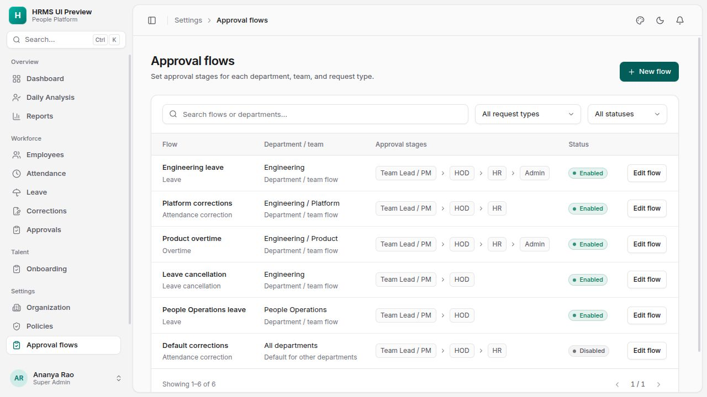

# Configurable approval workflows

Implemented for leave, leave cancellation, attendance corrections, and overtime. A department can have several child teams, each with a different ordered chain such as Employee → Team Lead / PM → HOD → HR → Admin. Configuration is stored in the database and edited in the app; changing a chain does not require code changes.

## Configuration in the app

1. In **Organization → Departments**, create a department, then add child units with **Unit type = Team** and the department as parent. Assign employees to their relevant team through personnel actions.
2. In **Settings → Approval flows**, create a flow for each request type and choose its department/team or the tenant-wide fallback.
3. Name and order its stages, then select one or more eligible people per stage. One approval from the selected people completes that stage. Add, remove, or reorder stages as needed. The supported limits are 1–50 stages and 1–50 accounts per stage.
4. Save the flow. HR managers can configure flows within their granted scope; super administrators can configure tenant-wide defaults. A department-scoped administrator can manage that department and its child teams, but cannot manage sibling departments or tenant-wide defaults.

Stage names do not require particular system roles. A designated employee account can approve its assigned request without receiving broad access to other employees’ records. Different people must review different stages, including when one person has multiple login accounts.

## Routing and submitted requests

For each request type, routing uses the employee’s current organization assignment at submission. The closest enabled team route wins, followed by its ancestors and then the tenant-wide fallback. Disabled routes are skipped. If there is no enabled applicable route, existing leave/attendance approval policies continue to apply.

An applicable configured route takes precedence over legacy approval-level and automatic-approval settings. It snapshots the ordered stages, approver accounts, and flow version at submission. Editing or disabling a flow affects future requests; submitted requests retain their original chain. Concurrent edits use a version check and return a conflict rather than overwriting another administrator’s update.

The **Workforce → Approvals** inbox shows pending configured requests to the requester, designated approvers, active delegates, and authorized workflow administrators. A decision is permitted only at the current stage. Self-approval, out-of-order approval, repeated approval by the same person, and decisions on cancelled or superseded routes are blocked. Approval history identifies reviewers, comments, timestamps, and delegation use.

Leave and cancellation have separate configurable routes. Corrections apply to attendance only after their final approval. Overtime remains pending until its final approval; rejecting any stage rejects the overtime review. If recalculation changes the overtime minutes, a fresh review begins. Removing overtime cancels a pending route. Historical overtime requests preserve the hours and timestamps that were reviewed, even after later attendance changes. Automatic attendance snapshots are attributed to the attendance calculation, rather than to a human reviewer.

For compatibility, the business records use `PENDING_L1`–`PENDING_L3` (and cancellation equivalents) for the first three stages, then `PENDING` or `CANCEL_PENDING` for later stages. The numeric current level and total levels remain available. Leave report status selectors include these states.

## Temporary delegation

Open a pending request and use **Assign temporary cover**. Choose an uncompleted stage, its original approver, a replacement, a start/end time, and a reason.

- A person designated at a later stage can authorize cover for an earlier stage of that request.
- A workflow administrator can authorize cover for any remaining stage within their administration scope, including the final stage.
- Delegation is request-specific by default. Only an authorized workflow administrator can enable it across the same flow stage during the selected dates.
- The replacement must be active, belong to the same tenant, and be different from the requester and people already assigned to the chain. Expired, future, and revoked delegations cannot authorize a decision.
- An inactive original account remains in the submitted chain so an authorized upper level can arrange cover. It cannot approve while inactive.
- The authorizer or an authorized workflow administrator can revoke delegation. Decision and revocation transactions serialize delegation authority, and expiry is checked again when authority is used.

The original approver retains their authority while active; a delegation adds temporary cover. Flow-wide cover follows the saved stage identifier, so removing that stage or changing its original approver does not silently grant authority in a different stage.

## Validation and deployment

Testing used fake tenants in a disposable PostgreSQL database. The API ran through the restricted `hrms_app` role with tenant row-level security enabled. Production data was not modified.

The combined approval and attendance regression run passed **2,652 tests**. It included all 11 configurable-approval scenarios, existing leave/correction workflows, overtime reviews, attendance reports, minimal attendance policies, and the policy combination matrix. A subsequent approval/overtime run passed **12 tests** after adding historical overtime snapshots, zero-overtime recalculation, and rejection checks.

The approval tests cover four-stage decisions for all four request types; team overrides and department/default inheritance; any-one stage approvers; snapshot stability; concurrent decisions and stale edits; self/out-of-order/repeated decisions; tenant isolation; scoped administration; upper-level authority; request-only and flow-wide delegation; future/expired/revoked cover; inactive originals; duplicate employee identities; rejection; and cancellation. These are concrete tested scenarios, not a guarantee that every possible future configuration is defect-free.

Frontend production build, frontend lint (existing warnings only), backend lint, approval-package type checking, and Alembic model/schema comparison passed. The entire migration chain through 0031 also applied cleanly to an empty disposable database. Initial browser verification covered overtime flow editing, adding/reordering stages, incomplete-stage validation, request details, delegation controls, and the required parent department when creating a team. Configuration and authorization mutations were exercised through isolated API tests.

### Navigation and UI follow-up

Daily Analysis and Reports now appear under **Overview**, operational requests under **Workforce → Approvals**, and configuration under **Settings → Approval flows**. The request inbox has summary counts, review tabs, search, request-type filtering, and pagination. Flow settings have department/team labels, stage previews, search, and status/type filters. Editing and reviewing use side panels with fixed action footers; approver selection uses a searchable checklist instead of a native multi-select. Overtime details display hours and minutes.

The redesigned UI was checked with fake, read-only local fixtures: 12 pending requests, six flows, all four request types, multiple departments and teams. Checks covered pagination, review/type filters, approver search/selection, invalid-stage save prevention, cancelling a draft, request-panel initial focus, and the mobile sidebar/editor. At a 390 px mobile viewport, both pages remain within the viewport and wide tables scroll inside their cards. No live HR data or approval permissions were changed during these presentation checks. Frontend production build and lint passed (existing warnings only), and all six existing frontend tests passed.

Additional previews: [request review](ui/approval-workflows/review-redesigned.jpg), [mobile flow editor](ui/approval-workflows/editor-mobile.jpg), [team editor](ui/approval-workflows/team-editor.jpg).

Deployment requires migration **0031**, following existing migration 0030, and deployment of the updated backend and frontend. This work has not been deployed to production. Existing requests without a configurable snapshot keep their existing approval behavior; enabling a flow does not retroactively reroute them.

