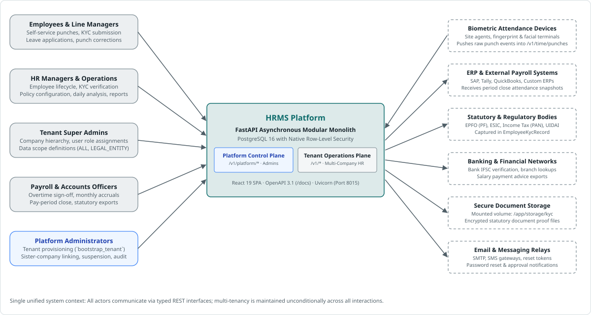
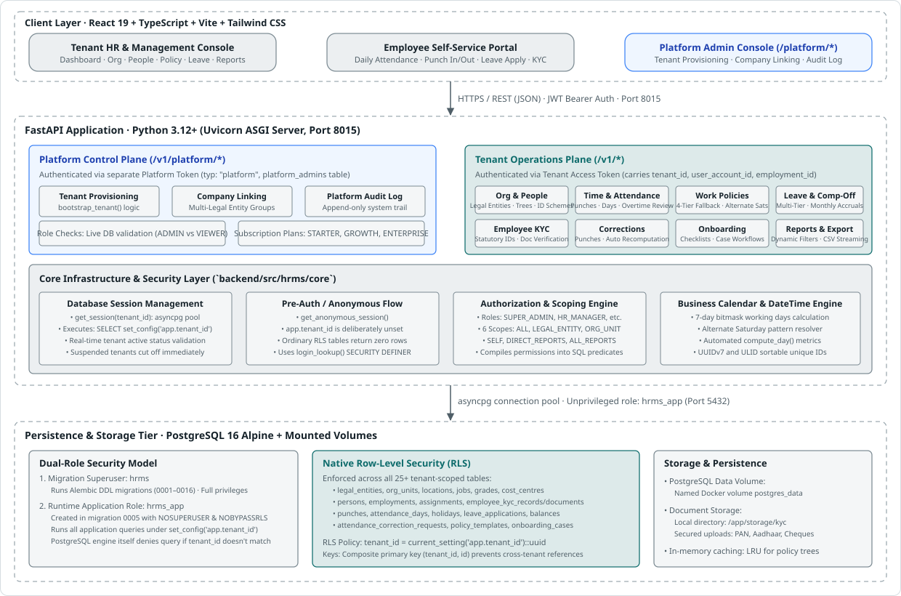
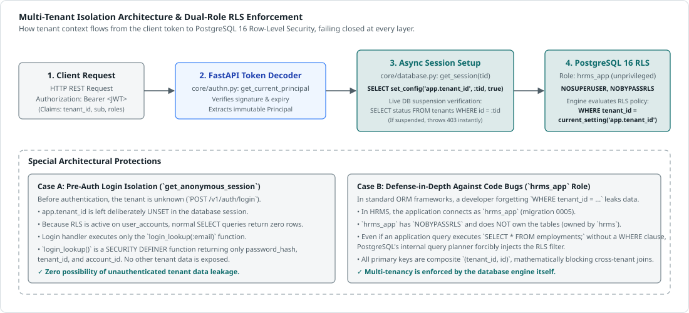

# Architecture 1 · Overview and principles

This section and the seven after it turn the SURAJ Group HRMS business requirements (v2.0, 17 Sep 2026) into a platform that serves many organisations. SURAJ Group becomes the first tenant, not the shape of the product. Section numbers such as §12 refer to that requirements document. **Performance/KPI (§16, and the KPI rows elsewhere) is out of scope for this analysis, as you asked.** The module framework in Architecture 6 leaves room to add it later without changing anything here.

## The short version

1. **The requirements describe one organisation; the platform has to serve many.** Every rule in the document that is specific to SURAJ Group (leave entitlements, reminder days, approval chains, PF/ESIC handling, the org chain) becomes tenant configuration. The document already asks for this: HR must "operate routine business rules without depending on the technical team" (§43).
2. **A tenant is not a company.** A tenant is the customer and the isolation boundary. Inside it sit legal entities, locations, org units, jobs, cost centres and positions, each as its **own dimension**. The single chain in §2 (Group → Company → Branch → Department → Sub-department → Team) is one tenant's shape, not the model.
3. **Multi-company and multi-location go into the data model from the first sprint.** The document's Phase 6 ("Expansion: multi-company, multi-location") can stay a rollout step, but it cannot be a build step. Adding it later would mean rewriting every table.
4. **Four platform engines carry most of the business logic:** effective-dated personnel actions, configurable approval workflows, scoped and versioned policies, and a due-date (obligation) engine feeding one Action Centre. Every module from §7 to §26 is built on them, not beside them.
5. **Default to pooled multi-tenancy, with dedicated cells when a tenant needs them.** Most tenants share a PostgreSQL cluster, with `tenant_id` on every row enforced by row-level security. Large, regulated or residency-bound tenants get a dedicated cell. Both run the same code and the same schema.
6. **India statutory logic becomes a versioned country pack.** PF, ESIC, PT and LWF are data plus pluggable calculators, stamped with an effective date and a source, and checked by HR (§20). Other countries arrive later as further packs.
7. **Build a modular monolith per cell, not microservices on day one.** Modules have hard boundaries and talk through events. Only the high-volume parts are separate services: attendance ingestion, notifications, search, document processing and analytics.

## Design principles

| # | Principle | What it rules out |
|---|---|---|
| P1 | **Tenant context is mandatory everywhere**: requests, jobs, events, cache keys, file paths, search queries, logs, metrics. Missing context fails closed. | Any query, job or export that runs "for all rows". |
| P2 | **Configuration, not customisation.** A tenant's difference is data: settings, packs, custom fields, workflow definitions. | `if tenant == …` code paths and per-customer forks. |
| P3 | **Two clocks.** Every business fact has an effective (valid) date; every change is recorded with when, who and why. | Overwriting a department, manager or salary in place. |
| P4 | **One person, one record, many employments.** Information entered once flows through the whole journey (Business philosophy, §11, §43). | Re-keying a candidate as an employee; losing history on rejoin. |
| P5 | **Access is decided centrally and enforced in the data layer**, for rows and fields, in screens, reports, search, exports and notifications alike. | Filtering restricted data only in the UI. |
| P6 | **Complexity is opt-in.** A 20-person tenant sees one company, one location and no positions; a 50,000-person tenant turns on entity groups, positions and matrix reporting. | Forcing every tenant through enterprise setup. |
| P7 | **Country and industry specifics live in packs**, versioned and effective-dated. | PF/ESIC columns in the core employee table; Indian assumptions in core code. |
| P8 | **API-first and event-first.** Anything the UI can do, the API can do, and every state change emits an event. | Screen-only features that integrations cannot reach. |

## Your requirements, and where each is met

| Your requirement | The mechanism | Section |
|---|---|---|
| Multiple tenants with strict data isolation | Tenant resolution at the edge; `tenant_id` on every row and in every key; PostgreSQL RLS that fails closed; composite foreign keys; per-tenant encryption keys; cross-tenant leakage tests in CI | 3 |
| Different industries and business models | Industry packs, tenant-defined org dimensions, worker types, custom fields and objects, a terminology layer | 4, 6, UI 2 |
| Multiple locations, branches, offices, sites | Location as its own dimension with type, jurisdiction, time zone, holiday calendar and statutory registrations | 4 |
| Different hierarchies and departments | Tenant-defined org unit types and depth; separate reporting, cost-centre and custom hierarchies; optional positions; effective-dated reorganisations | 4 |
| Enterprise-scale users, roles, permissions | Tenant-scoped identity with SSO, SCIM and OTP; roles × data scopes × data classes × conditions; delegation; access reviews | 5 |
| Configurable workflows and business rules | Versioned approval definitions; typed policy objects; a sandboxed expression language; layered, scoped, effective-dated configuration; simulation before publishing | 6 |
| Small organisations to large enterprises | Pooled and dedicated cells; partitioning; asynchronous heavy work; opt-in complexity; quotas and fair scheduling | 3, 7 |
| Security, auditing, compliance | Data classification; field encryption; tamper-evident audit log; sensitive-read logging; DPDP-ready retention and data-principal requests; controlled support access | 5 |
| Tenant-specific configuration and customisation | Configuration layers from platform to employee group; branding with contrast guards; terminology; templates; sandbox tenants with configuration promotion | 6, UI 1 |
| Multi-location and multi-region deployment | Regional cells; a home region per tenant; in-country disaster recovery; residency decisions before expanding | 3 |
| Extensibility for new industries, modules, capabilities | A module contract, packs, events and webhooks, a public API, custom objects, and later sandboxed extensions | 6, 7 |
| Shared resources with tenant isolation | Platform reference data (read-only, versioned), shared infrastructure with quotas, shared gateways with per-tenant identity, and no standing operator access | 3 |

## Target architecture at a glance

*Figure 1: System Context — Enterprise actors, internal dual planes, and external integrations.*

*Figure 2: Container Architecture — High-performance React 19 frontend, FastAPI ASGI backend, and PostgreSQL 16 dual-role RLS persistence tier.*

*Figure 3: Multi-tenant request resolution and database session isolation (details in Architecture 3).*

## Confirmed & Implemented Production Stack

The platform is implemented as a high-performance asynchronous modular monolith with native multi-tenancy:

| Concern | Implemented Choice | Why / Technical Justification |
|---|---|---|
| **Operational Database** | PostgreSQL 16 (`postgres:16-alpine`) | Native Row-Level Security (RLS) with `FORCE ROW LEVEL SECURITY`, JSONB for extensible attributes, composite primary keys `(tenant_id, id)`, and UUIDv7/ULID support. |
| **Database Access Security** | Dual-role model: `hrms` (migrations) vs `hrms_app` (runtime) | `hrms_app` role connects with `NOSUPERUSER` and `NOBYPASSRLS`. Prevents any possibility of developer query bugs leaking cross-tenant data. |
| **Backend Framework** | Python 3.12+ with FastAPI & Uvicorn | Asynchronous execution, native OpenAPI/Swagger generation (`/docs`), automated Pydantic v2 validation, and high throughput. |
| **Data Layer & ORM** | SQLModel & SQLAlchemy 2.0 (asyncpg) | Combines Pydantic type validation with SQLAlchemy 2.0 async engine and query capabilities. |
| **Schema Migrations** | Alembic (revisions 0001–0016) | Versioned, auditable DDL migrations with automated rollback support. |
| **Web Frontend** | React 19 + TypeScript + Vite 8 + Tailwind CSS | Fast HMR dev server, optimized production bundling, type safety, and responsive utility styling. |
| **Frontend State & Caching** | TanStack React Query v5 | Server-state caching, automatic background refetching, and mutation invalidation. |
| **Authentication** | Dual-Plane JWT (Tenant vs Platform) | Separate token typing (`typ: "platform"` vs tenant tokens with `tenant_id` and `employment_id`), bcrypt password hashing, and live DB revocation checks. |
| **Authorization** | In-house Role & Scope Resolution Engine | Role-based permission bundles (`SUPER_ADMIN`, `HR_MANAGER`, etc.) combined with 6 data scope types (`ALL`, `LEGAL_ENTITY`, `ORG_UNIT`, `SELF`, `DIRECT_REPORTS`, `ALL_REPORTS`). |
| **Package Management** | `uv` (Python) and `npm` (Frontend) | Extremely fast Rust-based dependency resolution and virtual environments. |
| **Containerization** | Docker & Docker Compose | Repeatable, isolated environments with persistent Postgres storage volumes. |

