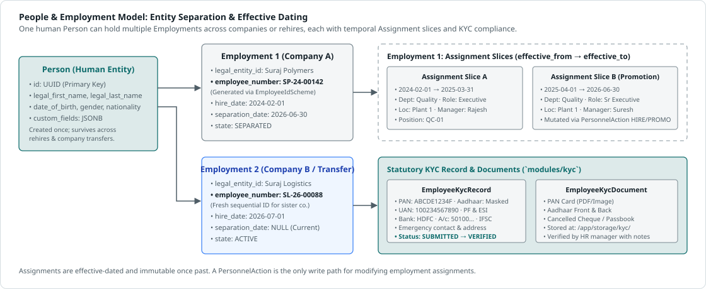

# Architecture 4 · Organisation, people and history model

## Why one hierarchy chain cannot serve every tenant

| Tenant type | How it is actually organised |
|---|---|
| Multi-company group (SURAJ Group) | Group → Company → Branch → Department → Sub-department → Team |
| Manufacturing | Plant → Department → Line or Section, with shifts, and contract workers supplied by agencies |
| Retail | Region → Area → Store; the store *is* the unit, and staff work rosters |
| Healthcare | Hospital → Department → Unit or Ward; 24×7 rosters; clinical licences that expire |
| IT services | Business unit → Practice → Delivery team; people sit at client sites; matrix reporting |
| Construction and infrastructure | Project sites that open and close; hiring by site |
| Education | Campus → School → Department; academic-year calendars |

In every case, *who employs you*, *where you work*, *which team you belong to*, *who pays for you* and *who approves your leave* are different questions with different answers. They must be different dimensions.

## The dimensions

| Dimension | The question it answers | Structure | Examples |
|---|---|---|---|
| **Legal entity** | Who employs this person and files their statutory returns? | Flat list; optional entity-group tree above it | Kaveri Polymers Pvt Ltd; Group › Manufacturing sub-group |
| **Establishment registration** | Which statutory registration covers them? | Entity × location × registration type, effective-dated | PF code, ESIC code or sub-code, PT registration per state, factory or shops-and-establishments licence |
| **Location** | Where do they work? | Tree (country › state › city › site) with tenant-defined site types | Head office, plant, store, branch, warehouse, project site, client site, remote |
| **Org unit** | Which functional group are they in? | Tenant-defined unit types and depth, effective-dated tree | Division › Department › Sub-department › Team or Line |
| **Job and grade** | What is the role, and at what level? | Job families › jobs (designations); grade or band ladders per entity | Senior Executive, grade M1 |
| **Position** (optional) | Which approved seat do they fill? | Position › reports-to position; budgeted | The "sanctioned strength" of §10 |
| **Cost centre** | Who pays? | Finance hierarchy, often from the ERP | CC-4100 Sales West |
| **Reporting line** | Who manages and approves? | Manager relationships: primary (solid) and functional (dotted); unit head derived from the org unit | Manager, HOD (§7) |
| **Worker type and category** | Which rules apply? | Lookup with system categories | Permanent, contractual, trainee, consultant, apprentice, agency worker |
| **Custom dimensions** | Anything specific to the tenant | Tenant-defined lists or trees | Project, zone, product line, client, union membership |

Every dimension record is **effective-dated**. A department renamed on 01 Apr keeps its old name in reports for March.

**Opt-in complexity (P6).** A small tenant gets one legal entity, one location, a flat list of departments, no positions and no cost centres, and the screens hide what is unused. Nothing needs restructuring when the tenant grows into them.

## Person, Employment, Assignment

*One person has one or more employments with legal entities. Each employment is a series of effective-dated assignment slices, including scheduled future ones. An inter-company transfer ends one employment and starts a linked one.*

- **Person**: identity and personal data (name, date of birth, contacts, family, emergency contacts) and a vault reference for identifiers and bank details. One per human, per tenant. Never shared across tenants.
- **Employment** (the work relationship): person × legal entity, with hire date, employee number, worker type, employment state (pre-hire, active, on notice, hold, separated), service stage (probation, confirmed, contract), notice terms and separation details. A person can have several over time (rejoin, inter-company transfer) and, if the tenant allows, at the same time.
- **Assignment** (effective-dated slices): org unit, location, job, grade, position, manager or managers, cost centre, shift or roster group, pay group, custom dimensions.
- **Compensation** (effective-dated, restricted): salary structure, components, CTC.
- **Statutory profile** (from the country pack, effective-dated): UAN, PF membership and dates, ESIC IP number, PT state, and so on for India.
- **Candidate to Person.** A candidate's data becomes the Person, with a pre-hire employment, when the offer is accepted. Nothing is typed twice (§11).

## Personnel actions: the only way employment data changes

Every change in §7 and §14 is a **personnel action**. Nothing edits employment data in place.

| Part of an action | Content |
|---|---|
| Type | Hire, confirm, extend probation, transfer, inter-entity transfer, promotion, designation change, manager change, location change, salary revision, hold, put on notice, separation, rejoin, data correction (the tenant can add types) |
| Reason code | From the tenant's list for that type |
| Effective date | When the change applies (it may be past, today or future) |
| Payload | The proposed new values: for a transfer, the new org unit, location and manager |
| Evidence | Attachments (§5 "supporting documents/proof") |
| Approvals | A workflow instance from the tenant's definition for that type (Architecture 6) |
| Outputs | Generated letters, notifications, obligations (for example, induction at the new site) |
| Status | Draft → Pending → Approved → Scheduled → Applied, or Rejected / Cancelled / Reversed |

Applying an action writes new effective-dated slices in one transaction with the audit entry and an outbox event. Other modules react to the event (see the flow in Architecture 7).

- **Future-dated actions** are *scheduled*: visible everywhere as "upcoming" (Employee 360, history, Action Centre) and applied by the scheduler on the date.
- **Retro-dated actions** also emit recalculation events for the affected periods (attendance days, leave accruals, payroll inputs). If a period is already closed, the change goes through the controlled correction path (§12 rule) and becomes a visible exception.
- **Correction or change?** A *correction* fixes wrong data: the same valid period, recorded again. A *change* is a new fact from a new date. Both are audited, but they mean different things in reports, so the UI asks which one the user intends.

## Two clocks (bitemporal where it matters)

- **Valid time** (`effective_from`, `effective_to`) on employment, assignment, compensation, statutory profile, org structure, and policies and configuration. It answers "what was true on 1 March?".
- **Transaction time** (`recorded_at`, `recorded_by`, `superseded_at`), kept as system-versioned history for compensation and assignment, and in the audit log for everything else. It answers "what did the March report show when it was run, before the backdated correction?".
- **The database enforces it.** A gist exclusion constraint such as `EXCLUDE USING gist (tenant_id WITH =, employment_id WITH =, daterange(effective_from, effective_to, '[)') WITH &&)` makes overlapping slices impossible. The same mechanism stops overlapping leave for one employee (§13, §30).
- **As-of access** goes through one shared temporal library and SQL functions (`assignment_as_of(date)`) so no module writes its own date logic. A nightly **headcount snapshot** per tenant supports trend reports cheaply.

## Reorganisations

- A merge, split or move of org units is one action with a mapping. The employees move with it, with a single effective date and one approval.
- Hierarchies are stored as adjacency lists plus a **closure table** (or `ltree` paths), materialised for "today" and for any date that is queried often. They are used by access control ("all reports of this manager") and by reporting ("everything under this division").
- Closure tables for very large units are recomputed asynchronously and in batches; reads never block on a reorganisation.

## Identifiers

- **Internal IDs**: UUIDv7 (time-ordered, index-friendly). Never shown to users.
- **Employee number**: a tenant-configured sequence pattern (for example `{ENTITY}-{YY}-{SEQ:5}` → KP-26-00481), unique per tenant (recommended) or per legal entity. The tenant decides whether it is kept on inter-entity transfer and whether it is reused on rejoin.
- **National and statutory identifiers** (PAN, UAN, ESIC IP, passport, Aadhaar in masked form): stored in an identifier vault table typed by the country pack. Values are encrypted, with a keyed hash (blind index) for exact-match duplicate checks and a masked display value.
