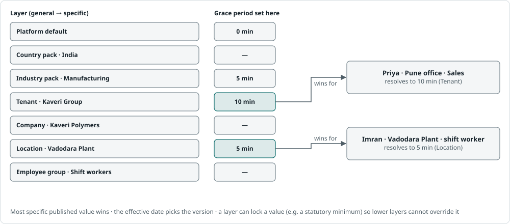

# Architecture 6 · Configuration, workflows and business rules

The requirements insist that HR, not developers, owns routine rules (§5, §32, §43). Across many tenants and industries that becomes the platform's central capability: **layered, scoped, effective-dated configuration**, plus three engines that read it (approval workflows, obligations and reminders, and policies with expressions).

## Configuration layers

*The most specific published layer that sets a value wins, so two employees of the same tenant can get different values. The effective date selects the version. A layer can lock a value so lower layers cannot override it.*

Layers, from general to specific: **platform default → country pack → industry pack → tenant → entity group → legal entity → location → org unit → employee group** (a dynamic segment such as "shift workers" or "trainees").

Every configuration object has:

- a type, a scope (one layer and one node in it), a key, and a typed value
- an **effective period** and a **version**
- a status: draft, published or retired
- author, approver and a change note (configuration changes are audited and can require approval)
- an optional **lock**, set by a higher layer, that forbids overrides (for example, a statutory minimum)

Two tools make this safe for HR users:

- **Simulation before publishing.** "Show me what changes if I publish this leave policy": balance differences for a sample of employees, and how many people are affected.
- **Configuration as a bundle.** Export and import versioned JSON bundles to promote from a sandbox tenant to production, to create industry packs, and to diff two tenants.

## What is configurable

| Area | Configuration objects | Requirement |
|---|---|---|
| Organisation | Unit types and depth, location types, custom dimensions, terminology | §2, §32 |
| People data | Custom fields and sections, form layouts, required-field rules, document requirements by worker type | §7, §21, §30 |
| Numbering | Employee ID, request references, letter numbers | §5, §22 |
| Approvals | Workflow definitions per process | §27 |
| Time | Shifts, rosters, attendance policies, overtime rules, period-close calendars, capture methods per location | §12 |
| Leave | Leave types, entitlement and accrual rules, carry-forward, encashment, holiday calendars | §13 |
| Lifecycle | Probation, confirmation and notice rules; due-date and reminder rules | §14, §19 |
| Checklists | Onboarding and exit-clearance templates | §9, §19 |
| Compliance | Country and statutory packs, establishment registrations, obligation calendars, evidence checklists, official links | §20 |
| Communication | Notification events, templates, channels, recipients, escalation, languages | §26 |
| Documents and letters | Document types, expiry, retention, letter templates, signatories | §21 |
| Service desk | Categories, SLAs, business-hours calendars, assignment rules | §22 |
| Policies | Categories, audiences, acknowledgement rules | §23 |
| Access | Roles, scopes, data-class grants, segregation-of-duties rules | §3, §33 |
| Branding | Logo, brand colour (contrast-guarded), custom domain, email sender, default language | UI 1 |

## Rules and expressions

- **Most rules are typed policy objects**, not code: grace minutes, thresholds, accrual rates, offsets. HR fills in forms that are validated and simulated.
- **Where logic is unavoidable** (conditions, derived dates, simple formulas), use a **sandboxed, typed, side-effect-free expression language** such as CEL (Common Expression Language), with a curated function library (`tenureMonths`, `daysBetween`, `isHoliday`, `lookup`, `round`), a type-checked editor and test cases. Examples:
  - approval condition: `request.days > 3 || employment.stage == "PROBATION"`
  - probation due date: `employment.hireDate.addMonths(policy.probationMonths)`
- **No arbitrary scripts in the core.** Tenant-authored code is a security, performance and upgrade risk. If deeper customisation is ever needed, it runs out of process as a sandboxed extension with time and memory limits (see Extensibility).

## Workflow and approval engine

**Definition** (versioned, per tenant and process type):

- a trigger: the process and action type (leave, attendance correction, transfer, salary revision, bank change, compliance exception…)
- steps, sequential or parallel, with "any one" or "all" completion
- an **approver resolver** per step: line manager, n-th level manager, head of the unit, *role within scope* (for example, "the HR Business Partner for this location"), a named user or group, or an expression
- **conditions** that include or skip a step (the "HR for selected cases" of §27)
- an SLA per step, reminders, and an escalation target
- delegation and alternate-approver rules (§27, §29)
- **segregation-of-duties rules:** no self-approval unless the tenant's policy allows it; maker different from checker for bank and salary changes
- required inputs: a reason on reject (§27), attachments

**Runtime:**

- Each instance is pinned to the definition version it started under. Editing a workflow never changes requests already in flight.
- Tasks appear in the Action Centre and on mobile. Available actions: approve, reject (with reason), send back for information, reassign (by an administrator, with reason), bulk-approve where the tenant allows.
- **Edge cases the engine must handle:**
  - the approver leaves or changes role mid-flight: re-resolve the step, and never leave it orphaned
  - no manager (§29): a fallback resolver (HR), plus a data-quality alert *before* requests arrive
  - a reorganisation mid-flight: resolve against the assignment as of the decision date
  - approval by an email link: signed, single-use, expiring, and never for Financial approvals
- **Technology.** Build a domain-specific approval engine on durable timers (a DB-backed scheduler at first; Temporal if orchestration grows). A BPMN designer is too complex for HR administrators; offer templates and a simple step editor.

## Obligations and reminders (the source of "due" work)

An **obligation** is something due for someone by a date: a probation review, confirmation, increment, contract end, document expiry, notice end or LWD, clearance item, F&F, a compliance filing, training feedback, a request SLA.

- **Generated by rules from data**, for example hire date plus the probation rule, and **recomputed on events**: when the LWD changes, the clearance due dates move (§29).
- **Reminder rules** per obligation type: offsets (-30, -15, -7 days; then every N days while overdue), recipients by role within scope, channels, and an escalation after M days overdue. The reminder table in §26 ships as the default.
- **Overdue work stays visible** until it is done or closed by an approved exception (§14 rule). Nothing is dismissed.
- **The Action Centre is the union** of workflow tasks, obligations and exceptions for each user, with counts per category. The dashboard cards of §6 read the same counts.

## Exceptions as a platform primitive

An **exception** records: subject, the rule or check bypassed, reason, evidence, approver, validity or expiry, and status. One model serves all of these: compliance "not applicable" and "payment delayed" (§20), clearance exceptions (§19), incomplete onboarding documents (§29), negative leave balance (§13), a correction after period close (§12), and an LWD before the resignation date (§30). "Exceptions" appears in dashboards and reports across modules because it is one table.

## Notifications

- Channels: in-app, email, SMS, WhatsApp Business, mobile push. In India, SMS needs **DLT-registered templates** and WhatsApp needs pre-approved templates, so templates are per tenant and approved before use.
- Templates per event, per language, per tenant override. Merge fields are limited by data class: **no Financial, Identity or Case data in SMS, WhatsApp or email bodies.** Link to the app instead.
- Per-user preferences, digests and quiet hours; delivery tracking; per-tenant quotas; custom sender domains.

## Extensibility

- **Module contract.** A module registers its entities, permissions, data classes, events, configuration object types, obligation types, Action Centre item types, dashboard cards, report datasets, search facets, notification events, API routes and migrations. New modules (rostering, payroll, performance, expenses) plug into the same kernel without platform changes.
- **Custom fields** on core entities: stored as JSONB with a metadata registry (type, validation, data class, visibility by role, searchable and reportable flags), with GIN indexes, and promoted to generated columns when heavily filtered.
- **Custom objects** (later): tenant-defined records with forms, lists, permissions and workflows, such as uniform issue or canteen cards.
- **Integration surface:** a public REST API (OpenAPI, versioned), OAuth2 client credentials per tenant, signed webhooks with retries, and an event catalogue.
- **Packs:** country packs and industry packs are versioned data bundles plus optional **calculator plugins**: platform-shipped code for statutory maths (India PF/ESIC, PT slabs by state), released with the platform, never written by tenants.
- **Later:** sandboxed extension functions (out of process, limited) and a connector marketplace.
