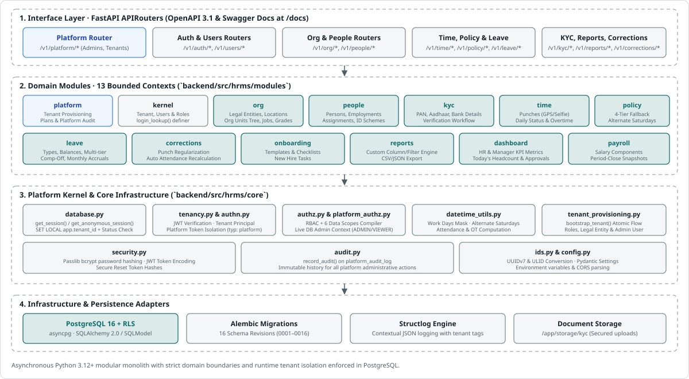

# Architecture 7 · Application, data, integration and scale

## Application architecture: a modular monolith per cell

**Why:** the employee journey (§36) is one chain of transactions that must stay consistent. A small team ships faster with one deployable, and hard module boundaries keep the option to extract services later. Microservices from day one would add distributed transactions and heavy operations before the domain has settled.

| Area | Modules (Implemented in `backend/src/hrms/modules/`) |
|---|---|
| **Platform Plane** | `platform`: Platform admin directory, tenant provisioning (`bootstrap_tenant`), company linking, subscription tiers, platform audit log |
| **Kernel & IAM** | `kernel`: Tenant models, user accounts, role definitions, role assignments, authentication routes (`/v1/auth/*`), RBAC scoping engine |
| **Organization** | `org`: Legal entities, locations, org units (hierarchical department tree), jobs, grades, cost centres, positions |
| **People & Lifecycle** | `people`: Person records, employments, effective-dated assignments, personnel actions, sequential employee ID formatting schemes |
| **Compliance & KYC** | `kyc`: Statutory identifiers (PAN, Aadhaar, UAN, PF, ESI, Passport, DL), bank accounts, document storage, and multi-state verification workflows |
| **Time & Attendance** | `time`: Raw punches (GPS/selfie/source), recomputable attendance days, holiday calendars, overtime lifecycle management |
| **Policy Engine** | `policy`: Policy templates (work week bitmasks, alternate Saturday patterns), 4-tier hierarchical policy resolution fallback |
| **Leave Management** | `leave`: Leave types, balances, multi-tier approval state machines, comp-off grants, leave encashment, monthly accruals |
| **Corrections** | `corrections`: Attendance regularization requests, approval actions, automatic punch creation and attendance day recalculation |
| **Onboarding** | `onboarding`: Configurable checklist templates, instantiated onboarding cases, task assignments across HR, IT, Manager, and Employee |
| **Reports & Dashboard**| `reports`, `dashboard`: Saved dynamic report definitions with filter/column engines, CSV exports, executive & manager KPI dashboard metrics |
| **Payroll Interface** | `payroll`: Compensation structures, payroll input snapshots, and period-close export contracts |

*Figure 1: Modular monolith architecture — APIRouter interfaces, 13 domain modules, platform kernel services, and database persistence adapters.*

**Frontend Architecture:**

- Single-page application built on **React 19**, **TypeScript**, **Vite 8**, and **Tailwind CSS**.
- **TanStack React Query v5** provides cache management, background synchronization, and optimistic mutation handling.
- Unified application layout serving both the **Tenant HR Operations Portal** and the **Platform Control Console** (`/platform/*`) with route protection and token separation.

## Data architecture

- **PostgreSQL 16 Engine:** Multi-tenant shared database with native **Row-Level Security (RLS)** applied across all tenant tables via `FORCE ROW LEVEL SECURITY`.
- **Dual-Role Model:** Migration scripts run as superuser `hrms`; the FastAPI application connects exclusively as unprivileged role `hrms_app` (`NOSUPERUSER`, `NOBYPASSRLS`).
- **Keys & Primary Indexing:** Composite primary keys `(tenant_id, id)` prevent any possibility of cross-tenant foreign key linkage. UUIDv7 and ULID strategies ensure sortable distributed primary identifiers.
- **Extensible Attributes:** JSONB columns for flexible custom fields (e.g. `Person.custom_fields`, `PlatformAuditLog.metadata_json`).
- **Schema Evolution:** Managed through Alembic async migrations (revisions 0001 through 0016).
- **Session Context:** Handled via FastAPI dependency injection: `get_session()` executes `SELECT set_config('app.tenant_id', :tid, true)` and performs real-time tenant status verification on every query. Anonymous flows use `get_anonymous_session()` and `login_lookup()` `SECURITY DEFINER` function.

## Payroll input contract (build this now, whatever §17 decides)

A **pay-period snapshot** per legal entity and pay group:

- **Contents:** joiners and leavers with dates; paid days, LOP days, overtime hours, shift allowances; leave encashment; arrears from retro-dated actions; variable pay and bonus inputs; deductions and recoveries (loans, advances, notice recovery); statutory applicability (PF, ESIC, PT state, LWF); the compensation structure in effect.
- **Behaviour:** locked when the attendance period closes. Versioned, so a later correction produces a *delta*, not a silent change. Exported through the API and in file formats for external payroll, or consumed by an internal payroll engine later.

## Integration architecture

*Figure 2: API contracts, OpenAPI 3.1 specifications, dual-plane route separation, and PostgreSQL 16 RLS execution.*

An **integration hub** runs in each cell. It provides a connector framework with per-tenant configuration and secrets, field mapping, schedules, retries and a dead-letter queue, idempotency keys, and per-tenant monitoring.

| Integration (§34) | Pattern | Notes |
|---|---|---|
| **Attendance devices** | Device push over HTTP, a site gateway agent that polls LAN devices, CSV import; mobile and web punches through the API | Idempotency key = device + user + timestamp. Tolerates late and out-of-order data, and clock drift (monitored). A gateway handles offline sites. |
| **Payroll** (internal or external) | Payroll input snapshots (above), API plus files | Locked, versioned, deltas on correction |
| **Accounting and ERP** (Tally, SAP, others) | Journal or voucher export for F&F and recoveries | Ledger mapping per tenant |
| **Email and calendar** | Microsoft 365 and Google Workspace through OAuth per tenant; SMTP fallback | Interviews, training sessions, HR dates |
| **Messaging** | SMS gateway (DLT templates), WhatsApp Business provider, push | Per-tenant quotas and sender identity |
| **Directory and SSO** | SAML/OIDC; SCIM inbound and outbound | Joiner-mover-leaver automation; IT clearance on exit |
| **Recruitment sources** | Job boards, career site, email parsing | Candidate consent captured on entry |
| **Government portals** | Links plus evidence in v1; file generation (such as the PF ECR text file and ESIC contribution upload) later as country-pack outputs | No stored portal credentials |
| **Document storage** | Platform object storage; tenant-owned storage (SharePoint, Drive) later | Retention and legal hold apply either way |
| **Later** | Bank account verification (penny-drop), background verification, e-sign (Aadhaar eSign or DSC), DigiLocker | Each as a connector |

**Bulk import framework.** Onboarding a tenant depends on it:

- templates per object, generated from the tenant's configuration, so custom fields are included
- validation and a **dry run** with an error file
- idempotent upserts, safe to re-run
- **history import**, so a tenant arrives with effective-dated history rather than a snapshot
- imports run as audited jobs with tenant quotas

## Scalability

**Sizing assumptions to validate** (decision D15): tenants from 10 to 200,000 employees; hundreds of tenants at first, thousands within five years; peaks between the 1st and 5th of each month (period close, leave accrual, payroll inputs) and at shift starts (punch bursts).

| Hotspot | Why it is hard | Design response |
|---|---|---|
| **Attendance ingestion and computation** | Millions of punches a day across tenants; corrections and late data force recomputation | A separate ingestion service; an append-only partitioned punch store; incremental computation per employee-day; recompute queues with per-tenant fairness |
| **Month-start batch storms** | Every tenant closes attendance, accrues leave and generates payroll inputs at once | Jobs sharded per tenant, staggered schedules, priority queues, autoscaled workers, idempotent resumable jobs |
| **Dashboards and Action Centre counts** | Aggregating over large scopes on every page load | Event-maintained projections per scope; short-TTL caches; asynchronous refresh |
| **Authorization on lists** | Scope, hierarchy and field rules on every query | Precomputed visibility sets, closure tables, compiled predicates, indexes on `(tenant_id, org_unit_id)` and similar |
| **Reports and exports** | Large as-of queries | Read replicas and the analytics store; asynchronous exports with row limits; daily headcount snapshots |
| **Global search** | Large populations with security trimming | OpenSearch per-tenant routing; visibility tags; restricted fields not indexed |
| **Audit and event volume** | Every change and every sensitive read | Partitioned append-only storage, tiered retention, writes through the outbox |
| **Documents** | Terabytes over time | Object-storage lifecycle policies, de-duplication, retention purge |
| **Noisy neighbours** | One tenant's import or export starving the rest | Per-tenant rate limits and quotas, separate worker pools per tier, moving the tenant to a dedicated database or cell |
| **Reorganisations** | Moving a unit with thousands of employees | Batched action application; asynchronous closure recomputation; reads never block |

**Suggested performance budgets:**

- interactive API p95 under 300 ms
- dashboard under 2 s
- scoped list pages over 10,000 employees under 1 s
- exports always asynchronous
- a new tenant provisioned from packs in under 10 minutes

## Deployment and operations

- Kubernetes per cell, infrastructure as code (Terraform), GitOps (for example, Argo CD), canary releases per cell, ring rollout across cells.
- OpenTelemetry traces, metrics and logs tagged with the tenant; per-tenant SLO dashboards; alerts for anomalies that could signal a cross-tenant problem (for example, one request touching two tenant IDs).
- Regular disaster-recovery drills and **tenant-restore drills**.
- Suggested SLOs, to confirm: 99.9% availability for pooled tenants, 99.95% for dedicated cells.
