# Database schema

Generated by `backend/scripts/schema_diagram.py` from a database migrated to head — don't edit by hand; `tests/test_schema_diagram.py` fails when this file is stale.

Every tenant table also references `tenants(id)` through `tenant_id`, and every reference between tenant tables includes `tenant_id` (rule L3). Those lines are left out to keep the diagrams readable, as are the lines of the who-did-it columns (`*_by`, referencing `user_accounts` or `employments`), which are still marked FK. Each diagram shows its area's tables with their keys; a table from another area appears through its relationship lines only.

## Platform and access

```mermaid
erDiagram
    auth_throttle {
        varchar scope PK
        varchar key_hash PK
    }
    dashboard_layouts {
        uuid tenant_id PK
        uuid id PK
        uuid user_account_id FK
    }
    platform_admins {
        uuid id PK
    }
    platform_audit_log {
        uuid id PK
        uuid actor_admin_id FK
    }
    platform_password_reset_tokens {
        uuid id PK
        uuid admin_id FK
    }
    role_assignments {
        uuid tenant_id PK
        uuid id PK
        uuid user_account_id FK
        uuid role_id FK
    }
    roles {
        uuid tenant_id PK
        uuid id PK
    }
    tenants {
        uuid id PK
    }
    user_accounts {
        uuid tenant_id PK
        uuid id PK
        uuid employment_id FK
    }
    user_preferences {
        uuid tenant_id PK
        uuid id PK
        uuid user_account_id FK
    }
    user_accounts ||--o{ approval_delegations : delegate_user_id
    user_accounts ||--o{ approval_delegations : original_user_id
    user_accounts ||--o{ approval_events : actor_user_id
    user_accounts ||--o{ attendance_group_access : user_account_id
    user_accounts ||--o{ correction_approval_actions : approver_user_account_id
    user_accounts ||--o{ daily_report_snapshots : user_id
    user_accounts ||--o{ dashboard_layouts : user_account_id
    user_accounts ||--o{ external_identities : user_account_id
    user_accounts ||--o{ job_applications : owner_user_id
    user_accounts ||--o{ kyc_access_log : actor_user_account_id
    user_accounts ||--o{ leave_approval_actions : approver_user_account_id
    platform_admins ||--o{ platform_audit_log : actor_admin_id
    platform_admins ||--o{ platform_password_reset_tokens : admin_id
    user_accounts ||--o{ recruitment_events : actor_user_id
    roles ||--o{ role_assignments : role_id
    user_accounts ||--o{ role_assignments : user_account_id
    employments ||--o{ user_accounts : employment_id
    user_accounts ||--o{ user_preferences : user_account_id
```

## Organisation

```mermaid
erDiagram
    cost_centres {
        uuid tenant_id PK
        uuid id PK
    }
    employee_id_schemes {
        uuid tenant_id PK
        uuid id PK
        uuid legal_entity_id FK
        uuid recorded_by FK
    }
    grades {
        uuid tenant_id PK
        uuid id PK
    }
    jobs {
        uuid tenant_id PK
        uuid id PK
    }
    legal_entities {
        uuid tenant_id PK
        uuid id PK
        uuid recorded_by FK
    }
    locations {
        uuid tenant_id PK
        uuid id PK
        uuid legal_entity_id FK
        uuid recorded_by FK
    }
    org_units {
        uuid tenant_id PK
        uuid id PK
        uuid parent_id FK
        uuid legal_entity_id FK
        uuid location_id FK
        uuid cost_centre_id FK
        uuid recorded_by FK
        uuid department_template_id FK
        uuid lead_employment_id FK
        uuid pm_employment_id FK
        uuid head_employment_id FK
    }
    positions {
        uuid tenant_id PK
        uuid id PK
        uuid org_unit_id FK
        uuid job_id FK
        uuid grade_id FK
    }
    legal_entities ||--o{ approval_flows : legal_entity_id
    org_units ||--o{ approval_flows : org_unit_id
    cost_centres ||--o{ assignments : cost_centre_id
    grades ||--o{ assignments : grade_id
    jobs ||--o{ assignments : job_id
    locations ||--o{ assignments : location_id
    org_units ||--o{ assignments : org_unit_id
    positions ||--o{ assignments : position_id
    legal_entities ||--o{ attendance_groups : legal_entity_id
    legal_entities ||--o{ brand_profiles : legal_entity_id
    legal_entities ||--o{ document_signatories : legal_entity_id
    legal_entities ||--o{ employee_id_schemes : legal_entity_id
    legal_entities ||--o{ employee_policy_assignments : legal_entity_id
    org_units ||--o{ employee_policy_assignments : org_unit_id
    legal_entities ||--o{ employments : legal_entity_id
    legal_entities ||--o{ holiday_calendar_assignments : legal_entity_id
    org_units ||--o{ holiday_calendar_assignments : org_unit_id
    legal_entities ||--o{ holidays : legal_entity_id
    legal_entities ||--o{ integration_profiles : legal_entity_id
    jobs ||--o{ job_openings : job_id
    legal_entities ||--o{ job_openings : legal_entity_id
    locations ||--o{ job_openings : location_id
    org_units ||--o{ job_openings : org_unit_id
    legal_entities ||--o{ leave_policy_assignments : legal_entity_id
    org_units ||--o{ leave_policy_assignments : org_unit_id
    legal_entities ||--o{ leave_separation_rules : legal_entity_id
    legal_entities ||--o{ locations : legal_entity_id
    cost_centres ||--o{ org_units : cost_centre_id
    org_units ||--o{ org_units : department_template_id
    employments ||--o{ org_units : head_employment_id
    employments ||--o{ org_units : lead_employment_id
    legal_entities ||--o{ org_units : legal_entity_id
    locations ||--o{ org_units : location_id
    org_units ||--o{ org_units : parent_id
    employments ||--o{ org_units : pm_employment_id
    legal_entities ||--o{ payslip_templates : legal_entity_id
    grades ||--o{ positions : grade_id
    jobs ||--o{ positions : job_id
    org_units ||--o{ positions : org_unit_id
    legal_entities ||--o{ rejoin_policies : legal_entity_id
    legal_entities ||--o{ reminder_rules : legal_entity_id
    org_units ||--o{ reminder_rules : org_unit_id
    legal_entities ||--o{ salary_structures : legal_entity_id
```

## People

```mermaid
erDiagram
    assignment_managers {
        uuid tenant_id PK
        uuid id PK
        uuid assignment_id FK
        uuid manager_employment_id FK
    }
    assignments {
        uuid tenant_id PK
        uuid id PK
        uuid employment_id FK
        uuid org_unit_id FK
        uuid location_id FK
        uuid job_id FK
        uuid grade_id FK
        uuid position_id FK
        uuid cost_centre_id FK
        uuid recorded_by FK
    }
    employee_kyc_documents {
        uuid tenant_id PK
        uuid id PK
        uuid employment_id FK
        uuid uploaded_by FK
        uuid verified_by FK
    }
    employee_kyc_records {
        uuid tenant_id PK
        uuid id PK
        uuid employment_id FK
        uuid person_id FK
        uuid verified_by FK
        uuid updated_by FK
    }
    employments {
        uuid tenant_id PK
        uuid id PK
        uuid person_id FK
        uuid legal_entity_id FK
        uuid recorded_by FK
    }
    kyc_access_log {
        uuid tenant_id PK
        uuid id PK
        uuid actor_user_account_id FK
        uuid employment_id FK
    }
    personnel_actions {
        uuid tenant_id PK
        uuid id PK
        uuid employment_id FK
        uuid recorded_by FK
    }
    persons {
        uuid tenant_id PK
        uuid id PK
        uuid recorded_by FK
    }
    employments ||--o{ approval_flows : employment_id
    employments ||--o{ approval_flows : owner_employment_id
    employments ||--o{ approval_instances : employment_id
    assignments ||--o{ assignment_managers : assignment_id
    employments ||--o{ assignment_managers : manager_employment_id
    cost_centres ||--o{ assignments : cost_centre_id
    employments ||--o{ assignments : employment_id
    grades ||--o{ assignments : grade_id
    jobs ||--o{ assignments : job_id
    locations ||--o{ assignments : location_id
    org_units ||--o{ assignments : org_unit_id
    positions ||--o{ assignments : position_id
    employments ||--o{ attendance_correction_requests : employment_id
    employments ||--o{ attendance_days : employment_id
    employments ||--o{ attendance_group_members : employment_id
    employments ||--o{ attendance_marks : employment_id
    employments ||--o{ comp_off_grants : employment_id
    employments ||--o{ company_transfers : from_employment_id
    persons ||--o{ company_transfers : person_id
    employments ||--o{ company_transfers : to_employment_id
    employments ||--o{ correction_approval_actions : approver_employment_id
    employments ||--o{ employee_approval_flows : employment_id
    employments ||--o{ employee_compensations : employment_id
    employments ||--o{ employee_kyc_documents : employment_id
    employments ||--o{ employee_kyc_records : employment_id
    persons ||--o{ employee_kyc_records : person_id
    employments ||--o{ employee_policy_assignments : employment_id
    employments ||--o{ employment_spells : employment_id
    legal_entities ||--o{ employments : legal_entity_id
    persons ||--o{ employments : person_id
    employments ||--o{ external_identities : employment_id
    employments ||--o{ holiday_calendar_assignments : employment_id
    employments ||--o{ integration_events : employment_id
    employments ||--o{ job_applications : hired_employment_id
    employments ||--o{ job_openings : hiring_manager_employment_id
    employments ||--o{ job_openings : requester_employment_id
    user_accounts ||--o{ kyc_access_log : actor_user_account_id
    employments ||--o{ kyc_access_log : employment_id
    employee_kyc_documents ||--o{ leave_applications : document_id
    employments ||--o{ leave_applications : employment_id
    employments ||--o{ leave_approval_actions : approver_employment_id
    employments ||--o{ leave_balance_transactions : employment_id
    employments ||--o{ leave_balances : employment_id
    employments ||--o{ leave_encashments : employment_id
    employments ||--o{ leave_monthly_ledger : employment_id
    employments ||--o{ leave_policy_assignments : employment_id
    employments ||--o{ leave_separation_settlements : employment_id
    employments ||--o{ onboarding_cases : employment_id
    employments ||--o{ org_units : head_employment_id
    employments ||--o{ org_units : lead_employment_id
    employments ||--o{ org_units : pm_employment_id
    employments ||--o{ personnel_actions : employment_id
    employments ||--o{ possible_duplicates : employment_id
    employee_kyc_documents ||--o{ prior_service : document_id
    persons ||--o{ prior_service : person_id
    employments ||--o{ punches : employment_id
    employments ||--o{ rejoin_records : employment_id
    personnel_actions ||--o{ rejoin_records : personnel_action_id
    employments ||--o{ user_accounts : employment_id
```

## Onboarding

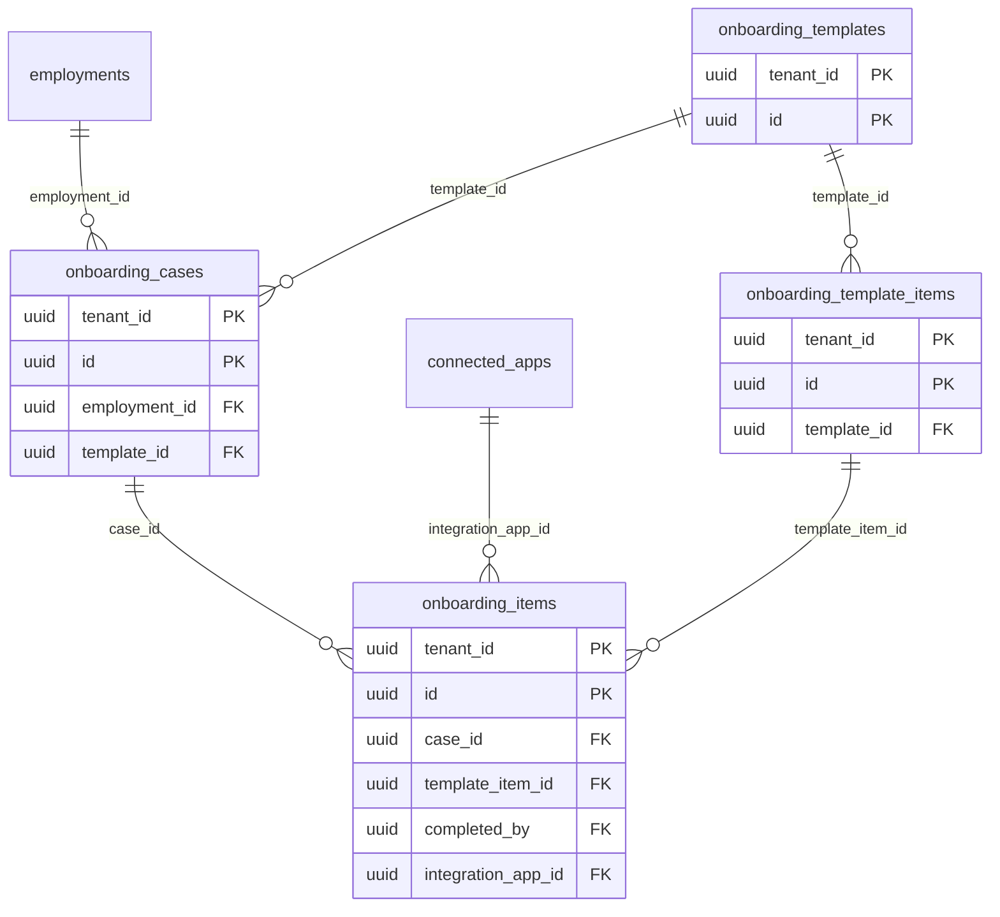

## Time and attendance

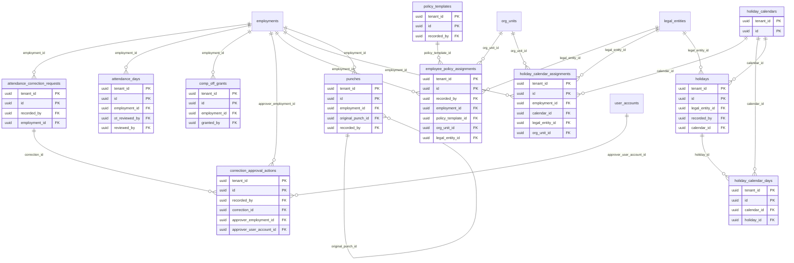

## Leave

```mermaid
erDiagram
    leave_applications {
        uuid tenant_id PK
        uuid id PK
        uuid recorded_by FK
        uuid employment_id FK
        uuid leave_type_id FK
        uuid document_id FK
    }
    leave_approval_actions {
        uuid tenant_id PK
        uuid id PK
        uuid recorded_by FK
        uuid application_id FK
        uuid approver_employment_id FK
        uuid approver_user_account_id FK
    }
    leave_balance_buckets {
        uuid tenant_id PK
        uuid id PK
        uuid recorded_by FK
    }
    leave_balance_transactions {
        uuid tenant_id PK
        uuid id PK
        uuid employment_id FK
        uuid bucket_id FK
        uuid leave_type_id FK
        uuid recorded_by FK
        uuid approved_by FK
    }
    leave_balances {
        uuid tenant_id PK
        uuid id PK
        uuid recorded_by FK
        uuid employment_id FK
        uuid leave_type_id FK
    }
    leave_bucket_policies {
        uuid tenant_id PK
        uuid id PK
        uuid policy_set_id FK
        uuid bucket_id FK
        uuid recorded_by FK
    }
    leave_encashments {
        uuid tenant_id PK
        uuid id PK
        uuid employment_id FK
        uuid leave_type_id FK
        uuid processed_by FK
    }
    leave_monthly_ledger {
        uuid tenant_id PK
        uuid id PK
        uuid employment_id FK
        uuid bucket_id FK
    }
    leave_policy_assignments {
        uuid tenant_id PK
        uuid id PK
        uuid recorded_by FK
        uuid employment_id FK
        uuid org_unit_id FK
        uuid legal_entity_id FK
        uuid leave_policy_set_id FK
    }
    leave_policy_sets {
        uuid tenant_id PK
        uuid id PK
        uuid recorded_by FK
    }
    leave_type_bucket_mapping {
        uuid tenant_id PK
        uuid id PK
        uuid leave_type_id FK
        uuid bucket_id FK
        uuid recorded_by FK
    }
    leave_types {
        uuid tenant_id PK
        uuid id PK
        uuid recorded_by FK
    }
    employee_kyc_documents ||--o{ leave_applications : document_id
    employments ||--o{ leave_applications : employment_id
    leave_types ||--o{ leave_applications : leave_type_id
    leave_applications ||--o{ leave_approval_actions : application_id
    employments ||--o{ leave_approval_actions : approver_employment_id
    user_accounts ||--o{ leave_approval_actions : approver_user_account_id
    leave_balance_buckets ||--o{ leave_balance_transactions : bucket_id
    employments ||--o{ leave_balance_transactions : employment_id
    leave_types ||--o{ leave_balance_transactions : leave_type_id
    employments ||--o{ leave_balances : employment_id
    leave_types ||--o{ leave_balances : leave_type_id
    leave_balance_buckets ||--o{ leave_bucket_policies : bucket_id
    leave_policy_sets ||--o{ leave_bucket_policies : policy_set_id
    employments ||--o{ leave_encashments : employment_id
    leave_types ||--o{ leave_encashments : leave_type_id
    leave_balance_buckets ||--o{ leave_monthly_ledger : bucket_id
    employments ||--o{ leave_monthly_ledger : employment_id
    employments ||--o{ leave_policy_assignments : employment_id
    leave_policy_sets ||--o{ leave_policy_assignments : leave_policy_set_id
    legal_entities ||--o{ leave_policy_assignments : legal_entity_id
    org_units ||--o{ leave_policy_assignments : org_unit_id
    leave_types ||--o{ leave_separation_rules : leave_type_id
    leave_balance_transactions ||--o{ leave_separation_settlements : balance_transaction_id
    leave_balance_buckets ||--o{ leave_separation_settlements : bucket_id
    leave_types ||--o{ leave_separation_settlements : leave_type_id
    leave_balance_buckets ||--o{ leave_type_bucket_mapping : bucket_id
    leave_types ||--o{ leave_type_bucket_mapping : leave_type_id
```

## Approvals

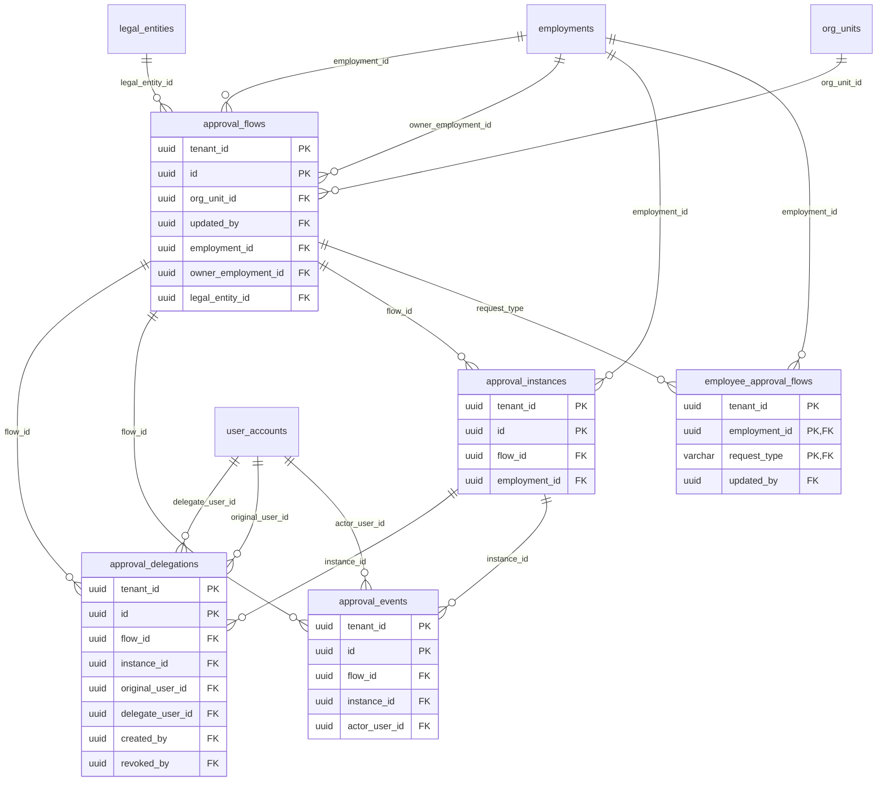

## Recruitment

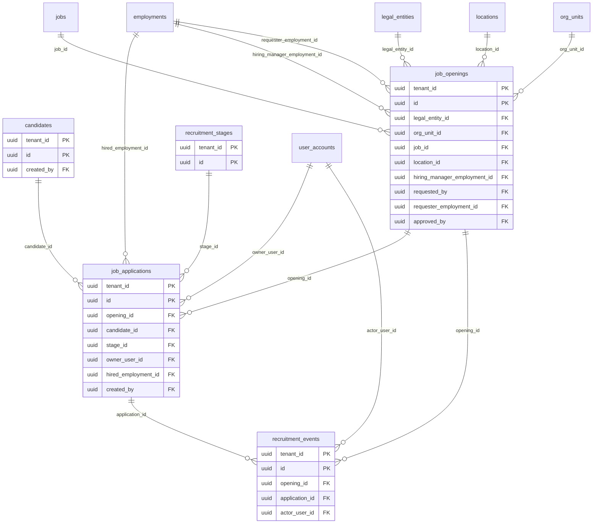

## Payroll

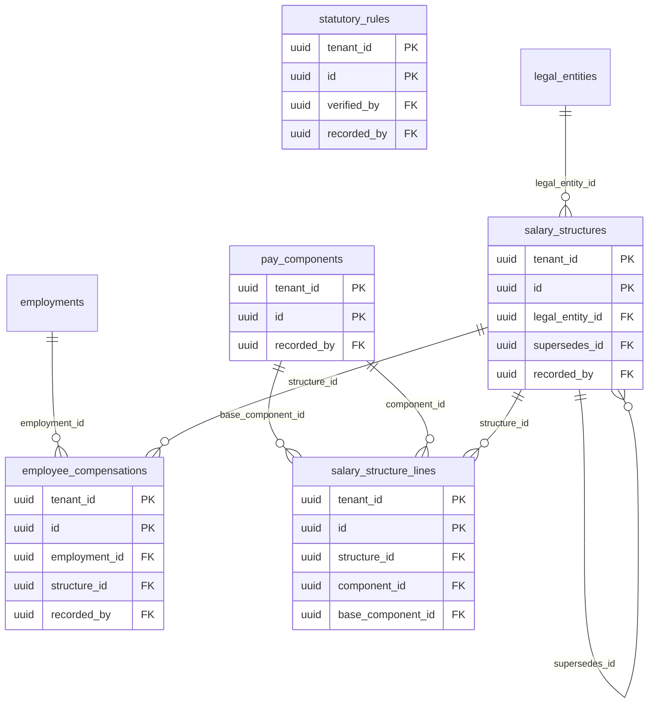

## Integrations

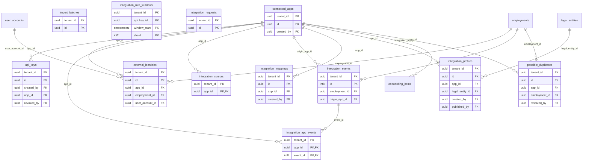

## Reports, history and jobs

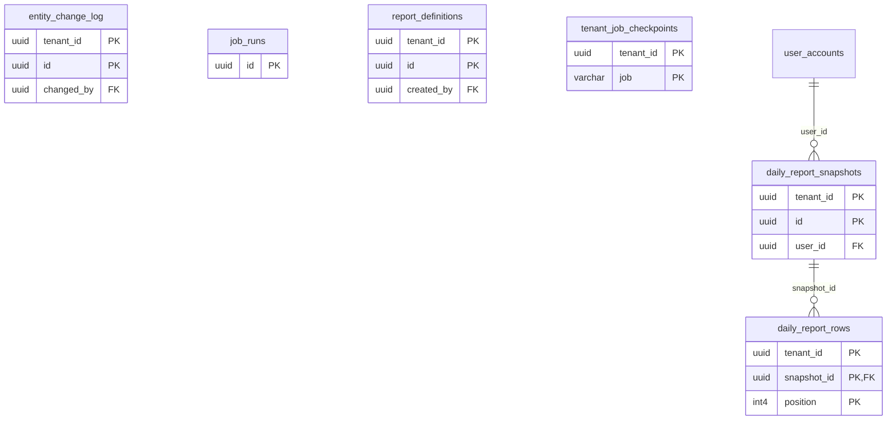

## Other

```mermaid
erDiagram
    attendance_group_access {
        uuid tenant_id PK
        uuid id PK
        uuid group_id FK
        uuid user_account_id FK
        uuid created_by FK
    }
    attendance_group_members {
        uuid tenant_id PK
        uuid id PK
        uuid group_id FK
        uuid employment_id FK
        uuid created_by FK
    }
    attendance_groups {
        uuid tenant_id PK
        uuid id PK
        uuid legal_entity_id FK
        uuid created_by FK
    }
    attendance_marks {
        uuid tenant_id PK
        uuid id PK
        uuid employment_id FK
        uuid marked_by FK
    }
    brand_assets {
        uuid tenant_id PK
        uuid id PK
        uuid uploaded_by FK
    }
    brand_profiles {
        uuid tenant_id PK
        uuid id PK
        uuid legal_entity_id FK
        uuid logo_asset_id FK
        uuid recorded_by FK
    }
    company_transfers {
        uuid tenant_id PK
        uuid id PK
        uuid person_id FK
        uuid from_employment_id FK
        uuid to_employment_id FK
        uuid created_by FK
    }
    document_signatories {
        uuid tenant_id PK
        uuid id PK
        uuid legal_entity_id FK
        uuid signature_asset_id FK
        uuid recorded_by FK
    }
    employment_spells {
        uuid tenant_id PK
        uuid id PK
        uuid employment_id FK
        uuid created_by FK
    }
    leave_separation_rules {
        uuid tenant_id PK
        uuid id PK
        uuid legal_entity_id FK
        uuid leave_type_id FK
        uuid created_by FK
    }
    leave_separation_settlements {
        uuid tenant_id PK
        uuid id PK
        uuid employment_id FK
        uuid spell_id FK
        uuid leave_type_id FK
        uuid bucket_id FK
        uuid balance_transaction_id FK
        uuid created_by FK
    }
    payslip_templates {
        uuid tenant_id PK
        uuid id PK
        uuid legal_entity_id FK
        uuid signatory_id FK
        uuid recorded_by FK
    }
    prior_service {
        uuid tenant_id PK
        uuid id PK
        uuid person_id FK
        uuid document_id FK
        uuid created_by FK
    }
    rejoin_policies {
        uuid tenant_id PK
        uuid id PK
        uuid legal_entity_id FK
        uuid created_by FK
    }
    rejoin_records {
        uuid tenant_id PK
        uuid id PK
        uuid employment_id FK
        uuid personnel_action_id FK
        uuid previous_spell_id FK
        uuid new_spell_id FK
        uuid approved_by FK
        uuid created_by FK
    }
    reminder_outbox {
        uuid tenant_id PK
        uuid id PK
        uuid rule_id FK
    }
    reminder_rules {
        uuid tenant_id PK
        uuid id PK
        uuid legal_entity_id FK
        uuid org_unit_id FK
        uuid created_by FK
        uuid updated_by FK
    }
    attendance_groups ||--o{ attendance_group_access : group_id
    user_accounts ||--o{ attendance_group_access : user_account_id
    employments ||--o{ attendance_group_members : employment_id
    attendance_groups ||--o{ attendance_group_members : group_id
    legal_entities ||--o{ attendance_groups : legal_entity_id
    employments ||--o{ attendance_marks : employment_id
    legal_entities ||--o{ brand_profiles : legal_entity_id
    brand_assets ||--o{ brand_profiles : logo_asset_id
    employments ||--o{ company_transfers : from_employment_id
    persons ||--o{ company_transfers : person_id
    employments ||--o{ company_transfers : to_employment_id
    legal_entities ||--o{ document_signatories : legal_entity_id
    brand_assets ||--o{ document_signatories : signature_asset_id
    employments ||--o{ employment_spells : employment_id
    leave_types ||--o{ leave_separation_rules : leave_type_id
    legal_entities ||--o{ leave_separation_rules : legal_entity_id
    leave_balance_transactions ||--o{ leave_separation_settlements : balance_transaction_id
    leave_balance_buckets ||--o{ leave_separation_settlements : bucket_id
    employments ||--o{ leave_separation_settlements : employment_id
    leave_types ||--o{ leave_separation_settlements : leave_type_id
    employment_spells ||--o{ leave_separation_settlements : spell_id
    legal_entities ||--o{ payslip_templates : legal_entity_id
    document_signatories ||--o{ payslip_templates : signatory_id
    employee_kyc_documents ||--o{ prior_service : document_id
    persons ||--o{ prior_service : person_id
    legal_entities ||--o{ rejoin_policies : legal_entity_id
    employments ||--o{ rejoin_records : employment_id
    employment_spells ||--o{ rejoin_records : new_spell_id
    personnel_actions ||--o{ rejoin_records : personnel_action_id
    employment_spells ||--o{ rejoin_records : previous_spell_id
    reminder_rules ||--o{ reminder_outbox : rule_id
    legal_entities ||--o{ reminder_rules : legal_entity_id
    org_units ||--o{ reminder_rules : org_unit_id
```

## Tables

| Table | Area | What it holds |
|---|---|---|
| `api_keys` | Integrations | Credentials a connected app uses; stored as hashes. |
| `approval_delegations` | Approvals | Temporary hand-over of an approver's authority. |
| `approval_events` | Approvals | Append-only history of approval decisions and delegations. |
| `approval_flows` | Approvals | Configured approval routes for a request type. |
| `approval_instances` | Approvals | A running approval of one request, with a snapshot of its steps. |
| `assignment_managers` | People | Who manages an assignment over time, by manager type. No overlaps per type; effective_to is exclusive. |
| `assignments` | People | Where an employment sits over time (unit, location, job, grade, position). No overlaps; effective_to is exclusive. |
| `attendance_correction_requests` | Time and attendance | A request to correct a day's attendance, and its status. |
| `attendance_days` | Time and attendance | The calculated attendance of one employee on one work date. |
| `attendance_group_access` | Other | Who may see an attendance group's daily sheet (VIEW) or also mark it (MARK), granted per group by HR. |
| `attendance_group_members` | Other | Who is in which attendance group and from when; effective_to is the first day they are no longer in it. A person is in at most one group on any day. |
| `attendance_groups` | Other | Groups of people whose attendance is marked, not punched (guards, drivers, cleaners): a name, optionally the one company it belongs to, retired by archiving. |
| `attendance_marks` | Other | Every time a marked day was set or cleared: the employee and date, the status (NULL: cleared) and any in/out times set, who did it, when, through what, and why. |
| `auth_throttle` | Platform and access | Failed-attempt counters and lockouts for sign-in and similar endpoints. |
| `brand_assets` | Other | Logos and signature images uploaded for documents, re-encoded to PNG. Never changed or removed, so a payslip issued with an image can always be reproduced. |
| `brand_profiles` | Other | How documents look: logo, colours, footer and contact details. The row without a company is the group default; a company row overrides only the fields it sets. |
| `candidates` | Recruitment | People who applied or were sourced. |
| `comp_off_grants` | Time and attendance | Compensatory leave earned for working on an off day. |
| `company_transfers` | Other | A person moved from one company of the group to another: the employment they left, the one they joined, when, and whether leave was carried over or settled. |
| `connected_apps` | Integrations | Outside systems a tenant connects (ERP, CRM, BI). |
| `correction_approval_actions` | Time and attendance | Append-only decisions on attendance correction requests. |
| `cost_centres` | Organisation | Cost centres that assignments and units are charged to. |
| `daily_report_rows` | Reports, history and jobs | The rows of a cached daily report. |
| `daily_report_snapshots` | Reports, history and jobs | Cached daily report results per login, kept until expiry. |
| `dashboard_layouts` | Platform and access | Per-login widget layout of a dashboard. |
| `document_signatories` | Other | People who sign documents (payslips, later letters): name, designation and an optional signature image; for one company, or for any company when none is set. |
| `employee_approval_flows` | Approvals | The approval flow chosen for one employee and request type. |
| `employee_compensations` | Payroll | An employee's salary over time. No overlaps. |
| `employee_id_schemes` | Organisation | How new employee numbers are generated, per company or tenant-wide. |
| `employee_kyc_documents` | People | Uploaded KYC documents and their verification status. |
| `employee_kyc_records` | People | An employee's identity, statutory and bank details (encrypted). |
| `employee_policy_assignments` | Time and attendance | Which attendance policy applies to an employee, unit or company from a date. The latest start wins; effective_to is inclusive. |
| `employment_spells` | Other | One stint of an employment: when the person joined and left. A rejoin opens the next stint; the employment record itself is reused. |
| `employments` | People | A person's employment with one company: the employee record. |
| `entity_change_log` | Reports, history and jobs | Append-only field-level history of changes to master data. |
| `external_identities` | Integrations | An employee's id in a connected app. |
| `grades` | Organisation | Pay grades or bands, ordered by sequence. |
| `holiday_calendar_assignments` | Time and attendance | Which calendar an employee, unit, company or the whole tenant follows. One per target at a time; effective_to is inclusive. |
| `holiday_calendar_days` | Time and attendance | The holidays a calendar contains. |
| `holiday_calendars` | Time and attendance | A named list of holidays for a year. |
| `holidays` | Time and attendance | A holiday, either in the tenant's library or on a calendar. |
| `import_batches` | Integrations | Records of bulk imports from other systems. |
| `integration_app_events` | Integrations | Each app's position in the events feed. |
| `integration_cursors` | Integrations | How far each app has read the events feed. |
| `integration_events` | Integrations | Outbox of employee changes for connected apps to read. |
| `integration_mappings` | Integrations | A connected app's values mapped to HRMS companies, units and roles. |
| `integration_profiles` | Integrations | Versioned settings of a connected app; published versions are frozen. |
| `integration_rate_windows` | Integrations | Per-key request counters for rate limiting. |
| `integration_requests` | Integrations | Log of every sync request from a connected app (retention-pruned). |
| `job_applications` | Recruitment | A candidate in the pipeline of one opening. |
| `job_openings` | Recruitment | A requisition to hire, its approval and status. |
| `job_runs` | Reports, history and jobs | One row per background job run, across all tenants, for monitoring. |
| `jobs` | Organisation | Job titles (designations). |
| `kyc_access_log` | People | Append-only record of who viewed or unmasked KYC data. |
| `leave_applications` | Leave | A request for leave and its status. |
| `leave_approval_actions` | Leave | Append-only decisions on leave applications. |
| `leave_balance_buckets` | Leave | Balances that one or more leave types draw from. |
| `leave_balance_transactions` | Leave | Append-only ledger of every change to a leave balance. |
| `leave_balances` | Leave | Yearly balance per employee and leave type. |
| `leave_bucket_policies` | Leave | The entitlement rules of a bucket within a policy set. |
| `leave_encashments` | Leave | Leave days paid out instead of taken. |
| `leave_monthly_ledger` | Leave | Monthly movement of each bucket per employee, opening to closing. |
| `leave_policy_assignments` | Leave | Which leave policy set applies to an employee, unit or company from a date. The latest start wins; effective_to is inclusive. |
| `leave_policy_sets` | Leave | A named set of leave entitlements. |
| `leave_separation_rules` | Other | What to do with unused leave when someone leaves, for a company and leave type (either may be 'any') from a date. The most specific rule in force applies. |
| `leave_separation_settlements` | Other | What was done with one leave balance when one stint of an employment ended: lapsed, encashed, or held (and later lapsed or restored on a rejoin). |
| `leave_type_bucket_mapping` | Leave | Which bucket each leave type draws from. |
| `leave_types` | Leave | Kinds of leave and their application rules. |
| `legal_entities` | Organisation | A company of the tenant: the employer of record. |
| `locations` | Organisation | A place people work (office, plant, site), optionally tied to a company. |
| `onboarding_cases` | Onboarding | An onboarding checklist started for one new employee. |
| `onboarding_items` | Onboarding | One task of an onboarding case and its progress. |
| `onboarding_template_items` | Onboarding | The tasks of an onboarding template. |
| `onboarding_templates` | Onboarding | Reusable onboarding checklists. |
| `org_units` | Organisation | Departments and teams, as a tree within a company. |
| `pay_components` | Payroll | Earnings, deductions and contributions a salary is built from. |
| `payslip_templates` | Other | What a payslip shows and in which layout. The row without a company is the group default; a company with its own row uses that instead, as a whole. |
| `personnel_actions` | People | Hires, transfers, promotions, separations and similar changes. |
| `persons` | People | A human being. One person can have several employments over time. |
| `platform_admins` | Platform and access | Operators of the platform console. Not tenant users. |
| `platform_audit_log` | Platform and access | Append-only record of what platform admins did. |
| `platform_password_reset_tokens` | Platform and access | One-time password-reset links for platform admins. |
| `policy_templates` | Time and attendance | Attendance rules: working hours, grace, half day, overtime. |
| `positions` | Organisation | Budgeted seats in an org unit, for a job and grade. |
| `possible_duplicates` | Integrations | Records from an app that look like an existing employee. |
| `prior_service` | Other | A period of work for an earlier employer that this company recognises for leave eligibility, gratuity, both or neither. Belongs to the person, not one employment. |
| `punches` | Time and attendance | Clock-in and clock-out events. Never edited: corrections add rows (is_corrected), and VOID rows cancel earlier ones. |
| `recruitment_events` | Recruitment | Append-only history of what happened to openings and applications. |
| `recruitment_stages` | Recruitment | Pipeline stages a tenant uses for candidates. |
| `rejoin_policies` | Other | How a company treats someone who rejoins: continue earlier service by default or start fresh, and how long a break can be before it must start fresh. |
| `rejoin_records` | Other | What was decided when a separated employee rejoined: keep earlier service and leave (CONTINUE) or start over (FRESH), who approved it, and why. |
| `reminder_outbox` | Other | Reminder mails queued for delivery. The people are kept as a payload and the mail is worded when it is sent. FAILED means every attempt was used. |
| `reminder_rules` | Other | A birthday or work-anniversary reminder: when it runs, who is told, and the wording. last_run_date is the local date it last queued mail for. |
| `report_definitions` | Reports, history and jobs | Saved report layouts and filters. |
| `role_assignments` | Platform and access | A role granted to a login, with the scope it applies to. |
| `roles` | Platform and access | Roles a tenant can grant (built-in ones are is_system). |
| `salary_structure_lines` | Payroll | How one component of a salary structure is calculated. |
| `salary_structures` | Payroll | Versioned salary templates; a published version is never edited. |
| `statutory_rules` | Payroll | Statutory values (PF, ESIC and similar) by rule and date, verified. |
| `tenant_job_checkpoints` | Reports, history and jobs | The last period a background job completed for a tenant. |
| `tenants` | Platform and access | A customer organisation. Every tenant-scoped row belongs to exactly one. |
| `user_accounts` | Platform and access | A login. At most one per employee. Each tenant has one SYSTEM account (id 0) that background jobs act as; it cannot sign in. |
| `user_preferences` | Platform and access | Per-login display preferences (theme, dashboard style). |
