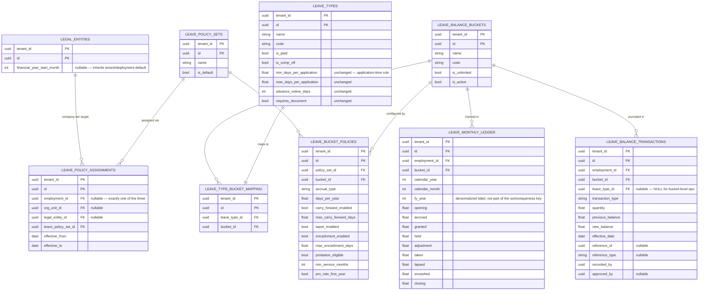
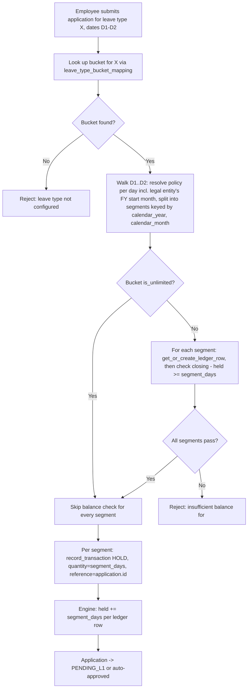
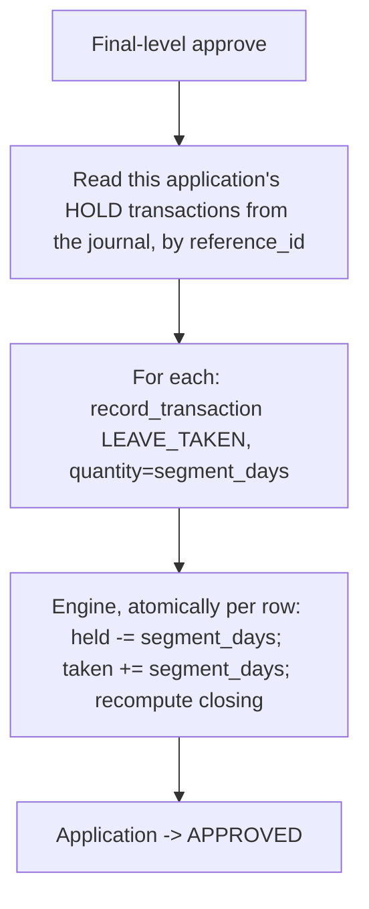
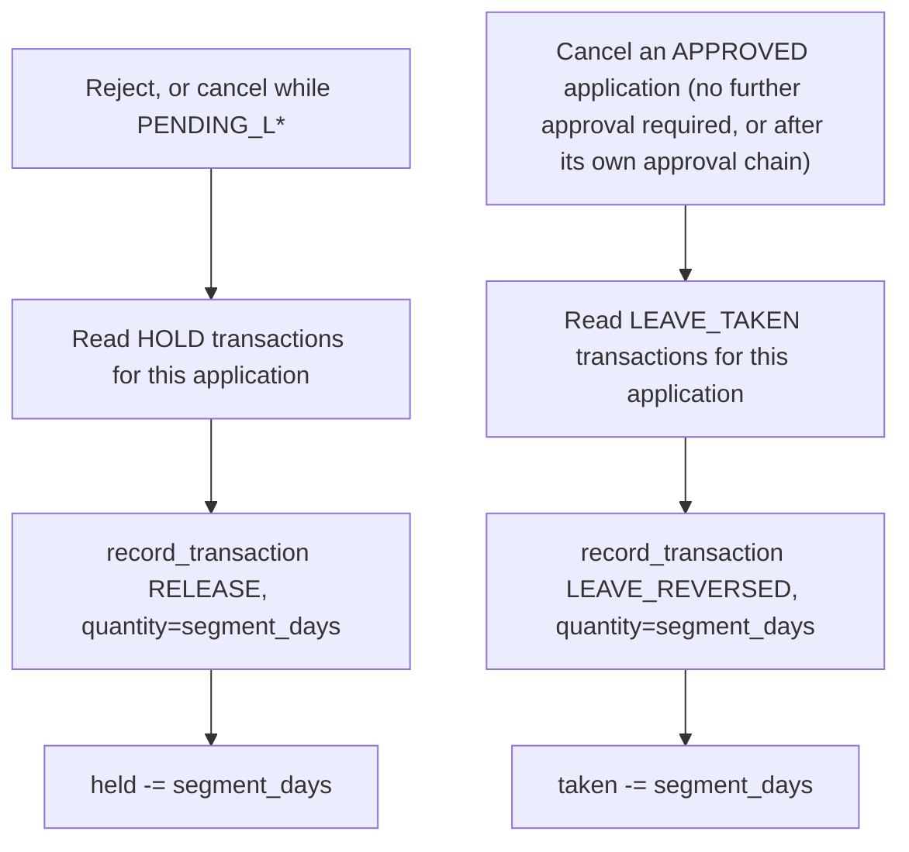
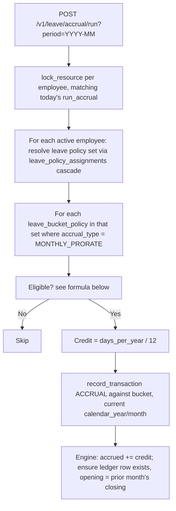
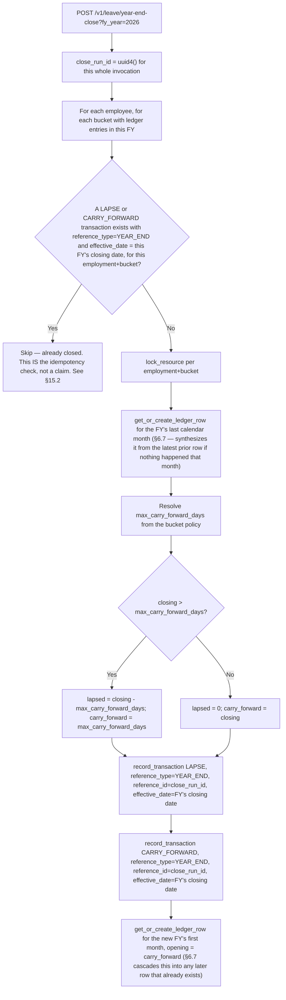
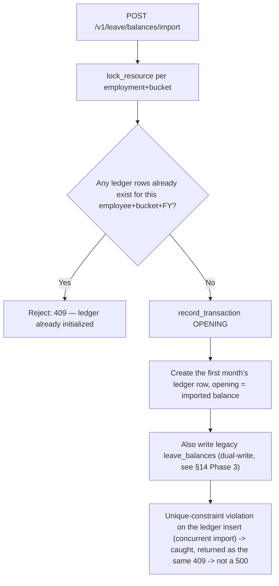

# Leave Management System — Enterprise Design Document

> **Module**: `backend/src/hrms/modules/leave/` (plus one column on `org/models.py::LegalEntity`)
> **Approach**: Evolve the existing module in place — additive tables, a new accounting engine, a refactored service layer
> **Phase**: 1 of 6 (see [§14 Phased Execution Plan](#14-phased-execution-plan)) — backend only

**Status: design, not implemented — Phase 0 decisions closed.** v1.1, 2026-09-29. This revises a first
draft of the same idea against the actual code in `modules/leave/`, `modules/policy/`, `core/locking.py`
and the RLS/immutability precedent already established for `kyc_access_log` (migration `0019`). The
draft's core idea — a dedicated balance bucket abstraction, an immutable transaction journal, and a
materialized monthly ledger — is sound and kept. This revision fixes six places where the draft's schema
breaks against code that already exists, and trims one place where it invented configurability nobody
has asked for. See [§3](#3-what-the-draft-got-wrong--corrected-here) for the corrections, with evidence.
A second review of *this* document (v1) caught three more implementation-level gaps, fixed in [§15](#15-second-review--three-more-corrections);
all five Phase 0 decisions are now resolved (§10).

---

## 1. Design Decisions Summary

| Decision | Choice | Changed from the draft? |
|---|---|---|
| Approach | Evolve existing `modules/leave/` in place | — |
| Financial year | Per **legal entity** (`legal_entities.financial_year_start_month`, nullable, inherits a tenant/deployment default), not per policy set | **Yes** — §3.2 |
| Ledger period key | `(calendar_year, calendar_month)` — real, sortable dates; `fy_year` is a denormalized label column for FY-scoped queries | **Yes** — §3.2 |
| Balance buckets | `leave_balance_buckets` + `leave_type_bucket_mapping` (unchanged from the draft — this part was right) | No |
| Bucket entitlement rules | `leave_bucket_policies`: **one row per (policy set, bucket)**, not per (policy set, leave type) | **Yes** — §3.3 |
| Application-time rules | Stay on `LeaveType` (`min/max_days_per_application`, `advance_notice_days`, `requires_document`) — **not duplicated** into the new tables | **Yes** — §3.4, scope cut |
| Leave policy assignment | New `leave_policy_assignments` table, same shape as `EmployeePolicyAssignment` — **not** a column bolted onto it | **Yes** — §3.1 |
| Monthly ledger | Materialized `leave_monthly_ledger`: 1 row per (employee, bucket, calendar year, calendar month), plus a `held` column | **Yes** — §3.5 |
| Pending-hold parity | `HOLD` / `RELEASE` transaction types, posted at submission — matches today's `pending_days` behavior exactly | **Yes** — §3.5 |
| Transaction audit | Immutable `leave_balance_transactions` — append-only, and **enforced by database privileges**, not just code discipline | **Yes** — §8 |
| Concurrency | Every ledger/journal mutation goes through `engine.py`, which takes `core.locking.lock_resource` per (employment, bucket) — no bypassing it | **Yes** — §6, §8 |
| Year-end close | `POST /v1/leave/year-end-close`, idempotent via a journal lookup, not just a claim | Clarified — §6.5 |
| Opening balance | `POST /v1/leave/balances/import` — one-time migration endpoint | No |
| Read-path cutover | `GET /v1/leave/balances` starts reading the ledger in **this** phase (Phase 3), same response shape — not deferred indefinitely | **Yes** — §7.2, §14 |
| LWP | `is_paid=False` type mapped to an `is_unlimited` bucket; transactions logged from cutover forward, history not backfilled | Clarified — §3.6, §10 |

---

## 2. What's already true — not something to build

The draft treated several already-solved problems as open. They aren't:

- **`LeaveType` already carries per-type rules** — `days_per_year`, `carry_forward`, `max_carry_forward_days`,
  `min_days_per_application`, `max_days_per_application`, `advance_notice_days`, `requires_document`
  ([leave/models.py:43-70](../backend/src/hrms/modules/leave/models.py)) — and
  [`_validate_application`](../backend/src/hrms/modules/leave/router.py) reads them directly. Everything
  in this document about *application-time* rules (can you even submit this request) leaves those fields
  exactly where they are; only *balance/entitlement* rules (how many days, does it carry forward, does it
  lapse) move to the new bucket-policy tables.
- **A pending-days hold already exists and is load-bearing.** `submit_application` posts `pending=+1`
  before any approval happens, specifically so two overlapping applications can't both clear a balance
  check that only one of them should pass; approval flips it to `used`, rejection/cancellation releases
  it (`router.py:544-579, 627, 664-702`). The new ledger has to keep this, not drop it — see §3.6.
- **Cross-boundary applications already get split and posted per segment.** `_allocate_days` buckets a
  date range by `day.year` and `_change_application_balance` loops the result, posting one balance
  adjustment per segment (`router.py:993-1016, 1069-1088`). The new engine keeps this shape, just with
  the segment key changed from calendar year to `(bucket, calendar_year, calendar_month)`.
- **A locking primitive already exists and is the established pattern for balance mutation**:
  `core.locking.lock_resource(session, tenant_id, resource)`, used today in `init_balances` and
  `run_accrual` (`router.py:198, 424`). The new engine uses it too — see §4 and §8.
- **Append-only enforced at the database level already has a precedent.** Migration `0019` makes
  `kyc_access_log` genuinely un-updatable — `ENABLE`/`FORCE ROW LEVEL SECURITY`, then
  `REVOKE ALL ... FROM hrms_app` and `GRANT SELECT, INSERT` only — not just a comment asking developers
  not to update it. `leave_balance_transactions` gets the same treatment. See §8.
- **The composite `(tenant_id, id)` primary key, `recorded_at`/`recorded_by`/`version`/`archived_at`
  convention, and manual registration in `model_registry.py`** are all established and unchanged by this
  design — every new table below follows them.

---

## 3. What the draft got wrong — corrected here

### 3.1 It bolted leave policy onto the attendance policy table

The draft added a nullable `leave_policy_set_id` straight onto `EmployeePolicyAssignment` and reused its
cascade. That table is attendance-specific: `policy_template_id` is `NOT NULL`
([policy/models.py:78](../backend/src/hrms/modules/policy/models.py)) and
[`_policy_for`](../backend/src/hrms/modules/policy/engine.py) does an unconditional lookup on it. Adding
a second, independent axis to the same row means changing a department's leave policy either forces you
to also resupply its attendance template on the same write, or requires making `policy_template_id`
nullable and breaking that lookup. **Fixed:** a new `leave_policy_assignments` table, identical shape
(`employment_id | org_unit_id | legal_entity_id`, `effective_from/to`), completely separate from
attendance. See §3.7 for how much of the resolution code is actually shared (some, not the table).

### 3.2 "Financial year" was a new column; it needed to be a new key

Two problems, both now fixed:

- **The split point.** `_allocate_days` keys by `day.year` (calendar year) today. A `financial_year_start_month`
  living only on the new ledger, with nothing changing how applications get segmented, means the code that
  decides *where* to split a multi-month application never learns about the FY boundary at all. Fixed by
  making the same day-walk FY-aware (§6.1) — it now asks the resolved policy for the legal entity's FY
  start month while it walks, splitting on that boundary instead of Dec 31.
- **Whose financial year.** The draft put `financial_year_start_month` on `leave_policy_sets`, which are
  assignable per employee/department/entity — so two employees in one tenant could have ledger rows
  labeled `fy_year=2026, month=4` meaning different real calendar months. Fixed by moving it to
  `legal_entities.financial_year_start_month` (nullable — falls back to a tenant/deployment default,
  `HRMS_DEFAULT_FINANCIAL_YEAR_START_MONTH`, mirroring `default_timezone`/`default_work_start` in
  `core/config.py`). This matches how this codebase already scopes "company-wide" settings — `holidays`
  already uses `legal_entity_id IS NULL` = tenant-wide, `IS NOT NULL` = one company
  ([time/models.py — `Holiday`](../backend/src/hrms/modules/time/models.py)) for exactly the same reason
  (different companies in one tenant can observe different rules). Every employee has a stable
  `legal_entity_id` from hire, so this is always resolvable, and everyone under one legal entity now
  genuinely shares one FY calendar.
- On top of that, the ledger itself is now keyed by real `(calendar_year, calendar_month)` — trivially
  sortable, trivially joins against `attendance_days.work_date`/`holidays.holiday_date` — with `fy_year`
  kept only as a denormalized label column for "show me all of FY2026" queries. See §5.7 for the schema.

### 3.3 Its own worked example double-counts under its own algorithm

Draft §9 Scenario B has two leave types (CL, SL) sharing one bucket (PL_BAL) with "one combined profile,
14 days/year." But the draft's own schema keys `leave_policy_profiles` by `(policy_set_id, leave_type_id)`
— so Scenario B actually needs *two* profile rows, one per leave type, both pointing at PL_BAL. If both
carry `days_per_year=14` (as the scenario implies), the accrual algorithm in draft §4.2 — "for each
profile where accrual_type=MONTHLY_PRORATE, credit = days_per_year/12" — runs twice and credits the
bucket 28 days/year, not 14. **Fixed:** entitlement/accrual/carry-forward/encashment rules move to
`leave_bucket_policies`, keyed **per (policy set, bucket)** — exactly one row governs how a bucket
behaves, however many leave types feed it. See §13 (Scenario B, corrected).

### 3.4 It duplicated `LeaveType`'s rule fields with no reconciliation story

The draft's profile table repeated `min_days_per_application`, `max_days_per_application`,
`advance_notice_days`, `requires_document` — fields `_validate_application` already reads straight off
`LeaveType`. Two sources of truth for the same rule, with no stated precedence. **Fixed, by cutting the
duplication rather than reconciling it:** those stay exactly where they are, on `LeaveType`. They're
*application-time* rules (can this specific request even be submitted), not *entitlement* rules (how
many days does this bucket hold, does it carry forward) — the two concerns the draft's single profile
table had conflated. Nobody has asked for "sick leave needs a doctor's note only in the Factory Workers
policy set" — if that shows up later, it's a small additive table (§10 decision 4), not a reason to
duplicate four fields now.

### 3.5 The ledger dropped the pending-hold; draft §4.1's balance check is a race without a lock

Two related fixes:

- **`held` is a real column now**, not absent. See §5.7 and §6.2.
- **Every invariant in §8 needs the lock it wasn't given.** `init_balances`/`run_accrual` already take
  `lock_resource(session, tenant_id, f"leave:{employment_id}")` before mutating a balance
  (`router.py:198, 424`) — this codebase's answer to exactly this race. The draft's engine functions never
  mention it, so "opening balance is one-time" and "year-end close is idempotent" were promises with
  nothing enforcing them between the read and the write. **Fixed:** `engine.record_transaction` (§6, §8)
  takes the lock itself, keyed per `(employment_id, bucket_id)`, so every call site gets it automatically
  — API endpoints can't forget it.

### 3.6 LWP's behavior change was implicit

Today, `_change_application_balance` early-returns for unpaid leave
(`if not lt.is_paid and not lt.is_comp_off: return`) — no row, no trace. Scenario C has LWP posting to an
`is_unlimited` bucket "for payroll export." That's a real, deliberate improvement — but it's a behavior
change, not a continuation, and history isn't there to backfill. Stated explicitly now: see §10.

### 3.7 What the draft got right (kept as-is)

- `leave_balance_buckets` + `leave_type_bucket_mapping`, tenant-global, one bucket per leave type. Making
  this vary per policy set would make one leave type mean structurally different things for different
  employees — not worth the flexibility.
- The transaction-type enum's shape (immutable journal, `reference_id`/`reference_type` linking back to
  the source record).
- `POST /v1/leave/balances/import` as a one-time, reject-if-already-initialized endpoint.
- Treating year-end close and opening-balance import as explicit, HR-triggered actions rather than
  something that happens implicitly inside a request path (this codebase already does the equivalent for
  scheduled personnel actions and monthly accrual — deliberate, auditable, re-runnable operations, not
  magic).

---

## 4. Entity-Relationship Overview



---

## 5. New / Changed Tables — Detailed Schema

### 5.1 `legal_entities.financial_year_start_month` (new column, existing table)

| Column | Type | Constraints | Description |
|---|---|---|---|
| `financial_year_start_month` | INT | NULLABLE, CHECK 1-12 | `NULL` = inherit the tenant's default (`HRMS_DEFAULT_FINANCIAL_YEAR_START_MONTH`, default 4 = April) |

### 5.2 `leave_balance_buckets` — unchanged from the draft

| Column | Type | Constraints | Description |
|---|---|---|---|
| `tenant_id` | UUID | PK, RLS | |
| `id` | UUID | PK | |
| `name` | VARCHAR(100) | NOT NULL | e.g. "Paid Leave Balance" |
| `code` | VARCHAR(20) | NOT NULL, UNIQUE per tenant | e.g. "PL_BAL" |
| `is_unlimited` | BOOLEAN | DEFAULT FALSE | For LWP-style buckets |
| `is_active` | BOOLEAN | DEFAULT TRUE | |
| `recorded_at` / `recorded_by` / `archived_at` | | | Standard columns |

### 5.3 `leave_type_bucket_mapping` — unchanged from the draft

| Column | Type | Constraints | Description |
|---|---|---|---|
| `tenant_id` | UUID | PK, RLS | |
| `id` | UUID | PK | |
| `leave_type_id` | UUID | FK → `leave_types.id`, **UNIQUE per tenant** | One bucket per leave type |
| `bucket_id` | UUID | FK → `leave_balance_buckets.id` | |
| `recorded_at` / `recorded_by` | | | |

### 5.4 `leave_policy_sets`

| Column | Type | Constraints | Description |
|---|---|---|---|
| `tenant_id` | UUID | PK, RLS | |
| `id` | UUID | PK | |
| `name` | VARCHAR(100) | NOT NULL | e.g. "Standard Leave Policy" |
| `description` | VARCHAR(500) | | |
| `is_default` | BOOLEAN | DEFAULT FALSE | Tenant-level fallback when no assignment resolves |
| `recorded_at` / `recorded_by` / `version` / `archived_at` | | | |

Note: **no `financial_year_start_month` here** — see §3.2. A policy set is purely "what are the
entitlement rules," not "which calendar."

### 5.5 `leave_bucket_policies` (replaces the draft's `leave_policy_profiles`)

One row per **(policy set, bucket)** — not per leave type. This is the fix for §3.3.

| Column | Type | Constraints | Description |
|---|---|---|---|
| `tenant_id` | UUID | PK, RLS | |
| `id` | UUID | PK | |
| `policy_set_id` | UUID | FK → `leave_policy_sets.id` | |
| `bucket_id` | UUID | FK → `leave_balance_buckets.id` | |
| `accrual_type` | VARCHAR(20) | NOT NULL | `ANNUAL_UPFRONT`, `MONTHLY_PRORATE`, `NONE` |
| `days_per_year` | FLOAT | NOT NULL, ≥0 | Total annual entitlement for this bucket under this policy set |
| `carry_forward_enabled` | BOOLEAN | DEFAULT FALSE | |
| `max_carry_forward_days` | FLOAT | NULLABLE | `NULL` = no cap |
| `lapse_enabled` | BOOLEAN | DEFAULT TRUE | |
| `encashment_enabled` | BOOLEAN | DEFAULT FALSE | |
| `max_encashment_days` | FLOAT | NULLABLE | |
| `probation_eligible` | BOOLEAN | DEFAULT FALSE | See §6.4 for the exact eligibility formula |
| `min_service_months` | INT | DEFAULT 0 | |
| `pro_rate_first_year` | BOOLEAN | DEFAULT TRUE | |
| `recorded_at` / `recorded_by` | | | |

> **Constraint**: `UNIQUE(tenant_id, policy_set_id, bucket_id)` — exactly one profile per bucket per
> policy set, whatever leave types feed that bucket.

### 5.6 `leave_policy_assignments` (replaces the draft's edit to `EmployeePolicyAssignment`)

Same shape as attendance's `EmployeePolicyAssignment`, deliberately a separate table — see §3.1.

| Column | Type | Constraints | Description |
|---|---|---|---|
| `tenant_id` | UUID | PK, RLS | |
| `id` | UUID | PK | |
| `employment_id` | UUID | NULLABLE, indexed | Exactly one of these three set — DB check constraint, mirroring `EmployeePolicyAssignment` |
| `org_unit_id` | UUID | NULLABLE, indexed | |
| `legal_entity_id` | UUID | NULLABLE, indexed | |
| `leave_policy_set_id` | UUID | FK, NOT NULL | (Only one axis here, so no nullability trick needed) |
| `effective_from` | DATE | NOT NULL | |
| `effective_to` | DATE | NULLABLE | |
| `recorded_at` / `recorded_by` / `version` / `archived_at` | | | |

### 5.7 `leave_monthly_ledger`

| Column | Type | Constraints | Description |
|---|---|---|---|
| `tenant_id` | UUID | PK, RLS | |
| `id` | UUID | PK | |
| `employment_id` | UUID | FK, indexed | |
| `bucket_id` | UUID | FK → `leave_balance_buckets.id` | |
| `calendar_year` | INT | NOT NULL | Real year |
| `calendar_month` | INT | NOT NULL, CHECK 1-12 | Real month, January = 1 |
| `fy_year` | INT | NOT NULL, indexed | Denormalized label (e.g. 2026 for FY2026-27), computed from the legal entity's FY start month at row-creation time |
| `opening` | FLOAT | NOT NULL, DEFAULT 0 | |
| `accrued` | FLOAT | NOT NULL, DEFAULT 0 | |
| `granted` | FLOAT | NOT NULL, DEFAULT 0 | |
| `held` | FLOAT | NOT NULL, DEFAULT 0 | **New.** Days from applications currently pending approval against this bucket/month — see §3.5, §6.2 |
| `adjustment` | FLOAT | NOT NULL, DEFAULT 0 | |
| `taken` | FLOAT | NOT NULL, DEFAULT 0 | |
| `lapsed` | FLOAT | NOT NULL, DEFAULT 0 | |
| `encashed` | FLOAT | NOT NULL, DEFAULT 0 | |
| `closing` | FLOAT | NOT NULL, DEFAULT 0 | `= opening + accrued + granted + adjustment - taken - lapsed - encashed` — **`held` is deliberately not part of this formula**; see §6.2 |
| `recorded_at` | TIMESTAMPTZ | | |

> **Constraint**: `UNIQUE(tenant_id, employment_id, bucket_id, calendar_year, calendar_month)`
>
> **Invariant** (engine-enforced; restated as invariant 1 in §12): ordering by `(calendar_year, calendar_month)`,
> `row[i+1].opening == row[i].closing`.

### 5.8 `leave_balance_transactions`

| Column | Type | Constraints | Description |
|---|---|---|---|
| `tenant_id` | UUID | PK, RLS | |
| `id` | UUID | PK | |
| `employment_id` | UUID | FK, indexed | |
| `bucket_id` | UUID | FK → `leave_balance_buckets.id` | |
| `leave_type_id` | UUID | FK, NULLABLE | `NULL` for bucket-level ops (carry-forward, lapse) |
| `transaction_type` | VARCHAR(20) | NOT NULL | See enum below |
| `quantity` | FLOAT | NOT NULL | Positive for credits, negative for debits |
| `previous_balance` | FLOAT | NOT NULL | `closing - held` immediately before, i.e. what was actually available |
| `new_balance` | FLOAT | NOT NULL | Same measure, after |
| `effective_date` | DATE | NOT NULL | |
| `reason` | VARCHAR(500) | NULLABLE | |
| `reference_id` | UUID | NULLABLE | e.g. the `LeaveApplication.id`; for `YEAR_END` transactions, a fresh UUID generated once per close *invocation* (not persisted as its own table — see §15.1), shared by every transaction that run writes |
| `reference_type` | VARCHAR(30) | NULLABLE | `LEAVE_APPLICATION`, `ENCASHMENT`, `COMP_OFF`, `YEAR_END`, `IMPORT` |
| `recorded_by` | UUID | NOT NULL | Renamed from the draft's `created_by` — matches this codebase's convention everywhere else. `NULL`-able only in the SQLModel sense is not allowed here; scheduled jobs (accrual, year-end) record the triggering account or a system account, never NULL |
| `approved_by` | UUID | NULLABLE | Who approved (leave applications only) |
| `recorded_at` | TIMESTAMPTZ | NOT NULL | |

**Transaction types** (two added to the draft's nine — `HOLD`, `RELEASE` — see §3.5):

```
OPENING           Initial migration import
ACCRUAL           Monthly or annual accrual credit
GRANT             Ad-hoc credit (comp-off, manual)
HOLD              Balance reserved at application submission — held += quantity
RELEASE           Hold released without being taken (reject, cancel-while-pending) — held -= quantity
LEAVE_TAKEN        Approval: held -= quantity AND taken += quantity, together
LEAVE_REVERSED    Approved leave cancelled: taken -= quantity
ADJUSTMENT        Manual adjustment by HR
LAPSE             Balance lapsed at year-end
ENCASHMENT        Balance converted to payout
CARRY_FORWARD     Balance carried to next FY
```

### 5.9 `employee_policy_assignments` (attendance) — explicitly **not** touched

No column is added here. This is a deliberate decision, not an omission — see §3.1.

---

## 6. Leave Accounting Engine — Core Flows

**Hard rule, enforced by code review and by §8's DB privileges:** `leave_monthly_ledger` and
`leave_balance_transactions` are only ever written to from `modules/leave/engine.py`. Every function in
it that mutates either table acquires `core.locking.lock_resource(session, tenant_id,
f"leave:{employment_id}:{bucket_id}")` before reading the current ledger row, and holds it for the
duration of that (employment, bucket) mutation. No router function writes to these tables directly —
mirrors how `_adjust_balance` is already the only place today that touches `LeaveBalance`.

### 6.1 Submission flow (holds a balance; nothing is deducted yet)



### 6.2 Approval flow (final level only — converts a hold into an actual debit)



`held` is intentionally **not** part of the `closing` formula (§5.7) — it mirrors today's
`allocated + carry_forward - used - pending` exactly (`router.py:178, 963`), where availability is
computed at read/check time as `closing - held`, not folded into a stored running total. This is why
`LEAVE_TAKEN` both releases the hold and posts the debit in one step: nothing about the confirmed
`closing` balance changes at submission time, only what's available for a *new* hold to be checked
against.

### 6.3 Reject / cancel-while-pending, and cancel-after-approval



### 6.4 Monthly accrual flow



**Eligibility formula** (the draft never specified this):

```
eligible = (bucket_policy.probation_eligible OR employment.employment_state != 'PROBATION')
           AND tenure_months(employment.hire_date, as_of=today) >= bucket_policy.min_service_months
```

Both conditions are AND'd. `tenure_months` is a small pure function (whole months between `hire_date`
and `as_of`), added to `core/datetime_utils.py` alongside the existing date helpers.

### 6.5 Year-end close flow



### 6.6 Opening balance import flow



### 6.7 `get_or_create_ledger_row`, precisely — the piece every flow above depends on

Every flow in §6.1–6.6 calls this; none of them fully specified it, which is the gap a second review
caught (§15.2, §15.3). Its actual contract:

```
get_or_create_ledger_row(employment_id, bucket_id, calendar_year, calendar_month):
  if a row exists for exactly this (employment_id, bucket_id, calendar_year, calendar_month): return it.

  prior = the row for this (employment_id, bucket_id) with the greatest (calendar_year, calendar_month)
          STRICTLY LESS THAN the target — by calendar ordering, never by recorded_at/insertion order.
          (This matters: §6.1 can create a future row — an advance-dated application — before the
          months between now and then have rows of their own.)

  new_row.opening = prior.closing if prior exists else 0 (or the imported opening — see §6.6)
  new_row.{accrued,granted,held,adjustment,taken,lapsed,encashed} = 0
  new_row.closing = new_row.opening
  insert new_row

  # Forward cascade: if a row for this (employment_id, bucket_id) already exists at a LATER
  # (calendar_year, calendar_month) than the one just created — because an advance-dated
  # application materialized it earlier — that row's `opening` was computed against a `closing`
  # that didn't exist yet. Fix it forward:
  next_row = the row for this (employment_id, bucket_id) with the smallest (calendar_year, calendar_month)
             STRICTLY GREATER THAN the target, if any
  if next_row exists and next_row.opening != new_row.closing:
      next_row.opening = new_row.closing
      recalculate next_row.closing (opening changed; its own deltas for that month are unchanged)
      recurse: cascade forward from next_row the same way
```

`recalculate_closing` (§12, invariant 2) triggers this same cascade whenever a row's `closing` changes
for any reason (a new transaction, not just a fresh row) — a later accrual, an out-of-order correction,
or year-end close's own carry-forward all need to propagate into any future row that already exists. The
cascade is bounded by how many future rows actually exist for that (employment, bucket) — in practice a
handful at most, since advance-dated applications are weeks or months out, not years — and runs inside
the same per-`(employment_id, bucket_id)` lock §6's hard rule already takes, so it's never racing another
mutation to the same chain.

This one algorithm is what makes §6.5's "read the FY's last calendar month row" safe even for an
employee with zero activity that month (it synthesizes the row from whatever came before), and what
makes §6.1's advance-dated holds safe against later, intervening accruals (the cascade corrects them
forward instead of leaving them stale).

---

## 7. API Endpoints

### 7.1 New endpoints

| Method | Path | Permission | Description |
|---|---|---|---|
| **Balance buckets** | | | |
| `GET` | `/v1/leave/buckets` | `leave.read` | List all balance buckets |
| `POST` | `/v1/leave/buckets` | `leave.write` | Create a bucket |
| `PATCH` | `/v1/leave/buckets/{id}` | `leave.write` | Update a bucket |
| **Bucket mappings** | | | |
| `GET` | `/v1/leave/bucket-mappings` | `leave.read` | List type-to-bucket mappings |
| `POST` | `/v1/leave/bucket-mappings` | `leave.write` | Create/update a mapping |
| `DELETE` | `/v1/leave/bucket-mappings/{id}` | `leave.write` | Remove a mapping |
| **Leave policy sets** | | | |
| `GET` | `/v1/leave/policy-sets` | `leave.write` | List policy sets |
| `POST` | `/v1/leave/policy-sets` | `leave.write` | Create a policy set |
| `PATCH` | `/v1/leave/policy-sets/{id}` | `leave.write` | Update a policy set |
| **Bucket policies** (renamed from the draft's "profiles" — §3.3) | | | |
| `GET` | `/v1/leave/policy-sets/{set_id}/bucket-policies` | `leave.write` | List bucket policies in a set |
| `POST` | `/v1/leave/policy-sets/{set_id}/bucket-policies` | `leave.write` | Create one |
| `PATCH` | `/v1/leave/bucket-policies/{id}` | `leave.write` | Update one |
| `DELETE` | `/v1/leave/bucket-policies/{id}` | `leave.write` | Remove one |
| **Leave policy assignments** (new table — §3.1/§5.6) | | | |
| `GET` | `/v1/leave/policy-assignments` | `leave.write` | List assignments |
| `POST` | `/v1/leave/policy-assignments` | `leave.write` | Assign a policy set to an employee/department/entity |
| `DELETE` | `/v1/leave/policy-assignments/{id}` | `leave.write` | End an assignment |
| **Ledger & transactions** | | | |
| `GET` | `/v1/leave/ledger` | `leave.read` | Monthly ledger rows for an employee |
| `GET` | `/v1/leave/transactions` | `leave.read` | Transaction history for an employee |
| **Balance operations** | | | |
| `POST` | `/v1/leave/balances/import` | `leave.write` | Import opening balances (one-time) |
| `POST` | `/v1/leave/year-end-close` | `leave.write` | Year-end close |
| **Audit** | | | |
| `GET` | `/v1/leave/audit/integrity-check` | `leave.write` | Verify ledger continuity and journal-vs-ledger agreement |

All permission strings above (`leave.read`, `leave.write`) already exist in the permission catalog
(`core/authz.py`); nothing new needs adding there.

### 7.2 Modified existing endpoints

| Endpoint | Change |
|---|---|
| `GET /v1/leave/applications` (n/a) / `GET /v1/leave/balances` | **Response shape unchanged.** Starting Phase 3, computed by joining `leave_type_bucket_mapping → bucket → leave_monthly_ledger` instead of reading `LeaveBalance` directly, so `available = closing - held`. The frontend needs no changes. |
| `POST /v1/leave/applications/{id}/submit` | Posts `HOLD` transactions per segment (§6.1) instead of `_adjust_balance(pending=1)` |
| `POST /v1/leave/applications/{id}/approve` (final level) | Posts `LEAVE_TAKEN` per held segment (§6.2) |
| `POST /v1/leave/applications/{id}/reject`, `/cancel` (while pending) | Posts `RELEASE` per held segment (§6.3) |
| `POST /v1/leave/applications/{id}/cancel-approve` | Posts `LEAVE_REVERSED` per taken segment (§6.3) |
| `POST /v1/leave/accrual/run` | Uses `leave_bucket_policies` for accrual rules; writes to ledger + journal (§6.4) |
| `POST /v1/leave/comp-off` | Posts `GRANT` |
| `POST /v1/leave/encashment` | Posts `ENCASHMENT` |
| `POST /v1/leave/balances/init` | Refactored onto `leave_bucket_policies` for allocation amounts, falling back to `LeaveType.days_per_year` when no policy set resolves (zero-config tenants — see §9, Risk Register) |

---

## 8. Security Architecture

- **Tenant isolation**: every new table follows the established `tenant_id` PK + RLS pattern; no
  exceptions.
- **Append-only, enforced by privilege, not convention.** `leave_balance_transactions` gets exactly the
  `kyc_access_log` treatment in the migration:
  ```sql
  ALTER TABLE leave_balance_transactions ENABLE ROW LEVEL SECURITY;
  ALTER TABLE leave_balance_transactions FORCE ROW LEVEL SECURITY;
  REVOKE ALL ON leave_balance_transactions FROM hrms_app;
  GRANT SELECT, INSERT ON leave_balance_transactions TO hrms_app;
  ```
  Even a bug in `engine.py` cannot issue an `UPDATE` or `DELETE` against this table — the runtime
  database role is physically not permitted to.
- **Single writer.** Only `modules/leave/engine.py` writes to `leave_monthly_ledger` or
  `leave_balance_transactions`. This is a code-review rule (§6), not DB-enforced — the ledger table does
  need `UPDATE` (recomputing `closing`), so it can't get the same privilege lockdown as the journal. Grep
  for direct `session.execute` / ORM writes against these two tables outside `engine.py` in review.
- **Concurrency.** `lock_resource(session, tenant_id, f"leave:{employment_id}:{bucket_id}")`, acquired by
  `engine.py` before every read-then-write against a ledger row. This closes a gap that exists in the
  *current* code too (`approve_application`/`reject_application`/`cancel_application` don't lock today) —
  fixing it here is in scope, since the new invariants depend on it.
- **Idempotency as a lookup, not a claim.** Year-end close and opening-balance import both check the
  journal for a prior matching transaction before writing (§6.5, §6.6), backed by the ledger's unique
  constraint as a hard backstop against a concurrent double-run.

---

## 9. Risk Register

| Risk | Likelihood | Impact | Mitigation |
|---|---|---|---|
| Legal entities with an unset `financial_year_start_month` silently use the wrong FY boundary | Medium | Medium — wrong month splits, wrong year-end close date | Default resolves from settings, never silently `NULL`; `GET /v1/org/legal-entities` response surfaces the effective value so HR can see it before running close |
| A tenant with existing `LeaveBalance` data never migrates to buckets | Low | Low by design | `balances/init` and `_validate_application`'s callers fall back to `LeaveType` fields when no `leave_policy_assignments` row resolves — old tenants keep working unmodified (§7.2) |
| Journal grows unbounded (one row per HOLD/RELEASE/LEAVE_TAKEN segment, not per application) | High (expected) | Low — it's an append-only audit table by design | Index on `(tenant_id, employment_id, bucket_id, recorded_at)`; no query in this design does an unindexed scan of it |
| `held` and `closing` drift apart under a bug | Low | High — wrong balance shown to employees | `GET /v1/leave/audit/integrity-check` recomputes both from the journal and compares; run it in CI against test fixtures, not just on demand |
| Two policy sets in one tenant end up needing per-leave-type application rules after all (§3.4's scope cut turns out wrong) | Low | Low — additive fix | `leave_type_policy_overrides` is a two-column table away (§10 decision 4); nothing in this design forecloses it |
| The forward cascade (§6.7) has a bug — a future, already-materialized row doesn't get corrected when an earlier month's closing changes | Low | High — same class of drift as the row above | `GET /v1/leave/audit/integrity-check` walks every row in calendar order per (employment, bucket) and checks `opening == prior.closing` — a broken cascade is exactly what this catches |

---

## 10. Open Decisions — resolved 2026-09-29

All five closed on review; Phase 0's gate (§14) is satisfied. Kept as a table, not deleted, so the
reasoning stays attached to the decision — matching how `docs/erp-integration-plan.md` §6/§10 keeps its
own resolved-vs-open split visible rather than rewriting history.

| # | Decision | Resolved | Rationale |
|---|---|---|---|
| 1 | Tenant default FY start month | `HRMS_DEFAULT_FINANCIAL_YEAR_START_MONTH = 4` (April) | Matches the Indian-entity context this deployment already assumes (`docs/erp-integration-plan.md`); any legal entity can still override it (§5.1) |
| 2 | LWP history | Not backfilled; tracked from cutover forward only | Clean boundary — today's code leaves no trace for LWP either (§3.6), so there's nothing to reconcile against |
| 3 | Payroll export shape for `ENCASHMENT`/LWP | Deferred — the journal is the handoff point, no export format defined here | Same boundary `docs/payroll-design.md` already draws; this system has no payroll module to receive it yet |
| 4 | Per-leave-type application rules varying by policy set | Not built — stays on `LeaveType` (§3.4) | Avoids speculative complexity; nothing forecloses adding `leave_type_policy_overrides` later if a real case shows up (§9) |
| 5 | Org-hierarchy cascade code reuse | Factor only the ancestor-walk CTE into `core/org_hierarchy.py`; keep the 3-tier cascade itself explicit and leave-specific | Matches this codebase's preference for concrete per-domain modules over a generic framework (§11 file structure) |

---

## 11. File Structure

```
backend/src/hrms/modules/leave/
├── __init__.py
├── models.py               # Updated — new SQLModel tables
├── schemas.py               # Updated — new request/response schemas
├── router.py                 # Updated — refactored + new endpoints
├── engine.py                 # NEW — the only writer of the ledger + journal (§6, §8)
├── policy_resolver.py        # NEW — resolve leave_policy_set for an employee (§10 decision 5)
└── audit.py                  # NEW — GET /v1/leave/audit/integrity-check logic

backend/src/hrms/core/
└── org_hierarchy.py          # NEW (small) — the shared ancestor-walk CTE, factored out of policy/engine.py
                               #                and reused by leave/policy_resolver.py
```

---

## 12. Key Invariants

> [!CAUTION]
> These must never be violated by any code path. Each now states *how* it's enforced, not just that it holds.

1. **Ledger continuity**: ordered by `(calendar_year, calendar_month)`, `ledger[i+1].opening == ledger[i].closing`. Enforced by `engine.get_or_create_ledger_row` always deriving a new row's `opening` from the prior row (by calendar order, not insertion order), never accepting it as an input — and by the forward cascade (§6.7) that keeps this true even when a later row was already materialized (an advance-dated application) before an earlier one existed.
2. **Ledger consistency**: `closing == opening + accrued + granted + adjustment - taken - lapsed - encashed` (note: **not** `held` — §6.2). Enforced by `engine.recalculate_closing`, called at the end of every mutation.
3. **Transaction immutability**: enforced by database privilege (§8), not code discipline.
4. **Available balance** = `closing - held` of the latest ledger row for that bucket, computed at read time — never stored as its own column, so it can't drift from its inputs.
5. **One bucket per leave type**: `UNIQUE(tenant_id, leave_type_id)` on `leave_type_bucket_mapping`.
6. **One entitlement profile per bucket per policy set**: `UNIQUE(tenant_id, policy_set_id, bucket_id)` on `leave_bucket_policies` — this is what fixes §3.3.
7. **Opening balance is one-time**: checked via journal lookup *and* backstopped by the ledger's unique constraint, inside a per-(employment, bucket) lock (§6.6).
8. **Year-end close is idempotent**: checked via a journal lookup for an existing `YEAR_END`-referenced transaction for that `fy_year`, not assumed (§6.5).
9. **Dual-write to legacy `leave_balances`**: only through Phase 3's transition window — see §14, Phase 3's gate. Not indefinite.
10. **Single writer**: only `engine.py` mutates the ledger or journal tables (§6, §8).

---

## 13. Example Scenarios

### Scenario A: Separate CL/SL buckets

```text
Bucket "Casual Leave Balance" (CL_BAL); Bucket "Sick Leave Balance" (SL_BAL)
CL type -> CL_BAL; SL type -> SL_BAL
Bucket policy for CL_BAL: 7 days/year, monthly prorate, no carry-forward
Bucket policy for SL_BAL: 7 days/year, monthly prorate, no carry-forward
```
Unchanged from the draft — this case was never ambiguous.

### Scenario B: Combined CL/SL under one Paid Leave bucket — corrected

```text
Bucket "Paid Leave Balance" (PL_BAL)
CL type -> PL_BAL; SL type -> PL_BAL      (two mapping rows, §5.3)

Bucket policy: (policy_set, PL_BAL) — ONE row, §5.5
  days_per_year = 14, carry_forward_enabled = true, max_carry_forward_days = 5

Both CL and SL applications post HOLD/LEAVE_TAKEN transactions against PL_BAL.
Monthly accrual runs the bucket policy ONCE per (employee, PL_BAL) — 14/12 credited, not 28/12.
```
This is the fix for §3.3: entitlement is keyed by bucket, never duplicated per leave type.

### Scenario C: LWP

```text
Bucket "LWP Balance" (LWP_BAL, is_unlimited = true)
LWP type (is_paid = false) -> LWP_BAL
No balance check (is_unlimited bypasses §6.1's check). HOLD/LEAVE_TAKEN still posted, for payroll export.
From cutover forward only — see §10 decision 2.
```

### Scenario D: Year-end close

```text
FY2026 (April 2026 - March 2027, this legal entity's FY start month = 4)
Employee's PL_BAL closing = 20 days at the March 2027 ledger row
Bucket policy: max_carry_forward_days = 15

Year-end close:
  LAPSE          quantity = -5   reference_type=YEAR_END  reference_id=2026
  CARRY_FORWARD  quantity = +15  reference_type=YEAR_END  reference_id=2026
  New ledger row: calendar_year=2027, calendar_month=4, fy_year=2027, opening=15

Running it again for fy_year=2026 finds the existing YEAR_END-referenced transaction and no-ops (§6.5).
```

### Scenario E: A leave application spanning the FY boundary — new, not in the draft

```text
Legal entity's FY starts in April. Employee applies for leave 30 March - 3 April 2027 (both working days).
_allocate_days (FY-aware, §3.2) splits into two segments:
  segment 1: calendar_year=2027, calendar_month=3, 2 days  (FY2026's last month)
  segment 2: calendar_year=2027, calendar_month=4, 3 days  (FY2027's first month)

Submission posts TWO HOLD transactions, one per segment, both reference_id = application.id.
Approval posts TWO LEAVE_TAKEN transactions, same split.
Each debits its own ledger row — FY2026's bucket balance and FY2027's are both charged correctly,
even though the application itself is one row in leave_applications with one days_requested total.
```

---

## 14. Phased Execution Plan

Each phase has a go/no-go gate — don't start the next until the current one's output is verified.

| Phase | Output | Verified by |
|---|---|---|
| 0 | Open decisions 1-5 (§10) resolved; this document re-reviewed against the answers | **Done** — §10 shows all five resolved 2026-09-29; §15 documents a second review's three additional fixes |
| 1 | Schema: migration `0020` (all new tables + `legal_entities.financial_year_start_month`); models registered in `model_registry.py`; `engine.py` core (`get_or_create_ledger_row`, `record_transaction`, `recalculate_closing`, the §6.7 forward cascade) — **no API changes yet** | Unit tests on the engine alone: invariants 1, 2, 3, 5, 6, 7, 10 hold under concurrent-call simulation (two tasks hammering the same employment+bucket); one test specifically creates a future row before its intervening months exist, then posts an accrual into a gap month, and asserts the cascade corrects the future row (§6.7, §15.3) |
| 2 | `leave_policy_assignments` + `policy_resolver.py` + CRUD endpoints for buckets, mappings, policy sets, bucket policies, assignments | `alembic check` clean; a policy set resolves through the same employee -> department -> entity -> default cascade attendance already uses, proven by a test that mirrors `policy/engine.py`'s existing test suite |
| 3 | Applications refactored onto the engine (`HOLD`/`RELEASE`/`LEAVE_TAKEN`/`LEAVE_REVERSED`, §6.1-6.3); `GET /v1/leave/balances` reads the ledger; dual-write to legacy `leave_balances` begins | Every existing leave-application test still passes unmodified (response shape parity); a new concurrent-submission test proves two overlapping applications can't both be approved past a balance that covers only one |
| 4 | Accrual run, comp-off, encashment refactored onto the engine | `run_accrual` produces identical `days_credited_total` to the pre-refactor implementation on the same fixture data |
| 5 | Year-end close + opening-balance import + `GET /v1/leave/audit/integrity-check` | Running year-end close twice for the same `fy_year` produces zero additional transactions (invariant 8, actually tested, not just claimed) |
| 6 | Remove dual-write; `leave_balances` becomes read-only/archived | A verification query shows ledger-derived and legacy balances agreed for every employee for N consecutive days (N to be set in Phase 5's sign-off, not before) |

Phase 6 is the only step that changes what's authoritative for anything already in production — it does
not start until Phase 5's output has run against real data for the agreed window.

---

## 15. Second Review — Three More Corrections

A second pass over this document (not the original draft — this one) caught three implementation-level
gaps that would only have surfaced while writing Phase 1's code. Two were exactly right as reported; the
third's proposed fix addressed the visible symptom but not the mechanism underneath it, so it's resolved
more completely here than it was proposed. All three are now reflected in §5.8, §6.5, §6.7, §9 and §12
above — this section is the record of what changed and why.

### 15.1 `reference_id` was typed `UUID`, but the year-end flow assigned it an integer

§5.8 defines `reference_id` as `UUID | NULLABLE`. The §6.5 flowchart (as first written) set
`reference_id=fy_year` — `2026`, an integer, not a UUID. Real defect, would have failed at the first
`INSERT` in Phase 1.

**Fixed** by generating one `close_run_id = uuid4()` per invocation of `/v1/leave/year-end-close`
(§6.5's new step `A2`), shared by every `LAPSE`/`CARRY_FORWARD` transaction that run writes — `reference_id`
stays correctly typed, no schema change needed. This was one of the two options proposed; the other
(encode the year into `reason`, a free-text field) is deliberately not what §6.5's idempotency check
relies on — parsing a year back out of free text for a correctness-critical lookup is fragile. Instead,
the idempotency check (§6.5 step `C`) keys off `effective_date` (already a properly typed `DATE` column,
set to the FY's closing date, which is deterministic from `fy_year` and the legal entity's FY start
month) plus `reference_type=YEAR_END` — never `reference_id`, which now exists purely to group one run's
transactions for audit purposes, the way `reason` groups nothing and `import_batches` groups an entire
ERP import under one row. No new table was added for that grouping — a generated correlation UUID plus
the existing `effective_date` fully covers both the idempotency check and the audit-grouping need, so a
dedicated `leave_year_end_batches` table (the `import_batches` precedent's shape) wasn't worth it here.

### 15.2 A dormant employee has no ledger row for the month year-end close needs to read

If nothing happens to an employee's bucket between, say, October and March, no `leave_monthly_ledger`
row exists for March — nothing ever called `get_or_create_ledger_row` for that month. §6.5 (as first
written) said "read the closing balance of the FY's last calendar month row," which assumed that row
existed. Real gap.

**Fixed** — not by a special case in the year-end flow, but by making `get_or_create_ledger_row` itself
correct for this case (§6.7): its "prior row" lookup is *the most recent existing row strictly before the
target*, by calendar order, whatever the size of the gap — not "the immediately preceding calendar
month." §6.5 now just calls `get_or_create_ledger_row` for the FY's last month like every other flow
calls it, and gets a row back whose `opening` (and therefore `closing`, since nothing happened) correctly
equals whatever the balance actually was at that point. No month-by-month backfill is needed, and no
row is materialized for months that genuinely had nothing happen in them.

### 15.3 Advance-dated applications and dormant-employee close are the same underlying gap — and the proposed fix for one would have quietly broken the other

The suggested fix — "copy forward the current month's closing as the future row's opening" — is correct
for the moment the future row is created. It doesn't cover what happens *afterward*: if month M+1 gets an
accrual (or any transaction) *after* month M+2 was already materialized by an advance-dated hold, M+2's
`opening` is now stale — it was fixed before M+1's later change existed — and invariant 1 (ledger
continuity, §12) breaks silently. This is a real hazard the suggested fix doesn't close, not a restatement
of it.

**Fixed** by the same `get_or_create_ledger_row` contract (§6.7) handling both directions: creating a row
looks *backward* for the nearest prior row (§15.2); on any change to a row's `closing` —
`recalculate_closing`, called from every mutation — the engine also looks *forward*, and if a later row
for the same `(employment_id, bucket_id)` already exists, corrects its `opening` to match and recurses.
One algorithm, stated once, used by every flow in §6 — rather than a per-flow special case that would
need to be re-derived (and could drift) each time a new call site is added. The Risk Register (§9) now
carries this cascade as its own tracked risk, with the integrity-check endpoint named as what catches a
regression in it.

### Open Decisions (§10), confirmed

All five were proposed exactly as this document already leaned, and are recorded as resolved in §10
rather than repeated here.
