# HRMS Platform System Design

**Version:** 1.0 draft for review · **Date:** 21 Sep 2026 · **Source:** SURAJ HRMS business requirements v2.0 · **Scope:** All modules except Performance/KPI

Companion: [HRMS Platform design system](https://claude.ai/artifact/8aT6uK81pa21ku7f1H2Zjv) (tokens, components and the earlier architecture analysis).

## How to read this document

This is the system design for the HRMS Platform: a multi-tenant HR product sold to many organisations, and a **public API product** that customers, partners and integration platforms build on. It turns the SURAJ Group business requirements (v2.0, 17 Sep 2026) and the earlier architecture analysis into buildable architecture: components, data, APIs, infrastructure, tools and delivery.

- **Part A** sets the context: what is being built, for whom, and to what service levels.
- **Part B** maps every capability to its module, data, API family and events. Use it as the traceability map.
- **Part C** is the application architecture: containers, modules, data model, identity, workflows, events and integrations.
- **Part D** is the API product: packaging, gateway, standards, security, the catalogue, webhooks, developer experience and metering.
- **Part E** covers infrastructure and operations: AWS topology, accounts, delivery, observability, disaster recovery, security and capacity.
- **Part F** is the technology stack, with alternatives and a build-or-buy call for each layer.
- **Part G** covers delivery: teams, roadmap, testing, decisions and risks.

Section references such as §12 point to the requirements document. **Performance/KPI (§16) stays out of scope.** The module framework leaves a slot for it. Numbers marked *proposed* are starting targets to confirm with the business before they become commitments.

### Decision summary

| # | Decision | Recommendation | Status |
|---|---|---|---|
| ADR-01 | Tenancy model | Pooled PostgreSQL with row-level security by default; a dedicated database or a dedicated cell for large, regulated or residency-bound tenants. Same code and schema everywhere. | Proposed |
| ADR-02 | Deployment shape | Cell-based architecture on AWS: primary region Mumbai (ap-south-1), disaster recovery in Hyderabad (ap-south-2), and a control plane that holds no employee data | Proposed |
| ADR-03 | Application style | A modular monolith per cell (Java 21, Spring Boot, Spring Modulith), plus satellite services for ingestion, notifications, webhooks, documents, search and exports | Proposed |
| ADR-04 | System of record | Aurora PostgreSQL; effective-dated records, bitemporal for assignment and compensation | Proposed |
| ADR-05 | Events | Transactional outbox relayed by Debezium to Kafka (MSK); CloudEvents envelope; schemas in a registry | Proposed |
| ADR-06 | Workflows and timers | Temporal as the runtime, with an in-house approval definition model that HR administrators edit | Proposed |
| ADR-07 | Identity | Keycloak (one organisation per tenant, per region) for SSO, OTP and OAuth clients; SCIM 2.0 in the platform identity service | Proposed |
| ADR-08 | Authorization | In-house model (roles × data scopes × data classes × conditions), compiled to SQL; visibility sets materialised in PostgreSQL | Proposed |
| ADR-09 | Public API | REST and JSON with OpenAPI 3.1, contract-first, dogfooded by our own apps; Kong Gateway; OAuth 2.0 | Proposed |
| ADR-10 | Webhooks | Thin, signed events (Standard Webhooks) delivered by Svix, self-hosted per cell; replayable for 30 days | Proposed |
| ADR-11 | Clients | React + TypeScript web SPA; React Native (Expo) mobile app for self-service | Proposed |
| ADR-12 | Analytics | CDC into ClickHouse, with Cube as the semantic layer for metrics, dashboards and the analytics API | Proposed |
| ADR-13 | Observability | OpenTelemetry everywhere; Grafana stack (Mimir, Loki, Tempo) | Proposed |
| ADR-14 | Delivery | Terraform + Terragrunt, GitHub Actions, Argo CD and Argo Rollouts, ring-based rollout across cells | Proposed |
| ADR-15 | Billing | Chargebee subscriptions with Razorpay payments (INR, GST); usage metered from gateway logs | Proposed |
| ADR-16 | Portability | Every runtime dependency of a cell has a portable equivalent (PostgreSQL, Kafka, OpenSearch, S3 API, Keycloak, Kong, Temporal), so dedicated or private cells can run on Azure, GCP or a customer's Kubernetes | Proposed |

## Part A · Context and requirements

### 1. What we are building

Two products on one platform:

1. **The HRMS application**, sold per active employee per month by module bundle. It covers the employee journey in §36, from manpower request to historical record, for organisations of 10 to 200,000 employees across industries and locations.
2. **The HRMS API**: the same capabilities as a documented, versioned, metered API with webhooks. Customers' IT teams, independent software vendors (ISVs), HR outsourcing partners and integration platforms (iPaaS) buy and build on it.

**The API is not an add-on.** Our own web and mobile apps call the same public API wherever they can (dogfooding), so every screen capability is available to integrators on day one, and API quality is felt by our own teams first.

**Goals**

- One codebase and schema for every tenant, industry and region; tenant differences are configuration and packs.
- Strict tenant isolation that can be demonstrated to enterprise security reviewers.
- An API product good enough to sell on its own: stable contracts, clear limits, sandbox, SDKs, webhooks, metering.
- Operable by a small team: a modular monolith per cell, managed services, automation over process.

**Non-goals for the first releases**

- Performance/KPI management (excluded by decision).
- An in-house payroll engine (payroll inputs are in scope; the engine waits for decision D10).
- Direct filing on government portals (links and evidence only, as §20 specifies).
- Cross-tenant features such as shared talent pools or benchmarks.

### 2. Product surfaces and actors

| Surface | Users | Platform | Notes |
|---|---|---|---|
| **HR console** | HR, managers, Accounts/Payroll, Admin/IT, management | Web SPA, 16:9 desktop (§38) | Uses the design system artifact |
| **Employee app** | Employees, managers on the move | iOS and Android (React Native), plus responsive web | Self-service (§25, §35), OTP login, punches, approvals |
| **Admin console** | Tenant administrators | Web | Configuration, roles, integrations, API apps, audit log |
| **Careers and pre-joining portal** | Candidates | Web | Applications, offer acceptance, pre-joining documents |
| **Developer portal** | Integration developers, ISVs | Web (public docs) plus the signed-in developer console | Docs, sandbox signup, app registration, keys, usage, webhooks |
| **Partner console** (later) | HR outsourcing firms, resellers | Web | Manage many client tenants through delegated access |
| **Public API and webhooks** | Customer systems, ISVs, iPaaS | REST/JSON, OAuth 2.0, signed webhooks | The API product (Part D) |
| **Ops console** | Our SRE, support, finance | Internal web | Tenants, cells, releases, just-in-time support access, billing |


*Figure 1. System context: who uses the platform, and which external systems it exchanges data with.*

### 3. Non-functional requirements (proposed targets)

These targets drive the design and must be agreed as decision D15 before sizing and contracts.

| ID | Quality | Target (proposed) | How the design meets it |
|---|---|---|---|
| NFR-01 | Availability: HR console and API | 99.9% monthly (pooled); 99.95% (Enterprise, dedicated cell) | Multi-AZ everything; cells limit blast radius; ring deployments |
| NFR-02 | Availability: punch ingestion | 99.95%; devices and agents buffer offline | Separate ingestion service; idempotent retries |
| NFR-03 | Data loss (RPO) | ≤ 15 min pooled; ≤ 5 min Enterprise (Aurora Global typically ~1 s) | Aurora Global Database, S3 replication, replayable events |
| NFR-04 | Recovery time (RTO) | ≤ 4 h pooled; ≤ 1 h Enterprise, for a full region loss | Warm or pilot-light DR in Hyderabad; runbooks; quarterly drills |
| NFR-05 | API latency | p95 ≤ 300 ms reads, ≤ 600 ms writes; p99 ≤ 1 s | Scoped indexed queries, read replicas, caching of reference data |
| NFR-06 | Webhook latency | p95 ≤ 60 s from commit to first delivery attempt | Outbox + Debezium + Svix |
| NFR-07 | Search | p95 ≤ 500 ms for scoped employee search | OpenSearch with tenant routing |
| NFR-08 | Throughput per cell (design point) | 500 API req/s sustained, 2,000 burst; 5 M punches/day, 2,000 punches/s peak | Horizontal pods, partitioned tables, Kafka buffering |
| NFR-09 | Batch window | Month-end close for every tenant in a cell within 4 h | Per-tenant jobs, fair queues, autoscaled workers |
| NFR-10 | Cell capacity | Up to 2,000 tenants or 1 M employees per pooled cell; tenants over 20,000 employees get a dedicated database; over 100,000, a dedicated cell | Placement rules in the control plane; tenant mobility tooling |
| NFR-11 | Security | OWASP ASVS L2 (L3 for authentication); penetration test before GA and yearly; critical vulnerabilities fixed ≤ 7 days, high ≤ 30 days | Part E, section 31 |
| NFR-12 | Privacy | DPDP-ready: purpose, retention, data-principal requests, breach support | Retention engine, DSR workflow, audit |
| NFR-13 | Audit | Tamper-evident; 7-year default retention (tenant-configurable) | Hash-chained audit log, S3 Object Lock archive |
| NFR-14 | Accessibility | WCAG 2.2 AA on web and mobile | Design system rules, axe in CI |
| NFR-15 | Localisation | English at launch; Indic languages for self-service next; RTL-ready layout | ICU messages, Noto fonts, logical CSS |
| NFR-16 | Supportability | Support access to tenant data only just-in-time, tenant-approved, time-boxed, recorded | Ops console + Keycloak step-up + audit |

## Part B · Capability map

### 4. Requirements to modules, data, APIs and events

Each row traces a business capability from the requirements to the module that owns it, the data it owns, the public API family that exposes it, the events it publishes, and the phase that delivers it (phases in section 37).

| Capability (§) | Owning module | Owns (key data) | API family | Key events | Phase |
|---|---|---|---|---|---|
| Organisation structure (§2, §32) | Organisation | Legal entities, registrations, locations, org units, jobs, grades, positions, cost centres, custom dimensions | `/v1/org` | `org.unit.changed`, `org.location.changed` | 0–1 |
| Users and access (§3, §33) | Kernel: identity and authorization | Users, roles, role assignments, data scopes, data-class grants | `/v1/admin/users`, `/v1/admin/roles`, `/scim/v2` | `access.role.assigned`, `access.role.revoked` | 0 |
| Employee Master and 360 (§7, §8) | People | Person, employment, assignment, identifiers (vault), contacts, family | `/v1/employees`, `/v1/persons` | `employee.hired`, `employee.updated` | 1 |
| Lifecycle changes (§7, §14) | People (personnel actions) | Personnel actions, reason codes, generated letters | `/v1/personnel-actions` | `personnel_action.*`, `employee.assignment.changed`, `employee.status.changed` | 1–2 |
| Onboarding (§9) | Talent | Onboarding cases, checklist instances | `/v1/onboarding` | `onboarding.completed` | 1 |
| Manpower planning (§10) | Talent | Headcount plans, requisitions, positions (with Organisation) | `/v1/requisitions` | `requisition.approved`, `vacancy.opened` | 3 |
| Recruitment (§11) | Talent | Vacancies, candidates, applications, interviews, offers | `/v1/vacancies`, `/v1/candidates`, `/v1/offers` | `candidate.stage.changed`, `offer.accepted` | 3 |
| Attendance (§12) | Time | Shifts, rosters, raw punches, attendance days, corrections, periods | `/v1/time` | `time.attendance_day.computed` (internal), `time.period.closed` | 2 |
| Leave (§13) | Absence | Leave types, policies, ledger entries, requests, holiday calendars | `/v1/leave` | `leave.request.*`, `leave.balance.changed` | 2 |
| Training (§15) | Learning | Programmes, sessions, enrolments, feedback, certificates | `/v1/learning` | `learning.enrolment.completed` | 3 |
| Payroll and salary (§17) | Compensation and payroll inputs | Salary structures, revisions, pay groups, calendars, input snapshots | `/v1/payroll` | `payroll.inputs.published` | 2 (inputs), 5 (engine) |
| Assets (§18) | Assets | Asset register, assignments, returns | `/v1/assets` | `asset.assigned`, `asset.returned` | 3 |
| Exit (§19) | Separation | Exit cases, clearance items, F&F inputs, exit interviews (Case class) | `/v1/separations` | `employee.separation.started`, `clearance.completed` | 1 (basic), 4 |
| Statutory compliance (§20) | Compliance | Registrations, obligations, evidence, exceptions, statutory profiles | `/v1/compliance` | `compliance.obligation.due`, `compliance.obligation.overdue` | 4 |
| Documents and letters (§21) | Kernel: documents | Documents, versions, templates, generated letters | `/v1/documents` | `document.verified`, `document.expiring` | 1 |
| HR requests (§22) | Service desk | Requests, SLA clocks, assignments | `/v1/requests` | `request.created`, `request.resolved` | 2 |
| Policies (§23) | Policies | Policies, versions, audiences, acknowledgements | `/v1/policies` | `policy.published`, `policy.acknowledged` | 2 |
| Dashboard and reports (§6, §24) | Analytics + Experience API | Projections, semantic metrics, report definitions | `/v1/analytics`, `/v1/bulk/exports` | none | 1 (basic) → 5 |
| Self-service and mobile (§25, §35) | Experience API | None of its own (composes other modules) | Uses the public API | none | 1–2 |
| Notifications and reminders (§26) | Kernel: notifications + obligations | Templates, preferences, deliveries, obligations | Internal | `obligation.due`, `obligation.overdue` | 0 |
| Approvals (§27) | Kernel: workflow | Definitions, instances, tasks, delegations | `/v1/tasks` | `workflow.task.created`, `workflow.task.completed` | 0 |
| History and audit (§28) | Kernel: audit + temporal records | Audit events, sensitive-read log | `/v1/admin/audit-events` | Streamed to SIEM | 0 |
| Exceptions (§29) | Kernel: exceptions | Exception records | `/v1/exceptions` | `exception.approved`, `exception.expired` | 0 |
| Settings and masters (§32) | Kernel: configuration | Configuration objects, packs, bundles | `/v1/admin/config` | `config.published` (internal) | 0 |
| Integrations (§34) | Integration hub | Connections, mappings, runs, credentials (encrypted) | `/v1/integrations`, `/v1/bulk` | `integration.run.failed` | 1 → 5 |
| Search and navigation (§31) | Kernel: search | Search index (derived) | `/v1/search` | none | 1 |
| Performance/KPI (§16) | Excluded | none | none | none | none |

### 5. How the modules depend on each other

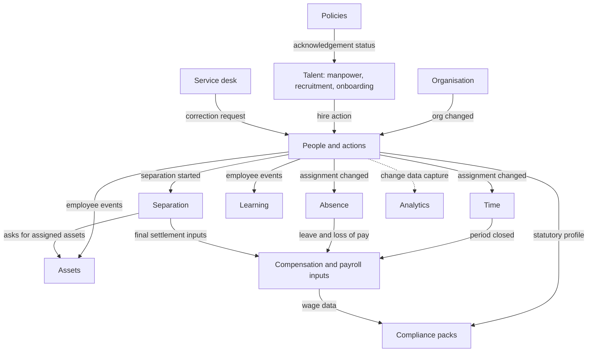

*Figure 2. Context map: upstream modules publish events that downstream modules consume. Every module also uses the platform kernel (identity, authorization, configuration, workflow, obligations, audit, documents, notifications), which is left out of this picture for clarity.*

Rules that keep the map healthy:

- **One owner per fact.** Only People writes assignments; only Absence writes the leave ledger; only Time writes attendance days. Others read through module interfaces or react to events.
- **No shared tables.** Module boundaries are verified in the build (Spring Modulith + ArchUnit).
- **Upstream never waits on downstream.** Organisation and People publish and move on. Downstream modules are idempotent and can replay.

## Part C · Application architecture

### 6. Architecture overview


*Figure 3. Containers. A global layer with no employee data routes each request to the tenant's home cell. Each cell holds the core app, its satellite services and its own data stores. Regions add identity, the API gateway and analytics.*

| Layer | Contents | Scope |
|---|---|---|
| **Clients** | HR console, employee app, admin console, careers portal, developer portal, customer and partner systems, site agents | Anywhere |
| **Global layer** | CloudFront, WAF and Shield for static assets; Route 53; control plane services (tenant registry, provisioning, plans and entitlements, metering and billing, developer app registry, releases); routing map | One, holds no employee personal data |
| **Regional layer** | Kong API gateway, Keycloak identity, analytics (ClickHouse + Cube), observability | One per region |
| **Cell** | Core platform app, satellite services, Aurora PostgreSQL, Kafka, Temporal, OpenSearch, Valkey, S3, KMS keys | Many per region; the unit of scale, isolation and deployment |

**API calls terminate in-region.** API clients use regional hostnames (`api.in.hrms.example`), so employee data is decrypted only inside India. CloudFront serves the web apps' static files globally.

### 7. Tenancy and cells


*Figure 4. How a request finds its tenant and keeps that tenant's context all the way into storage.*

**Tiers.** All run the same code, schema and migrations.

| Tier | Data | Compute | Typical tenant |
|---|---|---|---|
| Pooled | Shared Aurora cluster; `tenant_id` on every row; RLS | Shared cell | SMB and mid-market, trials |
| Pooled + dedicated database | Own Aurora cluster attached to a pooled cell | Shared cell | Over 20,000 employees, heavy batch, strict reviews |
| Dedicated cell | Full stack, optionally in the customer's AWS account or another cloud | Own | Over 100,000 employees, regulated, private deployment |

**Placement and routing**

- The control plane places a new tenant in a cell by region, tier and spare capacity (NFR-10) and writes `tenant → region → cell` to the routing map (a DynamoDB global table).
- Gateways cache the map for 60 s. Moving a tenant is a controlled workflow: freeze writes, copy, verify checksums, switch the route, unfreeze. It is also used for upgrades to a dedicated tier and for offboarding exports.
- **Isolation enforcement** (from Architecture 3 in the design system): edge tenant/token check; tenant context propagated into every job and event; `set_config('app.tenant_id', …, true)` at the start of each transaction; RLS with `FORCE ROW LEVEL SECURITY`; composite keys and foreign keys that include `tenant_id`; tenant-prefixed cache keys, search routing and S3 prefixes; per-tenant KMS data keys; a cross-tenant leakage suite in CI.

### 8. Inside the core platform app


*Figure 5. The core platform app: interfaces, twelve domain modules, the platform kernel, and infrastructure adapters.*

**Implementation choices**

- **Java 21 LTS, Spring Boot, Spring Modulith.** Each module is a top-level package with a published API package and an internal package. Spring Modulith verifies boundaries and documents the module graph. Its event publication registry keeps in-process listeners reliable.
- **Persistence:** Spring Data JPA (Hibernate 6) for aggregates, jOOQ for temporal and reporting queries, Flyway migrations per module. The transaction template sets the tenant setting before any statement runs.
- **Rules:** CEL (`cel-java`) with a curated function library and cost limits.
- **Workflows:** Temporal Java SDK. Workflow code lives in the owning module; workers run in the satellite deployment.
- **Interfaces:** the OpenAPI 3.1 documents are the source of truth. Server stubs and request validation are generated from them (contract-first, section 20).

**Module contract.** Every module declares:

- its entities and data classes
- its permissions (`module.resource.action`)
- its configuration object types and obligation types
- its events and schemas
- its API routes (OpenAPI)
- its dashboard cards and report datasets
- its search facets and notification events
- its migrations

A new module, such as rostering or payroll, plugs in through the same contract.

### 9. Domain and data model


*Figure 6. One person, several employments, effective-dated assignment slices.*

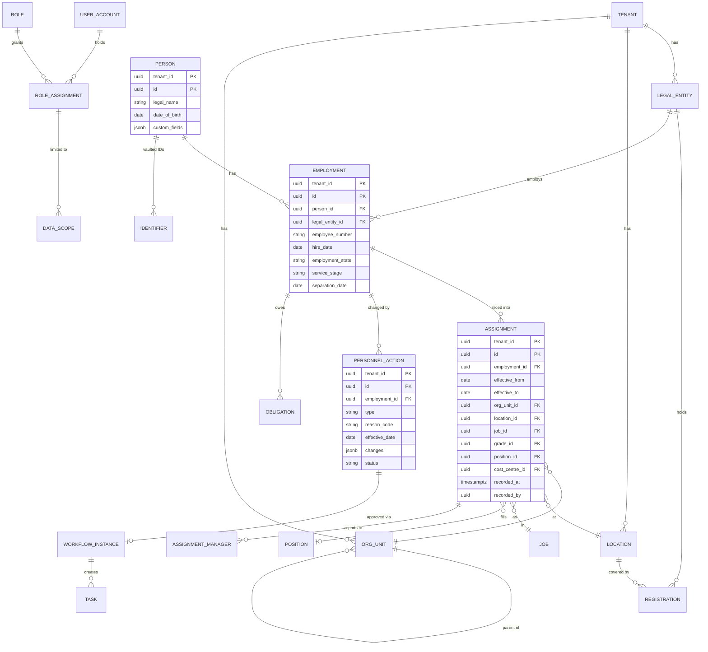

*Figure 7. Core entities for Phase 0 and 1. Every table's key starts with `tenant_id`.*

**Conventions applied to every table**

| Convention | Rule |
|---|---|
| Keys | `(tenant_id, id)` primary key; `id` is UUIDv7; foreign keys include `tenant_id` |
| Public IDs | Typed, opaque prefixes in the API (`emp_…`, `pa_…`, `loc_…`), encoding the UUID; internal IDs are never exposed as-is |
| Effective dating | `effective_from` (inclusive), `effective_to` (exclusive, null = open), with a gist exclusion constraint preventing overlap per owner |
| Transaction time | `recorded_at`, `recorded_by`; system-versioned history tables for assignment and compensation |
| Concurrency | `version` column for optimistic locking, exposed as the API `ETag` |
| Classification | Each column carries a data class in the module's metadata (Directory, Personal, Financial, Identity, Case); serialisers, exports and indexers read it |
| Soft delete | `archived_at` for business records; physical purge only by the retention engine or a verified data-principal erasure |
| Custom fields | `custom_fields jsonb` with a metadata registry; GIN index; hot fields promoted to generated columns |
| Partitioning | Monthly range partitions for punches, attendance days, audit, notifications and outbox; tenant hash sub-partitions in large pooled clusters |

### 10. Data architecture

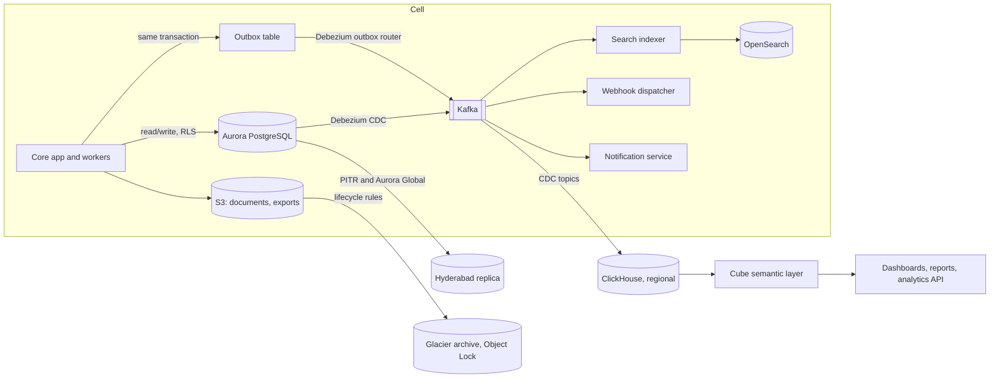

*Figure 8. Data flow. PostgreSQL is the only system of record; everything else is derived and can be rebuilt.*

| Store | Holds | Rebuildable? | Retention |
|---|---|---|---|
| Aurora PostgreSQL | System of record: all business data, configuration, outbox, audit (hot) | No; backed up, replicated | Per data class and tenant policy |
| S3 | Documents, generated letters, exports, audit archive (Object Lock), tenant export snapshots | No; versioned, replicated | Per document type; legal hold overrides |
| Kafka | Domain events, CDC streams | Yes, from the outbox and database | 7 days typical; compacted topics for reference data |
| OpenSearch | Employee and document search | Yes, reindex from PostgreSQL | Follows source |
| ClickHouse | Analytics facts and daily headcount snapshots | Yes, from CDC and snapshots | Tenant contract; aggregates longer than details |
| Valkey | Cache, rate-limit counters, sessions | Yes | Minutes to hours |
| Temporal | Workflow histories | Partly (business state lives in PostgreSQL) | 30–90 days after completion |

### 11. Identity and access

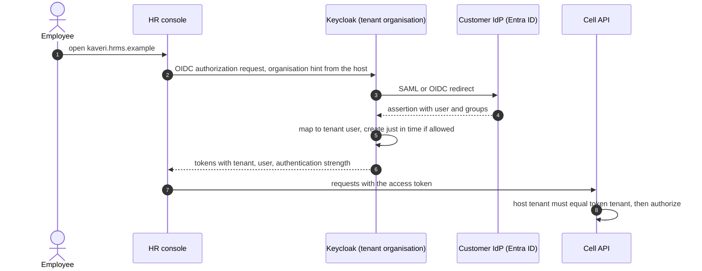

*Figure 9. Workforce sign-in through the customer's identity provider.*

**Login methods per tenant:** SSO (SAML 2.0 or OIDC) with just-in-time creation; password plus MFA (TOTP, WebAuthn and passkeys); **employee code plus mobile OTP** for staff without email, with device binding and rate limits; kiosk mode later.

**Access token claims** (short-lived, 5–15 minutes): `tenant`, `sub` (user), `acr` (authentication strength), `roles` digest, `scp` (API scopes for app tokens), `cell` hint. Permissions are **not** stuffed into tokens. The authorization module resolves them per request from cached role assignments.

**Authorization at run time**

1. Entitlement check: is the module licensed for the tenant (cached from the control plane)?
2. Permission check: role grants `module.resource.action`.
3. Data scope: role assignments are compiled into a SQL predicate (for example, `org_unit_id IN visible_units(:user)` or `employment_id IN visible_employees(:user)`), backed by closure tables and materialised visibility sets refreshed by events.
4. Data class: the serialiser drops or masks fields the role doesn't hold.
5. Conditions: CEL rules such as no self-approval, no edits in a closed period, delegation windows.

**Provisioning:** SCIM 2.0 server endpoints (`/scim/v2/Users`, `/Groups`) for directory tools that pull. Outbound connectors push joiners, movers and leavers to Microsoft Entra ID (API-driven inbound provisioning), Okta and Google Workspace. This automates IT clearance on exit (§19).

### 12. Workflows, rules and obligations

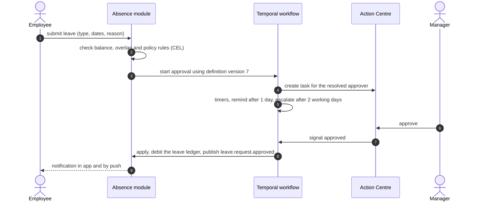

*Figure 10. A leave approval. Every approvable process runs the same way: definition, tasks, timers, decision, apply.*


*Figure 11. How a setting resolves for two employees of the same tenant.*

- **Approval definitions** are data, versioned per tenant and process: steps, approver resolvers, conditions, SLAs, escalation, delegation and segregation-of-duties rules. A Temporal workflow interprets the definition, and instances stay pinned to the version they started with.
- **Obligations** (probation due, document expiry, compliance filings, request SLAs) are generated by rules and recomputed on events. Durable timers send reminders at configured offsets and escalate. The Action Centre is the union of tasks, obligations and exceptions.
- **Exceptions** are one table and one API, used by every module (§29).

### 13. Events

**Envelope:** CloudEvents 1.0 (`id`, `type`, `source`, `time`, `subject`, `datacontenttype`, `dataschema`) plus extensions `tenantid`, `cellid`, `traceparent` and `actionid`. The partition key is `tenant_id` plus the aggregate ID, so events for one employee stay in order.

**Topics:** `<module>.<aggregate>.v<major>`, for example `people.employment.v1` or `absence.leave-request.v1`. Schemas are JSON Schema in a registry (AWS Glue Schema Registry, or Apicurio for portable cells), with backward-compatible evolution checked in CI.

**Payload policy:** internal events may carry full state. **Public webhook events are thin**: identifiers, what changed, and the effective date, never Financial, Identity or Case values. Receivers fetch details through the API with their own scopes.


*Figure 12. One approved change, one transaction, one event; every module updates itself.*

| Event | Producer | Internal consumers | Public webhook |
|---|---|---|---|
| `employee.hired` | People | Time, Absence, Learning, Assets, Compliance, Notifications, Search | Yes |
| `employee.assignment.changed` | People | Time, Absence, Access, Obligations, Search | Yes |
| `employee.status.changed` (confirmed, on notice, hold) | People | Obligations, Access, Payroll inputs | Yes |
| `employee.separation.started` / `.completed` | Separation | Assets, Payroll inputs, Compliance, Identity (deprovision) | Yes |
| `employee.rehired` | People | as for hired | Yes |
| `personnel_action.submitted` / `.approved` / `.rejected` / `.applied` | People | Notifications, Documents (letters) | Yes |
| `org.unit.changed`, `org.location.changed` | Organisation | People, Access, Search | Yes |
| `leave.request.submitted` / `.approved` / `.rejected` / `.cancelled` | Absence | Time, Notifications, Payroll inputs | Yes |
| `leave.balance.changed` | Absence | Analytics | Yes |
| `time.punch.received` | Ingestion | Attendance computation | No (bulk API instead) |
| `time.period.closed` | Time | Payroll inputs, Compliance | Yes |
| `payroll.inputs.published` (with version) | Payroll inputs | Compliance, Analytics | Yes |
| `candidate.stage.changed`, `offer.accepted` | Talent | Onboarding, Notifications | Yes |
| `onboarding.completed` | Talent | People, Notifications | Yes |
| `asset.assigned`, `asset.returned` | Assets | Separation | Yes |
| `document.verified`, `document.expiring` | Documents | Obligations, Notifications | Yes |
| `compliance.obligation.due` / `.overdue` / `.completed` | Compliance | Action Centre, Notifications | Yes |
| `request.created`, `request.resolved` | Service desk | Notifications | Yes |
| `policy.published`, `policy.acknowledged` | Policies | Onboarding, Notifications | Yes |
| `workflow.task.created`, `workflow.task.completed` | Kernel | Action Centre, Notifications | Yes (for chat and approval integrations) |
| `config.published` | Kernel | Caches, Obligations recompute | No |

### 14. Integration architecture

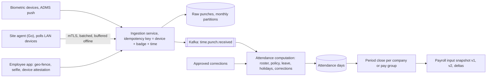

*Figure 13. Attendance ingestion. Punches are append-only; attendance days are computed and can always be recomputed.*

| Integration (§34) | Pattern | Tools |
|---|---|---|
| Attendance devices | Device push (ADMS-style HTTP) and a site agent that polls LAN devices; CSV fallback | Go agent (Windows or Linux service), mTLS certificates per site, ingestion service |
| Mobile and web punches | Public API `POST /v1/time/punches:batch` | Play Integrity and App Attest; geo-fence and selfie options per location |
| Payroll (external or internal) | Versioned payroll input snapshots, as API and file | `/v1/payroll/periods/{id}/inputs`; CSV/XLSX mappings per vendor |
| Accounting and ERP | Journal and voucher exports for F&F and recoveries | Connectors (Tally XML, SAP IDoc/API) built on the integration hub |
| Legacy file exchange | Scheduled SFTP drops, both ways | AWS Transfer Family per cell; PGP optional |
| Identity and directory | SAML/OIDC; SCIM in; push connectors out | Keycloak; platform identity service |
| Email and calendar | Notifications; interview and training invitations | Amazon SES; Microsoft Graph and Google Calendar with OAuth per tenant |
| Messaging | SMS (DLT templates), WhatsApp, push | MSG91 or Gupshup; Gupshup or Meta Cloud API; FCM/APNs |
| Recruitment sources | Job posting and applicant import | Connectors per board; consent captured on import |
| Verification and signatures | Background checks, e-sign, DigiLocker, bank account checks | Provider connectors (Leegality, Digio, eMudhra; BGV vendors) |
| Customer iPaaS and SIEM | Webhooks and API; audit stream | Svix endpoints; audit export to Splunk, Sentinel or S3 |
| Government portals | Links and evidence (v1); file generation later (PF ECR, ESIC upload) | Country pack outputs |

The **integration hub** runs connectors as Temporal workflows. Every connector gets per-tenant configuration, credentials encrypted with the tenant's data key, field mappings, schedules, retries, a dead-letter queue, run history, and alerts to the tenant admin.

### 15. Documents, search and notifications

| Capability | Design | Tools |
|---|---|---|
| Document storage | Upload through pre-signed S3 URLs to a quarantine prefix, then a malware scan, then promotion; versions never overwritten; retention and legal hold per type | S3, GuardDuty Malware Protection for S3, KMS |
| Letters | HR edits Word (DOCX) templates with merge fields; rendered to PDF; numbered; optional e-sign | Carbone (or docxtemplater) + Gotenberg; e-sign connectors |
| Search | Employee and document search, scoped by precomputed visibility tags; restricted fields not indexed | OpenSearch with per-tenant routing or indices |
| Notifications | Event → rule → template (per language) → channel, with preferences, quiet hours, digests and quotas; no restricted data in message bodies | Notification service; SES, SMS and WhatsApp providers, FCM/APNs |

### 16. Tenant provisioning

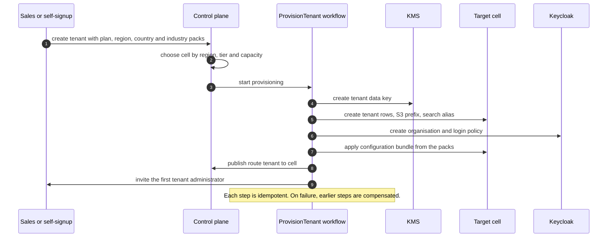

*Figure 14. Provisioning is a durable workflow, so a failure halfway leaves nothing behind.*

## Part D · The API product

### 17. Who buys the API, and how it is packaged

| Buyer | What they build | What they need most |
|---|---|---|
| **Customer IT** | Sync with ERP, payroll, directory, BI; approvals in Teams or Slack | Stable contracts, bulk APIs, webhooks, SSO for their apps |
| **ISVs and partners** | Apps sold to many tenants (payroll, benefits, BGV, LMS, expense) | Multi-tenant OAuth apps, sandbox, marketplace listing |
| **iPaaS vendors and consultants** | Connectors in MuleSoft, Boomi, Workato, Zapier | Consistent patterns, discoverable OpenAPI, webhooks |
| **HR outsourcing partners** | Run many client tenants | Partner API across tenants with delegated access |

**Suggested packaging** (starting points for decision D17; the limits are per tenant):

| | Starter | Growth | Enterprise | Partner program |
|---|---|---|---|---|
| API families | Read: organisation, employee directory fields, leave balances; webhooks; SCIM | Everything in Starter plus all module APIs, write and personnel actions, time, payroll inputs, bulk | Everything plus analytics query, admin APIs, event streaming | Multi-tenant OAuth apps, partner API |
| Rate limit | 60 req/min, 10,000/day | 600 req/min, 250,000/day | From 3,000 req/min, custom quotas | By each installing tenant's plan |
| Webhook endpoints | 2 | 10 | 50 | Per installation |
| Sandboxes | 1 shared | 1 dedicated | 3, plus a masked copy of production | Developer sandboxes |
| Connectivity | Public TLS | + IP allowlist | + mTLS, AWS PrivateLink | Public TLS |
| API availability SLA | Best effort | 99.9% | 99.95% with service credits | 99.9% |
| Support | Docs and community | Business hours | 24×7, named contact | Partner desk |

### 18. API platform architecture


*Figure 15. The API platform. The gateway is where plans, quotas and routing are enforced; the cells hold the data and emit events; metering turns gateway logs into bills.*

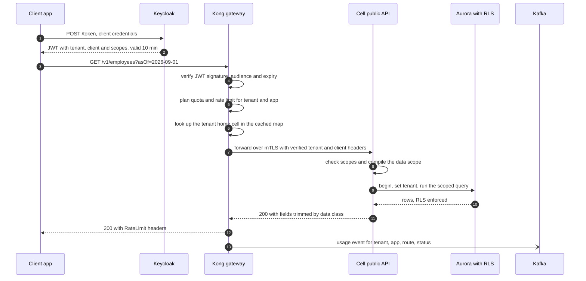

*Figure 16. One API call, end to end.*

### 19. API design standards

These rules apply to every endpoint. The OpenAPI linter enforces them in CI (section 20).

| Topic | Standard |
|---|---|
| Style | REST over HTTPS, JSON (UTF-8), `camelCase` fields, plural nouns (`/employees`), no verbs in paths except explicit commands (`:approve`, `:cancel`) |
| IDs | Opaque typed IDs (`emp_…`, `pa_…`, `loc_…`); never database keys; never reused |
| Dates | Business dates as `YYYY-MM-DD` (no time zone); instants as RFC 3339 UTC; the time zone named where it matters (`location.timeZone`) |
| Money | `{ "amount": "1250000.00", "currency": "INR" }` with a decimal string, never a float |
| **Temporal reads** | `asOf=YYYY-MM-DD` on any effective-dated resource; timelines at sub-resources (`/employees/{id}/assignments`) |
| **Changes to employment** | Never a raw `PATCH`. `POST /v1/personnel-actions` with type, effective date, reason and changes; returns `202` with status `PENDING_APPROVAL`, `SCHEDULED` or `APPLIED` |
| Pagination | Cursor-based: `limit` (max 200), `cursor`; responses carry `nextCursor` |
| Filtering and fields | `filter[status]=ACTIVE`, `filter[locationId]=loc_…`; `fields=` for sparse fieldsets; `expand=` for related objects, capped |
| Idempotency | `Idempotency-Key` header required on every `POST`; keys kept 24 h per tenant and app |
| Concurrency | `ETag` on reads; `If-Match` required on `PATCH` and `DELETE` of mutable resources |
| Errors | RFC 9457 Problem Details, plus a stable `code` and `requestId` |
| Rate limits | `429` with `Retry-After`; `RateLimit-Policy` and `RateLimit` headers on every response |
| Long work | `202 Accepted` with a job resource (`/v1/bulk/jobs/{id}`); completion by polling or the `bulk.job.completed` webhook |
| Files | Upload and download through short-lived pre-signed URLs, never through the JSON API |
| Deprecation | `Deprecation` and `Sunset` headers (RFC 9745, RFC 8594); a changelog entry; direct email to apps still calling |

**Example: transfer an employee**

```http
POST /v1/personnel-actions
Authorization: Bearer eyJ…
Idempotency-Key: 5f1c2a9e-2b1f-4a53-9d7e-0c4b6f1f2c10
Content-Type: application/json

{
  "type": "TRANSFER",
  "employmentId": "emp_01J8Z3K7Q9",
  "effectiveDate": "2026-10-01",
  "reasonCode": "BUSINESS_NEED",
  "changes": { "locationId": "loc_vadodara", "managerEmploymentId": "emp_01J7X2M4P1" }
}

HTTP/1.1 202 Accepted
{ "id": "pa_01J9A6T2V8", "status": "PENDING_APPROVAL", "workflow": { "currentStep": "LINE_MANAGER" } }
```

**Example: an error**

```json
{
  "type": "https://developers.hrms.example/errors/closed-period",
  "title": "Effective date falls in a closed attendance period",
  "status": 409,
  "detail": "August 2026 is closed for Kaveri Polymers. Submit an attendance correction instead.",
  "code": "EFFECTIVE_DATE_IN_CLOSED_PERIOD",
  "requestId": "req_01J9A6V0QH"
}
```

### 20. Contract-first lifecycle and versioning

1. **Design:** an OpenAPI 3.1 change is proposed in a pull request. The API review group (section 36) checks it against the standards.
2. **Lint and diff:** Spectral enforces the style guide. `oasdiff` blocks any breaking change to a published major version.
3. **Generate:** server interfaces and validators for the Java module; TypeScript types for our web and mobile apps; SDKs (TypeScript, Python, Java, C#) with Speakeasy or Stainless; the Postman collection.
4. **Test:** contract tests validate real responses against the schema; Schemathesis fuzzes every endpoint; the cross-tenant leakage suite runs against every route.
5. **Publish:** the docs (Redocly) and changelog update from the same file; the gateway imports the route list, so only documented routes are reachable.

**Versioning policy**

- The major version is in the path (`/v1`). Additive changes (new endpoints, new optional fields, new enum values, flagged in advance) ship without a version change. Clients must ignore unknown fields.
- A breaking change means a new major version, with at least **12 months** running both, deprecation headers, a migration guide, and outreach to every app still calling the old routes.
- Webhook event types are versioned the same way (`employee.hired` payloads only grow; a breaking change becomes a new type).

### 21. API security

| Flow | Used for | Details |
|---|---|---|
| **OAuth 2.0 client credentials** | A tenant's own server-to-server integrations | The client is registered in that tenant's organisation; tokens are bound to one tenant; secrets rotate; `private_key_jwt` or mTLS client authentication on Enterprise |
| **Authorization code + PKCE** | ISV and partner apps installed by many tenants, and user-delegated actions (approve from Teams) | A tenant admin consents; the installation is recorded in the control plane; the admin can revoke it at any time |
| **SCIM bearer tokens** | Directory tools | Scoped to SCIM only; rotated |
| **Partner tokens** | HR outsourcing partners | Delegated grant per client tenant, time-boxed, logged in both tenants' audit logs |

**Scopes** follow `resource:action`, with restricted data as separate scopes:

- **Standard:** `org:read`, `org:write`, `employees:read`, `actions:write`, `time:read`, `time.punches:write`, `leave:read`, `leave:write`, `documents:read`, `webhooks:manage`, `bulk:write`, `analytics:query`.
- **Restricted:** `employees.personal:read`, `employees.identity:read`, `employees.financial:read`, `payroll:read`, `cases:read`. These need confidential clients, tenant admin approval with a stated purpose, and periodic re-approval. Every use is logged in the sensitive-read log.

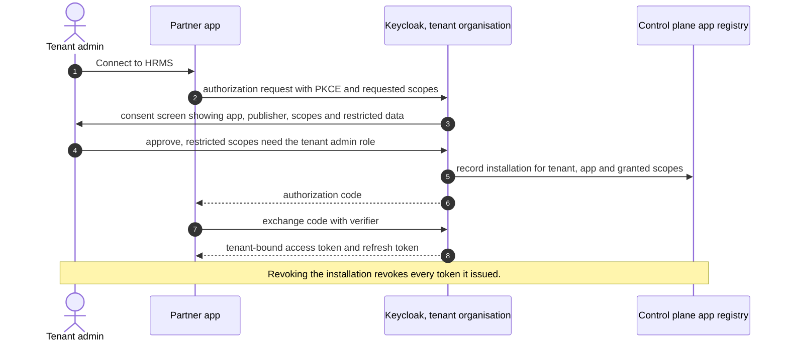

*Figure 17. Installing a partner app into a tenant.*

**OWASP API Security Top 10 (2023) mapping**

| Risk | Control in this design |
|---|---|
| API1 Broken object-level authorization | Tenant from the verified token only; RLS in the database; data scope compiled into every query; leakage tests on every route |
| API2 Broken authentication | OAuth 2.0 only (no long-lived API keys for data access); 10-minute tokens; mTLS or `private_key_jwt` on Enterprise; credential rotation |
| API3 Broken object-property-level authorization | Data-class scopes; serialiser trimming; write allowlists per operation (no mass assignment) |
| API4 Unrestricted resource consumption | Plan quotas and rate limits; max page size; request size limits; `expand` depth cap; bulk through async jobs |
| API5 Broken function-level authorization | One scope per operation from the OpenAPI document; admin APIs on separate routes and scopes |
| API6 Unrestricted access to sensitive business flows | OTP and export flows rate-limited per user and IP; large exports need approval and are watermarked |
| API7 Server-side request forgery | Webhook URLs validated (HTTPS only, no private ranges, resolved again on every delivery); delivery through an egress proxy |
| API8 Security misconfiguration | Gateway and headers as code; TLS 1.2+; CORS allowlists; policy checks in CI |
| API9 Improper inventory management | OpenAPI is the inventory; undocumented routes are unreachable; deprecated versions tracked with usage |
| API10 Unsafe consumption of APIs | Third-party responses (job boards, BGV, e-sign) schema-validated, time-limited and sandboxed |

### 22. API catalogue

| Family | Base path | Main resources and operations | Scopes | Plan |
|---|---|---|---|---|
| Organisation | `/v1/org` | `legal-entities`, `locations`, `org-units` (tree, `:move`), `jobs`, `grades`, `positions`, `cost-centres`, `dimensions` | `org:read`, `org:write` | Read: all; write: Growth |
| Employees | `/v1/employees`, `/v1/persons` | List and search, get (`asOf`, `expand=assignment,manager`), `/assignments` timeline, contacts, emergency contacts | `employees:read`, restricted class scopes | All |
| Personnel actions | `/v1/personnel-actions` | Create (hire, transfer, promotion, confirm, extend probation, notice, separation, rehire), get, `:cancel` | `actions:write`, `actions:read` | Growth |
| Talent | `/v1/requisitions`, `/v1/vacancies`, `/v1/candidates`, `/v1/applications`, `/v1/offers`, `/v1/onboarding` | CRUD by stage; `candidates/{id}:convert` | `recruiting:*`, `onboarding:*` | Growth |
| Time | `/v1/time` | `punches:batch`, `attendance-days`, `corrections`, `rosters`, `shifts`, `periods` | `time:read`, `time.punches:write`, `time:write` | Growth |
| Leave | `/v1/leave`, `/v1/holidays` | `types`, `balances` (`asOf`), `requests` (create, `:cancel`), holiday calendars | `leave:read`, `leave:write` | Read: all; write: Growth |
| Payroll inputs | `/v1/payroll` | `pay-groups`, `periods`, `periods/{id}/inputs` (`version`, `deltaFrom`), compensation (restricted) | `payroll:read` (restricted) | Growth |
| Separation | `/v1/separations` | Exit cases, clearance items, F&F inputs | `separations:*` | Growth |
| Other modules | `/v1/assets`, `/v1/learning`, `/v1/requests`, `/v1/policies` | Resources plus `acknowledgements`, `enrolments` | Per family | Growth |
| Compliance | `/v1/compliance` | `obligations`, `evidence`, `statutory-profiles` (restricted), `exceptions` | `compliance:*` | Growth |
| Documents | `/v1/documents` | Upload (pre-signed), list, versions, verify; `letters:generate` | `documents:*` | Growth |
| Tasks | `/v1/tasks` | List assigned tasks; `:approve`, `:reject` (user-delegated tokens only) | `tasks:act` | Growth |
| Webhooks and events | `/v1/webhook-endpoints`, `/v1/events` | Manage endpoints; list events; replay up to 30 days | `webhooks:manage`, `events:read` | All |
| Bulk | `/v1/bulk` | `imports`, `exports`, `jobs/{id}` (CSV, XLSX, JSONL) | `bulk:*` | Growth |
| Analytics | `/v1/analytics` | `metrics`, `query` (semantic layer, scoped) | `analytics:query` | Enterprise |
| Directory | `/scim/v2` | `Users`, `Groups` | SCIM token | All |
| Administration | `/v1/admin` | Users, roles, configuration bundles, audit events | `admin:*` (tenant admin apps only) | Enterprise |
| Partner | `/partner/v1` | Client tenants, delegated grants, usage | Partner token | Partner program |

### 23. Webhooks

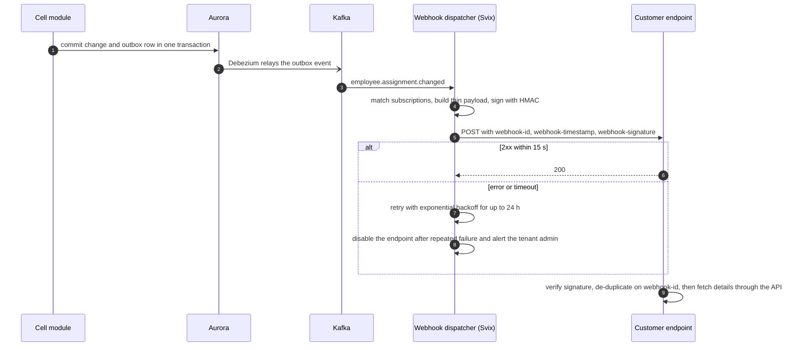

*Figure 18. Webhook delivery is at-least-once; receivers de-duplicate on the event ID.*

```json
{
  "id": "evt_01J9B2C3D4",
  "type": "employee.assignment.changed",
  "specversion": "1.0",
  "source": "/tenants/ten_kaveri",
  "time": "2026-10-01T00:00:05Z",
  "data": {
    "employmentId": "emp_01J8Z3K7Q9",
    "personnelActionId": "pa_01J9A6T2V8",
    "effectiveDate": "2026-10-01",
    "changedFields": ["locationId", "managerEmploymentId"]
  }
}
```

**Delivery policy:**

- Standard Webhooks signing, with secret rotation and two secrets valid during the overlap.
- 15-second timeout, then exponential backoff for up to 24 hours.
- Ordering is not guaranteed across events; each event carries `effectiveDate` and a per-employment sequence number.
- 30-day replay through `/v1/events`.
- Deliveries leave from static egress IPs that customers can allowlist.
- Tenants manage endpoints in the admin console (the embedded Svix portal) or through the API.

**Enterprise event streaming (later):** an Amazon EventBridge partner event source, or a dedicated Kafka topic per tenant, for customers who want a stream rather than callbacks.

### 24. Developer experience

| Element | Design | Tools |
|---|---|---|
| Public docs | Guides by job-to-be-done (sync employees, push punches, read payroll inputs), full reference from OpenAPI, errors catalogue, changelog | Redocly (or Mintlify), docs-as-code in the same repository |
| Developer console | Sign up, create a sandbox, register apps, manage OAuth clients and secrets, webhook endpoints, usage charts, request logs (last 7 days, bodies redacted) | In-house, on the control plane |
| Sandbox | A separate cell with synthetic tenants (realistic Indian org data, no real people), reset nightly; the same API and limits as production | Synthetic data generator in the platform |
| SDKs | TypeScript, Python, Java, C#; generated, typed, with retries, pagination and webhook verification helpers | Speakeasy or Stainless; published to npm, PyPI, Maven Central, NuGet |
| Collections and samples | Postman collection, sample apps (Teams approvals bot, payroll export, directory sync) | Generated from OpenAPI |
| Status and trust | Public status page per region and API; security page; subprocessor list; SOC 2 and ISO reports under NDA | Statuspage or Instatus |
| Support | Docs, community forum, ticketing by plan, office hours for partners | Freshdesk or Zendesk |
| Marketplace (later) | Listing for partner apps with review, security questionnaire and DPA | Built on the app registry |

### 25. Metering, limits and billing

- **What is metered:**
  - active employees per tenant per day (the main subscription metric), counted by the control plane from `employee.*` events
  - API calls by tenant, app, route family and status, from gateway logs
  - webhook deliveries
  - bulk rows processed
  - SMS and WhatsApp messages, passed through at cost plus margin
- **Pipeline:** gateway and services emit usage events to Kafka, which are aggregated in ClickHouse (idempotent by event ID), pushed daily to Chargebee as usage records, and invoiced with GST. Razorpay collects payment; enterprise customers pay by invoice. The same aggregates feed the usage charts in the developer console.
- **Enforcement:** rate limits at the gateway (Valkey counters per tenant and app). Daily quotas are soft, with alerts at 80% and 100% and overage billed on Growth; hard limits apply only on Starter and sandbox.
- **AWS Marketplace** listing (SaaS contract) for enterprise customers who buy through their AWS commitments.

## Part E · Infrastructure and operations

### 26. AWS deployment topology


*Figure 19. Production on AWS. Mumbai runs the regional edge, the cells and analytics across three availability zones; Hyderabad holds replicas and a pilot-light standby.*

**Why AWS as the primary cloud:** two Indian regions (Mumbai and Hyderabad) for in-country disaster recovery; every managed service this design needs (Aurora Global Database, MSK, OpenSearch, EKS); a marketplace that enterprise buyers already use. Section 34 maps each component to Azure and GCP for customers who require them.

**Compute:** EKS with Karpenter, mostly Graviton (arm64) instances.

| Node pool | Runs |
|---|---|
| `app` | Core app pods |
| `workers` | Temporal workers, exports, integrations |
| `ingest` | Attendance ingestion, isolated so punch storms don't starve the API |
| `system` | Ingress, observability agents, Svix |

Pods scale on CPU and request rate (HPA) and on queue lag (KEDA, for Kafka consumers).

### 27. Accounts and network

| Account (AWS Organizations, Control Tower) | Purpose |
|---|---|
| Management | Organisation, SCPs, billing only |
| Security tooling | GuardDuty, Security Hub, Inspector and Macie delegated admin; IAM Identity Center |
| Log archive | Organisation CloudTrail, Config, audit archive (S3 Object Lock) |
| Shared services | ECR, CI runners, artifact storage, Backstage |
| Control plane (prod, staging) | Tenant registry, provisioning, billing, developer console |
| Regional edge (per region) | Kong, Keycloak, egress proxy |
| Cell accounts (one per cell) | Everything in a cell; separate accounts keep blast radius and IAM small |
| Analytics and observability (per region) | ClickHouse, Cube, Grafana stack |
| Sandbox (public API) | The developer sandbox cell; synthetic data only |
| Staging and development | Pre-production; synthetic or masked data only |

**Network in each cell account**

- A VPC across three availability zones, with public subnets (load balancers and NAT only), private application subnets (EKS) and private data subnets (Aurora, Valkey, OpenSearch, MSK).
- VPC endpoints for S3, KMS, STS, ECR and Secrets Manager, so AWS traffic doesn't leave the VPC.
- Egress goes through AWS Network Firewall with domain allowlists. Webhook deliveries leave through a dedicated NAT with published static IPs.
- An **AWS PrivateLink endpoint service** for Enterprise API customers.
- Site agents connect outbound over HTTPS with mTLS, so no VPNs are needed.
- Security groups follow least privilege, and Kubernetes network policies (Cilium) separate namespaces.

### 28. Environments and delivery

| Environment | Data | Purpose |
|---|---|---|
| Development | Synthetic | Per-branch preview environments |
| Staging | Synthetic, plus masked data where a tenant opts in | Release candidates, E2E tests, isolation suite, performance smoke tests |
| API sandbox | Synthetic tenants | Public developer sandbox; runs the current release |
| Production, ring 0 | Our own internal tenant | First production deployment |
| Production, ring 1 | Canary tenants (one per industry pack) | Automated analysis before widening |
| Production, ring 2 | All cells | General availability |

```mermaid
flowchart LR
  PR["Pull request"] --> CI["GitHub Actions: build, unit and module tests, Testcontainers"]
  CI --> Q["Gates: CodeQL, Semgrep, Trivy, Spectral, oasdiff, ArchUnit"]
  Q --> IMG["Signed image and SBOM in ECR"]
  IMG --> DEV["Development via Argo CD"]
  DEV --> STG["Staging: E2E, isolation suite, k6"]
  STG --> SBX["API sandbox"]
  SBX --> R0["Ring 0: internal"]
  R0 --> R1["Ring 1: canary tenants"]
  R1 --> R2["Ring 2: all cells, Argo Rollouts analysis"]
```

*Figure 20. From pull request to every cell. A failed automated analysis at any ring rolls back without a human.*

- **Infrastructure as code:** Terraform (or OpenTofu) modules for a cell, the regional edge and the control plane, composed with Terragrunt per account and region. A new cell is a pull request.
- **Kubernetes delivery:** Helm charts, Argo CD (GitOps) per cluster, Argo Rollouts canaries gated on error rate and latency.
- **Database changes** follow expand, migrate, contract. Migrations run per cell before the new pods start. Tenant configuration bundles are migrated in the same release.
- **Supply chain:** pinned dependencies (Renovate), SBOMs (Syft), signed images (cosign), admission policies (Kyverno) that only admit signed images from our registry.

### 29. Observability and SRE

| Signal | Collection | Store and view |
|---|---|---|
| Traces | OpenTelemetry Java agent and SDKs, gateway plugin, mobile and web SDKs | Grafana Tempo |
| Metrics | OpenTelemetry and Prometheus exporters; RED metrics per route, tenant and cell; Kafka lag; Temporal task latency | Grafana Mimir (or Amazon Managed Prometheus) |
| Logs | Structured JSON with `tenantId`, `cellId`, `traceId`; personal data scrubbed at source | Grafana Loki; audit is separate (section 31) |
| Errors | Backend and frontend exceptions with scrubbing | Sentry (self-hosted, or SaaS with strict scrubbing) |
| Real-user monitoring | Web vitals and mobile app performance | Grafana Faro or Sentry |

- **SLOs** per journey: sign-in, employee search, leave apply and approve, punch ingestion, API reads and writes, webhook delivery, and month close. Each is tracked per cell and per tenant, with burn-rate alerts.
- **Per-tenant views** let support see one tenant's error rate and latency without seeing its data.
- **On-call and incidents:** PagerDuty or incident.io; runbooks per alert; a public status page per region and product (web, mobile, API, webhooks); post-incident reviews shared with affected enterprise tenants.

### 30. Resilience and disaster recovery

| Component | Within the region | Across regions (Mumbai → Hyderabad) | RPO | RTO |
|---|---|---|---|---|
| Aurora (cell, control plane, Keycloak) | Multi-AZ writer and readers, automatic failover | Aurora Global Database, managed failover | ~1 s typical, ≤ 5 min target | ≤ 1 h |
| S3 | 11 nines of durability, versioning | Cross-region replication (Replication Time Control for Enterprise) | Minutes | Immediate once reads switch |
| Kafka (MSK) | Three brokers across AZs, replication factor 3 | Critical topics mirrored; everything else replayed from the outbox and CDC | Minutes | ≤ 1 h |
| OpenSearch | Multi-AZ domain | Rebuilt from PostgreSQL (reindex) plus S3 snapshots; search degraded meanwhile | n/a (derived) | ≤ 4 h |
| Temporal | Multi-AZ | Persistence on Aurora Global (self-hosted) or a Temporal Cloud multi-region namespace | ~1 s | ≤ 1 h |
| EKS workloads | Multi-AZ node pools | Pilot light: clusters and images ready, scaled from GitOps | n/a | ≤ 1 h |
| ClickHouse | Replicated | Restored from S3 backups and CDC replay; analytics degraded meanwhile | Hours | ≤ 24 h |

- **Tenant-level restore:** a logical per-tenant snapshot (the tenant mobility tooling) restores one tenant to a point in time into a staging schema, for comparison and selective repair, without rolling back other tenants.
- **Game days every quarter:** AZ loss (AWS Fault Injection Service), a cell database failover, a full region failover rehearsal once a year, and a restore of one tenant.

### 31. Security architecture and threat model

**Assets, from most to least sensitive:** Case-class data (grievance, POSH, disciplinary); Financial (salary, bank); Identity (PAN, UAN, Aadhaar masked); personal data; credentials and tokens; the audit log; configuration; the cross-tenant boundary itself.

| STRIDE | Threat | Controls |
|---|---|---|
| Spoofing | A caller claims another tenant (host or header tricks) | Tenant taken only from the verified token and checked against the host; gateway strips inbound tenant headers |
| Spoofing | Stolen API client secret | 10-minute tokens, secret rotation, IP allowlists, mTLS or `private_key_jwt` on Enterprise, anomaly alerts per app |
| Spoofing | OTP abuse or SIM swap on mobile login | Rate limits, device binding, step-up for sensitive actions, re-verification on number change |
| Tampering | Forged punches from rooted phones or proxy punching | Play Integrity and App Attest, geo-fence, selfie with liveness option, anomaly reports |
| Tampering | Changes to audit history | Hash-chained audit per tenant, daily anchors to S3 Object Lock (compliance mode) |
| Repudiation | "I didn't approve that" | Approvals record identity, authentication strength, IP, device and reason; delegation names both people |
| Information disclosure | Cross-tenant read (BOLA) | RLS, composite keys, scoped queries, leakage suite in CI, isolation-focused penetration tests |
| Information disclosure | Over-privileged partner apps | Least-privilege scopes, restricted scopes needing admin approval and a purpose, app review, revocation, per-app access logs |
| Information disclosure | Data in logs, notifications, exports | Scrubbing at source; no restricted data in message bodies; watermarked exports with an audit trail |
| Denial of service | API floods, noisy tenants, slow webhook receivers | WAF and Shield Advanced, quotas, fair queues, async webhook dispatch with circuit breakers |
| Elevation of privilege | A tenant admin grants themselves Financial access | Role changes are approvable actions (maker-checker), alerting, and quarterly access reviews |
| Elevation of privilege | SSRF through webhook or integration URLs | URL validation, blocked private ranges, re-resolution per request, egress proxy |
| Elevation of privilege | Injection through templates or expressions | Logic-less templates for letters and messages; CEL sandbox with cost limits; no tenant-authored code |
| Elevation of privilege | Malicious file uploads | Quarantine, malware scan, content sniffing, never rendered inline from our domain |
| Elevation of privilege | Insider access by our staff | No standing access; just-in-time, tenant-approved, time-boxed, recorded; visible in the tenant's audit log |

**Compliance programme** (starts in Phase 0, so evidence accumulates):

- **ISO/IEC 27001** with the 27701 privacy extension, then a **SOC 2 Type II** observation period.
- **DPDP:** a data processing agreement template, processing records, a breach runbook, and data-principal request tooling.
- **Continuous control monitoring:** AWS Security Hub standards plus a GRC tool (Vanta or Drata) so audit evidence is collected automatically.
- An **annual third-party penetration test**, plus one before GA and before each major API version.
- **A trust centre:** security overview, subprocessor list, and reports under NDA.

### 32. Capacity, scaling and cost drivers

**The cell is the unit of scale.** When a pooled cell reaches about 70% of its design point (NFR-08, NFR-10), new tenants go to a new cell and nothing is rebalanced by default. Large tenants move to dedicated databases or cells with the mobility tooling.

| Dimension | Scales by | First bottleneck to watch |
|---|---|---|
| API traffic | Core app pods (HPA), Aurora read replicas | Scoped queries without the right composite index |
| Punch ingestion | Ingestion pods, Kafka partitions | Recompute storms after bulk corrections |
| Month-end batch | Worker pods (KEDA on queue depth), staggered per-tenant schedules | Aurora writer IOPS; use Aurora I/O-Optimized for busy cells |
| Search | OpenSearch data nodes, shard per large tenant | Reindex after reorganisations |
| Webhooks | Svix workers | Slow customer endpoints (isolated by queues per endpoint) |
| Analytics | ClickHouse replicas | Wide as-of queries; pre-aggregate daily snapshots |

**Cost drivers and levers:**

- **Per-cell fixed cost** (Aurora, MSK, OpenSearch, EKS control plane, NAT) is why small tenants are pooled. A dedicated cell's price must cover its fixed cost.
- **Variable costs** are compute for API and batch, storage (documents, punches, audit), data transfer (webhooks, NAT), and messaging, which is passed through.
- **Levers:** Graviton instances, Savings Plans once the base load is known, S3 Intelligent-Tiering and lifecycle rules, MSK Serverless for small cells, Aurora I/O-Optimized for heavy writers, and shutting down development and preview environments out of hours.
- A costed bill of materials needs the sizing numbers in decision D15. Build it with AWS Pricing Calculator per cell size, then per-tenant unit economics from the metered active employees.

## Part F · Tools and technology

### 33. Technology stack

These are the recommended defaults, the realistic alternatives, and why. "Build" means we write and own it; "adopt" means we run an open-source product; "buy" means a managed service or licence.

| Layer | Recommended | Alternatives | Why this one | Build / adopt / buy |
|---|---|---|---|---|
| Cloud | AWS: Mumbai primary, Hyderabad DR | Azure (Pune, Chennai, Mumbai), GCP (Mumbai, Delhi) | Two Indian regions, broadest managed services, AWS Marketplace | Buy |
| Containers | EKS + Karpenter on Graviton | ECS, AKS, GKE | Kubernetes keeps dedicated and private cells portable | Buy |
| Backend language and framework | Java 21 LTS, Spring Boot, Spring Modulith | Kotlin on the same stack; .NET 8 with ABP; TypeScript with NestJS | Complex domain, strong typing, verified module boundaries, first-class Temporal and Kafka SDKs, deep hiring pool in India | Build |
| Persistence | Spring Data JPA (Hibernate 6), jOOQ, Flyway | MyBatis, Liquibase | Aggregates in JPA; temporal and reporting SQL in jOOQ | Build |
| Database | Aurora PostgreSQL 16+ | RDS PostgreSQL, AlloyDB, Azure Database for PostgreSQL | RLS, range types and exclusion constraints, JSONB, Global Database | Buy |
| Connection pooling | PgBouncer in transaction mode | RDS Proxy (check session pinning with `set_config` first) | Safe with per-transaction tenant settings | Adopt |
| Cache and counters | ElastiCache for Valkey | Redis Cloud | Rate limits, sessions, reference data | Buy |
| Events and CDC | Amazon MSK (Kafka) + Debezium on MSK Connect | Confluent Cloud, Redpanda, Azure Event Hubs | Ordered per key, replayable, one mechanism for outbox and CDC | Buy + adopt |
| Schema registry | AWS Glue Schema Registry (Apicurio in portable cells) | Confluent Schema Registry | Compatibility checks for events | Buy / adopt |
| Workflows and timers | Temporal (Temporal Cloud or self-hosted) | Camunda 8, AWS Step Functions | Durable timers, workflow versioning, Java SDK; approval DSL on top | Buy / adopt |
| Rules and expressions | CEL (`cel-java`) | Drools, JSONLogic | Sandboxed, typed, fast, safe for tenant configuration | Adopt |
| Search | Amazon OpenSearch Service | Elastic Cloud | Tenant routing, security trimming, managed | Buy |
| Files | S3 with Object Lock and Intelligent-Tiering; GuardDuty Malware Protection for S3 | Azure Blob; ClamAV | Durable, cheap, scanned | Buy |
| Letters | Carbone (DOCX templates to PDF) + Gotenberg | docxtemplater, JasperReports | HR edits Word templates, not code | Adopt / buy |
| E-signature | Leegality, Digio or eMudhra (Aadhaar eSign, DSC); DocuSign abroad | SignDesk, Adobe Sign | Indian legal e-sign options | Buy |
| Identity | Keycloak 26+ (Organizations) on EKS | Auth0, Zitadel, Microsoft Entra External ID, WorkOS | Per-tenant SAML/OIDC and OTP, runs in-region, predictable cost at scale | Adopt |
| Directory sync | Platform identity service: SCIM 2.0 server plus push connectors | WorkOS Directory Sync | HR is the source of truth for joiners, movers and leavers | Build |
| Authorization | In-house model compiled to SQL; Cedar for conditions (optional) | OpenFGA, SpiceDB, OPA | List queries at scale need SQL predicates, not per-row calls | Build |
| API gateway | Kong Gateway (Enterprise or Konnect) | Apigee X, Azure API Management, WSO2 API Manager, Gravitee | Plugins for OAuth, quotas and OpenAPI validation; self-hostable per region | Buy / adopt |
| API docs | Redocly (or Mintlify) | ReadMe, Kong Dev Portal | Docs-as-code from OpenAPI | Buy |
| Developer console | In-house on the control plane | Kong Dev Portal | App registration tied to tenants, plans and installations | Build |
| SDK generation | Speakeasy or Stainless | OpenAPI Generator | Idiomatic, typed SDKs with retries and pagination | Buy |
| API quality | Spectral, oasdiff, Schemathesis, Postman | Optic | Style, breaking changes, fuzzing | Adopt |
| Webhooks | Svix, self-hosted per cell | Hookdeck; build on Kafka | Standard Webhooks signing, retries, embeddable endpoint portal | Adopt |
| Usage metering | Gateway logs → Kafka → ClickHouse | OpenMeter, Lago, Amberflo | Reuses the analytics stack; idempotent aggregates | Build |
| Billing | Chargebee + Razorpay | Stripe Billing, Zoho Billing | INR and GST invoicing, subscriptions plus usage | Buy |
| Web frontend | React + TypeScript + Vite; TanStack Router, Query and Table; React Hook Form + Zod; FormatJS | Angular, Next.js | Authenticated SPA; large ecosystem; ICU messages; uses the design system | Build |
| Mobile | React Native (Expo), SQLite offline store, FCM/APNs | Flutter, native Kotlin and Swift | Shares TypeScript skills and API types; over-the-air updates | Build |
| Site agent | Go single binary (Windows service or Linux) | .NET worker | Small footprint on customer machines; device protocol libraries | Build |
| Notifications | Amazon SES; MSG91 or Gupshup (SMS, DLT); Gupshup or Meta Cloud API (WhatsApp); FCM/APNs | SendGrid, Twilio, Kaleyra | Indian SMS and WhatsApp compliance | Buy |
| Analytics | ClickHouse (Cloud in Mumbai or self-hosted) + Cube | Redshift Serverless, Snowflake, BigQuery; Superset or Metabase for BI | Fast aggregates; multi-tenant semantic layer shared by dashboards and API | Buy / adopt |
| Observability | OpenTelemetry + Grafana (Mimir, Loki, Tempo); Sentry | Datadog, New Relic | Open standard, controllable cost | Adopt / buy |
| On-call and status | PagerDuty or incident.io; Statuspage or Instatus | Opsgenie (being retired by Atlassian) | Mature paging; public status for API customers | Buy |
| Cloud security | WAF, Shield Advanced, GuardDuty, Security Hub, Inspector, Macie, KMS, Secrets Manager, IAM Identity Center | Vault or OpenBao in private cells | Native, auditable | Buy |
| Application security | GitHub Advanced Security (CodeQL, secret scanning), Semgrep, Renovate, Trivy, ZAP, Syft, cosign, Kyverno | Snyk, Checkmarx | Shift-left gates in every pull request | Buy / adopt |
| CI/CD | GitHub Actions, Argo CD, Argo Rollouts, ECR | GitLab CI, Flux | GitOps per cell; automated canary analysis | Buy / adopt |
| Infrastructure as code | Terraform or OpenTofu + Terragrunt; Helm | Pulumi, AWS CDK | A cell is a module; many accounts and regions | Adopt |
| Feature flags | OpenFeature + Unleash (self-hosted) | LaunchDarkly, Flagsmith | Per-tenant flags that stay in-region | Adopt |
| Testing | JUnit 5, Testcontainers, ArchUnit, jqwik, Playwright, k6, axe, Maestro | Gatling, Cypress, Detox | See section 38 | Adopt |
| Governance | GRC: Vanta or Drata; internal portal: Backstage; ADRs (MADR) and C4 diagrams as code (Structurizr) in the repository | Port | Evidence and architecture stay current | Buy / adopt |
| Support desk | Freshdesk or Zendesk, integrated with just-in-time support access | Jira Service Management | Ticket to approved access to audit trail | Buy |
| AI features (later) | Claude via Amazon Bedrock or the Anthropic API, opt-in per tenant, every call audited; confirm in-region availability for residency | Other hosted models | Assistants for HR queries, policy Q&A, anomaly explanations | Buy |

### 34. Cloud mapping and portability

A dedicated or private cell must be able to run on another cloud or on a customer's Kubernetes. The rule: **every runtime dependency of a cell has a portable equivalent.**

| Component | AWS (default) | Azure | GCP | Portable / on-premises |
|---|---|---|---|---|
| Kubernetes | EKS | AKS | GKE | Any conformant Kubernetes |
| PostgreSQL | Aurora PostgreSQL | Azure Database for PostgreSQL Flexible Server | AlloyDB or Cloud SQL | PostgreSQL (Patroni / CloudNativePG) |
| Kafka | MSK | Event Hubs (Kafka API) or Confluent | Confluent Cloud or Managed Kafka | Strimzi on Kubernetes |
| Search | OpenSearch Service | OpenSearch self-hosted, or Elastic on Azure | Elastic Cloud | OpenSearch |
| Object storage | S3 | Blob Storage | Cloud Storage | S3-compatible (MinIO, Ceph) |
| Cache | ElastiCache for Valkey | Azure Cache for Redis | Memorystore | Valkey |
| Keys and secrets | KMS, Secrets Manager | Key Vault | Cloud KMS, Secret Manager | Vault or OpenBao |
| Edge and WAF | CloudFront, WAF, Shield | Front Door, WAF | Cloud CDN, Cloud Armor | Customer's edge |
| Identity, gateway, workflows, webhooks | Keycloak, Kong, Temporal, Svix | same | same | same |

Code reaches cloud services only through adapters (Figure 5). There are no cloud-specific SDK calls inside domain modules.

### 35. What we build and what we don't

| We build (this is the product) | We adopt or buy (undifferentiated) |
|---|---|
| All domain modules and their APIs | Cloud infrastructure and managed data services |
| The platform kernel: configuration layers, approval definitions, obligations, exceptions, audit, the authorization model | Identity server (Keycloak), API gateway (Kong), workflow runtime (Temporal), webhook delivery (Svix) |
| API standards, the public API, the developer console, the sandbox data generator | Docs hosting, SDK generation, billing, status page, support desk |
| Country and industry packs, statutory calculators | Messaging providers, e-sign, verification vendors |
| Connectors that set us apart: attendance devices, Tally, Indian payroll vendors | Observability backends, security scanners, GRC tooling |

## Part G · Delivery

### 36. Teams and governance

| Team | Owns | Starts |
|---|---|---|
| **Platform kernel** | Tenancy, identity integration, authorization, configuration, workflow, obligations, exceptions, audit, documents, notifications | Phase 0 |
| **Core HR** | Organisation, people, personnel actions, Employee 360, onboarding | Phase 0–1 |
| **Time and absence** | Attendance ingestion and computation, rosters, leave, holidays, the site agent | Phase 1 |
| **Talent and separation** | Manpower, recruitment, learning, assets, exit and clearance | Phase 2 |
| **Compliance and payroll inputs** | Country packs, statutory calculators, payroll input snapshots | Phase 1–2 |
| **API platform and developer experience** | Gateway, API standards, OpenAPI pipeline, SDKs, webhooks, developer console, sandbox, metering | Phase 0 |
| **Experience** | Web console, mobile app, design system | Phase 0 |
| **Cloud platform and SRE** | Accounts, cells, IaC, delivery, observability, DR, cost | Phase 0 |
| **Security and GRC** | AppSec reviews, threat models, penetration tests, ISO and SOC 2, DPDP | Phase 0 |
| **Data and analytics** | CDC, ClickHouse, Cube, metric definitions, reports | Phase 2 |

**Governance that keeps an API product stable:**

- **API review group:** the API platform lead plus one engineer from each domain team. It reviews every OpenAPI change weekly.
- **Architecture decision records** in the repository for every choice in this document.
- **A tenant-neutrality review** on every feature that came from a single customer: would tenant number two want it configured differently?

### 37. Roadmap: platform and API together

| Phase | Platform scope | API product milestones | Exit criteria |
|---|---|---|---|
| **0 · Foundation** | Accounts, one cell, control plane (minimum), identity, authorization, configuration, workflow, obligations, audit, documents, notifications, import framework, design system and app shell | API standards and linting; gateway with OAuth and quotas; OpenAPI pipeline; webhook infrastructure; internal developer console | Two synthetic tenants from different industry packs; zero cross-tenant failures in the leakage suite; a personnel action flows end to end |
| **1 · Core HR** | Organisation, Employee Master and 360, onboarding, documents, self-service, transfers and promotions, basic separation; SURAJ Group migrated with history | **Private beta** with design partners: organisation, employees (read), personnel actions (write), documents, SCIM, bulk import, lifecycle webhooks | SURAJ Group live; UAT items in §42 for employees, history and access pass |
| **2 · Daily HR** | Attendance with devices and the site agent, leave, lifecycle due dates, HR requests, policies, SMS and WhatsApp, mobile app, payroll inputs | **Public API v1 GA**: time and punches, leave, payroll inputs, tasks; public developer portal; sandbox; SDKs (TypeScript, Python, Java) | A month closed end to end; payroll inputs consumed by one external payroll system through the API |
| **3 · Workforce** | Manpower, recruitment, training, assets | Talent APIs; job-board connectors; OAuth apps with authorization code (partner-ready) | A vacancy to a joined employee with no re-entry, including through the API |
| **4 · Exit and compliance** | Full exit, clearance and F&F inputs; India compliance pack (PF, ESIC, PT, LWF) with evidence | Separation and compliance APIs; PF ECR file generation as a pack output | Monthly compliance evidence complete for one period |
| **5 · Scale and analytics** | Analytics store, semantic layer, management dashboards; a second pooled cell; the first dedicated tenant | Analytics API (Enterprise); usage-based billing live; AWS Marketplace listing | Dashboards and reports agree; the first Enterprise tenant is on a dedicated database or cell |
| **6 · Expansion** | New countries and regions, industry packs, partner console, private cells | Marketplace and partner program; event streaming (EventBridge or Kafka) | Business-driven |

### 38. Testing strategy

| Level | What it proves | Tools |
|---|---|---|
| Unit | Domain rules, CEL policies, calculators | JUnit 5, jqwik (property-based for effective dating and leave accrual) |
| Module | A module works alone and respects boundaries | Spring Modulith application-module tests, ArchUnit |
| Integration | Real PostgreSQL with RLS, Kafka, Temporal | Testcontainers |
| **Tenant isolation** | No route, job, event or export crosses tenants | A two-tenant fixture suite on every route and every event consumer, run in CI and staging |
| Contract | Responses match OpenAPI; no breaking change | Schema validation in tests, oasdiff, Schemathesis fuzzing |
| End to end | Key journeys through the UI | Playwright (web), Maestro (mobile) |
| Performance | NFR-05 to NFR-09 at the cell design point | k6 (API), Gatling (batch), replayed punch storms |
| Security | Known weaknesses, OWASP API Top 10 | ZAP in CI, annual third-party penetration test, bug bounty after GA |
| Accessibility | WCAG 2.2 AA | axe in CI, manual screen-reader passes per release |
| Resilience | Failover works | AWS Fault Injection Service game days; DR and tenant-restore drills |
| Acceptance | Business completeness (§42, §43) | HR-run UAT scripts per module with real examples |

### 39. Decisions still needed

| # | Decision | Status after this design |
|---|---|---|
| D1 | Business model | **Settled:** SaaS for many organisations, plus a sold API |
| D2 | What a tenant is | Recommended: one customer organisation; SURAJ Group is one tenant with several companies |
| D4 | Cloud and regions | Recommended: AWS Mumbai with DR in Hyderabad; confirm residency promises before selling abroad |
| D8 | Stack and team shape | Recommended: section 33 and section 36; confirm against the team you can hire |
| D9 | Employee number behaviour on transfer and rejoin | Open: a tenant setting, but pick SURAJ Group's default |
| D10 | Payroll inside or outside | Open: the payroll input API ships either way (Phase 2) |
| D11 | Attendance devices | Open: list SURAJ Group's devices to prioritise adapters |
| D13 | Default access matrix | Open: SURAJ Group sign-off becomes the default template |
| D15 | Scale targets and SLOs | Open: confirm the NFRs in section 3; then cost the bill of materials |
| D17 | Pricing and API plans | Proposed in section 17; validate with sales |
| D18 | Gateway licence: Kong Enterprise, Konnect, or open source plus in-house portal | Open: decide after a proof of concept of quotas, OAuth and developer console integration |
| D19 | Temporal Cloud or self-hosted | Open: depends on in-region availability and the team's operational appetite |

### 40. Risks of selling a platform and an API

| Risk | Impact | Mitigation |
|---|---|---|
| Breaking an integration a customer depends on | Churn, SLA credits, reputational damage | Contract-first, oasdiff gate, 12-month deprecation, usage-aware outreach, SDK pinning |
| Data exfiltration by an over-privileged partner app | Privacy breach across tenants | Restricted scopes, admin consent with purpose, app review, per-app logs and anomaly alerts, instant revocation |
| API abuse and scraping | Cost, availability, data leakage | WAF, quotas, pagination caps, export controls, anomaly detection per app |
| Webhook endpoints that are insecure or slow | Leaked events; backlogs | Thin payloads, signing, retries with endpoint isolation, auto-disable with alerts |
| Support load from integrators | Engineering time drained | Excellent docs and errors, sandbox, SDKs, request logs in the developer console, paid support tiers |
| SLA penalties | Revenue loss | SLOs tighter than SLAs, cells to limit blast radius, status page, credits capped in contracts |
| Version sprawl | Maintenance cost | One major version at a time plus the deprecated one; additive evolution by default |
| Legal exposure through third-party apps | Liability under DPDP | Partner agreement with data-protection terms; tenants act as fiduciary; installation consent recorded |
| The first customer shaping the API | An API that fits one tenant | Design partners from two or three industries in the private beta; tenant-neutrality review |
