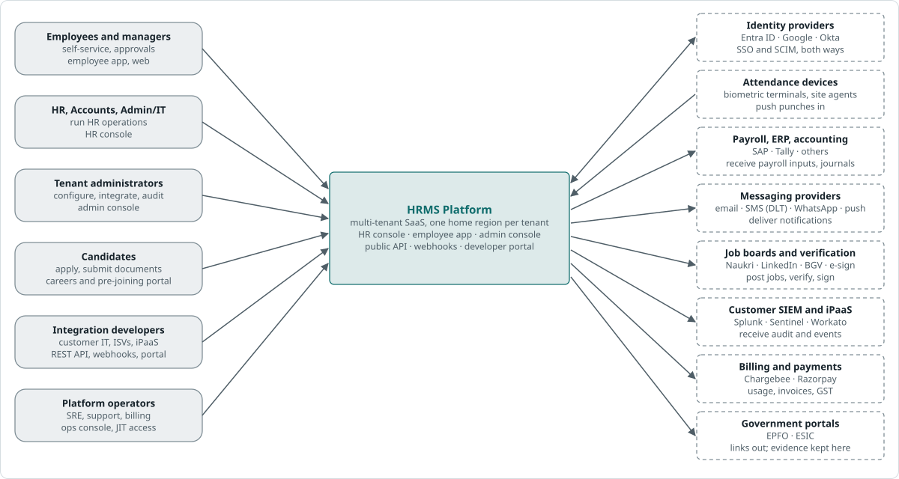
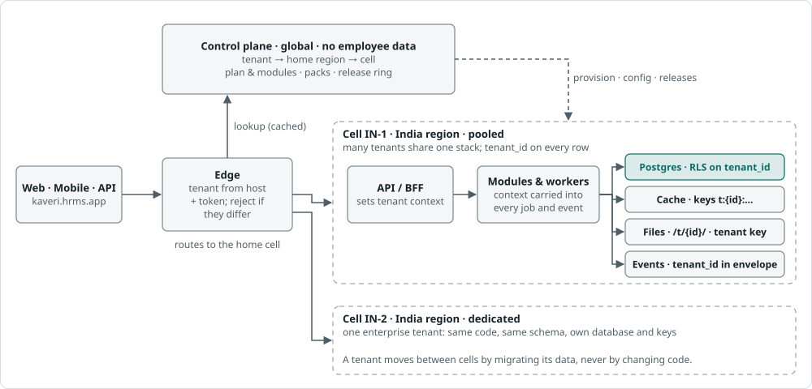
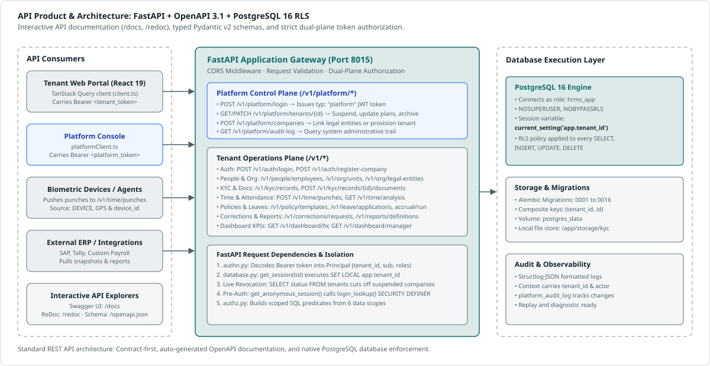
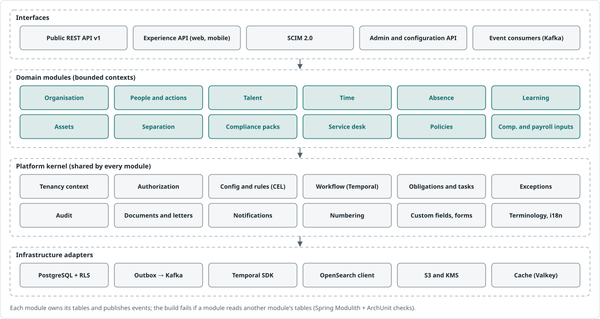
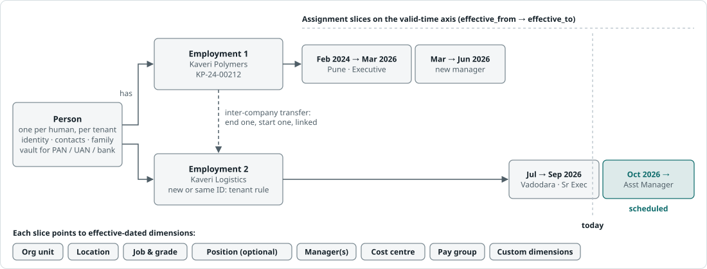
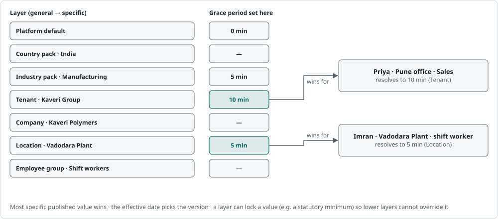
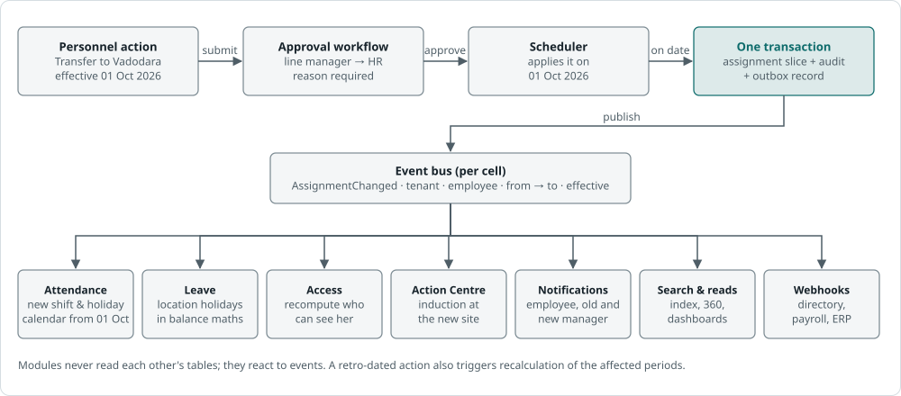
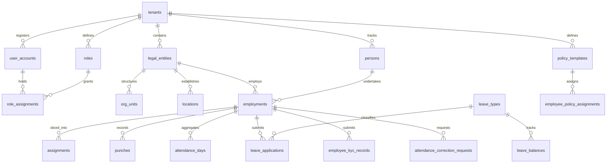
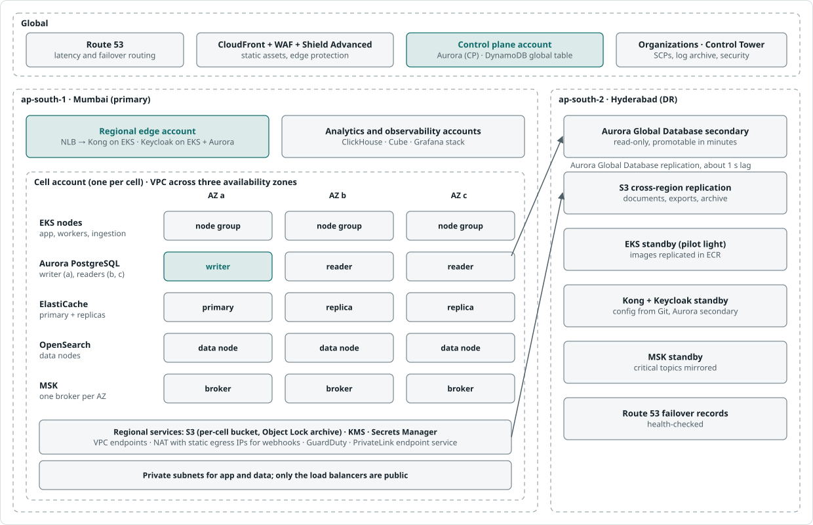

# HRMS Platform — System Design & Architecture Specification

**Current Release:** v0.1.0 · **Architecture Style:** Multi-Tenant Modular Monolith · **Target Environments:** Docker / Cloud  
**Authoritative Documentation:** Reflects the verified, running implementation in `backend/` and `frontend/`.

---

## Executive Summary

The **HRMS Platform** is an enterprise multi-tenant Human Resource Management System built to handle multi-company organizational hierarchies, employee lifecycles, KYC compliance, attendance tracking, hierarchical work policies, leave entitlements, regularizations, and payroll contracts.

The platform is implemented as a **high-performance asynchronous modular monolith**:
- **Backend:** Python 3.12+ with [FastAPI](https://fastapi.tiangolo.com/), [SQLModel](https://sqlmodel.tiangolo.com/) & [SQLAlchemy 2.0](https://www.sqlalchemy.org/) (asyncpg), [Alembic](https://alembic.sqlalchemy.org/), [Pydantic v2](https://docs.pydantic.dev/), and `uv`.
- **Frontend:** [React 19](https://react.dev/) with [TypeScript](https://www.typescriptlang.org/), [Vite 8](https://vite.dev/), [Tailwind CSS](https://tailwindcss.com/), and [TanStack Query v5](https://tanstack.com/query/latest).
- **Database:** [PostgreSQL 16](https://www.postgresql.org/) leveraging native **Row-Level Security (RLS)**, dual-role least privilege, and composite primary keys `(tenant_id, id)`.

---

## Architecture Diagrams Catalogue

| # | Diagram | File | Scope & Technical Content |
|---|---|---|---|
| **01** | **System Context** | [diagrams/context.svg](diagrams/context.svg) | External actors (Employees, Managers, HR, Platform Admins) and integrations (Biometrics, ERP/Payroll, Statutory bodies, Document store). |
| **02** | **Container Architecture** | [diagrams/containers.svg](diagrams/containers.svg) | Client surfaces (React 19 SPA), FastAPI Gateway with dual planes, session guards, and PostgreSQL 16 dual roles (`hrms` vs `hrms_app`). |
| **03** | **Modular Monolith Internals** | [diagrams/monolith.svg](diagrams/monolith.svg) | FastAPI APIRouters, 13 domain modules, core infrastructure (`core/*`), and persistence adapters. |
| **04** | **Multi-Tenant Isolation** | [diagrams/tenancy.svg](diagrams/tenancy.svg) | Request flow, `SET LOCAL app.tenant_id`, pre-auth `login_lookup()` security definer, and PostgreSQL RLS engine enforcement. |
| **05** | **Policy Resolution Engine** | [diagrams/config.svg](diagrams/config.svg) | 4-tier fallback: Employee → Department ancestor tree → Legal Entity → Tenant default, plus alternate Saturday schedules. |
| **06** | **People & Employment Model** | [diagrams/people.svg](diagrams/people.svg) | Entity separation (`Person` vs `Employment` vs `Assignment`), custom ID schemes, effective dating, and KYC verification records. |
| **07** | **Workflows & State Machines** | [diagrams/flow.svg](diagrams/flow.svg) | Multi-tier approval lifecycles (`PENDING_L1..L3`), punch corrections with automatic attendance & OT recomputation, and leave accruals. |
| **08** | **API Platform Architecture** | [diagrams/apiplatform.svg](diagrams/apiplatform.svg) | OpenAPI 3.1 contracts, interactive Swagger UI (`/docs`), dual JWT token typing, and async database execution. |
| **09** | **AWS Cloud Deployment** | [diagrams/aws.svg](diagrams/aws.svg) | Route 53, CloudFront CDN, ALB, ECS Fargate / EKS, Amazon Aurora Multi-AZ PostgreSQL 16 with RLS, S3, and DR in Hyderabad. |

---

## 1. Architectural Principles & High-Level System Context



*Figure 1. System context: Actors (Employees, Managers, HR, Super Admins, Platform Admins) and external systems communicating with the HRMS platform.*


*Figure 2. Container architecture: Web clients access the FastAPI modular monolith backend, which enforces dual-plane security and PostgreSQL 16 Row-Level Security via dual roles.*

### The Two Operating Planes

1. **Platform Control Plane (`/v1/platform/*`)**:
   - Operates strictly *above* individual tenants.
   - Used by platform administrators to provision new tenants, assign subscription tiers, suspend/activate companies, manage platform staff, and audit system operations.
   - Authenticated via separate platform JWT tokens (`typ: "platform"`) validated through the `platform_admins` table.

2. **Tenant Operations Plane (`/v1/*`)**:
   - Encapsulates all tenant HR activities: organization management, employee records, KYC, attendance, leaves, corrections, policies, and reports.
   - Enforces strict tenant data boundaries. Every request carries a tenant access token, and the transaction context sets PostgreSQL's `app.tenant_id`.

---

## 2. Architectural Decision Records (ADRs)

| ADR # | Decision | Chosen Implementation | Justification & Technical Reality |
|---|---|---|---|
| **ADR-01** | Multi-Tenancy Isolation | **Pooled PostgreSQL 16 with Row-Level Security (RLS)** | `tenant_id` is part of composite primary keys `(tenant_id, id)`. Queries execute under `SET LOCAL app.tenant_id = :tid`. Bypassing this fails closed. |
| **ADR-02** | Database Least Privilege | **Dual-Role Model (`hrms` vs `hrms_app`)** | Alembic migrations run as superuser `hrms`. The running FastAPI application connects as unprivileged role `hrms_app` (`NOSUPERUSER`, `NOBYPASSRLS`). Even if application SQL omits a tenant WHERE clause, PostgreSQL itself denies cross-tenant access. |
| **ADR-03** | Application Runtime | **Python 3.12+ Asynchronous Modular Monolith** | Built with FastAPI, SQLModel, and asyncpg. Delivers asynchronous non-blocking I/O across all endpoints, native OpenAPI/Swagger generation, and clean module boundaries. |
| **ADR-04** | Anonymous Tenant Resolution | **`login_lookup()` Security Definer Function** | Unauthenticated callers (`POST /v1/auth/login`) connect via `AnonymousSessionDep` with `app.tenant_id` unset. They cannot query RLS tables directly; credentials are resolved strictly via a locked-down `SECURITY DEFINER` function. |
| **ADR-05** | Real-Time Revocation | **Live Session & Context Verification** | Instead of relying on static JWT token lifetimes (up to 8h), `get_session` checks `tenants.status == 'ACTIVE'` and `archived_at IS NULL` on every request. Platform admin status and roles are also verified live against the DB on each request. |
| **ADR-06** | Authorization & Scoping | **Role-Based Permissions + 6 Data Scope Types** | Permissions are bundled into roles (`SUPER_ADMIN`, `HR_MANAGER`, `MANAGER`, `EMPLOYEE`, `ACCOUNTANT`). Visibility is filtered by scope types: `ALL`, `LEGAL_ENTITY`, `ORG_UNIT`, `SELF`, `DIRECT_REPORTS`, `ALL_REPORTS`. |
| **ADR-07** | Policy Resolution Engine | **4-Tier Hierarchical Fallback** | Working hours, late marks, overtime parameters, and alternate Saturday patterns fall back hierarchically: `Employee` → `Department Ancestor Tree` → `Legal Entity` → `Tenant Default`. |
| **ADR-08** | Client Architecture | **React 19 + TypeScript + Vite + Tailwind + TanStack Query** | Single Page Application featuring client-side route guards, TanStack React Query for caching and background synchronization, and Tailwind CSS for uniform design. |
| **ADR-09** | Identity Model | **Separation of Person vs Employment vs UserAccount** | A `Person` represents the human entity; `Employment` represents a legal contract with a company (enabling multi-company and rehires); `UserAccount` holds login credentials. |
| **ADR-10** | Overtime & Attendance | **Automated Computation with Human Review Workflow** | Punches feed daily attendance calculation. Overtime is calculated based on policy thresholds, requires manager review (`PENDING` → `APPROVED`/`REJECTED`), and automatically resets upon punch correction. |



*Figure 3. Multi-tenant isolation architecture: JWT decoding, async session dependency injection, SET LOCAL app.tenant_id, and PostgreSQL 16 RLS policy evaluation.*

---

## 3. System Architecture & Component Breakdown



*Figure 4. API product architecture: OpenAPI 3.1 contracts, Swagger UI, dual token verification, and async database execution.*

### 3.1 Core Subsystems (`backend/src/hrms/core`)

- **`database.py`**:
  - Manages `create_async_engine` connection pools.
  - `get_session()` dependency sets PostgreSQL's `app.tenant_id` via `SELECT set_config('app.tenant_id', :tid, true)` and performs real-time tenant status (`status == 'ACTIVE'`, unarchived) and user account status (`status == 'ACTIVE'`, matching `employment_id`) validation before yielding the session.
  - `get_anonymous_session()` provides an unbound session for pre-auth flows.
- **`tenancy.py`**:
  - Resolves tenant UUID from the verified JWT `Principal` (falling back to `X-Tenant-ID` only in explicit development scenarios).
- **`authn.py`**:
  - Decodes and validates bearer JWT tokens.
  - Produces immutable `Principal` (containing `tenant_id`, `user_account_id`, `employment_id`, and `role_names`).
  - Implements `get_current_platform_principal` for platform admins, rejecting tenant tokens on platform routes.
- **`authz.py`**:
  - Resolves effective permissions (`ROLE_PERMISSIONS`) and builds hierarchical SQL predicates for employee visibility sets (`ALL`, `LEGAL_ENTITY`, `ORG_UNIT`, `SELF`, `DIRECT_REPORTS`, `ALL_REPORTS`).
- **`platform_authz.py`**:
  - Real-time resolution of `PlatformAdminContext` (`ADMIN` vs `VIEWER`). Blocks mutating operations for read-only viewer accounts.
- **`security.py`**:
  - Password hashing with `passlib[bcrypt]`.
  - JWT creation/verification (`create_access_token`, `create_platform_token`) using HS256.
- **`tenant_provisioning.py`**:
  - Single atomic codepath `bootstrap_tenant()` executed during self-registration or platform admin provisioning.
  - Allocates tenant slug, sets up system roles (`SUPER_ADMIN`, `HR_MANAGER`, etc.), creates the root legal entity, provisions the initial admin `UserAccount`, and assigns the `SUPER_ADMIN` role.
- **`audit.py`**:
  - Append-only recording to `platform_audit_log` with actor, action, target, and JSON metadata.
- **`datetime_utils.py`**:
  - Business calendar utilities: working day determination taking into account 7-day bitmasks, holiday dates, and alternate Saturday patterns (`SECOND_FOURTH_OFF`, `FIRST_THIRD_OFF`).
  - Attendance metrics calculator (`compute_day()`) for gross, effective, break, late, early, and overtime minutes.
- **`ids.py`**:
  - Distributed UUID conversion and formatting utilities (supporting UUIDv7 and ULID).

---

## 4. Domain Modules Breakdown



*Figure 5. The core modular monolith: API routers, 13 domain modules, platform kernel services, and infrastructure adapters.*

```
backend/src/hrms/modules/
├── platform/      # Platform admin APIs, tenant management, subscription tiers, audit logs
├── kernel/        # Auth (login/register), tenant models, users, roles, role assignments
├── org/           # Legal entities, locations, org units (department tree), jobs, grades, cost centres
├── people/        # Persons, employments, assignments (effective-dated), personnel actions, ID schemes
├── kyc/           # Statutory identification, bank accounts, document upload & verification workflows
├── time/          # Raw punches (GPS/selfie/source), attendance days, overtime review, holidays
├── policy/        # Policy templates, alternate Saturday patterns, hierarchical policy resolution
├── leave/         # Leave types, balances, applications, multi-tier approvals, comp-offs, monthly accruals
├── corrections/   # Attendance punch regularizations, approval actions, automatic recomputation
├── onboarding/    # Reusable onboarding checklist templates, cases, and trackable task items
├── reports/       # Configurable report definitions, dynamic filters, CSV/JSON export engine
├── dashboard/     # Aggregated metric cards for HR and Department Managers
└── payroll/       # Compensation schemas, payroll input contracts, and period close exports
```

### 4.1 Detailed Domain Capabilities

#### 1. Platform Administration (`modules/platform`)
- **Tenant Management**: List, inspect, patch subscription plans (`STARTER`, `GROWTH`, `ENTERPRISE`), suspend active accounts, or archive companies.
- **Company Linking**: Add multiple legal entities under a single tenant.
- **Platform Admin Management**: Invite administrators, assign `ADMIN` or `VIEWER` roles, reset credentials via secure tokens.
- **Platform Audit Trail**: Immutable queryable history of all tenant-level modifications.

#### 2. Kernel & Identity (`modules/kernel`)
- **Authentication**: `POST /v1/auth/login` (email/password), `POST /v1/auth/register-company` (self-service tenant bootstrap), `GET /v1/auth/me`.
- **User Management**: Manage credentials, employee links, account activation, and role assignments.
- **RBAC**: Pre-seeded system roles (`SUPER_ADMIN`, `HR_MANAGER`, `MANAGER`, `EMPLOYEE`, `ACCOUNTANT`).

#### 3. Organization Structure (`modules/org`)
- **Legal Entities**: Distinct employer corporations with country codes and statutory registrations.
- **Locations**: Offices, manufacturing plants, sites with geolocations and timezones (`Asia/Kolkata` default).
- **Org Units**: Self-referencing hierarchical department tree (`parent_id`) with effective date validity (`effective_from`, `effective_to`).
- **Positions, Jobs, Grades, Cost Centres**: Structural attributes mapped to assignments.

#### 4. People & Lifecycle (`modules/people`)
- **Person vs Employment**: Clean entity separation. Supports multiple employments across companies or rehires.
- **Assignments**: Sliced temporal records capturing position, department, location, job, grade, and manager.
- **Personnel Actions**: Audited workflow for `HIRE`, `TRANSFER`, `PROMOTION`, `CONFIRM`, `SEPARATION`, `CHANGE_MANAGER`.
- **Custom Employee ID Schemes**: Configurable prefix, sequence padding, starting number, and reset intervals per legal entity.



*Figure 6. People & Employment data model: Person, employments across legal entities, effective-dated assignment slices, and KYC records.*

#### 5. Employee KYC (`modules/kyc`)
- **Statutory Identity**: PAN, Aadhaar, UAN, PF, ESI, Passport, Driving License, Voter ID.
- **Banking**: Account holder, bank name, account number, IFSC code, branch.
- **Document Management**: File storage under `/app/storage/kyc`, mime-type validation, and verification statuses:
  `NOT_SUBMITTED` → `DRAFT` → `SUBMITTED` → `VERIFIED` / `REJECTED` / `ACTION_REQUIRED`.

#### 6. Time & Attendance (`modules/time`)
- **Punches**: Append-only event store supporting `IN`, `OUT`, `BREAK_START`, `BREAK_END` via `WEB`, `MOBILE`, `DEVICE`, or `MANUAL`. Captures GPS coordinates, device IDs, and selfie storage keys.
- **Attendance Days**: Recomputable daily aggregates:
  - Working durations (`gross_minutes`, `break_minutes`, `effective_minutes`).
  - Status derivation: `PRESENT`, `ABSENT`, `HALF_DAY`, `LATE`, `EARLY_DEPARTURE`, `ON_LEAVE`, `HOLIDAY`, `WEEKEND`, `PENDING`.
- **Overtime Tracking**: Automatic qualification based on policy, with state transition: `NONE` → `PENDING` → `APPROVED` / `REJECTED`. Overtime approvals are automatically invalidated and reset if a correction alters punch hours.

#### 7. Policy Engine (`modules/policy`)
- **Templates**: Configure expected start/end times, work week bitmasks (e.g. `1111100`), break durations, grace periods, OT rules, and punch rounding.
- **Alternate Saturday Patterns**: Native support for `ALL`, `SECOND_FOURTH_OFF`, `FIRST_THIRD_OFF` without requiring manual calendar hacks.
- **Hierarchical Resolution**:



*Figure 7. Hierarchical Policy Resolution Engine: Fallback priorities from Employee to Department, Legal Entity, and Tenant Default.*

#### 8. Leave Management (`modules/leave`)
- **Leave Types**: Configurable carry-forward limits, document requirements, paid/unpaid status, comp-off designation, encashment flags.
- **Leave Balances**: Tracks allocated, carry-forward, used, and pending days.
- **Multi-Level Approvals**: State transitions through `PENDING_L1` → `PENDING_L2` → `PENDING_L3` → `APPROVED` / `REJECTED`.
- **Monthly Accrual Engine**: Automated run (`/v1/leave/accrual/run`) crediting pro-rata days, guarded against duplicate execution via `last_accrued_period`.

#### 9. Attendance Corrections (`modules/corrections`)
- **Regularization Types**: Missed punches, attendance marking, late arrival justifications.
- **Workflow**: Employee submits correction request → Multi-level approval action → On approval, automatically triggers punch insertion and `AttendanceDay` recomputation.



*Figure 8. Workflows and state machines: Punch regularizations with automated recomputation and leave application lifecycles.*

#### 10. Onboarding (`modules/onboarding`)
- **Templates & Checklists**: Configurable task templates for new hires and rehires.
- **Cases**: Auto-instantiated onboarding workflows tracking tasks for HR, Employee, IT, and Manager.

#### 11. Reports & Analytics (`modules/reports`, `modules/dashboard`)
- **Dynamic Report Engine**: Saved report definitions supporting field selection, filtering operators, and CSV streaming.
- **Dashboard**: Real-time operational visibility: daily attendance counts, pending leave requests, pending corrections, and KYC submission statistics.

---

## 5. Database Schema & Data Architecture



### 5.1 Database Schema Evolution (Alembic Migrations)

| Migration | Revision ID | Key Schema Changes |
|---|---|---|
| `0001` | `0001_initial_schema` | Core tables: `tenants`, `legal_entities`, `locations`, `org_units`, `jobs`, `grades`, `cost_centres`, `positions`, `persons`, `employments`, `assignments`, `user_accounts`, `roles`, `role_assignments`. |
| `0002` | `0002_time_onboarding_reports` | Time tracking: `punches`, `attendance_days`, `holidays`. Onboarding tables and report definitions. |
| `0003` | `0003_policy_leave_corrections` | Policy templates, leave management (`leave_types`, `leave_balances`, `leave_applications`), attendance corrections. |
| `0004` | `0004_auth_and_scoping` | Role assignment scoping enhancements (`ALL`, `LEGAL_ENTITY`, `ORG_UNIT`, `SELF`, `DIRECT_REPORTS`). |
| `0005` | `0005_app_role_rls_enforcement` | Creates `hrms_app` role (`NOSUPERUSER`, `NOBYPASSRLS`), applies PostgreSQL RLS policies across all tenant tables, creates `login_lookup()` SECURITY DEFINER function. |
| `0006` | `0006_platform_admins` | Creates `platform_admins`, `platform_audit_log`, `platform_password_reset_tokens`. |
| `0007` | `0007_platform_enterprise` | Enterprise platform capabilities, tenant plans, and company linking. |
| `0008` | `0008_employee_kyc` | Tables: `employee_kyc_records`, `employee_kyc_documents`. |
| `0009` | `0009_overtime` | Overtime review fields on `attendance_days` (`ot_minutes`, `ot_status`, reviewer metadata). |
| `0010` | `0010_leave_completeness` | Holidays calendar, comp-off grants, leave encashments, and monthly accrual tracking (`last_accrued_period`). |
| `0011` | `0011_drop_shifts` | Replaces rigid shift tables with flexible policy-driven schedules. |
| `0012` | `0012_dept_policy_alternate_saturday` | Adds `org_unit_id` targeting and alternate Saturday options. |
| `0013` | `0013_saturday_pattern_off_naming` | Clarifies Saturday pattern nomenclature (`SECOND_FOURTH_OFF`, `FIRST_THIRD_OFF`). |
| `0014` | `0014_legal_entity_policy_assignment` | Adds whole-company `legal_entity_id` policy assignment tier. |
| `0015` | `0015_employee_id_schemes` | Sequential custom employee ID formatting schemes per legal entity. |
| `0016` | `0016_approver_user_account` | Records `approver_user_account_id` on `leave_approval_actions` and `correction_approval_actions`, allowing company administrators without employment records to approve requests. |

---

## 6. Frontend Architecture

The frontend is a single-page application built on **React 19**, **TypeScript**, and **Vite**:

```
frontend/src/
├── api/              # Strongly-typed Axios/Fetch clients (client.ts, platformClient.ts, kyc.ts, etc.)
├── components/       # Reusable UI primitives: AppLayout, Sidebar, Navbar, StatCard, Modals, Badges
├── context/          # AuthContext (JWT storage, role checking, tenant context)
├── lib/              # Utility helpers, date formatters, class merges
└── pages/            # View components & route handlers:
    ├── LoginPage.tsx                     # Tenant user login (email/password)
    ├── RegisterCompanyPage.tsx           # Self-service tenant signup
    ├── PlatformLoginPage.tsx             # Platform admin sign-in
    ├── PlatformConsolePage.tsx           # Platform control panel (tenants, admins, audit)
    ├── DashboardPage.tsx                 # Tenant HR / manager home
    ├── EmployeePage.tsx                  # Employee directory & profile manager
    ├── DailyAnalysisPage.tsx             # Real-time attendance analysis & punch viewer
    ├── AttendancePage.tsx                # Attendance summary & monthly punch calendar
    ├── LeavePage.tsx                     # Leave applications, balances & approval actions
    ├── PolicyPage.tsx                    # Policy templates & hierarchical assignment rules
    ├── CorrectionsPage.tsx               # Punch corrections & manager approvals
    ├── OrganizationPage.tsx              # Legal entities, departments & locations
    ├── OnboardingPage.tsx                # Checklist tasks & onboarding cases
    ├── ReportsPage.tsx                   # Dynamic report generator & CSV exports
    └── ProfilePage.tsx                   # Personal employee profile & KYC submission
```

### 6.1 State Management & Data Fetching
- **TanStack React Query v5**: Handles asynchronous server-state fetching, background refetching, and automated cache invalidation upon mutations.
- **Client Authentication Interceptors**:
  - Automatically attaches `Authorization: Bearer <token>` to all requests.
  - In development mode, attaches `X-Tenant-ID` where required.
  - Intercepts 401 Unauthorized responses to clear stale sessions and redirect to login.

---

## 7. Infrastructure, Deployment & Runbook Operations



*Figure 9. AWS Cloud deployment architecture: Route 53, CloudFront, ALB, ECS Fargate, Multi-AZ Aurora PostgreSQL 16 with RLS, S3, and DR.*

### 7.1 Container Architecture (`docker-compose.yml`)

The platform is containerized using Docker and Docker Compose:
- **`db` service**: Runs `postgres:16-alpine` on port `5432` with persistent volume `postgres_data`. Includes automated health check (`pg_isready -U hrms`).
- **`api` service**: Builds from `backend/Dockerfile` (Python 3.12-slim + `uv`). Runs FastAPI via Uvicorn on port `8015`. Live-mounts `backend/src` for hot reloading.
- **Frontend**: Runs locally via Vite dev server on port `5173` or containerized with Nginx in production.

### 7.2 Runbook & Day-to-Day Operations

```bash
# 1. Start the PostgreSQL database
docker compose up -d db

# 2. Run database migrations (must run before application start)
cd backend
uv run alembic upgrade head

# 3. Seed initial platform administrator
# (Creates platform@hrms.internal / credentials stored in credential.md)
uv run python scripts/seed_platform_admin.py

# 4. Optional: Seed demo tenant data (SFPL Group multi-company setup)
uv run python scripts/seed_demo.py

# 5. Start Backend API
uv run uvicorn hrms.main:app --reload --port 8015

# 6. Start Frontend Web Client
cd ../frontend
npm install
npm run dev
```

---

## 8. Security & Compliance Controls

1. **Database Row-Level Security**:
   - `ALTER TABLE <tenant_table> ENABLE ROW LEVEL SECURITY;`
   - `ALTER TABLE <tenant_table> FORCE ROW LEVEL SECURITY;`
   - Enforced unconditionally under the unprivileged `hrms_app` runtime user.
2. **SQL Injection Mitigation**:
   - 100% of queries use SQLAlchemy parameterized statements or SQLModel ORM constructs.
3. **Password Security**:
   - Password hashing utilizes `passlib` with the `bcrypt` algorithm.
4. **Token Isolation**:
   - Platform admin tokens have `typ: "platform"` and omit tenant identifiers.
   - Tenant user tokens have `sub: <user_id>`, `tenant_id: <uuid>`, and `roles: [...]`.
   - Neither token type can access the other plane's endpoints.
5. **Real-time Status Revocation**:
   - Suspended tenants and inactive platform admins are denied on their next request without waiting for JWT expiry.
